# Behavioral

Topic: `behavioral`. 20 free questions.

## Which Project Best Demonstrates Your Ownership, and Why?

[View this question on DeepOffer](https://getdeepoffer.com/questions/proudest-project.html)

**Source / companies:** Reported in public interview compilations — Amazon, Meta

**Interview type:** Behavioral

**Tag:** confirmed

### Answer

<b>Pick for ownership</b>: Choose the project you discovered or led - not the one you merely participated in.

<b>Structure</b>: Background and why it was hard, then your key decisions (alternatives and tradeoffs), then execution (who you unblocked, what went wrong), then quantified results (metric, scope, attribution).

<b>Make numbers credible</b>: Always give the context (which experiment, what period, confidence level). Interviewers will probe where numbers come from; made-up numbers fall apart fast.

Prepare an English version: if you interview at international companies, record yourself telling it fully in English. Where you stumble is what to rewrite.

### Mermaid diagram

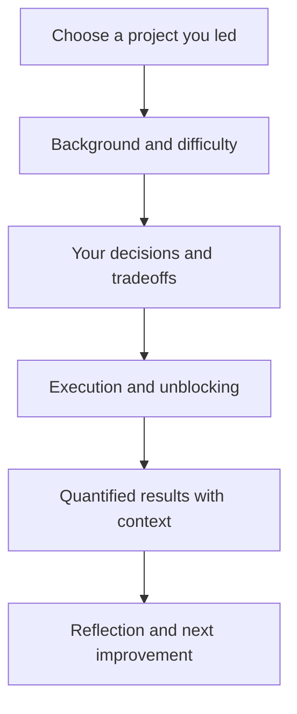

### Follow-ups

- As a follow-up, consider this: if you did it again, what would you do differently? (Prepare one real improvement)

- Explore one more angle: where exactly was your personal contribution boundary?

- How would you describe the biggest failure point in this project?

## Describe a Time You Resolved a Professional Disagreement

[View this question on DeepOffer](https://getdeepoffer.com/questions/conflict-with-colleague.html)

**Source / companies:** Reported in public interview compilations — Google

**Interview type:** Behavioral

**Tag:** confirmed

### Answer

<b>STAR structure</b>: Situation (one line of background), Task (the shared goal), Action (how you handled the disagreement), Result (outcome and reflection).

<b>Red lines</b>: Do not demonize the other person or frame it as a character issue. Present their position fairly - it shows you understand the bigger picture.

<b>Strong Actions</b>: Bring the debate back to data - propose a small experiment, an offline evaluation, or a one-page doc to align on evaluation criteria. If it still cannot be decided, explain how you escalated and then executed (disagree and commit).

End with one reflection: what work habit did you change after this?

### Mermaid diagram

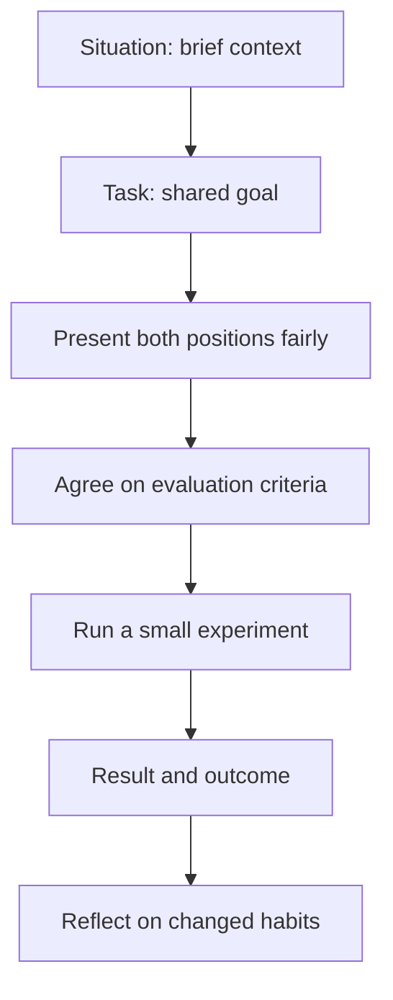

### Follow-ups

- Suppose they just won't listen to data. How should the answer change?

- As a follow-up, consider this: have you ever been wrong and insisted anyway?

- What method do you use to escalate without making it look like complaining?

## What Specifically Attracts You to This Role, and Why Move Now?

[View this question on DeepOffer](https://getdeepoffer.com/questions/why-our-company-why-leaving.html)

**Source / companies:** Source: Common pattern across 2026 interview reports · Google

**Interview type:** Behavioral

**Tag:** confirmed

### Answer

<b>Three parts</b>: Specific interest in this company/team (product, tech direction, something you used or read), your career plan (what you want to build in the next 2-3 years), and how the two fit together.

<b>Red lines</b>: Do not badmouth your current company or team. Do not lead with money or level. Frame leaving as what you are moving toward, not what you are running from.

Specificity is the only persuasion: Your recommendation system is large-scale is generic. We reproduced your sequence modeling paper in our team last year is real interest.

### Mermaid diagram

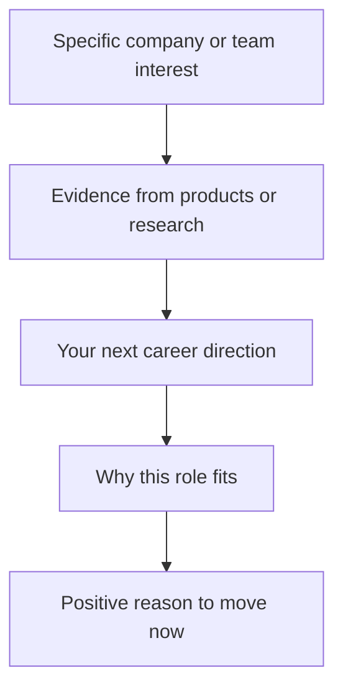

### Follow-ups

- As a follow-up, consider this: what other companies are you interviewing with? (Decide your answer in advance)

- How would you define your long-term career goal?

- How might you improve about our product?

## Describe a Meaningful Project Setback and What Changed Afterwards

[View this question on DeepOffer](https://getdeepoffer.com/questions/failed-project-story.html)

**Source / companies:** Source: Common pattern across 2026 interview reports · Google

**Interview type:** Behavioral

**Tag:** hot

### Answer

<b>Pick the right failure</b>: A real failure, but not a sloppy mistake - a wrong approach, a bad estimate, a failed push. Not a fake failure like I am too much of a perfectionist.

<b>Structure</b>: One line of background, where it failed and your share of responsibility (own it proactively), the impact, what you learned and what mechanism you changed afterward.

Weight it 30/70: 30 percent on the failure itself, 70 percent on reflection and change. Interviewers test maturity and growth, not blame.

Best ending: later, on another project, this exact lesson saved you once.

### Mermaid diagram

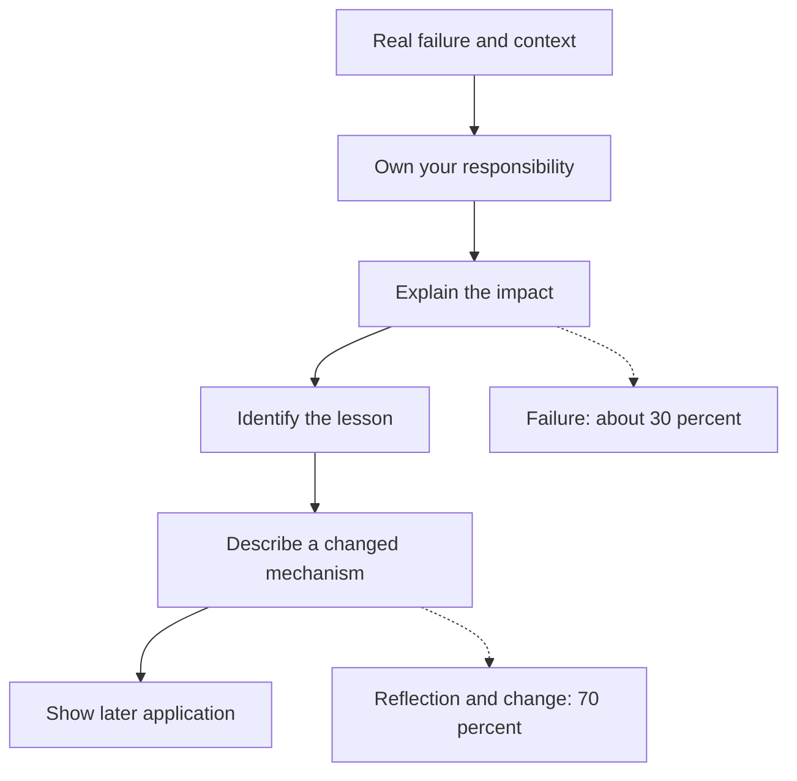

### Follow-ups

- At what point did you first sense it was going to fail? (Signal sensitivity)

- As a follow-up, consider this: given one more chance, what is the first thing you would change?

- In what way did you deliver the bad news upward?

## Describe How You Protected Delivery Quality Under a Severe Deadline

[View this question on DeepOffer](https://getdeepoffer.com/questions/tight-deadline-delivery.html)

**Source / companies:** Source: Common pattern across 2026 interview reports · Amazon

**Interview type:** Behavioral

**Tag:** hot

### Answer

<b>Cut scope, not quality</b>: Split requirements into must-have and nice-to-have. Confirm the MVP boundary with PM/partners in writing, and give the cut items a follow-up timeline.

<b>Front-load risk</b>: Prototype the most uncertain module first (a spike). Do not develop in order and leave the landmine for the end. Align every dependency's dates with buffer.

<b>Stay transparent</b>: Daily progress and blocker updates. Escalate the moment risk appears - interviewers fear says it is fine until the last day most.

Close with a real example: something you actually cut, why you cut it, and shipped on time.

### Mermaid diagram

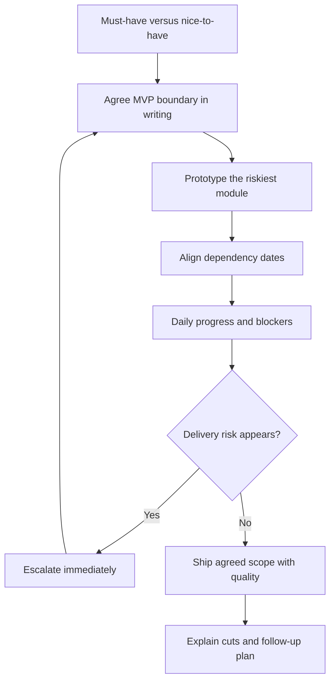

### Follow-ups

- Suppose PM refuses to cut scope. How should the answer change?

- What method do you use to estimate time? (Break down, calibrate from history, add buffer)

- As a follow-up, consider this: tell me about a deadline you missed?

## Describe a time you worked on a project with a tight deadline.

[View this question on DeepOffer](https://getdeepoffer.com/questions/reported-316-describe-a-time-you-worked-on-a-project-with-a-tight-deadline.html)

**Source / companies:** Reported in interviews — Meta, Aug 2026

**Interview type:** Behavioral

**Tag:** reported

**Source link:** <https://www.tryexponent.com/guides/meta-machine-learning-engineer-interview/experiences>

### Answer

<b>Pick a deadline that was genuinely immovable, not self-imposed.</b> A launch tied to a partner release, a conference demo, or a model-refresh window scores far better than 'I left the work late.' Name the external constraint and the real consequence of missing it, so the pressure reads as earned rather than manufactured.

<b>Show the triage, not just the hustle.</b> Interviewers score how you re-scoped under time pressure: what you cut, what you shipped as a simpler first version, and what you explicitly deferred with the team's agreement. A story that is only 'we worked weekends and made it' signals poor judgment, not strong execution.

<b>Make your own contribution concrete.</b> Say which tradeoff you personally proposed — dropping a feature, freezing the model, reusing an existing pipeline — and how you got the team to accept it. Vague 'we prioritized' language hides whether you drove the decision or merely survived it.

<b>Close with what the crunch taught you about planning.</b> The strongest endings name a concrete change you made afterwards: earlier integration testing, a buffer in the schedule, or a smaller first milestone. It turns a survival story into evidence that you learned to avoid the next crunch.

### Mermaid diagram

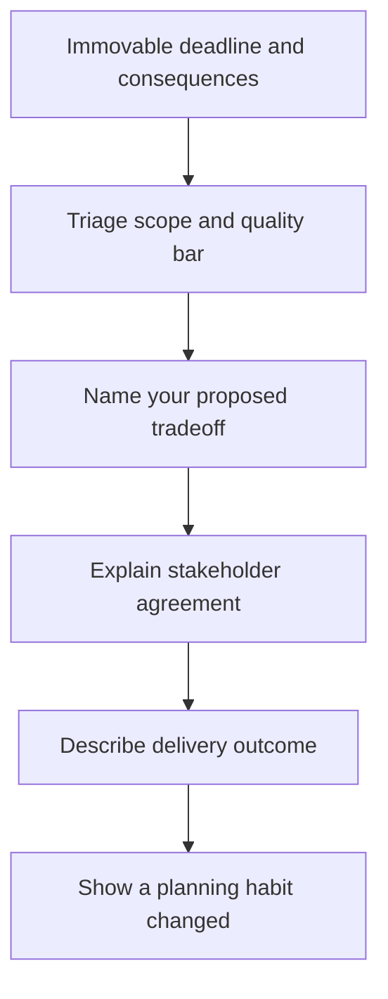

### Follow-ups

- What would you have cut first if the deadline had moved up another week, and why that item rather than the others?

- How did you decide what 'good enough' meant for the shipped version, and who signed off on that bar?

- Looking back, what was the earliest moment you could have spotted the deadline risk, and what do you do differently now to catch it?

## Describe a time you received negative feedback from your manager and how you handled it.

[View this question on DeepOffer](https://getdeepoffer.com/questions/reported-317-describe-a-time-you-received-negative-feedback-from-your-manager-and-how.html)

**Source / companies:** Reported in interviews — Meta, Aug 2026

**Interview type:** Behavioral

**Tag:** reported

**Source link:** <https://www.tryexponent.com/guides/meta-machine-learning-engineer-interview/experiences>

### Answer

<b>Name the feedback verbatim enough to be believable.</b> 'My manager said my design docs buried the decision in background detail and reviewers couldn't tell what I was asking for' lands far better than 'I got feedback on communication.' Specificity proves you actually heard it instead of paraphrasing it into something flattering.

<b>Show the uncomfortable part: your first reaction.</b> A credible answer admits the initial defensiveness or surprise — you thought the docs were thorough — and then describes what made you reconsider, such as re-reading the doc through a reviewer's eyes or noticing the same comment from a second person.

<b>Describe a behavior change with evidence, not a resolution to improve.</b> Interviewers want the next doc, the next review, or the next presentation where you applied it differently, plus what changed in the outcome: faster approvals, fewer clarification rounds, a reviewer saying the decision was clear.

<b>Keep the manager's framing fair.</b> The trap here is retelling the story as 'my manager was wrong but I humored them.' Even if you partly disagreed, show what part of the feedback was valid and what you took from it — graciousness under criticism is exactly what is being scored.

### Mermaid diagram

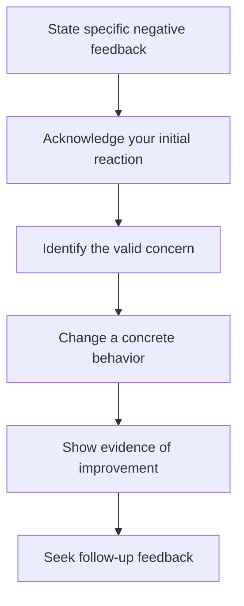

### Follow-ups

- How did you check whether the change actually fixed the problem, rather than just assuming it did?

- Has similar feedback come up again since, and how did you respond the second time?

- What feedback have you actively sought out since then, and from whom?

## Describe a time you faced a conflict while on a team.

[View this question on DeepOffer](https://getdeepoffer.com/questions/reported-318-describe-a-time-you-faced-a-conflict-while-on-a-team.html)

**Source / companies:** Reported in interviews — Meta, Aug 2026

**Interview type:** Behavioral

**Tag:** reported

**Source link:** <https://www.tryexponent.com/guides/meta-machine-learning-engineer-interview/experiences>

### Answer

<b>Frame the conflict as a substantive disagreement, not a personality clash.</b> Two reasonable approaches to the same problem — say, retraining a model versus patching the serving path — gives you something real to resolve. A story about a teammate being 'difficult' leaves the interviewer wondering whether you were the difficult one.

<b>Show that you understood the other side's case before pushing your own.</b> Name the legitimate concern behind their position — their approach reduced risk, protected latency, or shipped sooner — and describe how you acknowledged it in conversation. Resolution that skips this step reads as winning an argument, not resolving a conflict.

<b>Describe the mechanism that broke the deadlock.</b> Strong stories name a concrete step: a small experiment both sides agreed would settle it, a shared metric you both accepted as the tiebreaker, or a compromise design that kept each side's core requirement. 'We talked it out' is not a mechanism.

<b>End on the working relationship, not just the technical outcome.</b> Interviewers are scoring whether the team still functioned afterwards. Mention the follow-up: you reviewed their code, they reviewed yours, or you jointly presented the result — proof the conflict left the relationship intact or stronger.

### Mermaid diagram

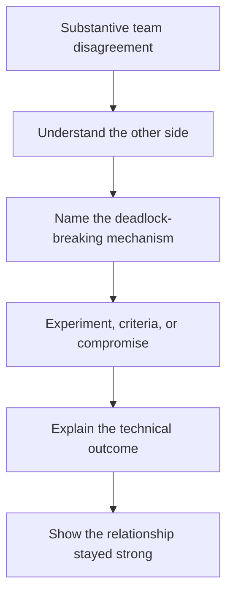

### Follow-ups

- What would you do differently if the other person had refused to accept the experiment's result?

- How did you keep the disagreement from spreading to the rest of the team while it was unresolved?

- Did the experience change how you raise disagreements with teammates now?

## Describe a time you disagreed with your manager.

[View this question on DeepOffer](https://getdeepoffer.com/questions/reported-319-describe-a-time-you-disagreed-with-your-manager.html)

**Source / companies:** Reported in interviews — Meta, Apr 2026

**Interview type:** Behavioral

**Tag:** reported

**Source link:** <https://www.tryexponent.com/guides/meta-machine-learning-engineer-interview/experiences>

### Answer

<b>Pick a disagreement about a decision, not about your treatment.</b> A technical or product call — a launch scope, a modeling approach, a timeline — is safe ground. Disagreeing about a performance rating or a promotion reads as a grievance, and the interviewer will spend the rest of the answer wondering about your attitude toward authority.

<b>Show the case you built, not just the opinion you held.</b> What made your position credible: data you pulled, a prototype you ran, a risk you quantified, or a customer impact you could point to. 'I felt strongly' is not a case; interviewers score whether you argued with evidence or with insistence.

<b>Be honest about how the disagreement ended — including if you lost.</b> The highest-scoring versions often end with the manager deciding otherwise and the candidate committing fully anyway, without quiet sabotage or 'I told you so' later. Disagree-and-commit is the exact behavior this question is designed to surface.

<b>Keep the manager's reasoning visible.</b> Summarize why your manager preferred their path — a constraint you didn't initially see, a stakeholder concern, a risk tolerance difference — so the story shows you can hold two perspectives at once rather than casting yourself as the only reasonable person in the room.

### Mermaid diagram

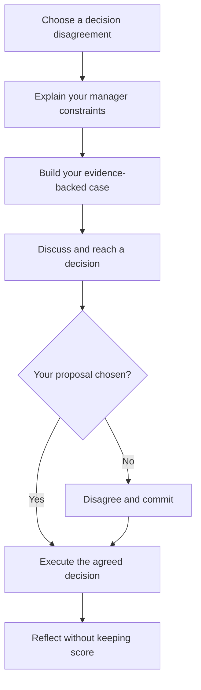

### Follow-ups

- If your manager's decision had gone wrong, how would you have raised it afterwards without sounding like you were keeping score?

- How do you decide when a disagreement is worth escalating versus when to let it go?

- What did you learn about how your manager prefers to receive pushback?

## Describe the project you are most proud of.

[View this question on DeepOffer](https://getdeepoffer.com/questions/reported-320-describe-the-project-you-are-most-proud-of.html)

**Source / companies:** Reported in interviews — Meta, Apr 2026

**Interview type:** Behavioral

**Tag:** reported

**Source link:** <https://www.tryexponent.com/guides/meta-machine-learning-engineer-interview/experiences>

### Answer

<b>Choose a project where your fingerprints are on the hardest part.</b> The best choice is not the biggest or most prestigious project on your resume, but the one where you personally owned the decision or the build that made it work — the modeling choice, the system design, the unblocking insight. If your role could be swapped for anyone else's, pick a different project.

<b>Explain why it was hard before explaining what you built.</b> A proud-project answer earns its weight from the obstacle: a constraint that made the obvious approach fail, a dataset that fought back, a deadline or resource limit that forced real ingenuity. Without the difficulty, the achievement has no scale for the interviewer to judge it against.

<b>Quantify the outcome in terms a non-teammate can feel.</b> Latency cut by a stated amount, a manual process eliminated, adoption by a named team, a metric that moved — any of these beats 'it was very successful.' If the numbers are confidential, use relative terms ('roughly halved') rather than dropping quantification entirely.

<b>Say what still nags at you about it.</b> A brief honest note — the evaluation you wish you'd run, the corner you cut that you'd revisit — signals ownership and taste. Pure self-congratulation makes interviewers suspect you can't see your own work critically.

### Mermaid diagram

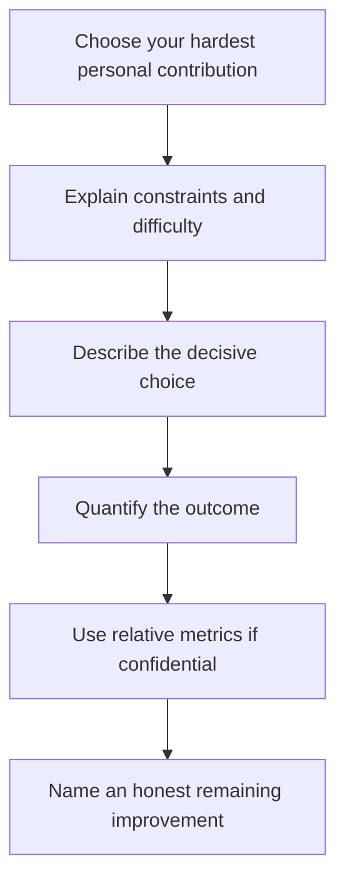

### Follow-ups

- If you had twice the time on that project, what would you have done differently?

- What was the single decision you made that, if reversed, would have changed the outcome most?

- How did that project change what you chose to work on next?

## Describe a time you handled a difficult stakeholder.

[View this question on DeepOffer](https://getdeepoffer.com/questions/reported-321-describe-a-time-you-handled-a-difficult-stakeholder.html)

**Source / companies:** Reported in interviews — Meta (trending 2 months ago, Oct 2026)

**Interview type:** Behavioral

**Tag:** reported

**Source link:** <https://www.tryexponent.com/guides/meta-machine-learning-engineer-interview/questions>

### Answer

<b>Define 'difficult' as a behavior, not a character judgment.</b> A stakeholder who changed requirements late, demanded an unrealistic date, or distrusted the team's estimates is a workable story. One who was simply 'impossible to work with' tells the interviewer nothing about your skill and raises questions about your diplomacy.

<b>Show that you diagnosed the underlying interest behind the demand.</b> The stakeholder pushing for an earlier date usually cares about a launch commitment or a metric review, not the date itself. Strong answers name that underlying need and describe how addressing it — a phased delivery, an interim readout — defused the pressure better than arguing about the date.

<b>Describe the communication structure you put in place.</b> Difficult stakeholder stories improve when you name a concrete cadence or artifact: a weekly status note with explicit tradeoffs, a written agreement on scope before work started, or a decision log both sides could point to. Structure, not charm, is what interviewers score here.

<b>Show the relationship after the project, not just the delivery.</b> Did the stakeholder sponsor your next project, adopt your recommendation, or start coming to you earlier? A repaired or strengthened working relationship is the real proof that the handling worked, beyond the one deliverable shipping.

### Mermaid diagram

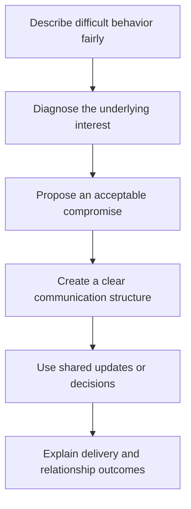

### Follow-ups

- How did you handle it when the stakeholder went around you to your manager?

- What early signal do you now watch for that tells you a stakeholder relationship is heading this way?

- What would you have done if the stakeholder had rejected the compromise you offered?

## Describe a time you made a mistake.

[View this question on DeepOffer](https://getdeepoffer.com/questions/reported-322-describe-a-time-you-made-a-mistake.html)

**Source / companies:** Reported in interviews — Meta (trending 11 days ago, Oct 2026); also reported at OpenAI — Sources: tryexponent Meta MLE questions, https://www.tryexponent.com/guides/meta-machine-learning-engineer-interview/questions; GitHub garliatsai bank, https://github.com/garliatsai/ai-engineering-interview-questions-company-wise*

**Interview type:** Behavioral

**Tag:** reported

**Source link:** <https://github.com/garliatsai/ai-engineering-interview-questions-company-wise>

### Answer

<b>Own a real mistake with real consequences.</b> A trivial slip you caught instantly ('I had a typo') dodges the question, and interviewers notice. Pick an error that actually cost something — a bad deploy, a wrong assumption baked into an analysis, a missed edge case that reached users — and say plainly that it was yours.

<b>Separate the mistake from the cover-up temptation.</b> The scored behavior is what you did in the first hour: who you told, how quickly, and what you said before you had a fix. Candidates who describe escalating promptly, even while the impact was still unclear, score far better than those whose story starts with the solution already in hand.

<b>Describe the fix and the prevention as two different things.</b> Reverting the change or correcting the analysis is the fix; the checklist, test, review step, or monitoring alert you added so the same error can't recur is the prevention. Interviewers specifically listen for the second one — a story with only the fix reads as incident response, not learning.

<b>Resist the urge to spread the blame.</b> Even if a reviewer missed it or the tooling was weak, the strongest answers keep the ownership on themselves and mention systemic factors only as context for the prevention step. 'It was partly the process's fault' is the trap this question sets.

### Mermaid diagram

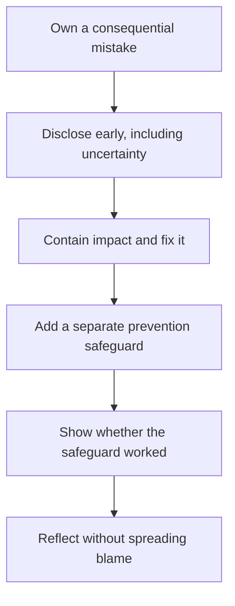

### Follow-ups

- How did you tell the people affected by the mistake, and what did you say to them?

- Has the safeguard you added ever caught a similar error since? What happened?

- What would you do differently in the first hour if the same kind of mistake happened again tomorrow?

## Introduce yourself.

[View this question on DeepOffer](https://getdeepoffer.com/questions/pq-0364.html)

**Source / companies:** Apple

**Interview type:** Behavioral

**Tag:** reported

### Answer

Give a 60–90 second arc: current scope and strengths, one or two relevant past outcomes, and why this role is the logical next step. Keep personal history secondary to evidence of fit.

Prefer one specific example with dates, scale, and measurable impact over a list of claims; never invent details that were not part of the real experience.

### Mermaid diagram

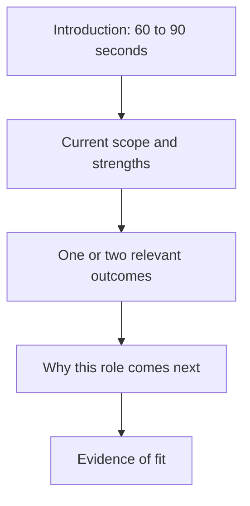

### Follow-ups

- Who disagreed, and how did you earn alignment?

- How did you know the outcome was successful?

## Describe a time you disagreed with a researcher or tech lead about priorities, and what happened.

[View this question on DeepOffer](https://getdeepoffer.com/questions/pq-0365.html)

**Source / companies:** Reported in public interview compilations — Google

**Interview type:** Behavioral

**Tag:** reported

### Answer

Use a concise STAR structure: establish the stakes, isolate your own responsibility, explain the decision and trade-off, and quantify the result. Include what you learned and what you would change now.

Prefer one specific example with dates, scale, and measurable impact over a list of claims; never invent details that were not part of the real experience.

### Mermaid diagram

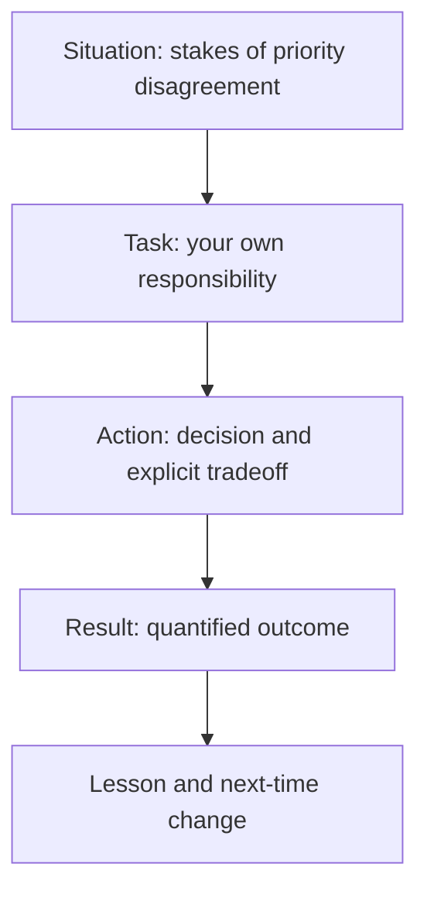

### Follow-ups

- What was the hardest decision?

- Which lesson changed your later behavior?

## Describe a time you had a conflict with someone, how you resolved it, and what you learned.

[View this question on DeepOffer](https://getdeepoffer.com/questions/pq-0366.html)

**Source / companies:** Meta

**Interview type:** Behavioral

**Tag:** reported

### Answer

Use a concise STAR structure: establish the stakes, isolate your own responsibility, explain the decision and trade-off, and quantify the result. Include what you learned and what you would change now.

Prefer one specific example with dates, scale, and measurable impact over a list of claims; never invent details that were not part of the real experience.

### Mermaid diagram

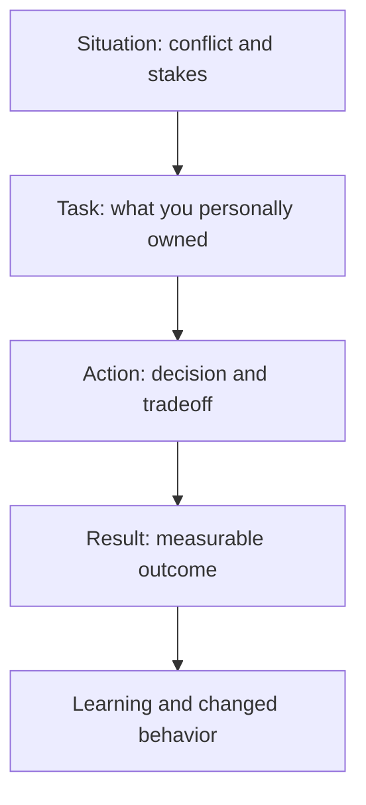

### Follow-ups

- What did you personally own?

- Which measurable result followed?

## Describe a time you had conflicting priorities with stakeholders and how you secured alignment.

[View this question on DeepOffer](https://getdeepoffer.com/questions/pq-0367.html)

**Source / companies:** Google

**Interview type:** Behavioral

**Tag:** reported

### Answer

Use a concise STAR structure: establish the stakes, isolate your own responsibility, explain the decision and trade-off, and quantify the result. Include what you learned and what you would change now.

Prefer one specific example with dates, scale, and measurable impact over a list of claims; never invent details that were not part of the real experience.

### Mermaid diagram

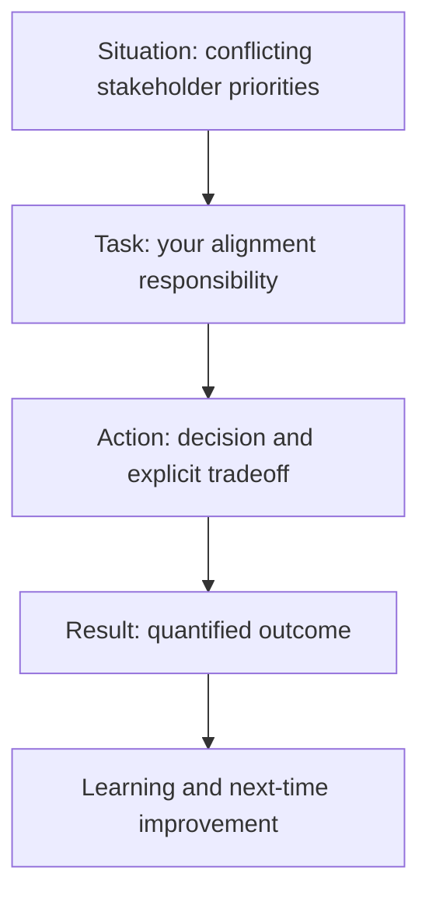

### Follow-ups

- What trade-off did you make explicit?

- What would you do differently now?

## Explain your views on AGI and AI safety.

[View this question on DeepOffer](https://getdeepoffer.com/questions/pq-0368.html)

**Source / companies:** Reported in public interview compilations — OpenAI

**Interview type:** Behavioral

**Tag:** reported

### Answer

State a clear principle, acknowledge uncertainty, and explain how risk tiering, evaluations, human oversight, auditability, and escalation should affect deployment decisions. Distinguish personal values from empirical claims.

Prefer one specific example with dates, scale, and measurable impact over a list of claims; never invent details that were not part of the real experience.

### Mermaid diagram

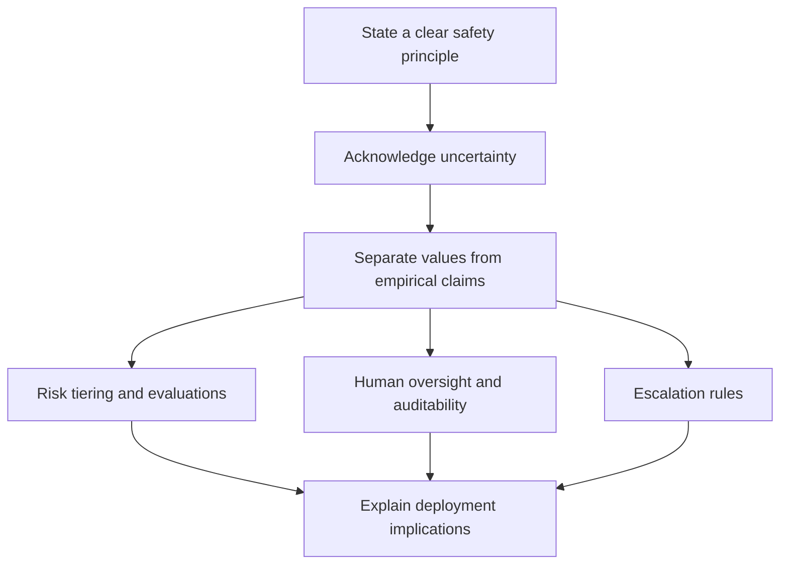

### Follow-ups

- Who disagreed, and how did you earn alignment?

- How did you know the outcome was successful?

## Explain why you want to work at OpenAI specifically.

[View this question on DeepOffer](https://getdeepoffer.com/questions/pq-0369.html)

**Source / companies:** Reported in public interview compilations — OpenAI

**Interview type:** Behavioral

**Tag:** reported

### Answer

Connect the role’s concrete mission and technical problems to evidence from your past work and the skills you want to deepen. Keep the reason forward-looking and avoid generic praise or criticism of a current employer.

Prefer one specific example with dates, scale, and measurable impact over a list of claims; never invent details that were not part of the real experience.

### Mermaid diagram

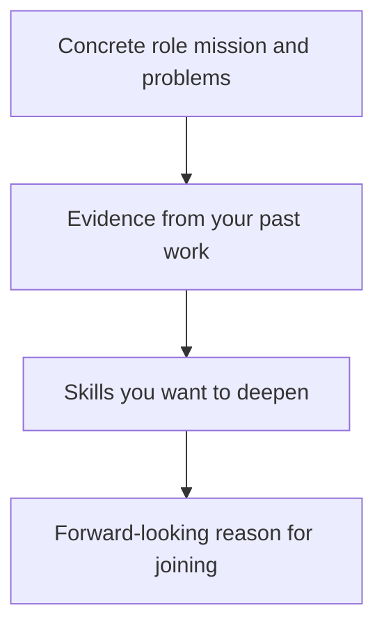

### Follow-ups

- What was the hardest decision?

- Which lesson changed your later behavior?

## Explain why you want to work at Anthropic, and where you disagree with the company.

[View this question on DeepOffer](https://getdeepoffer.com/questions/pq-0370.html)

**Source / companies:** Reported in public interview compilations — Anthropic

**Interview type:** Behavioral

**Tag:** reported

### Answer

Connect the role’s concrete mission and technical problems to evidence from your past work and the skills you want to deepen. Keep the reason forward-looking and avoid generic praise or criticism of a current employer.

Prefer one specific example with dates, scale, and measurable impact over a list of claims; never invent details that were not part of the real experience.

### Mermaid diagram

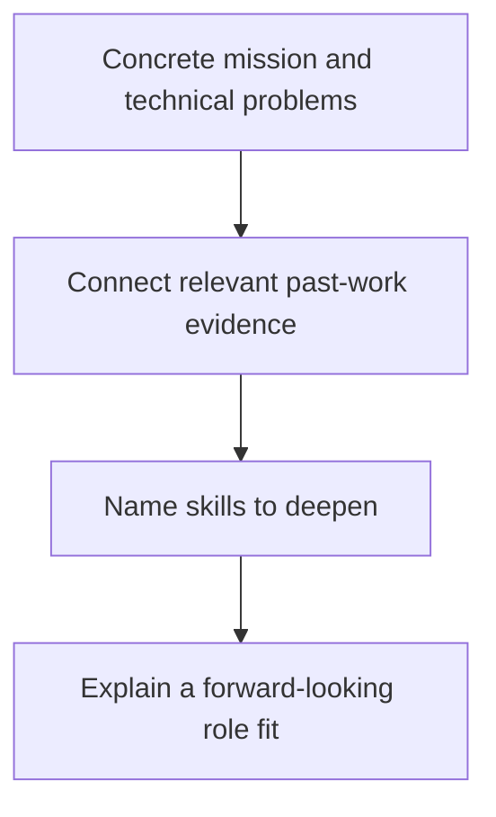

### Follow-ups

- What did you personally own?

- Which measurable result followed?

## Walk through a project you owned end to end and its key technical decisions.

[View this question on DeepOffer](https://getdeepoffer.com/questions/pq-0371.html)

**Source / companies:** Reported in public interview compilations — Anthropic

**Interview type:** Behavioral

**Tag:** reported

### Answer

Use a concise STAR structure: establish the stakes, isolate your own responsibility, explain the decision and trade-off, and quantify the result. Include what you learned and what you would change now.

Prefer one specific example with dates, scale, and measurable impact over a list of claims; never invent details that were not part of the real experience.

### Mermaid diagram

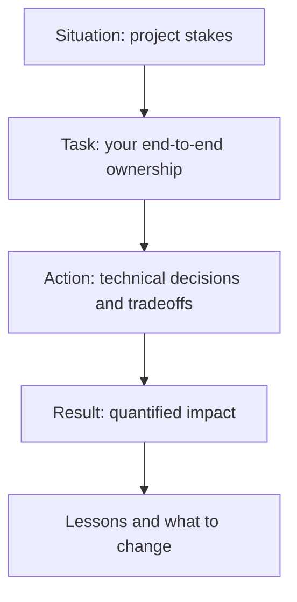

### Follow-ups

- What trade-off did you make explicit?

- What would you do differently now?

