# ML Coding

Topic: `coding`. 100 free questions.

## How Would You Code Stable Softmax, Cross-Entropy, and Their Gradient in NumPy?

[View this question on DeepOffer](https://getdeepoffer.com/questions/coding-softmax-cross-entropy-python.html)

**Source / companies:** Reported in public interview compilations — Google

**Interview type:** Deep Learning

**Tag:** hot

### Answer

<b>Forward</b>: Subtract the row max for numerical stability, exp, then normalize by row to get probabilities $P$. Loss = -mean(log P[range(n), y] + eps), where eps prevents $\log(0)$.

<b>Backward</b>: The gradient with respect to logits has a clean form - $\frac{dL}{dZ}=\frac{P-\operatorname{onehot}(y)}{n}$. No need to unroll the chain rule step by step; hand-derivation and code should agree.

<b>Self-check habit</b>: After writing it, verify a few dimensions with numerical gradients (small finite differences). Doing a gradient check unprompted in an ML coding round is a strong plus.

Shape discipline: be explicit about where the batch dimension is (keepdims). Interviewers plant traps exactly here.

### Mermaid diagram

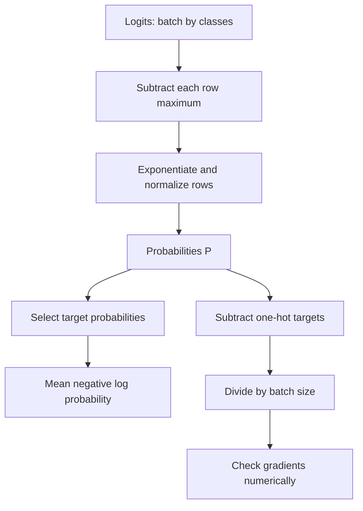

### Follow-ups

- In what way does the gradient change with label smoothing?

- What method do you use to mask the loss when the batch contains padding?

- Explore one more angle: writing it without a framework - what numerical pitfalls matter?

## How Would You Train Logistic Regression Using Gradient Descent from Scratch?

[View this question on DeepOffer](https://getdeepoffer.com/questions/coding-logistic-regression-gd.html)

**Source / companies:** Reported in public interview compilations — Anthropic, OpenAI

**Interview type:** Classical ML

**Tag:** hot

### Answer

<b>Model</b>: $z=Xw+b,\quad p=\operatorname{sigmoid}(z)$, loss is binary cross-entropy. Write matrix shapes in comments first - half the bugs in hand-coding rounds are shape bugs.

<b>Gradients</b>: $dW=\frac{X^T(p-y)}{n},\quad db=\operatorname{mean}(p-y)$ - again prediction minus label, consistent with the softmax case.

<b>Training loop</b>: Initialize (zero init works for logistic regression - explain why it fails for neural networks), then forward, loss, backward, update. Print loss each round and check it decreases monotonically.

<b>Engineering details</b>: Standardize features first; how to spot learning-rate-too-large oscillation; numerically stable sigmoid (two branches for positive/negative).

### Mermaid diagram

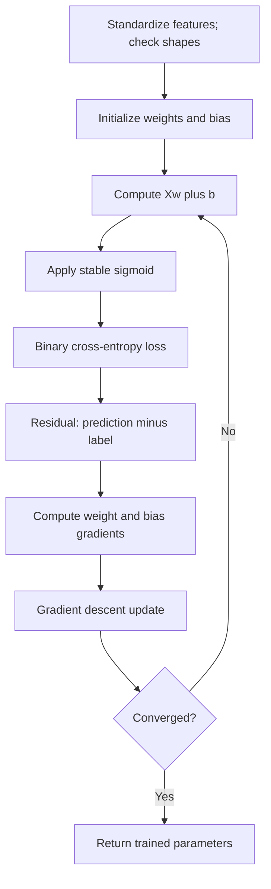

### Follow-ups

- For what reason can logistic regression use zero init but neural networks cannot?

- In what way does the gradient change with L2 regularization?

- What method do you use to judge convergence and when to stop?

## Implement a BPE tokenizer from scratch: train merge rules, then encode and decode without external libraries.

[View this question on DeepOffer](https://getdeepoffer.com/questions/reported-253-implement-a-bpe-tokenizer-from-scratch-train-merge-rules-then-encode-and.html)

**Source / companies:** Reported in a public interview report — OpenAI (MLE coding round); take-home at Anthropic

**Interview type:** LLM Theory

**Tag:** reported

**Source link:** <https://github.com/landedjobs/ai-interview-questions/blob/HEAD/banks/coding-and-system-design.md>

### Answer

Count adjacent symbol pairs, repeatedly merge the most frequent pair, and store the ordered merge table. Encoding reapplies merges by rank; decoding concatenates token bytes, so normalization and unknown-byte handling must be explicit.

Test empty input, one-element input, duplicates, boundary indices, invalid states, and the largest allowed size; state time and space complexity.

### Mermaid diagram

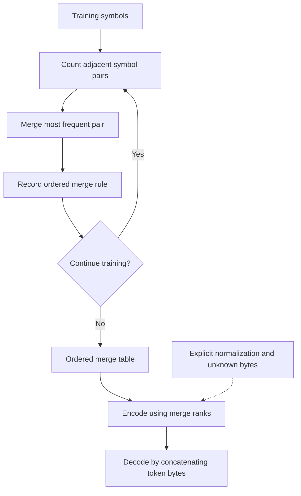

### Follow-ups

- What are the time and space costs?

- Which edge case is easiest to miss?

## Implement scaled dot-product self-attention in NumPy or PyTorch with an optional causal mask.

[View this question on DeepOffer](https://getdeepoffer.com/questions/reported-254-implement-scaled-dot-product-self-attention-in-numpy-or-pytorch-with-an.html)

**Source / companies:** Reported in a public interview report — OpenAI, Meta, AI-lab MLE screens

**Interview type:** Deep Learning

**Tag:** reported

**Source link:** <https://github.com/landedjobs/ai-interview-questions/blob/HEAD/banks/coding-and-system-design.md>

### Answer

Project $Q$, $K$, and $V$; reshape to heads; compute $\frac{QK^T}{\sqrt{d}}$; apply causal or padding masks before softmax; multiply by $V$; then concatenate heads and project. Test tensor shapes and fully masked rows.

Test empty input, one-element input, duplicates, boundary indices, invalid states, and the largest allowed size; state time and space complexity.

### Mermaid diagram

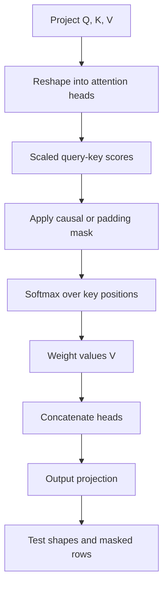

### Follow-ups

- How would you test correctness deterministically?

- What changes when the input no longer fits memory?

## Implement a correct multi-head self-attention forward pass with projections, reshaping, and masking.

[View this question on DeepOffer](https://getdeepoffer.com/questions/reported-255-implement-a-correct-multi-head-self-attention-forward-pass-with-projecti.html)

**Source / companies:** Reported in interviews — Apple (MLE technical screen, Mar 2026); Google NumPy coding

**Interview type:** Deep Learning

**Tag:** reported

**Source link:** <https://github.com/landedjobs/ai-interview-questions/blob/HEAD/banks/coding-and-system-design.md>

### Answer

Project $Q$, $K$, and $V$; reshape to heads; compute $\frac{QK^T}{\sqrt{d}}$; apply causal or padding masks before softmax; multiply by $V$; then concatenate heads and project. Test tensor shapes and fully masked rows.

Test empty input, one-element input, duplicates, boundary indices, invalid states, and the largest allowed size; state time and space complexity.

### Mermaid diagram

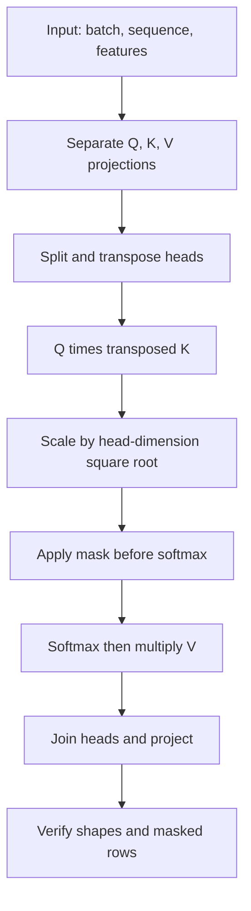

### Follow-ups

- Which invariant should hold after every operation?

- How would you make the implementation thread-safe?

## Build a full transformer block from scratch: multi-head attention, feed-forward network, residuals, and layer norm.

[View this question on DeepOffer](https://getdeepoffer.com/questions/reported-256-build-a-full-transformer-block-from-scratch-multi-head-attention-feed-fo.html)

**Source / companies:** Reported in a public interview report — Frontier labs (research-engineering onsites) · OpenAI

**Interview type:** Deep Learning

**Tag:** reported

**Source link:** <https://github.com/garliatsai/ai-engineering-interview-questions-company-wise>

### Answer

Compose pre-norm attention and MLP sublayers with residual additions: $x\leftarrow x+\operatorname{Attn}(\operatorname{Norm}(x))$, then $x\leftarrow x+\operatorname{MLP}(\operatorname{Norm}(x))$. Keep dropout and masks explicit and verify batch, head, sequence, and feature dimensions.

Test empty input, one-element input, duplicates, boundary indices, invalid states, and the largest allowed size; state time and space complexity.

### Mermaid diagram

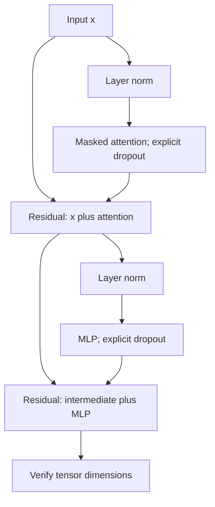

### Follow-ups

- Can you reduce memory without changing the result?

- Which adversarial input exposes the worst case?

## Implement FlashAttention-style tiled attention without ever materializing the full N×N matrix.

[View this question on DeepOffer](https://getdeepoffer.com/questions/reported-257-implement-flashattention-style-tiled-attention-without-ever-materializin.html)

**Source / companies:** Reported in a public interview report — Mistral AI

**Interview type:** Deep Learning

**Tag:** reported

**Source link:** <https://github.com/landedjobs/ai-interview-questions/blob/HEAD/banks/coding-and-system-design.md>

### Answer

Tile Q and K/V blocks so scores never materialize globally. Maintain each query row’s running maximum and normalization sum, rescaling the accumulated output when a new tile changes the maximum.

Test empty input, one-element input, duplicates, boundary indices, invalid states, and the largest allowed size; state time and space complexity.

### Mermaid diagram

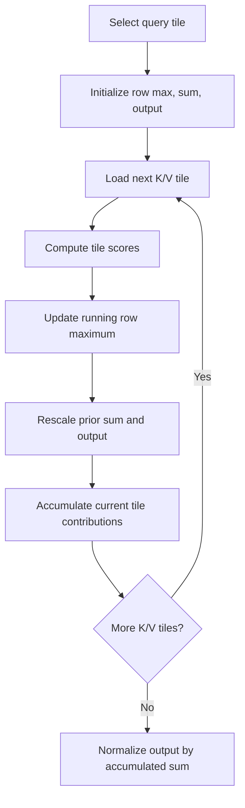

### Follow-ups

- What are the time and space costs?

- Which edge case is easiest to miss?

## Hand-write a KV cache and single-step decode.

[View this question on DeepOffer](https://getdeepoffer.com/questions/reported-258-hand-write-a-kv-cache-and-single-step-decode.html)

**Source / companies:** Reported in public interview compilations — Moonshot AI

**Interview type:** LLM Inference & Serving

**Tag:** reported

**Source link:** <https://github.com/garliatsai/ai-engineering-interview-questions-company-wise>

### Answer

Store per-layer K/V tensors indexed by sequence position, append the current token’s projections, and attend the new query over cached positions. Preallocate or page storage to avoid repeated concatenation.

Test empty input, one-element input, duplicates, boundary indices, invalid states, and the largest allowed size; state time and space complexity.

### Mermaid diagram

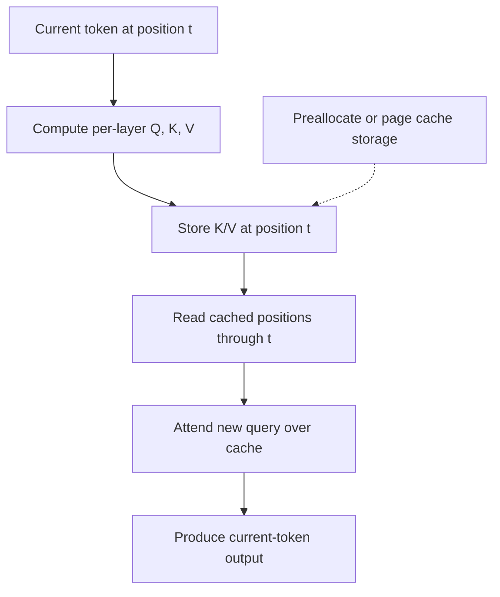

### Follow-ups

- How would you test correctness deterministically?

- What changes when the input no longer fits memory?

## Implement top-k, top-p, and temperature sampling over a logits vector.

[View this question on DeepOffer](https://getdeepoffer.com/questions/reported-259-implement-top-k-top-p-and-temperature-sampling-over-a-logits-vector.html)

**Source / companies:** Reported in public interview compilations — Google DeepMind, Apple

**Interview type:** LLM Theory

**Tag:** reported

**Source link:** <https://github.com/garliatsai/ai-engineering-interview-questions-company-wise>

### Answer

Scale logits by temperature, mask outside top-k or the cumulative top-p set, subtract the maximum for stability, softmax, and sample. Handle zero temperature deterministically and renormalize after filtering.

Test empty input, one-element input, duplicates, boundary indices, invalid states, and the largest allowed size; state time and space complexity.

### Mermaid diagram

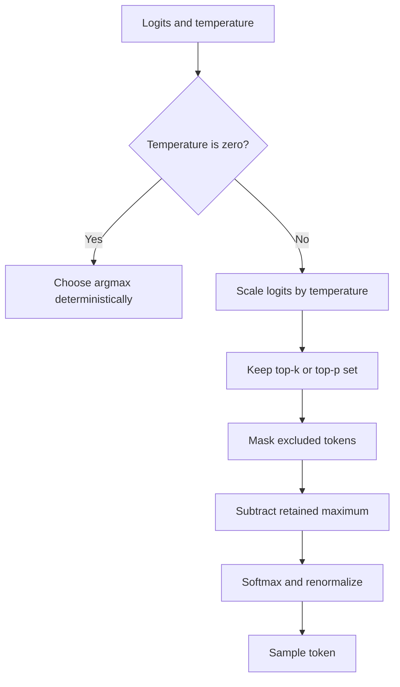

### Follow-ups

- Which invariant should hold after every operation?

- How would you make the implementation thread-safe?

## Implement top-k MoE routing with a shared expert in PyTorch and point out the efficiency and correctness traps.

[View this question on DeepOffer](https://getdeepoffer.com/questions/pq-0301.html)

**Source / companies:** Reported in public interview compilations — DeepSeek

**Interview type:** Deep Learning

**Tag:** reported

### Answer

Compute router logits, select top-k experts per token, normalize selected weights, dispatch tokens, run experts, and scatter-add outputs. Capacity limits, duplicate routing, dropped tokens, load balance, and device communication are the main traps.

Test empty input, one-element input, duplicates, boundary indices, invalid states, and the largest allowed size; state time and space complexity.

### Mermaid diagram

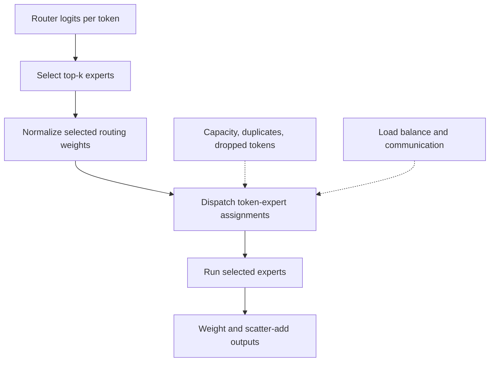

### Follow-ups

- Can you reduce memory without changing the result?

- Which adversarial input exposes the worst case?

## Implement a top-k MoE router, then contrast auxiliary-loss load balancing with a loss-free approach.

[View this question on DeepOffer](https://getdeepoffer.com/questions/pq-0302.html)

**Source / companies:** Reported in public interview compilations — Zhipu AI

**Interview type:** LLM Theory

**Tag:** reported

### Answer

Compute router logits, select top-k experts per token, normalize selected weights, dispatch tokens, run experts, and scatter-add outputs. Capacity limits, duplicate routing, dropped tokens, load balance, and device communication are the main traps.

Test empty input, one-element input, duplicates, boundary indices, invalid states, and the largest allowed size; state time and space complexity.

### Mermaid diagram

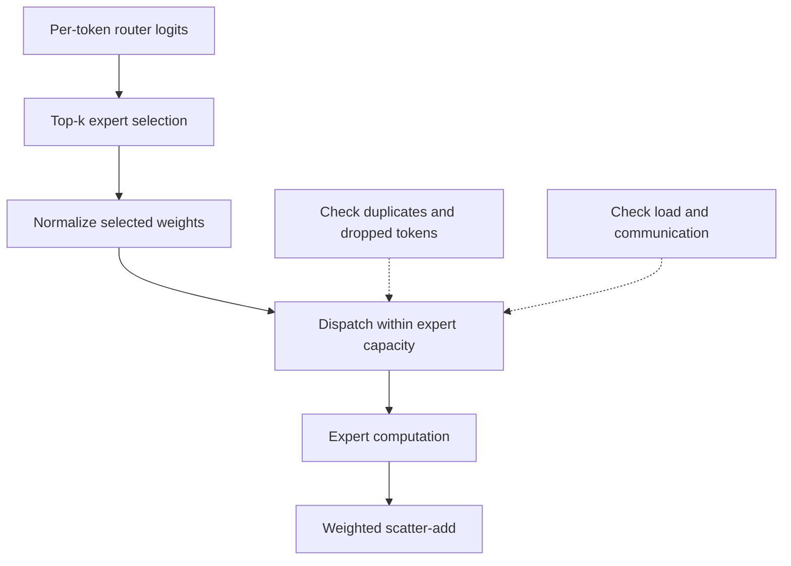

### Follow-ups

- What are the time and space costs?

- Which edge case is easiest to miss?

## Hand-write a miniGPT.

[View this question on DeepOffer](https://getdeepoffer.com/questions/pq-0303.html)

**Source / companies:** OpenAI

**Interview type:** LLM Theory

**Tag:** reported

### Answer

Implement token and position embeddings, repeated causal transformer blocks, final normalization, and a tied or separate vocabulary head. Train with shifted cross-entropy and generate autoregressively while reusing cached states.

Test empty input, one-element input, duplicates, boundary indices, invalid states, and the largest allowed size; state time and space complexity.

### Mermaid diagram

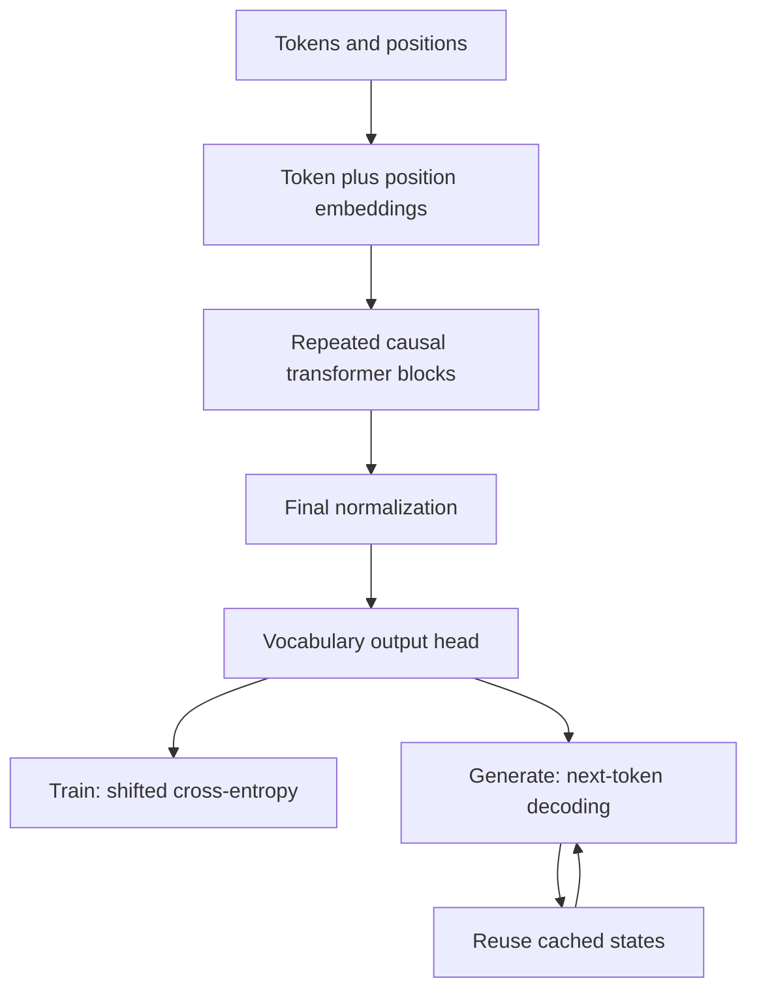

### Follow-ups

- How would you test correctness deterministically?

- What changes when the input no longer fits memory?

## Debug a Transformer: find the classic bugs.

[View this question on DeepOffer](https://getdeepoffer.com/questions/reported-263-debug-a-transformer-find-the-classic-bugs.html)

**Source / companies:** Reported in interviews — OpenAI, 2026

**Interview type:** Deep Learning

**Tag:** reported

### Answer

Check mask orientation and dtype, softmax axis, scaling by head dimension, reshape/transpose order, residual placement, normalization epsilon, dropout mode, label shift, padding loss, and device/dtype consistency.

Test empty input, one-element input, duplicates, boundary indices, invalid states, and the largest allowed size; state time and space complexity.

### Mermaid diagram

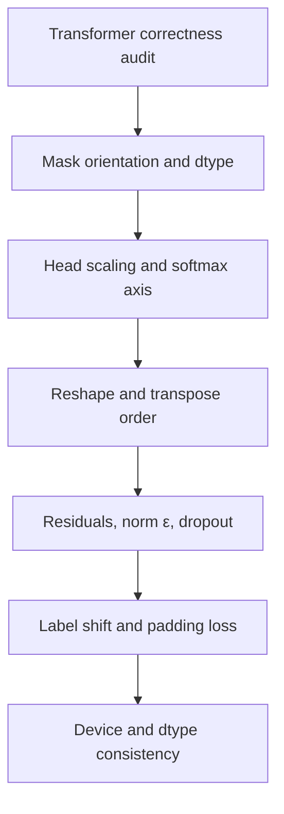

### Follow-ups

- Which invariant should hold after every operation?

- How would you make the implementation thread-safe?

## Implement k-means clustering on a shared doc.

[View this question on DeepOffer](https://getdeepoffer.com/questions/reported-264-implement-k-means-clustering-on-a-shared-doc.html)

**Source / companies:** Reported in interviews — Google, Dec 2019

**Interview type:** Classical ML

**Tag:** reported

### Answer

Initialize centroids, assign each point to its nearest centroid, recompute means, and repeat until assignments or objective stabilize. Handle empty clusters and use vectorized squared distances; multiple k-means++ restarts reduce bad local optima.

Test empty input, one-element input, duplicates, boundary indices, invalid states, and the largest allowed size; state time and space complexity.

### Mermaid diagram

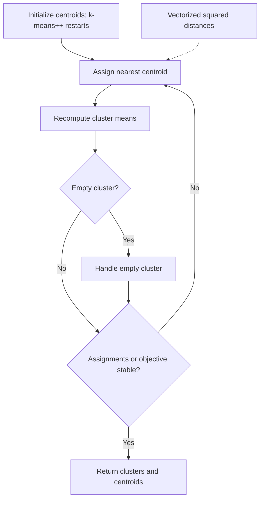

### Follow-ups

- Can you reduce memory without changing the result?

- Which adversarial input exposes the worst case?

## Implement logistic regression from scratch in Python with no ML libraries.

[View this question on DeepOffer](https://getdeepoffer.com/questions/pq-0306.html)

**Source / companies:** Reported in public interview compilations — Twilio

**Interview type:** Classical ML

**Tag:** reported

### Answer

Compute logits $Xw+b$, stable sigmoid probabilities, average binary cross-entropy, and gradients $\frac{X^T(p-y)}{n}$ plus regularization. Update parameters until validation loss or gradient norm stabilizes.

Test empty input, one-element input, duplicates, boundary indices, invalid states, and the largest allowed size; state time and space complexity.

### Mermaid diagram

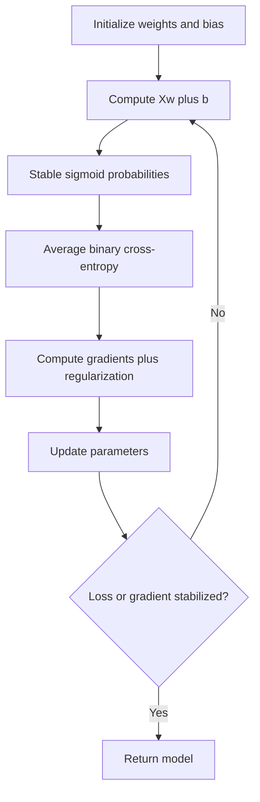

### Follow-ups

- What are the time and space costs?

- Which edge case is easiest to miss?

## In NumPy, compute minADE and minFDE for multi-modal trajectory predictions with variable-length ground truth — no Python loops.

[View this question on DeepOffer](https://getdeepoffer.com/questions/pq-0307.html)

**Source / companies:** Reported in public interview compilations — Waymo

**Interview type:** Robotics & Autonomy

**Tag:** reported

### Answer

Build a broadcasted $[\text{batch},\text{modes},\text{time}]$ displacement tensor, mask invalid ground-truth steps, average valid distances for ADE, and gather the last valid step for FDE. Take the minimum over trajectory modes per example.

Test empty input, one-element input, duplicates, boundary indices, invalid states, and the largest allowed size; state time and space complexity.

### Mermaid diagram

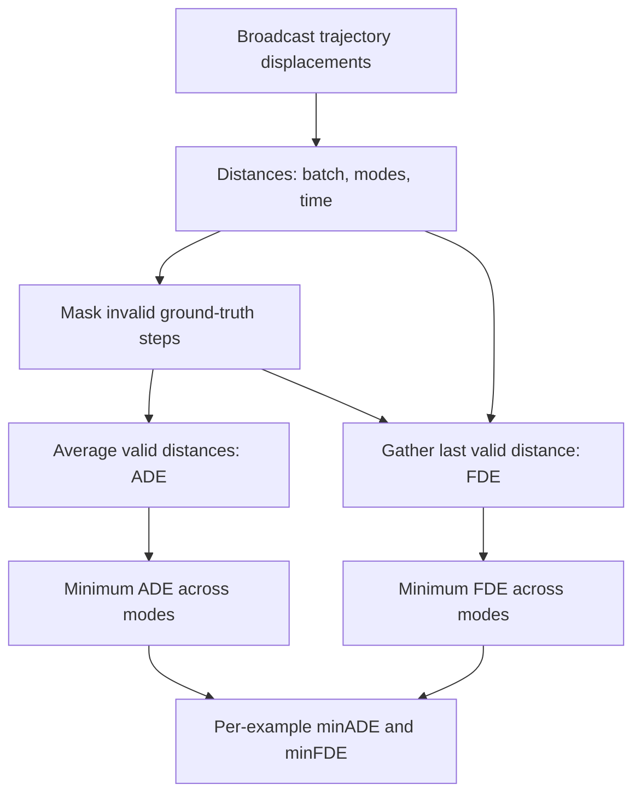

### Follow-ups

- How would you test correctness deterministically?

- What changes when the input no longer fits memory?

## Implement non-maximum suppression, then vectorize it.

[View this question on DeepOffer](https://getdeepoffer.com/questions/pq-0308.html)

**Source / companies:** Reported in public interview compilations — Tesla

**Interview type:** Computer Vision

**Tag:** reported

### Answer

Sort boxes by score, keep the highest, suppress remaining boxes whose IoU exceeds the threshold, and repeat. Vectorize IoU against all remaining boxes each round and define behavior for degenerate boxes and ties.

Test empty input, one-element input, duplicates, boundary indices, invalid states, and the largest allowed size; state time and space complexity.

### Mermaid diagram

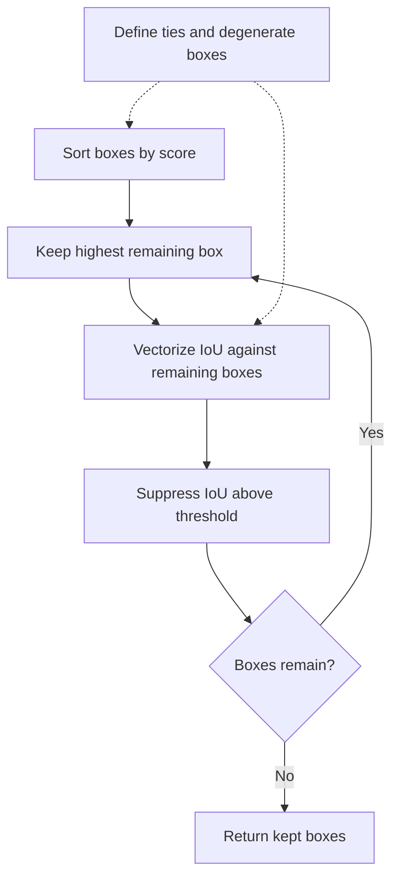

### Follow-ups

- Which invariant should hold after every operation?

- How would you make the implementation thread-safe?

## Implement the block manager for a paged KV cache: allocate, append, free, and copy-on-write prefix sharing.

[View this question on DeepOffer](https://getdeepoffer.com/questions/pq-0311.html)

**Source / companies:** Reported in public interview compilations — NVIDIA

**Interview type:** LLM Inference & Serving

**Tag:** reported

### Answer

Store per-layer K/V tensors indexed by sequence position, append the current token’s projections, and attend the new query over cached positions. Preallocate or page storage to avoid repeated concatenation.

Test empty input, one-element input, duplicates, boundary indices, invalid states, and the largest allowed size; state time and space complexity.

### Follow-ups

- How would you test correctness deterministically?

- What changes when the input no longer fits memory?

## Write the Python to run an LLM call over 50,000 documents given ~100 concurrency and occasional 429s and timeouts.

[View this question on DeepOffer](https://getdeepoffer.com/questions/pq-0321.html)

**Source / companies:** Reported in public interview compilations — Anthropic

**Interview type:** LLM Inference & Serving

**Tag:** reported

### Answer

Use bounded async workers behind a queue or semaphore, batch when supported, apply exponential backoff with jitter only to retryable failures, honor Retry-After, isolate per-item errors, and checkpoint idempotent progress.

Test empty input, one-element input, duplicates, boundary indices, invalid states, and the largest allowed size; state time and space complexity.

### Mermaid diagram

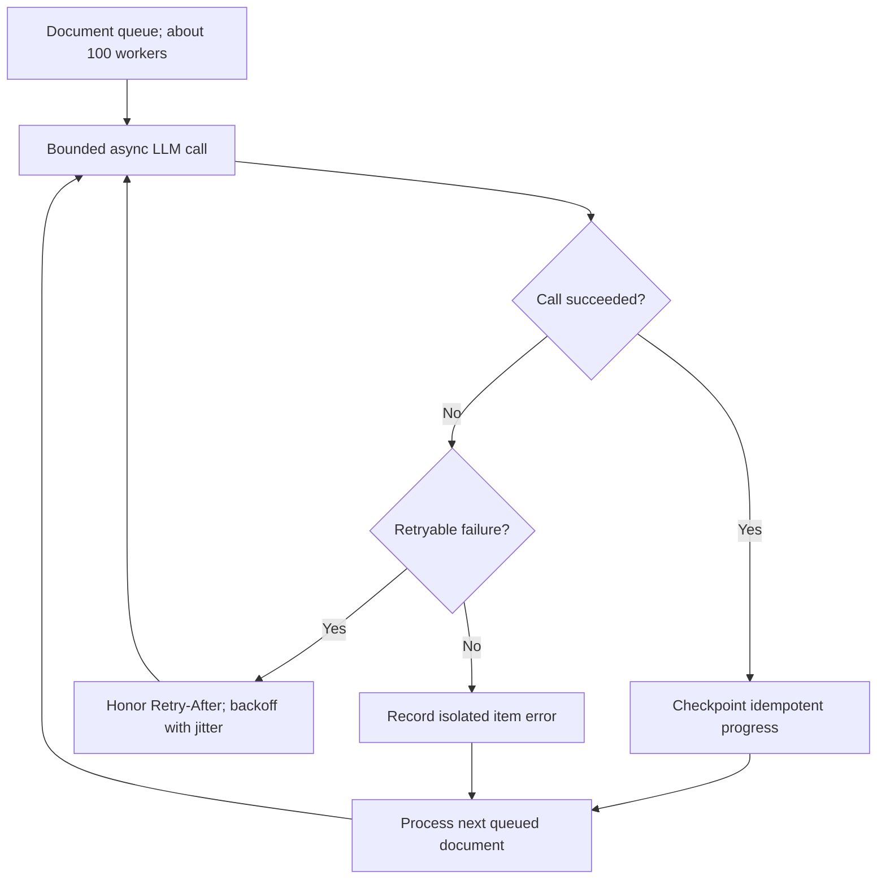

### Follow-ups

- Can you reduce memory without changing the result?

- Which adversarial input exposes the worst case?

## From a stream of user actions, return the k most engaged-with items — then explain why a heap solution could be wrong in production.

[View this question on DeepOffer](https://getdeepoffer.com/questions/pq-0327.html)

**Source / companies:** Reported in public interview compilations — Meta

**Interview type:** Classical ML

**Tag:** reported

### Answer

Exact counts need memory proportional to distinct keys; bounded memory requires an approximation such as Count-Min Sketch plus a candidate heap. For windows, use time buckets or an expiring structure and state the error bounds.

Test empty input, one-element input, duplicates, boundary indices, invalid states, and the largest allowed size; state time and space complexity.

### Mermaid diagram

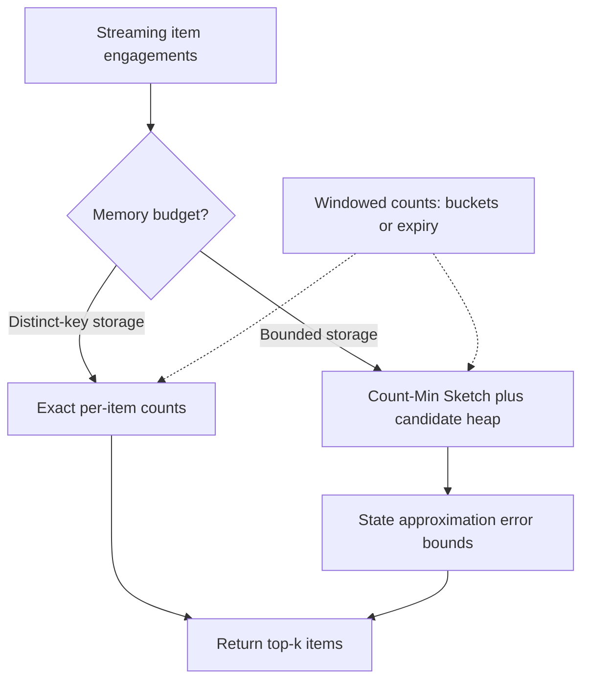

### Follow-ups

- How would you test correctness deterministically?

- What changes when the input no longer fits memory?

## Implement a minimal agent loop with tool dispatch, error handling, and a step budget.

[View this question on DeepOffer](https://getdeepoffer.com/questions/pq-0329.html)

**Source / companies:** Reported in public interview compilations — Cognition

**Interview type:** Conversational AI & Agents

**Tag:** reported

### Answer

Loop over model output, validate a typed tool request, execute through a bounded dispatcher, append the observation, and stop on completion, error, or budget. Reject unknown tools and cap retries and total steps.

Test empty input, one-element input, duplicates, boundary indices, invalid states, and the largest allowed size; state time and space complexity.

### Mermaid diagram

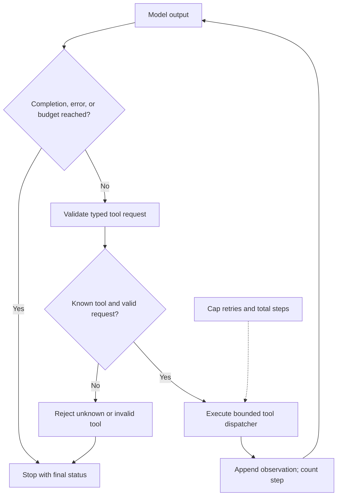

### Follow-ups

- Can you reduce memory without changing the result?

- Which adversarial input exposes the worst case?

## Diagnose a Spark job joining a 2TB fact table to a 50GB dimension table where one straggler task runs 100x longer than the rest.

[View this question on DeepOffer](https://getdeepoffer.com/questions/pq-0335.html)

**Source / companies:** Reported in public interview compilations — Databricks

**Interview type:** ML Platform

**Tag:** reported

### Answer

Inspect the physical plan and task metrics for skew, spills, and shuffle size. Salt hot keys, repartition, preaggregate, or use a broadcast only if the 50GB side truly fits executors; adaptive query execution can split skewed partitions.

Test empty input, one-element input, duplicates, boundary indices, invalid states, and the largest allowed size; state time and space complexity.

### Mermaid diagram

```mermaid
flowchart TD
A["Inspect plan and task metrics"] --> B["Check skew, spills, shuffle size"]
B --> C["Hot keys or skewed partitions"]
C --> D["Salt, repartition, or preaggregate"]
C --> E["AQE: split skewed partitions"]
B --> F{"Dimension truly fits executors?"}
F -->|Yes| G["Consider broadcast join"]
F -->|No| H["Keep distributed join strategy"]
```

### Follow-ups

- How would you test correctness deterministically?

- What changes when the input no longer fits memory?

## Build the task-lifecycle core of an annotation platform, then add k-annotator consensus, priority re-review, and annotator cooldowns.

[View this question on DeepOffer](https://getdeepoffer.com/questions/pq-0336.html)

**Source / companies:** Reported in public interview compilations — Scale AI

**Interview type:** ML Platform

**Tag:** reported

### Answer

State the data model and invariants first, choose a structure that gives the required operations their target complexity, and keep correctness separate from optimization. Implement the smallest working version before adding concurrency, persistence, or scale.

Test empty input, one-element input, duplicates, boundary indices, invalid states, and the largest allowed size; state time and space complexity.

### Follow-ups

- Which invariant should hold after every operation?

- How would you make the implementation thread-safe?

## Given annotation sessions as (start, end) timestamps, return the peak number of concurrent annotators and the intervals at peak load.

[View this question on DeepOffer](https://getdeepoffer.com/questions/pq-0337.html)

**Source / companies:** Reported in public interview compilations — Scale AI

**Interview type:** Classical ML

**Tag:** reported

### Answer

Create $+1$ events at starts and $-1$ at ends, sort with an explicit tie convention, and sweep a running count. Record segments where the count equals the maximum.

Test empty input, one-element input, duplicates, boundary indices, invalid states, and the largest allowed size; state time and space complexity.

### Mermaid diagram

```mermaid
flowchart TD
A["Start: plus one; end: minus one"] --> B["Sort events; define tie convention"]
B --> C["Sweep event groups by timestamp"]
C --> D["Update count for next segment"]
D --> E{"Compare count with maximum"}
E -->|Higher| F["Set maximum; reset peak intervals"]
E -->|Equal| G["Append current interval"]
E -->|Lower| H{"More events?"}
F --> G
G --> H
H -->|Yes| C
H -->|No| I["Return peak count and intervals"]
```

### Follow-ups

- Can you reduce memory without changing the result?

- Which adversarial input exposes the worst case?

## Implement GPU credit operations (create_grant / subtract / get_balance) with expiry priority and out-of-order operations, then optimize for production.

[View this question on DeepOffer](https://getdeepoffer.com/questions/pq-0339.html)

**Source / companies:** Reported in public interview compilations — OpenAI

**Interview type:** ML Platform

**Tag:** reported

### Answer

State the data model and invariants first, choose a structure that gives the required operations their target complexity, and keep correctness separate from optimization. Implement the smallest working version before adding concurrency, persistence, or scale.

Test empty input, one-element input, duplicates, boundary indices, invalid states, and the largest allowed size; state time and space complexity.

### Follow-ups

- How would you test correctness deterministically?

- What changes when the input no longer fits memory?

## Build a text editor in 4 parts: buffer ops, dual-stack undo/redo, AI autocomplete with Trie + word frequencies, and real-time collaboration/OT.

[View this question on DeepOffer](https://getdeepoffer.com/questions/pq-0340.html)

**Source / companies:** Reported in public interview compilations — OpenAI

**Interview type:** Classical ML

**Tag:** reported

### Answer

A gap buffer is strong near the cursor; a piece table or rope handles arbitrary edits and line lookup more evenly. Keep undo/redo as inverse operations, and use OT or CRDT rules for concurrent edits.

Test empty input, one-element input, duplicates, boundary indices, invalid states, and the largest allowed size; state time and space complexity.

### Mermaid diagram

```mermaid
flowchart TD
A["Text editor requirements"] --> B{"Buffer access pattern?"}
B -->|Near cursor| C["Gap buffer"]
B -->|Arbitrary edits and line lookup| D["Piece table or rope"]
A --> E["Undo and redo: inverse operations"]
A --> F["Concurrent edits: OT or CRDT"]
```

### Follow-ups

- Which invariant should hold after every operation?

- How would you make the implementation thread-safe?

## Schedule data-labeling tasks across (task, model) and (task, human) pairs.

[View this question on DeepOffer](https://getdeepoffer.com/questions/pq-0341.html)

**Source / companies:** Reported in public interview compilations — OpenAI

**Interview type:** ML Platform

**Tag:** reported

### Answer

State the data model and invariants first, choose a structure that gives the required operations their target complexity, and keep correctness separate from optimization. Implement the smallest working version before adding concurrency, persistence, or scale.

Test empty input, one-element input, duplicates, boundary indices, invalid states, and the largest allowed size; state time and space complexity.

### Follow-ups

- Can you reduce memory without changing the result?

- Which adversarial input exposes the worst case?

## Implement weighted random sampling with follow-ups, and write a test function proving the non-deterministic solution works.

[View this question on DeepOffer](https://getdeepoffer.com/questions/pq-0347.html)

**Source / companies:** Reported in public interview compilations — Citadel

**Interview type:** Classical ML

**Tag:** reported

### Answer

State the data model and invariants first, choose a structure that gives the required operations their target complexity, and keep correctness separate from optimization. Implement the smallest working version before adding concurrency, persistence, or scale.

Test empty input, one-element input, duplicates, boundary indices, invalid states, and the largest allowed size; state time and space complexity.

### Follow-ups

- How would you test correctness deterministically?

- What changes when the input no longer fits memory?

## A model runs fine in FP32 but produces garbage after conversion to FP16 — debug it.

[View this question on DeepOffer](https://getdeepoffer.com/questions/pq-0354.html)

**Source / companies:** Reported in public interview compilations — NVIDIA

**Interview type:** Deep Learning

**Tag:** reported

### Answer

Check overflow, underflow, unstable reductions, normalization epsilon, and unsupported casts. Keep sensitive accumulations in FP32, use loss scaling during training, compare layer outputs to FP32, and locate the first divergence.

Test empty input, one-element input, duplicates, boundary indices, invalid states, and the largest allowed size; state time and space complexity.

### Mermaid diagram

```mermaid
flowchart TD
A["Compare FP16 layers against FP32"] --> B["Locate first divergent layer"]
B --> C["Check overflow and underflow"]
B --> D["Check reductions and norm ε"]
B --> E["Check unsupported casts"]
C --> F["Keep sensitive accumulations FP32"]
D --> F
C --> G["Training: apply loss scaling"]
F --> H["Compare layer outputs again"]
G --> H
```

### Follow-ups

- What are the time and space costs?

- Which edge case is easiest to miss?

## Debug a CUDA kernel running 10x slower than expected, without running it: name the usual suspects and how to confirm each.

[View this question on DeepOffer](https://getdeepoffer.com/questions/pq-0355.html)

**Source / companies:** Reported in public interview compilations — NVIDIA

**Interview type:** Deep Learning

**Tag:** reported

### Answer

Check occupancy, memory coalescing, shared-memory bank conflicts, divergence, launch overhead, synchronization, and whether the kernel is bandwidth or compute bound. Confirm with profiler counters and a roofline estimate.

Test empty input, one-element input, duplicates, boundary indices, invalid states, and the largest allowed size; state time and space complexity.

### Mermaid diagram

```mermaid
flowchart TD
A["Slow CUDA kernel"] --> B["Occupancy and launch overhead"]
A --> C["Coalescing and memory bandwidth"]
A --> D["Shared-memory bank conflicts"]
A --> E["Divergence and synchronization"]
B --> F["Check profiler counters"]
C --> F
D --> F
E --> F
F --> G["Estimate roofline limit"]
G --> H["Identify bandwidth or compute bound"]
```

### Follow-ups

- How would you test correctness deterministically?

- What changes when the input no longer fits memory?

## Implement a random forest classifier from scratch without scikit-learn, using bagged trees and majority vote

[View this question on DeepOffer](https://getdeepoffer.com/questions/pq-0437.html)

**Source / companies:** Netflix

**Interview type:** Classical ML

**Tag:** reported

### Answer

<b>Bagging first</b>: Train each tree on a bootstrap sample — draw $n$ rows with replacement from $n$ training rows. Roughly a third of rows stay out of each tree's sample; those out-of-bag rows give you a free validation estimate with no extra split.

<b>Decorrelate the trees</b>: At each split, consider only a random subset of features ($\sqrt{p}$ for classification). Without this, the strongest features dominate every tree and the ensemble barely beats a single tree.

<b>Vote at the end</b>: Each tree predicts a class and the forest takes the majority vote. If you need probabilities, average the trees' predicted class probabilities instead of voting.

<b>Complexity check</b>: One tree costs about $O(n\log n\cdot p)$ for $n$ rows and $p$ features; the forest multiplies by the tree count but parallelizes trivially since trees are independent.

### Mermaid diagram

```mermaid
flowchart TD
A["Training rows"] --> B["Bootstrap sample per tree"]
B --> C["Random feature subset per split"]
C --> D["Train independent decision trees"]
D --> E["Each tree predicts"]
E --> F["Class: majority vote"]
E --> G["Probabilities: average tree probabilities"]
B --> H["Out-of-bag rows validate trees"]
I["Random features decorrelate trees"] -.-> C
```

### Follow-ups

- Why does bootstrap sampling reduce variance but not bias? (Each tree keeps the same bias; averaging kills only the uncorrelated variance)

- How would you get feature importances out of the forest? (Mean decrease in impurity, or permutation importance measured on out-of-bag rows)

- When would you prefer gradient boosting over a random forest? (Small data where bias dominates, or when you can afford tuning for the last point of accuracy)

## Implement TF-IDF vectorization from scratch with NumPy

[View this question on DeepOffer](https://getdeepoffer.com/questions/pq-0438.html)

**Source / companies:** Amazon / Google

**Interview type:** NLP

**Tag:** reported

### Answer

<b>Term frequency</b>: Count how often each term appears in a document, normalized by document length so long documents don't dominate the scores.

<b>Inverse document frequency</b>: $\operatorname{idf}(t)=\log\left(\frac{N}{\operatorname{df}(t)}\right)$, where $N$ is the document count and $\operatorname{df}(t)$ the number of documents containing $t$. Rare terms get high weight; words appearing everywhere get near zero.

<b>Multiply and normalize</b>: tf-idf is $\mathrm{tf}\times\mathrm{idf}$ per (document, term); then L2-normalize each document vector so cosine similarity isn't skewed by document length.

<b>Edge cases</b>: Smooth the idf as $\log\left(\frac{N+1}{\mathrm{df}+1}\right)+1$ so unseen terms never divide by zero. Decide up front whether query-only terms get the training idf or a default value.

### Mermaid diagram

```mermaid
flowchart TD
A["Tokenized document corpus"] --> B["Count terms per document"]
B --> C["TF: count divided by length"]
A --> D["DF: documents containing term"]
D --> E["IDF: log of N over DF"]
D --> F["Smoothed IDF avoids zero division"]
C --> G["Multiply TF and chosen IDF"]
E --> G
F --> G
G --> H["L2-normalize document vectors"]
I["Define query-only term policy"] -.-> G
```

### Follow-ups

- Why log in the idf instead of a raw ratio? (It dampens the extreme boost given to very rare terms)

- How do you handle a query term that never appeared in training? (Out-of-vocabulary fallback — drop it or assign a default idf)

- When does BM25 beat plain TF-IDF, and why? (Saturating tf curve plus document-length normalization)

## Implement beam search decoding over next-token logits from scratch

[View this question on DeepOffer](https://getdeepoffer.com/questions/pq-0439.html)

**Source / companies:** Amazon / Google

**Interview type:** LLM Theory

**Tag:** reported

### Answer

<b>Keep $k$ hypotheses</b>: Start with one empty hypothesis. At each step, expand every hypothesis over the full vocabulary, score each extension by cumulative log-probability, and keep only the top $k$.

<b>Log-probs, not probs</b>: Add log-probabilities instead of multiplying probabilities — it avoids underflow and turns the product into a sum.

<b>Length bias</b>: Raw cumulative scores favor short sequences, so normalize by length (divide by $\mathrm{length}^{\alpha}$, $\alpha$ around 0.6–1.0) when comparing finished hypotheses.

<b>Termination</b>: A hypothesis that emits EOS is finished and leaves the beam. Stop when the best unfinished hypothesis can't beat the best finished one, or at max length.

### Mermaid diagram

```mermaid
flowchart TD
A["Start with empty hypothesis"] --> B["Expand active hypotheses over vocabulary"]
B --> C["Add next-token log probabilities"]
C --> D["Keep top-k extensions"]
D --> E["Separate EOS-finished hypotheses"]
E --> F["Compare finished scores with length-normalization"]
F --> G{"Safe stopping bound or max-length?"}
G -->|No| H["Continue unfinished hypotheses"]
H --> B
G -->|Yes| I["Stop and select best sequence"]
```

### Follow-ups

- Why does a larger beam sometimes produce worse, more generic outputs? (Beam search maximizes likelihood, and bland text has high likelihood)

- How does beam search differ from temperature sampling? (Deterministic search for the max-probability sequence vs stochastic draws)

- What breaks if you forget to mask already-finished hypotheses? (They keep expanding past EOS and pollute the beam)

## Implement the batch normalization forward and backward pass in NumPy

[View this question on DeepOffer](https://getdeepoffer.com/questions/pq-0440.html)

**Source / companies:** Amazon / Google

**Interview type:** Deep Learning

**Tag:** reported

### Answer

<b>Forward</b>: For a mini-batch, compute mean $\mu$ and variance $\sigma^2$ over the batch dimension, normalize $\hat{x}=\frac{x-\mu}{\sqrt{\sigma^2+\epsilon}}$, then output $y=\gamma\hat{x}+\beta$ with learned scale and shift.

<b>Why it helps</b>: Normalizing each layer's inputs keeps activations in a stable range, so later layers stop chasing a moving target as earlier weights change.

<b>Backward</b>: Chain rule through $y$ into $\gamma$, $\beta$, $\hat{x}$, then into $\mu$, $\sigma^2$, and $x$. The gradient w.r.t. $x$ has three paths — direct through $\hat{x}$, plus through the mean and through the variance — and omitting any one of them gives a wrong gradient.

<b>Train vs test</b>: At inference there is no batch, so use the running averages of $\mu$ and $\sigma^2$ collected during training. Forgetting to switch modes is the classic silent bug.

### Mermaid diagram

```mermaid
flowchart TD
A["Input and mode"] --> B{"Training?"}
B -->|Yes| C["Compute batch mean and variance"]
C --> D["Update running statistics"]
B -->|No| E["Use running mean and variance"]
C --> F["Normalize using variance plus ε"]
E --> F
F --> G["Scale γ; shift β"]
G --> H["Training: upstream gradient"]
H --> I["Gradients for γ and β"]
H --> J["Input gradient: direct, mean, variance"]
```

### Follow-ups

- Why does the epsilon sit inside the square root instead of outside? (It guards the division itself; outside it would shift the scale)

- What goes wrong with batch norm at batch size 1 or 2? (Statistics are pure noise — use layer norm or group norm instead)

- Derive the gradient of the loss w.r.t. gamma in one line. (Sum over the batch of upstream gradient times x-hat)

## Implement precision, recall, and F1 from raw predicted labels in NumPy, without sklearn

[View this question on DeepOffer](https://getdeepoffer.com/questions/pq-0441.html)

**Source / companies:** Amazon / Google

**Interview type:** Statistics & Evaluation

**Tag:** reported

### Answer

<b>Count first</b>: From predicted and true labels, count TP (predicted 1, true 1), FP (predicted 1, true 0), FN (predicted 0, true 1). Every metric below derives from these three numbers.

<b>Formulas</b>: $\mathrm{Precision}=\frac{\mathrm{TP}}{\mathrm{TP}+\mathrm{FP}}$ — of what you flagged, how much was right. $\mathrm{Recall}=\frac{\mathrm{TP}}{\mathrm{TP}+\mathrm{FN}}$ — of what was real, how much you caught. $F_1=\frac{2PR}{P+R}$, the harmonic mean of the two.

<b>Why harmonic, not arithmetic</b>: The harmonic mean punishes lopsided trade-offs — a model with 100% precision and 1% recall scores near zero, which is the honest summary.

<b>Degenerate cases</b>: If the model predicts no positives, precision is $0/0$ — define it as 0 (or 1, but state the choice and stay consistent). Apply the same guard to recall when there are no true positives.

### Mermaid diagram

```mermaid
flowchart TD
A["Predicted and true labels"] --> B["Count TP, FP, FN"]
B --> C["Precision = TP / (TP + FP)"]
B --> D["Recall = TP / (TP + FN)"]
C --> E["Guard zero denominators consistently"]
D --> E
E --> F["F1 = 2PR / (P + R)"]
F --> G["Guard undefined F1 denominator"]
G --> H["Harmonic mean penalizes imbalance"]
```

### Follow-ups

- When do you optimize F1 instead of plain accuracy? (Imbalanced classes, where the majority-class baseline inflates accuracy)

- How do you extend these metrics to multi-class? (Macro average treats classes equally; micro average aggregates the counts first)

- Your fraud model has 99% precision but 40% recall — what do you change? (Lower the decision threshold, or upweight the positive class)

## Build a k-nearest neighbors classifier from scratch with Euclidean distance and a tie-breaking rule

[View this question on DeepOffer](https://getdeepoffer.com/questions/pq-0442.html)

**Source / companies:** Shopify · Meta

**Interview type:** Classical ML

**Tag:** reported

### Answer

<b>Distance</b>: For a query point, compute Euclidean distance to every training point — square root of summed squared differences. Standardize features first, or the largest-scale feature decides everything.

<b>Vote</b>: Take the $k$ nearest neighbors and predict the majority class. Odd $k$ avoids ties in binary problems, but ties still happen with even $k$ or multiple classes.

<b>Tie-breaking</b>: State the rule up front. Common choices: smallest class label, the class of the single nearest neighbor, or distance-weighted votes so nearer points count more.

<b>Cost</b>: Training is free — just store the data. Each query costs $O(n\cdot d)$. For large $n$, mention KD-trees or approximate nearest-neighbor search as the follow-up.

### Mermaid diagram

```mermaid
flowchart TD
A["Store training points and labels"] --> B["Standardize features consistently"]
B --> C["Query: distances to all points"]
C --> D["Select k nearest neighbors"]
D --> E["Count class votes"]
E --> F{"Tied classes?"}
F -->|Yes| G["Apply declared tie-breaking rule"]
F -->|No| H["Return majority class"]
G --> H
I["Query distance cost: O(n d)"] -.-> C
```

### Follow-ups

- Why does kNN collapse in high dimensions? (Distances concentrate — every point ends up roughly equally far, the curse of dimensionality)

- How do you pick k in practice? (Cross-validation; small k overfits, large k underfits)

- What changes with distance-weighted voting? (Nearer neighbors dominate the vote, which softens the tie problem)

## Implement multivariate linear regression via the normal equation in NumPy and handle singular matrices

[View this question on DeepOffer](https://getdeepoffer.com/questions/pq-0443.html)

**Source / companies:** Reported in public interview compilations · Google

**Interview type:** Classical ML

**Tag:** reported

### Answer

<b>The formula</b>: With design matrix $X$ (rows = samples, first column ones for the intercept) and targets $y$, the least-squares solution is $w=(X^T X)^{-1}X^T y$. Derive it by setting the gradient of $\|Xw-y\|^2$ to zero.

<b>Singular danger</b>: $X^T X$ is singular when features are collinear or when $p>n$. Then the inverse doesn't exist and a plain solve() blows up.

<b>The fix</b>: Use the pseudo-inverse (np.linalg.pinv, SVD-based) for the minimum-norm solution, or add ridge regularization: $w=(X^T X+\lambda I)^{-1}X^T y$, which is invertible for any $\lambda>0$.

<b>Cost</b>: Forming $X^T X$ is $O(np^2)$ and inverting is $O(p^3)$ — fine for hundreds of features, hopeless for millions, which is where gradient descent wins.

### Mermaid diagram

```mermaid
flowchart TD
A["Design matrix with intercept column"] --> B["Form X-transpose X and X-transpose y"]
B --> C{"Gram matrix singular?"}
C -->|No| D["Solve normal equation"]
C -->|Yes| E["SVD pseudo-inverse: minimum norm"]
C -->|Yes| F["Or ridge: add λ I"]
F --> G["Solve regularized system"]
D --> H["Return regression weights"]
E --> H
G --> H
I["Form: O(n p squared)"] -.-> B
J["Solve: O(p cubed)"] -.-> D
```

### Follow-ups

- What does the λI term do geometrically? (It penalizes large weights and shrinks the solution toward zero)

- Why does p > n guarantee a singular XᵀX? (Its rank is at most n, but the matrix is p×p)

- When would you still prefer gradient descent with small p? (Streaming data, or when X doesn't fit in memory)

## Implement a single neuron's forward and backward pass with sigmoid activation and MSE loss in NumPy

[View this question on DeepOffer](https://getdeepoffer.com/questions/pq-0444.html)

**Source / companies:** Reported in public interview compilations · Google

**Interview type:** Deep Learning

**Tag:** reported

### Answer

<b>Forward</b>: $z=w\cdot x+b$, $a=\sigma(z)=\frac{1}{1+e^{-z}}$, loss $L=(a-y)^2$. Three lines, no hidden state.

<b>Backward</b>: Chain rule in order: $\frac{dL}{da}=2(a-y)$, $\frac{da}{dz}=a(1-a)$, $\frac{dz}{dw}=x$, $\frac{dz}{db}=1$. Multiply through: $\frac{dL}{dw}=2(a-y)\cdot a(1-a)\cdot x$.

<b>The sigmoid derivative trick</b>: $\sigma^{\prime}(z)=\sigma(z)(1-\sigma(z))$ — you already computed $a$ in the forward pass, so cache it and reuse it instead of recomputing.

<b>Watch the saturation</b>: When $|z|$ is large, $a(1-a)\approx0$ and the gradient vanishes — the neuron stops learning. That is the entire vanishing-gradient story in a single neuron.

### Mermaid diagram

```mermaid
flowchart TD
A["z = w dot x + b"] --> B["a = sigmoid(z); cache a"]
B --> C["Loss = (a - y) squared"]
C --> D["dL/da = 2(a - y)"]
B --> E["da/dz = a(1 - a)"]
D --> F["dL/dz: multiply chain factors"]
E --> F
F --> G["dL/dw = (dL/dz) times x"]
F --> H["dL/db = dL/dz"]
E -.-> I["Large absolute z: vanishing gradient"]
```

### Follow-ups

- Why use cross-entropy with sigmoid instead of MSE here? (Cross-entropy pairs better with sigmoid; MSE stalls on the flat saturated regions)

- What changes with ReLU instead of sigmoid? (The derivative is 0 or 1 — the a(1−a) term disappears entirely)

- How do the gradients change with a batch of m examples? (Average the per-example gradients)

## Implement PCA via SVD in NumPy without using sklearn

[View this question on DeepOffer](https://getdeepoffer.com/questions/pq-0445.html)

**Source / companies:** Reported in public interview compilations · Google

**Interview type:** Classical ML

**Tag:** reported

### Answer

<b>Center first</b>: Subtract the column means. PCA finds directions of variance, and uncentered data makes the first component chase the mean instead of the spread.

<b>SVD</b>: Compute U, S, Vt = svd(X_centered). The rows of Vt are the principal axes ordered by singular value; $\frac{S^2}{n-1}$ gives the variance each axis explains.

<b>Project</b>: Keep the top k rows of Vt as components; the projected data is X_centered @ Vt[:k].T. Choose k by cumulative explained variance, e.g. 95%.

<b>SVD vs eigendecomposition</b>: SVD on X is more numerically stable than eigendecomposition of the covariance $X^T X$, which squares the condition number.

### Mermaid diagram

```mermaid
flowchart TD
A["Fit column means on training data"] --> B["Center training matrix X"]
B --> C["SVD: U, S, V-transpose"]
C --> D["Axes: rows of V-transpose"]
C --> E["Explained variance: S squared / (n-1)"]
E --> F["Choose k by cumulative variance"]
D --> G["Keep top-k principal axes"]
F --> G
G --> H["Project centered data onto axes"]
A --> I["Test data: reuse training means"]
I --> H
```

### Follow-ups

- Why fit the centering on train and reuse it on test? (Refitting on test leaks test statistics into the transform)

- What does it mean if the first component explains 99% of variance? (One dominant direction — check for an unscaled feature)

- How is PCA different from factor analysis? (PCA is a rotation of the data; factor analysis models latent variables plus noise)

## Implement reservoir sampling to sample k items from a data stream in Python

[View this question on DeepOffer](https://getdeepoffer.com/questions/pq-0446.html)

**Source / companies:** Reported in public interview compilations · Meta

**Interview type:** Classical ML

**Tag:** reported

### Answer

<b>The algorithm</b>: Fill the reservoir with the first $k$ items. For each later item $i$ $(i>k)$, keep it with probability $k/i$, replacing a uniformly random reservoir slot when kept.

<b>Why it's uniform</b>: Induction — after $i$ items, each has probability $k/i$ of being in the reservoir. Item $i+1$ is kept with probability $k/(i+1)$, and each existing item survives with $(k/i)\cdot(1-1/(i+1))=k/(i+1)$. The invariant holds for all $i$.

<b>Memory</b>: $O(k)$ no matter how long the stream runs — that is the entire point; you never store the stream.

<b>One pass</b>: Each item is seen once and the decision is final. You never need to know the stream length in advance.

### Mermaid diagram

```mermaid
flowchart TD
A["Fill reservoir with first k"] --> B["Read next item i"]
B --> C["Keep item with probability k/i"]
C --> D{"Keep item?"}
D -->|Yes| E["Replace uniformly random reservoir slot"]
D -->|No| F["Leave reservoir unchanged"]
E --> G{"More stream items?"}
F --> G
G -->|Yes| B
G -->|No| H["Return reservoir; O(k) memory"]
I["Invariant: each item has probability k/i"] -.-> G
```

### Follow-ups

- What breaks with weighted stream items? (You need weighted reservoir sampling — e.g. A-Res with exponential random keys)

- How would you parallelize this over stream shards? (Sample per shard, then merge reservoirs with the correct reweighting)

- Why not just keep every 100th item? (Periodic sampling aliases with periodic patterns in the data)

## Given a user event log DataFrame, compute per-user rolling 7-day conversion features in pandas

[View this question on DeepOffer](https://getdeepoffer.com/questions/pq-0447.html)

**Source / companies:** Reported in public interview compilations · Meta

**Interview type:** Classical ML

**Tag:** reported

### Answer

<b>Sort and index</b>: Sort by user and timestamp and work with a real datetime index. Rolling over time needs rolling('7D', on='timestamp') — a plain rolling(7) counts rows, not days.

<b>Define conversion first</b>: Build the binary event column (e.g. purchase = 1) before rolling. Rolling a raw event log without the label defined produces nonsense.

<b>Groupby + rolling</b>: df.groupby('user').rolling('7D', on='timestamp')['converted'].sum() gives trailing-7-day conversions per user per event. Shift the result by one step when the feature must exclude the current row.

<b>Leakage check</b>: A window that includes the prediction-time event leaks the label. Always ask: is this feature computable at serving time from past data only?

### Mermaid diagram

```mermaid
flowchart TD
A["Sort by user and timestamp"] --> B["Use real datetime timestamps"]
B --> C["Define binary conversion events"]
C --> D["Group by user"]
D --> E["Trailing seven-day conversion sum"]
E --> F["Exclude prediction-time event"]
F --> G["Align results to original rows"]
G --> H["Verify past-only serving availability"]
I["Seven days differs from seven rows"] -.-> E
```

### Follow-ups

- What's the difference between rolling(7) and rolling('7D')? (Row count vs calendar time — sparse users get different windows)

- How do you avoid the groupby-rolling multi-index headache? (reset_index, or merge the result back on the keys)

- Features look great offline but fail online — first suspect? (Lookahead leakage: the window included future events)

## Implement 2D convolution with configurable stride and padding in NumPy

[View this question on DeepOffer](https://getdeepoffer.com/questions/pq-0448.html)

**Source / companies:** Reported in public interview compilations · NVIDIA

**Interview type:** Deep Learning

**Tag:** reported

### Answer

<b>Output size</b>: For input $H\times W$, kernel $k$, stride $s$, padding $p$: $\mathrm{out}=\left\lfloor\frac{H+2p-k}{s}\right\rfloor+1$ per dimension. Get this formula right before writing any loop.

<b>The loops</b>: Pad the input with $p$ zeros on each side. For each output position $(i,j)$, take the $k\times k$ patch at input rows $i\cdot s\ldots i\cdot s+k-1$ and sum the elementwise product with the kernel.

<b>Stride and padding roles</b>: Stride $s$ downsamples by stepping the window; padding $p$ preserves spatial size — $p=(k-1)/2$ with $s=1$ keeps $H\times W$ for odd $k$.

<b>Vectorize the inner op</b>: The patch–kernel dot product is a single NumPy sum(patch * kernel). Loop only over output positions, never over kernel elements.

### Mermaid diagram

```mermaid
flowchart TD
A["Input, kernel, stride, padding"] --> B["Compute output height and width"]
B --> C["Zero-pad input"]
C --> D["Visit output position i, j"]
D --> E["Extract patch at stride offset"]
E --> F["Sum patch times unflipped kernel"]
F --> G["Store output value"]
G --> H{"More output positions?"}
H -->|Yes| D
H -->|No| I["Return CNN-style cross-correlation"]
J["Size = floor((H+2p-k)/s)+1"] -.-> B
```

### Follow-ups

- How do you extend this to multiple input channels? (Convolve per channel and sum the results)

- What's the difference between this cross-correlation and true convolution? (The kernel is flipped; deep learning uses cross-correlation and simply learns the flipped kernel)

- Why is naive looping too slow, and what does im2col do? (It rearranges sliding windows into one big matrix multiply)

## Implement Gaussian Naive Bayes from scratch in NumPy

[View this question on DeepOffer](https://getdeepoffer.com/questions/pq-0449.html)

**Source / companies:** Reported in public interview compilations · Amazon

**Interview type:** Classical ML

**Tag:** reported

### Answer

<b>Training = statistics</b>: For each class $c$, store the prior $P(c)=\frac{\operatorname{count}(c)}{n}$, plus the per-feature mean and variance of that class's rows. That is the entire fit — no iteration.

<b>Gaussian likelihood</b>: $P(x_j\mid c)=\operatorname{Normal}(x_j;\mu_{cj},\sigma_{cj}^2)$. The 'naive' part is treating features as conditionally independent, so the joint likelihood is the product over $j$.

<b>Work in log space</b>: Sum the log-prior and log-likelihoods per class, then take argmax. Raw products underflow to zero with more than a handful of features.

<b>Zero-variance guard</b>: A constant feature inside one class gives $\sigma^2=0$ and a division by zero — add a small epsilon (var_smoothing) to every variance.

### Mermaid diagram

```mermaid
flowchart TD
A["Group training rows by class"] --> B["Estimate class priors"]
A --> C["Estimate feature means and variances"]
C --> D["Add variance smoothing ε"]
B --> E["For each query and class"]
D --> E
E --> F["Log prior plus Gaussian log-likelihoods"]
F --> G["Sum independent-feature contributions"]
G --> H["Predict class with maximum score"]
```

### Follow-ups

- When does the independence assumption actually hurt? (Correlated features get double-counted — e.g. duplicated signals)

- Why does Naive Bayes often work well despite the wrong assumption? (Classification only needs the argmax to be right, not the probabilities)

- How would you handle a categorical feature here? (A separate multinomial/categorical model, or encode it first)

## Implement the Adam optimizer update step from scratch in NumPy

[View this question on DeepOffer](https://getdeepoffer.com/questions/pq-0450.html)

**Source / companies:** Reported in public interview compilations · Meta

**Interview type:** Deep Learning

**Tag:** reported

### Answer

<b>Two moving averages</b>: $m=\beta_1 m+(1-\beta_1)g$ tracks the gradient mean (momentum); $v=\beta_2 v+(1-\beta_2)g^2$ tracks the uncentered variance. Defaults: $\beta_1=0.9$, $\beta_2=0.999$.

<b>Bias correction</b>: Both start at zero, so early steps are biased toward zero. Correct with $\hat{m}=\frac{m}{1-\beta_1^t}$, $\hat{v}=\frac{v}{1-\beta_2^t}$, where $t$ is the step count.

<b>The update</b>: $\theta\mathrel{-=}\frac{\alpha\cdot\hat{m}}{\sqrt{\hat{v}}+\epsilon}$. Each parameter gets its own effective learning rate — large for sparse or noisy gradients, small for steady ones.

<b>Why it works</b>: Momentum smooths out ravines; the $\hat{v}$ denominator adapts to per-parameter scale. The $\epsilon$ ($1\times10^{-8}$) is just numerical safety in the division.

### Mermaid diagram

```mermaid
flowchart TD
A["Gradient g at step t"] --> B["m = β₁*m + (1-β₁)*g"]
A --> C["v = β₂*v + (1-β₂)*g*g"]
B --> D["m̂ = m / (1-β₁ᵗ)"]
C --> E["v̂ = v / (1-β₂ᵗ)"]
D --> F["Update = α*m̂ / (√v̂+ε)"]
E --> F
F --> G["Subtract update from parameters"]
G --> H["Retain m and v"]
I["Zero-initialize moments; begin t at one"] -.-> A
```

### Follow-ups

- What goes wrong if you skip bias correction? (The first steps are tiny — the optimizer crawls at the start)

- Why does Adam sometimes generalize worse than SGD with momentum? (Adaptive rates can settle into sharp minima; practitioners often switch to SGD late in training)

- How does AdamW differ from Adam with L2? (Decoupled weight decay — L2 inside Adam gets rescaled by the adaptive denominator, which is wrong)

## Debug a U-Net segmentation model live in PyTorch/NumPy and find the bugs

[View this question on DeepOffer](https://getdeepoffer.com/questions/pq-0451.html)

**Source / companies:** Apple

**Interview type:** Computer Vision

**Tag:** reported

### Answer

<b>Shapes first</b>: Print the tensor shape after every block. The classic U-Net bug is a skip-connection mismatch — the encoder map is $64\times64$ but the decoder upsampled to $63\times63$ because of odd input sizes or wrong padding. Fix by center-cropping or padding before concatenation.

<b>Channels at the concat</b>: After concatenation the channel count doubles, so the next convolution must expect 2× channels. An 'expected 128 channels, got 64' error means the skip was dropped or the conv was written for the no-skip shape.

<b>Loss vs metric</b>: If the loss falls but IoU stays flat, suspect class imbalance — background dominates and the model predicts all-background. Switch to Dice loss or weighted cross-entropy, and check per-class IoU instead of the mean.

<b>Sanity checks</b>: Overfit a single batch first — if it can't memorize 4 images, the bug is structural (broken skip, dead ReLUs from bad init, or misaligned mask labels). Also verify each mask is actually paired with its image.

### Mermaid diagram

```mermaid
flowchart TD
A["Debug segmentation model"] --> B["Trace every block tensor shape"]
B --> C["Align skip spatial sizes"]
C --> D["Check channels after concatenation"]
D --> E["Overfit one small batch"]
E --> F{"Memorizes the batch?"}
F -->|No| G["Check gradients, labels, image-mask pairs"]
F -->|Yes| H["Compare loss and per-class IoU"]
H --> I{"Background dominates?"}
I -->|Yes| J["Dice or weighted cross-entropy"]
I -->|No| K["Inspect validation preprocessing and modes"]
```

### Follow-ups

- Your skip tensors are 65×65 vs 64×64 — what are the two cleanest fixes? (Center-crop the larger, or pad the smaller)

- Loss goes NaN after 10 steps — where do you look first? (Learning rate, then log(0) in the loss, then exploding activations)

- Training IoU looks fine but validation IoU is much worse — what do you check? (Augmentation mismatch between train and val, or batch norm train/test mode)

## Implement grouped query attention

[View this question on DeepOffer](https://getdeepoffer.com/questions/pq-0805.html)

**Source / companies:** LeetML · Alibaba

**Interview type:** Deep Learning

**Tag:** reported

### Answer

<b>Key insight</b>: grouped-query attention sits between multi-head attention and multi-query attention. With $h$ query heads and $g$ key/value heads, each KV head is shared by $h/g$ query heads, so the KV cache shrinks by a factor of $h/g$ while quality stays close to full MHA.

<b>Approach</b>: project $Q$ with $h$ heads and $K$, $V$ with $g$ heads. Reshape $Q$ to $(B,T,g,h/g,d_h)$ so each KV head broadcasts across its query group, then run standard scaled dot-product attention per group and merge the heads back.

<b>Complexity</b>: attention FLOPs stay $O(B\times H\times T^2\times d_h)$, but KV-cache memory and decode-time memory traffic drop by $h/g$ versus MHA, which is where the latency win comes from.

<b>Edge cases</b>: $h$ must be divisible by $g$; $g=1$ recovers multi-query attention and $g=h$ recovers MHA. When converting an MHA checkpoint, initialize each grouped KV head by averaging the corresponding MHA heads, then fine-tune briefly.

### Mermaid diagram

```mermaid
flowchart TD
A["h query heads; g KV heads"] --> B["Require h divisible by g"]
B --> C["Project Q with h heads"]
B --> D["Project K and V with g"]
C --> E["Group h/g queries per KV head"]
D --> E
E --> F["Scaled attention within each group"]
F --> G["Merge query-head outputs"]
D -.-> H["KV storage: g/h of MHA"]
B -.-> I["g=1: MQA; g=h: MHA"]
```

### Follow-ups

- How does GQA change per-token decode latency compared to MHA, and why does the FLOP count barely matter there?

- When converting a trained MHA model to GQA, how would you initialize the grouped KV heads and validate the conversion?

## Self attention with a kv cache for incremental decoding

[View this question on DeepOffer](https://getdeepoffer.com/questions/pq-0806.html)

**Source / companies:** LeetML · Anthropic

**Interview type:** Deep Learning

**Tag:** reported

### Answer

<b>Key insight</b>: during autoregressive decoding the keys and values of past tokens never change, so compute them once, cache them, and at each step attend the single new query over the cache instead of recomputing everything.

<b>Approach</b>: prefill the prompt to fill per-layer K/V caches. Each decode step computes q, k, v for the new token only, appends k and v to the cache, scores q against all cached keys, and samples the next token. Loop until EOS or a max length.

<b>Complexity</b>: each step costs $O(T_{\mathrm{cached}}\times d)$ instead of $O(T^2\times d)$; total cache memory is $O(L\times T\times d)$ per layer in fp16, which is why long contexts are cache-bound rather than compute-bound.

<b>Edge cases</b>: position ids must continue past the prompt length; batched requests need per-sequence lengths and padding masks; beam search multiplies the cache by the beam width; cache dtype (fp16 versus int8) trades memory for quality.

### Mermaid diagram

```mermaid
flowchart TD
A["Prefill prompt"] --> B["Populate per-layer K/V caches"]
B --> C["New token with continued position"]
C --> D["Compute new q, k, v"]
D --> E["Append k and v"]
E --> F["Attend q over cached keys"]
F --> G["Sample next token"]
G --> H{"EOS or maximum length?"}
H -->|No| C
H -->|Yes| I["Stop decoding"]
J["Track per-sequence cache lengths"] -.-> E
```

### Follow-ups

- Why is decoding memory-bound while prefilling is compute-bound?

- How would you handle a batch where sequences finish at different times without wasting cache memory?

## Masked self attention

[View this question on DeepOffer](https://getdeepoffer.com/questions/pq-0807.html)

**Source / companies:** LeetML · OpenAI

**Interview type:** Deep Learning

**Tag:** reported

### Answer

<b>Key insight</b>: causality means query $i$ may only attend to keys $j\le i$. Implement it by adding a mask of 0 (allowed) or negative infinity (blocked) to the scores before the softmax, so blocked positions get exactly zero weight.

<b>Approach</b>: $\mathrm{scores}=\frac{QK^T}{\sqrt{d_k}}+\mathrm{mask}$, with mask[i,j] set to negative infinity for $j>i$; softmax over the last dimension. Combine additively with a padding mask when batching variable-length sequences.

<b>Complexity</b>: identical FLOPs to unmasked attention, $O(B\times H\times T^2\times d)$; the mask is $(T,T)$ and broadcasts over batch and heads.

<b>Edge cases</b>: in fp16 use the dtype minimum instead of negative infinity to avoid NaNs; a fully-masked row produces NaN, so never mask an entire row; encoder self-attention uses only the padding mask with no causal part.

### Mermaid diagram

```mermaid
flowchart TD
A["Compute scaled query-key scores"] --> B["Allow key j only if j<=i"]
B --> C["Combine with padding mask"]
C --> D["Block disallowed scores before softmax"]
D --> E["Guard fully masked rows"]
E --> F["Softmax over key dimension"]
F --> G["Weight values with causal probabilities"]
H["Broadcast mask across batch and heads"] -.-> C
```

### Follow-ups

- What goes wrong numerically if you use raw negative infinity in fp16, and what do you use instead?

- How does the mask change for prefix-LM or sliding-window attention?

## Multi head attention with combined qkv weight matrix

[View this question on DeepOffer](https://getdeepoffer.com/questions/pq-0808.html)

**Source / companies:** LeetML · Google

**Interview type:** Deep Learning

**Tag:** reported

### Answer

<b>Key insight</b>: fuse the three $Q$, $K$, $V$ projections into one GEMM with a single weight matrix $W_{\mathrm{qkv}}$ of shape $(d,3d)$. One big matmul replaces three small ones: fewer kernel launches and better arithmetic intensity.

<b>Approach</b>: compute $X\times W_{\mathrm{qkv}}$, split the last dimension into three chunks of size $d$ for q, k, v, then reshape into heads exactly as in standard MHA.

<b>Complexity</b>: same FLOPs, $O(B\times T\times d^2)$, but measurably faster at small batch sizes where launch overhead dominates; the backward pass is a single GEMM too.

<b>Edge cases</b>: the split must respect head boundaries; under tensor parallelism the fused matrix is sharded column-wise per head group; a fused QKV bias variant needs its bias split the same way.

### Mermaid diagram

```mermaid
flowchart TD
A["Input X"] --> B["Fused weight: d by 3d"]
B --> C["One GEMM: X times Wqkv"]
A --> C
C --> D["Split last dimension into QKV"]
D --> E["Reshape into attention heads"]
E --> F["Standard scaled multi-head attention"]
F --> G["Join heads and project"]
H["Match bias splits and head shards"] -.-> D
I["Fewer launches; same projection FLOPs"] -.-> C
```

### Follow-ups

- When would you not fuse QKV, for example under tensor parallelism or with GQA?

- Why does fusion help more at small batch sizes than at large ones?

## Batched causal self attention

[View this question on DeepOffer](https://getdeepoffer.com/questions/pq-0809.html)

**Source / companies:** LeetML · OpenAI

**Interview type:** Deep Learning

**Tag:** reported

### Answer

<b>Key insight</b>: add a batch dimension and let the $(T,T)$ causal mask broadcast over $(B,H,T,T)$. Every sequence in the batch is independent; the mask itself is shared.

<b>Approach</b>: $Q$, $K$, $V$ have shape $(B,H,T,d)$; $\mathrm{scores}=\frac{QK^T}{\sqrt{d_k}}+\mathtt{causal\_mask}$; softmax over the key dimension; $\mathrm{output}=\mathtt{probs}\times V$.

<b>Complexity</b>: $O(B\times H\times T^2\times d)$ time and $O(B\times H\times T^2)$ memory for the scores if materialized.

<b>Edge cases</b>: ragged batches need the causal mask OR-ed with a per-sequence padding mask; keep the mask dtype equal to the scores dtype to avoid silent upcasting; for long sequences use a fused kernel that never materializes the scores.

### Mermaid diagram

```mermaid
flowchart TD
A["QKV: batch, heads, time, features"] --> B["Scaled query-key scores"]
C["Broadcast shared causal mask"] --> D["Combine per-sequence padding mask"]
B --> E["Apply masks to scores"]
D --> E
E --> F["Softmax over key positions"]
F --> G["Multiply probabilities by V"]
G --> H["Independent output for each sequence"]
I["Long sequences: fused attention kernel"] -.-> B
```

### Follow-ups

- How do you combine a causal mask with padding masks for variable-length batches?

- At what sequence length does materializing the score matrix become infeasible, and what do you do then?

## Flash attention v1 forward pass

[View this question on DeepOffer](https://getdeepoffer.com/questions/pq-0810.html)

**Source / companies:** LeetML · OpenAI

**Interview type:** Deep Learning

**Tag:** reported

### Answer

<b>Key insight</b>: FlashAttention computes exact attention without ever materializing the $(N,N)$ score matrix. Tile $Q$, $K$, $V$ into SRAM-sized blocks and maintain an online softmax with a running row-max $m$ and running row-sum $l$, rescaling partial outputs as new blocks arrive.

<b>Approach</b>: loop over $Q$ blocks; inside, loop over $K$/$V$ blocks: compute $S=Q_i K_j^T$, update $m_{\mathrm{new}}=\max(m,\operatorname{rowmax}(S))$, rescale the running output by $\exp(m-m_{\mathrm{new}})$, accumulate $\exp(S-m_{\mathrm{new}})V_j$, and update $l$ the same way; finish with $O/l$. The backward pass recomputes $S$ from the stored $m$ and $l$ instead of saving it.

<b>Complexity</b>: FLOPs unchanged at $O(N^2 d)$, but HBM traffic drops to $O(N^2 d^2/M)$ for SRAM size $M$; memory is $O(Nd)$.

<b>Edge cases</b>: block sizes are chosen from the SRAM budget; the causal variant skips fully-masked blocks; dropout needs a stateless RNG so forward recompute and backward agree.

### Mermaid diagram

```mermaid
flowchart TD
A["Choose Q tile fitting SRAM"] --> B["Initialize row max, sum, output"]
B --> C["Load next K/V tile"]
C --> D["Compute scaled score tile"]
D --> E["Update running row maximum"]
E --> F["Rescale prior output and sum"]
F --> G["Add tile exponentials and weighted V"]
G --> H{"More K/V tiles?"}
H -->|Yes| C
H -->|No| I["Divide output by running sum"]
I --> J{"More Q tiles?"}
J -->|Yes| A
J -->|No| K["Return exact attention output"]
```

### Follow-ups

- Why is the backward pass done by recomputation rather than saving the attention matrix?

- Where does the speedup actually come from if the FLOP count is identical?

## Rotary positional embeddings rope

[View this question on DeepOffer](https://getdeepoffer.com/questions/pq-0811.html)

**Source / companies:** LeetML · Google

**Interview type:** Deep Learning

**Tag:** reported

### Answer

<b>Key insight</b>: rotary embeddings encode relative position by rotating each pair of dimensions of $q$ and $k$ by an angle proportional to their absolute positions. The dot product of rotated $q_m$ and $k_n$ then depends only on $m-n$.

<b>Approach</b>: for pair $i$, $\mathrm{angle}=m\times\mathrm{base}^{-2i/d}$; rotate $(x_{2i},x_{2i+1})$ by that angle. Precompute cos/sin tables per position, apply them to $q$ and $k$ before attention, and cache the tables.

<b>Complexity</b>: $O(T\times d)$ extra work, no learned parameters, and it composes naturally with cached decoding since each position's rotation is independent.

<b>Edge cases</b>: the pair layout (adjacent dims versus split halves) must match the checkpoint; with a KV cache the position offset must continue past the prompt; contexts longer than trained need base rescaling or the angles alias.

### Mermaid diagram

```mermaid
flowchart TD
A["Absolute token position m"] --> B["Compute pairwise rotation angles"]
B --> C["Precompute cosine and sine tables"]
C --> D["Rotate query and key pairs"]
D --> E["Compute attention dot products"]
E --> F["Position dependence uses relative offset"]
G["Match checkpoint dimension-pair layout"] -.-> D
H["Cached decoding: continue position indices"] -.-> A
```

### Follow-ups

- Why does RoPE give relative position information even though it is applied with absolute positions?

- Derive why the rotated dot product depends only on the distance m &#8722; n.

## Pre norm gpt transformer block forward pass

[View this question on DeepOffer](https://getdeepoffer.com/questions/pq-0812.html)

**Source / companies:** LeetML · OpenAI

**Interview type:** Deep Learning

**Tag:** reported

### Answer

<b>Key insight</b>: pre-norm puts the LayerNorm inside the residual branch, $x+\operatorname{Sublayer}(\operatorname{LN}(x))$, so the residual stream itself is never normalized. Gradients flow cleanly through the identity path, which is what lets very deep stacks train.

<b>Approach</b>: $h=x+\operatorname{Attn}(\operatorname{LN}_1(x))$ with a causal mask; $y=h+\operatorname{MLP}(\operatorname{LN}_2(h))$; $\operatorname{MLP}=W_2(\operatorname{GELU}(W_1(x)))$. Finish the stack with a final LayerNorm before the output head.

<b>Complexity</b>: $O(T\times d^2)$ for the projections plus $O(T^2\times d)$ for attention per block.

<b>Edge cases</b>: post-norm (LN after the residual add) trains worse at depth; keep residual adds in fp32 when the rest is fp16; the final LayerNorm is required or the head sees unnormalized activations.

### Mermaid diagram

```mermaid
flowchart TD
A["Input x"] --> B["LayerNorm one"]
B --> C["Causal self-attention"]
C --> D["h = x + attention"]
A --> D
D --> E["LayerNorm two"]
E --> F["MLP: linear, GELU, linear"]
F --> G["y = h + MLP"]
D --> G
G --> H["Repeat transformer blocks"]
H --> I["Final LayerNorm before output head"]
```

### Follow-ups

- Why does pre-norm train more stably than post-norm in deep transformers?

- Where does the final LayerNorm go, and what happens if you forget it?

## Moe forward pass with a shared expert

[View this question on DeepOffer](https://getdeepoffer.com/questions/pq-0813.html)

**Source / companies:** LeetML · Google DeepMind

**Interview type:** Deep Learning

**Tag:** reported

### Answer

<b>Key insight</b>: route each token to a few specialist experts, but also run one shared expert on every token. The shared expert absorbs common knowledge so the routed experts do not waste capacity relearning it.

<b>Approach</b>: $g=\operatorname{softmax}(W_g x)$; pick the top-k experts; $\mathrm{out}=\operatorname{Shared}(x)+\sum_{i\in\text{top-k}}g_i\times E_i(x)$, where each $E_i$ is an FFN. Renormalize the selected gate weights to sum to one.

<b>Complexity</b>: $\text{active parameters per token}=\text{shared}+k\text{ experts}$; total parameters can be far larger, at the cost of all-to-all dispatch overhead in distributed serving.

<b>Edge cases</b>: $k=1$ is common; add a load-balancing auxiliary loss so routing does not collapse onto a few experts; token dropping under a capacity factor changes training dynamics.

### Mermaid diagram

```mermaid
flowchart TD
A["Token x"] --> B["Shared expert runs on every token"]
A --> C["Softmax router logits"]
C --> D["Select top-k experts"]
D --> E["Renormalize selected gate weights"]
E --> F["Dispatch and run selected experts"]
F --> G["Weighted sum of routed outputs"]
B --> H["Add shared and routed outputs"]
G --> H
I["Auxiliary balancing prevents routing collapse"] -.-> C
J["Capacity limits may drop tokens"] -.-> F
```

### Follow-ups

- What problem does the shared expert solve that top-k routing alone does not?

- How do you keep the router from collapsing onto a few experts?

## Multi query attention mqa

[View this question on DeepOffer](https://getdeepoffer.com/questions/pq-0814.html)

**Source / companies:** LeetML · Google

**Interview type:** Deep Learning

**Tag:** reported

### Answer

<b>Key insight</b>: multi-query attention shares a single $K$/$V$ head across all query heads. It is GQA with one group: the smallest possible KV cache and the fastest decode, at a small quality cost versus MHA.

<b>Approach</b>: project $K$ and $V$ once per layer; broadcast them across the $h$ query heads inside the attention computation; everything else is standard MHA.

<b>Complexity</b>: the KV cache is $1/h$ the size of MHA; decode memory traffic drops proportionally, which directly cuts per-token latency.

<b>Edge cases</b>: converting an MHA checkpoint by mean-pooling KV heads usually needs a short fine-tune; training MQA from scratch can be slightly less stable; GQA is the usual middle ground today.

### Mermaid diagram

```mermaid
flowchart TD
A["Input tokens"] --> B["Project h query heads"]
A --> C["Project one K/V head"]
C --> D["Cache shared K/V once"]
B --> E["All queries use shared K/V"]
D --> E
E --> F["Scaled attention for each query head"]
F --> G["Merge heads and project"]
D -.-> H["KV cache: 1/h of MHA"]
I["MQA is GQA with one group"] -.-> C
```

### Follow-ups

- When would you pick MQA over GQA, and what do you give up?

- Why does shrinking the KV cache speed up decoding even though FLOPs barely change?

## Scale attention scores by sqrt d k

[View this question on DeepOffer](https://getdeepoffer.com/questions/pq-0815.html)

**Source / companies:** LeetML · OpenAI

**Interview type:** Deep Learning

**Tag:** reported

### Answer

<b>Key insight</b>: if $q$ and $k$ components have mean 0 and variance 1, their dot product has variance $d_k$. Dividing by $\sqrt{d_k}$ keeps attention logits at unit scale so the softmax does not saturate and gradients do not vanish.

<b>Approach</b>: $\mathrm{scores}=\frac{QK^T}{\sqrt{d_k}}$ before the softmax. That is the entire change.

<b>Complexity</b>: negligible, one scalar division.

<b>Edge cases</b>: without scaling, large head dims push the softmax into flat regions with near-zero gradients; learned per-head temperatures exist but $\sqrt{d_k}$ remains the default that just works.

### Mermaid diagram

```mermaid
flowchart TD
A["Independent unit-variance q, k components"] --> B["Dot-product variance grows with dk"]
B --> C{"Scale by square root dk?"}
C -->|Yes| D["Logit variance stays near one"]
D --> E["Less softmax saturation"]
E --> F["Healthier gradients"]
C -->|No| G["Large logits saturate softmax"]
G --> H["Near-zero gradients"]
```

### Follow-ups

- Derive why the variance of the dot product is d<sub>k</sub> under unit-variance components.

- What breaks in training if you forget the scaling?

## Build causal mask with position offsets for cached attention

[View this question on DeepOffer](https://getdeepoffer.com/questions/pq-0816.html)

**Source / companies:** LeetML · OpenAI

**Interview type:** Deep Learning

**Tag:** reported

### Answer

<b>Key insight</b>: with $P$ cached tokens and $T_{\mathrm{new}}$ incoming tokens, query $i$ sits at absolute position $P+i$ and may see keys $j\le P+i$. The mask is $(T_{\mathrm{new}},P+T_{\mathrm{new}})$, not square.

<b>Approach</b>: build mask[i, j] = ($j\le P+i$) and add negative infinity where false. At decode time $T_{\mathrm{new}}=1$, so the mask is a single row.

<b>Complexity</b>: mask memory is $O(T_{\mathrm{new}}\times(P+T_{\mathrm{new}}))$; trivial at decode, worth fusing into the kernel at prefill.

<b>Edge cases</b>: $P=0$ reduces to the standard causal mask; sliding-window variants additionally require $j\ge P+i-w$; padding inside the cache needs a second mask OR-ed in.

### Mermaid diagram

```mermaid
flowchart TD
A["P cached tokens; T new tokens"] --> B["Query i has position P+i"]
B --> C["Keys span cached plus new tokens"]
C --> D["Allow j <= P+i"]
D --> E["Mask shape: T by (P+T)"]
E --> F["Block false entries before softmax"]
F --> G["Combine cache-padding mask"]
H["P=0: standard causal mask"] -.-> D
I["Single-token decode: one mask row"] -.-> E
```

### Follow-ups

- Why is the mask rectangular rather than square during cached decoding?

- How would you extend this for sliding-window attention with a cache?

## Bahdanau additive attention

[View this question on DeepOffer](https://getdeepoffer.com/questions/pq-0817.html)

**Source / companies:** LeetML · Google

**Interview type:** Deep Learning

**Tag:** reported

### Answer

<b>Key insight</b>: Bahdanau attention scores alignment with a small MLP instead of a dot product: $\mathrm{score}=v^T\tanh(Ws+Uh)$. It makes no geometric assumptions about the query and key spaces, which mattered for RNN encoder-decoder models.

<b>Approach</b>: project the decoder state $s$ and each encoder hidden state $h_j$, sum, apply tanh, dot with the learned vector $v$ to get scores; softmax; $\mathrm{context}=\sum\alpha_j h_j$.

<b>Complexity</b>: $O(T\times d^2)$ for the projections versus $O(T^2\times d)$ for dot-product attention, plus extra parameters.

<b>Edge cases</b>: $v$, $W$, and $U$ are all learned; largely superseded by scaled dot-product attention, which is cheaper and parallelizes better; still a good answer when asked for alternatives to dot-product scoring.

### Mermaid diagram

```mermaid
flowchart TD
A["Decoder state s"] --> B["Project with learned W"]
C["Encoder states hj"] --> D["Project with learned U"]
B --> E["Sum projected state pairs"]
D --> E
E --> F["Apply tanh"]
F --> G["Dot with learned vector v"]
G --> H["Softmax alignment scores"]
H --> I["Context: weighted encoder-state sum"]
C --> I
```

### Follow-ups

- Compare the parameter cost and parallelizability of additive versus dot-product attention.

- Why did the field move away from additive attention?

## Vision transformer vit image encoder

[View this question on DeepOffer](https://getdeepoffer.com/questions/pq-0818.html)

**Source / companies:** LeetML · Google

**Interview type:** Deep Learning

**Tag:** reported

### Answer

<b>Key insight</b>: a Vision Transformer treats an image as a sequence: split it into fixed patches, embed each patch linearly, and run a plain transformer encoder over the patch sequence plus a learnable [CLS] token.

<b>Approach</b>: reshape $(H,W,C)$ into $N=HW/P^2$ flattened patches; linearly project each to dimension $d$; prepend [CLS]; add learned positional embeddings; stack encoder blocks; classify from the [CLS] output.

<b>Complexity</b>: attention over $N$ tokens costs $O(N^2\times d)$; smaller patches give finer detail but quadratically more tokens.

<b>Edge cases</b>: input size must be divisible by $P$ (resize or crop first); positional embeddings need interpolation when fine-tuning at a new resolution; ViTs are data-hungry and rely on augmentation or large-scale pretraining.

### Mermaid diagram

```mermaid
flowchart TD
A["Image divisible by patch size"] --> B["Split and flatten image patches"]
B --> C["Linear patch embeddings"]
C --> D["Prepend learned CLS token"]
D --> E["Add positional embeddings"]
E --> F["Stack transformer encoder blocks"]
F --> G["Classify using CLS output"]
H["New resolution: interpolate position embeddings"] -.-> E
I["N=HW/P squared; attention O(N squared*d)"] -.-> F
```

### Follow-ups

- How do you handle test images at a different resolution than training?

- Why do ViTs typically need more data than CNNs to reach the same accuracy?

## Kv cache memory budget and eviction policy

[View this question on DeepOffer](https://getdeepoffer.com/questions/pq-0819.html)

**Source / companies:** LeetML · OpenAI

**Interview type:** LLM Inference & Serving

**Tag:** reported

### Answer

<b>Key insight</b>: the KV cache grows linearly with context length, batch size, layers, and heads: $\mathrm{bytes}=2\times L\times H_{\mathrm{kv}}\times d_h\times T\times B\times\mathtt{bytes\_per\_element}$. Serving capacity is decided by this budget, not by FLOPs.

<b>Approach</b>: compute the per-request budget from the model config and a max context; when it is exceeded, evict: sliding window (keep the recent $w$ tokens), attention sinks (always keep the first few tokens), or heavy-hitter eviction that drops tokens with low cumulative attention. Quantizing the cache is a softer alternative.

<b>Complexity</b>: eviction bookkeeping is $O(1)$ amortized per token; score-tracking variants keep $O(T)$ statistics.

<b>Edge cases</b>: eviction is lossy for long-range dependencies; output length is unknown upfront, so reserve for the max; requests sharing a prefix can share cache pages.

### Mermaid diagram

```mermaid
flowchart TD
A["Model config and maximum context"] --> B["Budget = 2*L*Hkv*dh*T*B*element_bytes"]
B --> C["Reserve for maximum output length"]
C --> D{"Cache exceeds budget?"}
D -->|No| E["Retain current cache"]
D -->|Yes| F["Choose a lossy retention policy"]
F --> G["Sliding window: recent tokens"]
F --> H["Attention sinks: preserve first tokens"]
F --> I["Heavy hitters: high-attention tokens"]
J["Cache quantization reduces storage"] -.-> B
K["Shared prefixes can share pages"] -.-> B
```

### Follow-ups

- Why do attention sinks work, i.e. why do the first tokens matter so much?

- How would you size a GPU fleet for a target concurrent-user count given a model config?

## Estimate kv cache size from model config

[View this question on DeepOffer](https://getdeepoffer.com/questions/pq-0820.html)

**Source / companies:** LeetML · OpenAI, xAI, Mistral AI, Amazon, Apple, NVIDIA, Together AI, Character.AI

**Interview type:** LLM Inference & Serving

**Tag:** reported

### Answer

<b>Key insight</b>: per token per layer, the cache holds one K and one V vector per KV head: $2\times n_{\mathrm{kv}}\times d_h\times\mathtt{bytes\_per\_element}$. Multiply by layers, sequence length, and batch.

<b>Approach</b>: $\mathrm{total}=2\times L\times n_{\mathrm{kv}}\times d_h\times T\times B\times\mathtt{bytes\_per\_element}$. Example: a 32-layer model with 32 KV heads of dim 128 in fp16 uses $2\times32\times32\times128\times2=524{,}288$ bytes per token, about 0.5 MB; a 4k context is about 2 GB per request.

<b>Complexity</b>: pure arithmetic, but get every factor right: layers, KV heads (not query heads), both K and V, and the element size.

<b>Edge cases</b>: GQA/MQA shrink $n_{\mathrm{kv}}$; int8/fp8 caches halve it; paged-attention metadata adds overhead; batch multiplies everything.

### Mermaid diagram

```mermaid
flowchart TD
A["KV heads times head dimension"] --> B["Multiply by two: K and V"]
B --> C["Multiply by bytes per element"]
C --> D["Bytes per token per layer"]
D --> E["Multiply by layer count"]
E --> F["Multiply by context and batch"]
F --> G["Total KV tensor bytes"]
G --> H["Add paging metadata overhead"]
I["Use KV heads, not query heads"] -.-> A
J["GQA, MQA, quantization reduce bytes"] -.-> G
```

### Follow-ups

- A 70B-class model with GQA serves 8k contexts: walk me through the cache math.

- Which single config change most reduces cache size, and what does it cost in quality?

## Compute attention memory traffic and flops

[View this question on DeepOffer](https://getdeepoffer.com/questions/pq-0821.html)

**Source / companies:** LeetML · NVIDIA

**Interview type:** LLM Inference & Serving

**Tag:** reported

### Answer

<b>Key insight</b>: prefilling is compute-bound while decoding is memory-bound. Attention FLOPs per layer are about $4\times B\times H\times T^2\times d_h$ ($QK^T$ plus attention-times-V); decode traffic per token is roughly $2\text{ bytes}\times\mathrm{params}$ for fp16 weights plus the KV cache read.

<b>Approach</b>: for prefill, count matmuls: projections cost $O(BTd^2)$ and attention $O(BHT^2 d)$. For decode, count bytes moved: weights stream once per token and the KV cache streams once per token; time is approximately bytes divided by bandwidth.

<b>Complexity</b>: the $T^2$ attention term dominates prefill FLOPs at long context; at decode, FLOPs are nearly irrelevant next to bytes moved.

<b>Edge cases</b>: batching amortizes weight reads across requests but not cache reads; quantization cuts the byte count linearly; attention overtakes the FFN in prefill cost once $T$ is on the order of $d$.

### Mermaid diagram

```mermaid
flowchart TD
A["Attention resource estimate"] --> B["Prefill: many query positions"]
A --> C["Decode: one new query"]
B --> D["Count projection and attention matmuls"]
D --> E["Attention grows quadratically with context"]
E --> F["Assess compute demand"]
C --> G["Count weight and KV-cache reads"]
G --> H["Bytes divided by sustained bandwidth"]
H --> I["Assess memory-bandwidth demand"]
J["Batching amortizes weight reads"] -.-> G
```

### Follow-ups

- At what context length does attention overtake the feed-forward network in prefill cost?

- Why does doubling the batch barely change per-token latency at small batch sizes?

## Per token decode latency from memory bandwidth

[View this question on DeepOffer](https://getdeepoffer.com/questions/pq-0822.html)

**Source / companies:** LeetML · Groq

**Interview type:** LLM Inference & Serving

**Tag:** reported

### Answer

<b>Key insight</b>: decode latency is a roofline estimate: seconds per token is approximately bytes moved divided by memory bandwidth. Each token streams the full weight matrices plus the KV cache through memory.

<b>Approach</b>: bytes is approximately $2\times\mathrm{params}\text{ (fp16)}+\text{cache bytes}$; divide by achievable bandwidth. Example: 7B in fp16 is 14 GB; at 2 TB/s that is about 7 ms/token in theory, higher in practice from kernel overhead and cache reads.

<b>Complexity</b>: one division, but it is the single most useful back-of-the-envelope estimate in serving.

<b>Edge cases</b>: use sustained, not peak, bandwidth; small batches waste bandwidth on overhead; int4/int8 quantization cuts bytes nearly linearly; the KV term grows with context and eventually matters.

### Mermaid diagram

```mermaid
flowchart TD
A["Parameters times weight bytes"] --> C["Total bytes moved per decode"]
B["KV-cache bytes read"] --> C
C --> D["Divide by sustained memory bandwidth"]
D --> E["Estimate seconds per token"]
E --> F["Account for overhead in practice"]
G["Quantization reduces bytes moved"] -.-> C
H["Longer context increases cache reads"] -.-> B
```

### Follow-ups

- Estimate per-token latency for a 70B model in fp16 on an 8-GPU node.

- Why does quantization speed up decoding even though it adds dequantization work?

## Speculative decoding verification

[View this question on DeepOffer](https://getdeepoffer.com/questions/pq-0823.html)

**Source / companies:** LeetML · Google

**Interview type:** LLM Inference & Serving

**Tag:** reported

### Answer

<b>Key insight</b>: a small draft model proposes several tokens; the large target model verifies all of them in one parallel forward pass. Accepted tokens are free, and the output distribution is provably identical to running the target alone.

<b>Approach</b>: greedy mode: accept draft tokens while the target's argmax matches, then emit the target's token at the first mismatch plus one bonus token. Sampling mode: accept token $x$ with probability $\min(1,p(x)/q(x))$; on rejection resample from the normalized positive part of $p-q$.

<b>Complexity</b>: wall-clock wins when the draft is cheap and acceptance is high; the extra FLOPs are affordable because decoding is memory-bound.

<b>Edge cases</b>: acceptance collapses on hard tokens, so fall back gracefully; tree-structured drafts raise acceptance; higher sampling temperature lowers it.

### Mermaid diagram

```mermaid
flowchart TD
A["Draft proposes several tokens"] --> B["Target verifies in one pass"]
B --> C{"Decoding mode?"}
C -->|Greedy| D["Keep target-argmax matching prefix"]
D --> E{"Any argmax mismatch?"}
E -->|Yes| F["Emit target argmax at mismatch"]
E -->|No| G["Emit target next token by mode"]
C -->|Sampling| H["Accept token with min(1,p/q)"]
H --> I["Keep prefix before first rejection"]
I --> J{"Any rejected token?"}
J -->|Yes| K["Sample normalized positive part: p-q"]
J -->|No| G
F --> L["Continue from resulting prefix"]
G --> L
K --> L
M["p: target; q: draft probabilities"] -.-> H
```

### Follow-ups

- Why is the output distribution exactly preserved rather than approximately?

- When does speculative decoding slow things down instead of speeding them up?

## Lora low rank adaptation forward pass

[View this question on DeepOffer](https://getdeepoffer.com/questions/pq-0824.html)

**Source / companies:** LeetML · Microsoft

**Interview type:** LLM Theory

**Tag:** reported

### Answer

<b>Key insight</b>: freeze the pretrained weight $W$ and learn a low-rank update $\Delta W=(\alpha/r)\times B\times A$ with $r$ much smaller than $d$. The forward pass is $xW+(\alpha/r)(xA)B$, and only $A$ and $B$ receive gradients.

<b>Approach</b>: $A$ is $(d,r)$ with random init, $B$ is $(r,d)$ with zero init so training starts exactly from the base model; the $\alpha/r$ scaling keeps update magnitudes stable as $r$ varies.

<b>Complexity</b>: adds $O(B\times T\times d\times r)$ per adapted layer and $2dr$ parameters per matrix, tiny next to $d^2$.

<b>Edge cases</b>: $r$ too small underfits the task; adapt attention projections first, then the MLP if needed; dropout on the adapter path helps small datasets; merge the adapter for serving.

### Mermaid diagram

```mermaid
flowchart TD
A["Input x"] --> B["Frozen base path: xW"]
A --> C["Adapter path: xA then B"]
C --> D["Scale adapter output by α/r"]
B --> E["Add base and adapter outputs"]
D --> E
F["A random; B zero-initialized"] -.-> C
G["Gradients update only A and B"] -.-> C
H["Rank r much smaller than width"] -.-> C
```

### Follow-ups

- Why is B initialized to zero, and what would go wrong otherwise?

- How do you choose which layers and modules to adapt?

## Qlora quantized low rank adaptation forward pass

[View this question on DeepOffer](https://getdeepoffer.com/questions/pq-0825.html)

**Source / companies:** LeetML · Meta

**Interview type:** LLM Theory

**Tag:** reported

### Answer

<b>Key insight</b>: QLoRA keeps the frozen base weights in 4-bit NormalFloat with double quantization, and trains LoRA adapters in bf16. The forward pass dequantizes weights to compute precision on the fly, so very large models fine-tune on a single GPU.

<b>Approach</b>: store $W$ as 4-bit blocks with small quantization constants (themselves quantized); forward: dequantize each block to bf16, compute $xW+(\alpha/r)(xA)B$; gradients flow only to $A$ and $B$; optimizer states are paged to CPU.

<b>Complexity</b>: about 0.5 bytes per base parameter plus the adapters; matmuls run slower than fp16 because of the dequantization step.

<b>Edge cases</b>: NF4 assumes roughly normally-distributed weights; block size 64 is typical; double quantization shrinks the constants' memory; merging back to 4-bit for serving needs care.

### Mermaid diagram

```mermaid
flowchart TD
A["Frozen NF4 base weights"] --> B["Dequantize blocks to BF16"]
B --> C["Base matmul xW"]
D["BF16 trainable LoRA adapters"] --> E["Compute scaled low-rank adapter output"]
C --> F["Add base and adapter outputs"]
E --> F
G["Double-quantized block constants"] -.-> A
H["Only adapter parameters receive gradients"] -.-> D
I["Paged optimizer states"] -.-> D
```

### Follow-ups

- What is double quantization and how much memory does it actually save?

- When would QLoRA underperform full fine-tuning, and how would you detect it?

## Merge lora adapter weights for zero latency inference

[View this question on DeepOffer](https://getdeepoffer.com/questions/pq-0826.html)

**Source / companies:** LeetML · OpenAI

**Interview type:** LLM Inference & Serving

**Tag:** reported

### Answer

<b>Key insight</b>: LoRA is linear, so the adapter can be folded into the base weights once: $W_{\mathrm{merged}}=W+(\alpha/r)\times B\times A$. After merging there is zero added latency and no adapter code path at inference.

<b>Approach</b>: after training, compute the low-rank product, scale it, add it into $W$, and save the merged checkpoint. Serve it like any dense model.

<b>Complexity</b>: a one-time $O(d^2\times r)$ merge per adapted matrix.

<b>Edge cases</b>: merge in fp32 then cast to the serving dtype; keep the unmerged base if you serve many adapters off one model; the merge must use the same $\alpha/r$ as training.

### Mermaid diagram

```mermaid
flowchart TD
A["Trained base and LoRA adapters"] --> B["Load merge operands in FP32"]
B --> C["Compute adapter matrix product"]
C --> D["Apply training α/r scaling"]
D --> E["Add update to base weights"]
E --> F["Cast to serving dtype"]
F --> G["Save merged checkpoint"]
G --> H["Serve as a dense model"]
I["Keep unmerged base for multiple adapters"] -.-> A
```

### Follow-ups

- When can you not merge, for example in multi-tenant adapter serving?

- What numerical care is needed when merging in low precision?

## Post training quantization with per channel scale factors

[View this question on DeepOffer](https://getdeepoffer.com/questions/pq-0827.html)

**Source / companies:** LeetML · OpenAI

**Interview type:** LLM Inference & Serving

**Tag:** reported

### Answer

<b>Key insight</b>: weight channels have wildly different ranges, so per-output-channel scales $s_c=\frac{\max|w_c|}{2^{b-1}-1}$ preserve small channels that per-tensor quantization would crush.

<b>Approach</b>: for each output channel compute its scale, quantize $w_q=\operatorname{clamp}(\operatorname{round}(w/s))$, store int8 plus one fp scale per channel; rescale during or after the matmul.

<b>Complexity</b>: calibration is a single max-abs pass; the scales add $d_{\mathrm{out}}$ floats, negligible next to the weights.

<b>Edge cases</b>: activation outliers may need per-group or per-token scales too; symmetric versus asymmetric is a skew tradeoff; Hessian-aware methods go further by choosing rounding with second-order information.

### Mermaid diagram

```mermaid
flowchart TD
A["Weight matrix"] --> B["Find max-absolute value per output-channel"]
B --> C["Channel scale = max_abs / 127"]
C --> D["Round weights divided by scale"]
D --> E["Clamp to int8 range"]
E --> F["Store int8 weights and channel scales"]
F --> G["Rescale during or after matmul"]
H["Separate scales preserve small channels"] -.-> C
```

### Follow-ups

- Why per-channel scales for weights but per-token scales for activations?

- What breaks when a single outlier dominates a channel's scale?

## Symmetric int8 quantization

[View this question on DeepOffer](https://getdeepoffer.com/questions/pq-0828.html)

**Source / companies:** LeetML · NVIDIA

**Interview type:** LLM Inference & Serving

**Tag:** reported

### Answer

<b>Key insight</b>: symmetric int8 quantization fixes the zero point at 0: $\mathrm{scale}=\mathtt{max\_abs}/127$, $x_q=\operatorname{clamp}(\operatorname{round}(x/\mathrm{scale}),-128,127)$. No offset arithmetic, which keeps quantized matmuls simple.

<b>Approach</b>: calibrate max_abs on weights directly or on representative activations; quantize; dequantize as $x\approx\mathrm{scale}\times x_q$.

<b>Complexity</b>: $O(n)$ calibration, then integer arithmetic.

<b>Edge cases</b>: skewed distributions waste dynamic range, use asymmetric quantization there; calibration must choose between max (outlier-sensitive) and a percentile (clips tails); the $-128$ level is often left unused to keep symmetry.

### Mermaid diagram

```mermaid
flowchart TD
A["Weights or representative activations"] --> B["Calibrate max-absolute range"]
B --> C["Scale = max_abs / 127"]
C --> D["Guard zero calibration range"]
D --> E["Round x divided by scale"]
E --> F["Clamp to int8 range"]
F --> G["Store integer with zero-point zero"]
G --> H["Dequantize: scale times integer"]
I["Percentile calibration can clip outliers"] -.-> B
```

### Follow-ups

- When does symmetric quantization fail and asymmetric quantization win?

- How do you pick the calibration range: max versus a percentile?

## Int8 kv cache quantize and dequantize

[View this question on DeepOffer](https://getdeepoffer.com/questions/pq-0829.html)

**Source / companies:** LeetML · OpenAI

**Interview type:** LLM Inference & Serving

**Tag:** reported

### Answer

<b>Key insight</b>: the KV cache dominates long-context memory, so quantize K and V to int8 with stored scales: roughly 2&#215; smaller cache and 2&#215; less decode traffic, with dequantization fused into the attention kernel.

<b>Approach</b>: on each append, compute a scale per row or head and quantize; during attention, dequantize to fp16 on the fly. Keys usually need per-channel scales because outliers concentrate in fixed channels, while values work fine per-token.

<b>Complexity</b>: quantization is $O(d)$ per token; fused dequantization adds little overhead.

<b>Edge cases</b>: key-channel outliers degrade quality, so keep a recent window in fp16 as a safety net; quantize after rotary embeddings are applied to the keys, matching the layout the kernel expects.

### Mermaid diagram

```mermaid
flowchart TD
A["New K/V vectors"] --> B["Apply RoPE to keys first"]
B --> C["Compute K/V quantization scales"]
C --> D["Quantize and append int8 cache"]
D --> E["Store scales alongside cache"]
E --> F["Attention: fused dequantization"]
F --> G["Compute attention in floating precision"]
H["Keys: consider per-channel scales"] -.-> C
I["Values: per-token scales often suffice"] -.-> C
J["Validate quality; optional FP16 window"] -.-> G
```

### Follow-ups

- Why do keys and values want different quantization granularities?

- How would you measure whether an int8 cache hurt quality on your workload?

## Binary cross entropy loss

[View this question on DeepOffer](https://getdeepoffer.com/questions/pq-0830.html)

**Source / companies:** LeetML · Google

**Interview type:** Deep Learning

**Tag:** reported

### Answer

<b>Key insight</b>: binary cross-entropy is $-[y\log p+(1-y)\log(1-p)]$. From logits, never apply sigmoid then log; use the log-sigmoid formulation, which is exact and overflow-safe.

<b>Approach</b>: with logits $z$: $\mathrm{loss}=\max(z,0)-z\times y+\log(1+\exp(-|z|))$; average over the batch.

<b>Complexity</b>: $O(n)$.

<b>Edge cases</b>: sigmoid-then-log underflows to negative infinity; imbalanced data needs a positive-class weight; label smoothing has a BCE variant too.

### Mermaid diagram

```mermaid
flowchart TD
A["Logits z and binary targets y"] --> B["Compute max(z,0) - z*y"]
A --> C["Compute log1p(exp(-abs(z)))"]
B --> D["Add stable terms per example"]
C --> D
D --> E["Average binary cross-entropy over batch"]
F["Positive-class weighting handles imbalance"] -.-> D
```

### Follow-ups

- Show why the naive sigmoid-then-log version overflows.

- How do you handle a 100:1 class imbalance with BCE?

## Multi class cross entropy loss

[View this question on DeepOffer](https://getdeepoffer.com/questions/pq-0831.html)

**Source / companies:** LeetML · Meta

**Interview type:** Deep Learning

**Tag:** reported

### Answer

<b>Key insight</b>: multiclass cross-entropy is $-\log\operatorname{softmax}(z)_y$. Fuse the log-softmax and the negative-log-likelihood into one op with the max-subtraction trick for stability.

<b>Approach</b>: $\mathrm{loss}=-(z_y-\operatorname{logsumexp}(z))$; logsumexp subtracts max(z) before exponentiating.

<b>Complexity</b>: $O(n\times C)$.

<b>Edge cases</b>: integer labels versus one-hot targets; ignore_index for padding tokens; mean versus sum reduction changes the effective learning rate.

### Mermaid diagram

```mermaid
flowchart TD
A["Class logits and target index"] --> B["Find maximum class logit m"]
B --> C["Exponentiate logits minus m"]
C --> D["Log summed exponentials plus m"]
A --> E["Gather target-class logit"]
D --> F["Loss = logsumexp minus target logit"]
E --> F
F --> G["Ignore padding before reduction"]
G --> H["Apply declared mean or sum"]
```

### Follow-ups

- Why is the max-subtraction trick necessary, and what happens without it?

- How does label smoothing change this loss?

## Derivative of softmax

[View this question on DeepOffer](https://getdeepoffer.com/questions/pq-0832.html)

**Source / companies:** LeetML · Meta

**Interview type:** Deep Learning

**Tag:** reported

### Answer

<b>Key insight</b>: the softmax Jacobian is $\operatorname{diag}(s)-ss^T$: entry $(i,j)$ equals $s_i(1-s_i)$ on the diagonal and $-s_i s_j$ off the diagonal.

<b>Approach</b>: derive it with the quotient rule applied to $\frac{\exp(z_i)}{\sum_k\exp(z_k)}$.

<b>Complexity</b>: materializing the Jacobian is $O(C^2)$, so never do it; the vector-Jacobian product is $s\times(g-\operatorname{dot}(g,s))$, which is $O(C)$.

<b>Edge cases</b>: a saturated softmax has a near-zero Jacobian, which is why raw softmax outputs train poorly without the log; rows sum to zero, reflecting shift-invariance of the softmax.

### Mermaid diagram

```mermaid
flowchart TD
A["Softmax output s; upstream gradient g"] --> B["Compute dot(g, s)"]
B --> C["Subtract dot product from g"]
C --> D["Multiply elementwise by s"]
D --> E["Vector-Jacobian product: O(C)"]
A --> F["Jacobian = diag(s) - outer(s,s)"]
F --> G["Materializing full matrix: O(C squared)"]
H["Saturation makes derivatives small"] -.-> F
```

### Follow-ups

- Derive the vector-Jacobian product without forming the matrix.

- What does the Jacobian look like when the softmax is saturated, and why does that matter?

## Derivative of cross entropy loss w r t logits

[View this question on DeepOffer](https://getdeepoffer.com/questions/pq-0833.html)

**Source / companies:** LeetML · Microsoft

**Interview type:** Deep Learning

**Tag:** reported

### Answer

<b>Key insight</b>: the gradient of cross-entropy with respect to the logits is simply $p-y$: predicted probabilities minus the one-hot target. The log and softmax derivatives cancel exactly, which is why this pairing trains so well.

<b>Approach</b>: differentiate $-\log\operatorname{softmax}(z)_y$; the quotient-rule terms telescope to $s-\operatorname{onehot}(y)$. With mean reduction, divide by the batch size.

<b>Complexity</b>: $O(C)$ per example.

<b>Edge cases</b>: label smoothing replaces the one-hot target with a smoothed distribution; temperature scaling divides the logits before this gradient is computed.

### Mermaid diagram

```mermaid
flowchart TD
A["Logits z"] --> B["Softmax probabilities p"]
C["Target: one-hot or smoothed distribution"] --> D["Gradient per example: p - target"]
B --> D
D --> E{"Mean reduction?"}
E -->|Yes| F["Divide by batch size"]
E -->|No| G["Keep unscaled per-example gradient"]
F --> H["Gradient with respect to logits"]
G --> H
```

### Follow-ups

- Walk through the cancellation that gives p &#8722; y.

- How does the gradient change with label smoothing?

## Contrastive loss infonce nt xent

[View this question on DeepOffer](https://getdeepoffer.com/questions/pq-0834.html)

**Source / companies:** LeetML · OpenAI

**Interview type:** Deep Learning

**Tag:** reported

### Answer

<b>Key insight</b>: InfoNCE/NT-Xent treats the positive pair as the correct class among all in-batch candidates: $-\log\left[\frac{\exp(\mathrm{sim}/\tau)}{\sum_k\exp(\mathrm{sim}_k/\tau)}\right]$. It is cross-entropy where the classes are the other examples.

<b>Approach</b>: L2-normalize the embeddings; build the pairwise similarity matrix; the positive sits on a known diagonal; divide similarities by temperature $\tau$ before the softmax.

<b>Complexity</b>: $O(N^2\times d)$ for the similarity matrix, which is why large batches are expensive.

<b>Edge cases</b>: $\tau$ too small makes training unstable, too large kills discrimination; false negatives (same-class pairs treated as negatives) hurt; the symmetric variant averages both directions.

### Mermaid diagram

```mermaid
flowchart TD
A["Positive pairs and candidate embeddings"] --> B["L2-normalize embeddings"]
B --> C["Build pairwise similarity matrix"]
C --> D["Divide similarities by temperature"]
D --> E["Identify positive candidate indices"]
E --> F["Cross-entropy over candidate similarities"]
F --> G["Optional symmetry: average both directions"]
H["False negatives harm training"] -.-> E
I["Temperature trades sharpness and stability"] -.-> D
```

### Follow-ups

- Why do contrastive methods need large batches, and what are the alternatives?

- What goes wrong when the temperature is set too low or too high?

## Knowledge distillation loss

[View this question on DeepOffer](https://getdeepoffer.com/questions/pq-0835.html)

**Source / companies:** LeetML · Google

**Interview type:** Deep Learning

**Tag:** reported

### Answer

<b>Key insight</b>: the student matches the teacher's softened distribution plus the hard labels: $\alpha\times\operatorname{CE}(y,s)+(1-\alpha)\times\tau^2\times\operatorname{KL}(\operatorname{softmax}(t/\tau)\|\operatorname{softmax}(s/\tau))$. The temperature reveals the teacher's dark knowledge about class similarities.

<b>Approach</b>: soften both teacher and student logits with temperature $\tau$; the $\tau^2$ factor keeps gradient magnitudes comparable across temperatures.

<b>Complexity</b>: one teacher forward pass, whose logits can be cached offline.

<b>Edge cases</b>: a large teacher-student capacity gap can hurt, sometimes fixed with an intermediate assistant model; $\tau$ too high washes out the signal; feature distillation is an alternative to logit matching.

### Mermaid diagram

```mermaid
flowchart TD
A["Frozen teacher logits t"] --> B["Teacher probabilities: softmax(t/τ)"]
C["Student logits s"] --> D["Student probabilities: softmax(s/τ)"]
B --> E["KL: teacher distribution to student"]
D --> E
E --> F["Weight by (1-α)*τ squared"]
C --> G["Cross-entropy with hard labels"]
G --> H["Weight by α"]
F --> I["Add distillation and supervised losses"]
H --> I
```

### Follow-ups

- Why is the KL term multiplied by &#964;&#178;?

- What do you do when the student is far smaller than the teacher and distillation stalls?

## Dpo loss with nll regularization on chosen sequences

[View this question on DeepOffer](https://getdeepoffer.com/questions/pq-0836.html)

**Source / companies:** LeetML · Anthropic

**Interview type:** LLM Theory

**Tag:** reported

### Answer

<b>Key insight</b>: pure DPO can widen the chosen/rejected margin while letting the chosen response's absolute likelihood drift down. Adding $\lambda\times\mathrm{NLL}$ on the chosen sequence anchors it: $\mathrm{loss}=-\log\sigma(\beta\times\mathrm{margin})+\lambda\times(-\log\pi(\mathrm{chosen}))$.

<b>Approach</b>: $\mathrm{margin}=\log\left[\frac{\pi(\mathrm{chosen})}{\pi_{\mathrm{ref}}(\mathrm{chosen})}\right]-\log\left[\frac{\pi(\mathrm{rejected})}{\pi_{\mathrm{ref}}(\mathrm{rejected})}\right]$, computed from summed token log-probs; add the chosen-only negative log-likelihood term.

<b>Complexity</b>: two policy and two reference forward passes per pair, same as plain DPO.

<b>Edge cases</b>: $\lambda$ too large turns training into SFT and kills the preference signal; length-normalize the log-probs when responses differ a lot in length; the reference model doubles memory.

### Mermaid diagram

```mermaid
flowchart TD
A["Chosen and rejected responses"] --> B["Sum policy token log-probabilities"]
A --> C["Sum frozen-reference token log-probabilities"]
B --> D["Chosen: policy minus reference"]
C --> D
B --> E["Rejected: policy minus reference"]
C --> E
D --> F["Margin = chosen minus rejected"]
E --> F
F --> G["DPO loss = -log sigmoid(β*margin)"]
B --> H["Chosen NLL = -log policy(chosen)"]
H --> I["Multiply chosen NLL by λ"]
G --> J["Add DPO and NLL terms"]
I --> J
```

### Follow-ups

- Why does plain DPO sometimes lower the likelihood of the chosen response?

- How would you tune &#955; without a full hyperparameter sweep?

## Direct preference optimization dpo loss

[View this question on DeepOffer](https://getdeepoffer.com/questions/pq-0837.html)

**Source / companies:** LeetML · Anthropic

**Interview type:** LLM Theory

**Tag:** reported

### Answer

<b>Key insight</b>: DPO skips the reward model entirely. Under the Bradley-Terry preference model, the optimal-policy objective has a closed form: $-\log\sigma\left(\beta\log\left[\frac{\pi(\mathrm{chosen})}{\pi_{\mathrm{ref}}(\mathrm{chosen})}\right]-\beta\log\left[\frac{\pi(\mathrm{rejected})}{\pi_{\mathrm{ref}}(\mathrm{rejected})}\right]\right)$.

<b>Approach</b>: compute summed token log-probs for chosen and rejected under the policy and under a frozen reference; form the implicit rewards; apply the sigmoid loss. $\beta$ controls the KL penalty against the reference.

<b>Complexity</b>: four forward passes per pair ($\text{policy}\times2$, $\text{reference}\times2$, reference under no-grad).

<b>Edge cases</b>: $\beta$ too small lets the policy drift off-distribution; DPO needs high-quality preference pairs; alternatives like IPO address over-optimization on deterministic preferences.

### Mermaid diagram

```mermaid
flowchart TD
A["Chosen and rejected sequences"] --> B["Policy summed token log-probabilities"]
A --> C["Frozen-reference summed token log-probabilities"]
B --> D["Chosen log-ratio: policy minus reference"]
C --> D
B --> E["Rejected log-ratio: policy minus reference"]
C --> E
D --> F["Margin = chosen minus rejected"]
E --> F
F --> G["Scale margin by β"]
G --> H["Loss = -log sigmoid(scaled margin)"]
I["Reference computation uses no gradients"] -.-> C
```

### Follow-ups

- What role does &#946; play, and what happens at the extremes?

- Why does DPO still need a reference model if there is no reward model?

## Variational autoencoder loss negative elbo

[View this question on DeepOffer](https://getdeepoffer.com/questions/pq-0838.html)

**Source / companies:** LeetML · Google

**Interview type:** Classical ML

**Tag:** reported

### Answer

<b>Key insight</b>: the VAE loss is the negative ELBO: reconstruction error plus $\operatorname{KL}(q(z\mid x)\|\mathrm{N}(0,I))$. The KL term regularizes the latent space so you can sample from it.

<b>Approach</b>: the encoder outputs $\mu$ and $\log\sigma^2$; reparameterize $z=\mu+\sigma\times\epsilon$; the KL has a closed form, $-0.5\times\sum(1+\log\sigma^2-\mu^2-\sigma^2)$; the decoder reconstructs $x$ from $z$.

<b>Complexity</b>: $O(\mathrm{batch}\times\mathtt{latent\_dim})$.

<b>Edge cases</b>: KL collapse, where the decoder ignores $z$, is fixed with KL annealing or free bits; parameterize log-variance for stability; $\beta$-VAE scales the KL to trade reconstruction against disentanglement.

### Mermaid diagram

```mermaid
flowchart TD
A["Encoder outputs mean and log-variance"] --> B["σ = exp(0.5*log-variance)"]
B --> C["z = mean + σ*ε"]
D["ε sampled from standard normal"] --> C
C --> E["Decode z to reconstruct x"]
E --> F["Reconstruction loss"]
A --> G["KL against standard-normal prior"]
G --> H["KL = Σ(μ²+exp(logvar)-1-logvar)/2"]
F --> I["Negative ELBO: reconstruction plus KL"]
H --> I
J["KL annealing can address collapse"] -.-> I
```

### Follow-ups

- What is KL collapse and how do you diagnose it?

- Why the reparameterization trick instead of sampling z directly?

## Mixture of experts load balancing loss

[View this question on DeepOffer](https://getdeepoffer.com/questions/pq-0839.html)

**Source / companies:** LeetML · Google DeepMind

**Interview type:** Deep Learning

**Tag:** reported

### Answer

<b>Key insight</b>: without a balancing term, gating collapses onto a few experts. The auxiliary loss $n\times\sum_i f_i P_i$ pushes routing toward uniform: $f_i$ is the fraction of tokens dispatched to expert $i$ and $P_i$ is its mean gate probability.

<b>Approach</b>: compute hard dispatch fractions and mean gate probabilities per layer; add $\lambda$ times the auxiliary loss to the training objective.

<b>Complexity</b>: $O(T\times n)$ bookkeeping per layer, negligible.

<b>Edge cases</b>: $\lambda$ too large hurts specialization; too small lets collapse happen; newer aux-loss-free variants balance with learned per-expert biases instead.

### Mermaid diagram

```mermaid
flowchart TD
A["Per-token expert gate probabilities"] --> B["Mean probability Pᵢ per expert"]
A --> C["Hard token dispatch assignments"]
C --> D["Dispatch fraction fi per expert"]
B --> E["Auxiliary loss = n*Σ(fi*Pᵢ)"]
D --> E
E --> F["Multiply by balancing weight λ"]
F --> G["Add to main training objective"]
H["Too much balancing hurts specialization"] -.-> F
I["Too little allows routing collapse"] -.-> F
```

### Follow-ups

- Why multiply the token fraction by the mean gate probability rather than using just one of them?

- What happens to expert specialization if the balancing weight is too large?

## Grpo objective function

[View this question on DeepOffer](https://getdeepoffer.com/questions/pq-0840.html)

**Source / companies:** LeetML · DeepSeek

**Interview type:** LLM Theory

**Tag:** reported

### Answer

<b>Key insight</b>: GRPO drops the critic network. For each prompt, sample a group of $G$ responses and set $\mathrm{advantage}=\frac{r_i-\operatorname{mean}(r)}{\operatorname{std}(r)}$: each response is judged relative to its own group.

<b>Approach</b>: compute group-normalized advantages, then a PPO-style clipped objective, $\min(\mathrm{ratio}\times A,\operatorname{clip}(\mathrm{ratio})\times A)$, minus $\beta\times\operatorname{KL}(\pi\|\pi_{\mathrm{ref}})$. No value model is trained.

<b>Complexity</b>: $G$ rollouts per prompt make generation the dominant cost, but you save an entire value network.

<b>Edge cases</b>: guard $\mathrm{std}=0$ when all rewards in a group are equal; reward hacking is easier to miss without a critic; larger $G$ reduces variance at linear generation cost.

### Mermaid diagram

```mermaid
flowchart TD
A["Sample G responses per prompt"] --> B["Score rewards within each group"]
B --> C["Compute group mean and standard deviation"]
C --> D["Normalize advantages; guard zero deviation"]
D --> E["Compute policy-to-old-policy probability ratios"]
E --> F["Compare raw and clipped ratio*A"]
F --> G["Take smaller surrogate per item"]
G --> H["Subtract β*KL(policy to reference)"]
H --> I["Maximize averaged objective; no critic"]
```

### Follow-ups

- Why does group-relative normalization remove the need for a critic?

- What breaks when every response in a group gets the same reward?

## Adam optimization algorithm

[View this question on DeepOffer](https://getdeepoffer.com/questions/pq-0841.html)

**Source / companies:** LeetML · Google DeepMind

**Interview type:** Deep Learning

**Tag:** reported

### Answer

<b>Key insight</b>: Adam keeps per-parameter first and second moment estimates of the gradient and corrects their initialization bias, giving an adaptive step size per parameter.

<b>Approach</b>: $m=\beta_1 m+(1-\beta_1)g$; $v=\beta_2 v+(1-\beta_2)g^2$; bias-correct $\hat{m}=\frac{m}{1-\beta_1^t}$, $\hat{v}=\frac{v}{1-\beta_2^t}$; update $\theta\mathrel{-=}\frac{\mathrm{lr}\times\hat{m}}{\sqrt{\hat{v}}+\epsilon}$. Defaults: $\beta_1=0.9$, $\beta_2=0.999$, $\epsilon=1\times10^{-8}$.

<b>Complexity</b>: $O(\mathrm{params})$ extra memory for the two moment buffers.

<b>Edge cases</b>: bias correction matters most in early steps; epsilon placement (inside versus outside the sqrt) varies by framework; putting L2 in the gradient is not true weight decay, which is why AdamW exists.

### Mermaid diagram

```mermaid
flowchart TD
A["Gradient g; increment step t"] --> B["Update first moment m"]
A --> C["Update second moment v"]
B --> D["m̂ = m/(1-β₁ᵗ)"]
C --> E["v̂ = v/(1-β₂ᵗ)"]
D --> F["Adaptive step: m̂/(√v̂+ε)"]
E --> F
F --> G["Multiply by learning rate"]
G --> H["Subtract from parameters"]
I["Retain both per-parameter moment buffers"] -.-> A
```

### Follow-ups

- Why is bias correction needed, and when does it stop mattering?

- What goes wrong when you implement weight decay as L2 regularization inside Adam?

## Adamw optimizer step

[View this question on DeepOffer](https://getdeepoffer.com/questions/pq-0842.html)

**Source / companies:** LeetML · Meta

**Interview type:** Deep Learning

**Tag:** reported

### Answer

<b>Key insight</b>: AdamW decouples weight decay from the adaptive update: $\theta\mathrel{-=}\mathrm{lr}\times\left(\frac{\hat{m}}{\sqrt{\hat{v}}+\epsilon}+\lambda\theta\right)$. The decay is no longer divided by the gradient scale, so it actually regularizes.

<b>Approach</b>: same moment estimates as Adam; add $\lambda\theta$ directly to the parameter update instead of adding $\lambda\theta$ to the gradient. Typically exclude normalization and bias parameters from decay.

<b>Complexity</b>: same as Adam: two moment buffers.

<b>Edge cases</b>: $\lambda$ around 0.01 to 0.1 is typical for transformers; with plain Adam, L2 in the gradient gets normalized away for large-gradient parameters, silently weakening regularization.

### Mermaid diagram

```mermaid
flowchart TD
A["Raw gradient g"] --> B["Update Adam moments"]
B --> C["Bias-correct m and v"]
C --> D["Adaptive term: m̂/(√v̂+ε)"]
E["Eligible parameters θ"] --> F["Decay term: λ*θ"]
D --> G["Add adaptive and decay terms"]
F --> G
G --> H["Subtract learning-rate-scaled sum"]
I["Exclude bias and norm parameters"] -.-> E
J["Decay never enters gradient moments"] -.-> B
```

### Follow-ups

- Derive why L2-inside-the-gradient is not equivalent to decoupled decay under adaptivity.

- Which parameters do you usually exclude from weight decay, and why?

## Momentum optimizer

[View this question on DeepOffer](https://getdeepoffer.com/questions/pq-0843.html)

**Source / companies:** LeetML · Google

**Interview type:** Deep Learning

**Tag:** reported

### Answer

<b>Key insight</b>: momentum keeps an exponentially-weighted average of past gradients, $v=\mu v+g$, and steps $\theta\mathrel{-=}\mathrm{lr}\times v$. Consistent directions accelerate; oscillating ones cancel.

<b>Approach</b>: heavy-ball form above with $\mu$ around 0.9; Nesterov variant evaluates the gradient at the lookahead point $\theta-\mathrm{lr}\times\mu v$ for a corrective effect.

<b>Complexity</b>: $O(\mathrm{params})$ extra memory for the velocity buffer.

<b>Edge cases</b>: $\mu$ too high causes overshoot and oscillation; the dampened form $v=\mu v+(1-\mu)g$ rescales the effective learning rate; momentum helps ravines but not saddle-point escape by itself.

### Mermaid diagram

```mermaid
flowchart TD
A["Gradient at current parameters"] --> B["Velocity = μ*velocity + gradient"]
B --> C["Parameters -= learning_rate*velocity"]
C --> D["Retain velocity for next step"]
D --> A
E["Consistent gradients accelerate"] -.-> B
F["Large μ can overshoot"] -.-> C
G["Nesterov: gradient at lookahead parameters"] -.-> A
```

### Follow-ups

- How does Nesterov momentum differ from heavy-ball, intuitively?

- What happens if you set the momentum coefficient too close to 1?

## Rmsprop optimizer

[View this question on DeepOffer](https://getdeepoffer.com/questions/pq-0844.html)

**Source / companies:** LeetML · Google

**Interview type:** Deep Learning

**Tag:** reported

### Answer

<b>Key insight</b>: RMSprop normalizes each parameter's gradient by a running root-mean-square: $s=\rho s+(1-\rho)g^2$; $\theta\mathrel{-=}\frac{\mathrm{lr}\times g}{\sqrt{s}+\epsilon}$. Large-gradient directions get smaller effective steps.

<b>Approach</b>: per-parameter second-moment estimate with $\rho$ around 0.9; no momentum term in the original form.

<b>Complexity</b>: $O(\mathrm{params})$ extra memory for the squared-gradient buffer.

<b>Edge cases</b>: the centered variant adds momentum on top; Adam is essentially RMSprop plus momentum plus bias correction; epsilon placement inside the sqrt is the common convention.

### Mermaid diagram

```mermaid
flowchart TD
A["Per-parameter gradient g"] --> B["s = ρ*s + (1-ρ)*g*g"]
B --> C["Denominator = √s + ε"]
A --> D["Normalize g by denominator"]
C --> D
D --> E["Scale by learning rate"]
E --> F["Subtract update from parameters"]
F --> G["Retain squared-gradient buffer s"]
```

### Follow-ups

- How is Adam related to RMSprop, precisely?

- When would you still pick RMSprop over Adam today?

## Warmup cosine decay schedule

[View this question on DeepOffer](https://getdeepoffer.com/questions/pq-0845.html)

**Source / companies:** LeetML · Meta

**Interview type:** Deep Learning

**Tag:** reported

### Answer

<b>Key insight</b>: linearly warm up the learning rate to avoid early instability from large gradients and uncalibrated optimizer moments, then cosine-anneal down to a small floor for a smooth, well-conditioned finish.

<b>Approach</b>: for step $t$ below $W$ warmup steps, $\mathrm{lr}=\mathrm{base}\times t/W$; after that, $\mathrm{lr}=\mathtt{min\_lr}+0.5\times(\mathrm{base}-\mathtt{min\_lr})\times\left(1+\cos\left(\pi\times\frac{t-W}{T-W}\right)\right)$.

<b>Complexity</b>: trivial arithmetic per step.

<b>Edge cases</b>: warmup too short causes divergence spikes; min_lr is often $0.1\times\mathrm{base}$; the cosine-restart variant periodically resets to base for ensembling-like effects.

### Mermaid diagram

```mermaid
flowchart TD
A["Step t; warmup W; total T"] --> B{"t below W?"}
B -->|Yes| C["Learning rate = base*t/W"]
B -->|No| D["Phase = (t-W)/(T-W)"]
D --> E["Cosine factor = (1+cos(π*phase))/2"]
E --> F["Scale by base minus minimum"]
F --> G["Add minimum learning rate"]
C --> H["Use rate for optimizer step"]
G --> H
```

### Follow-ups

- Why does training diverge without warmup, mechanistically?

- How do you pick the warmup length relative to total steps?

## Gradient clipping by global norm

[View this question on DeepOffer](https://getdeepoffer.com/questions/pq-0846.html)

**Source / companies:** LeetML · Amazon

**Interview type:** Deep Learning

**Tag:** reported

### Answer

<b>Key insight</b>: rescale ALL gradients by a single factor $c/\|g\|$ when the global norm exceeds $c$. This preserves the update direction while bounding the step size, which tames exploding gradients.

<b>Approach</b>: compute norm = &#8730;(&#931; ||g<sub>i</sub>&#178;); if $\mathrm{norm}>c$, multiply every gradient by $c/\mathrm{norm}$. Clip after backward, before the optimizer step.

<b>Complexity</b>: one extra norm pass over the gradients.

<b>Edge cases</b>: per-parameter clipping distorts the direction and is a different operation; $c$ around 1.0 is typical for transformers; clipping fixes explosions, not bad curvature.

### Mermaid diagram

```mermaid
flowchart TD
A["Run backward pass"] --> B["Sum squared norms across gradients"]
B --> C["Take square root: global norm"]
C --> D{"Norm exceeds threshold c?"}
D -->|Yes| E["Multiply every gradient by c/norm"]
D -->|No| F["Keep gradients unchanged"]
E --> G["Run optimizer step"]
F --> G
H["One factor preserves gradient direction"] -.-> E
```

### Follow-ups

- Why clip by global norm rather than per-parameter?

- What symptoms tell you clipping is masking a deeper problem?

## Basic autograd operations

[View this question on DeepOffer](https://getdeepoffer.com/questions/pq-0847.html)

**Source / companies:** LeetML · Meta

**Interview type:** Deep Learning

**Tag:** reported

### Answer

<b>Key insight</b>: reverse-mode autodiff records every operation's inputs and a backward closure on a tape, then applies the chain rule in reverse topological order. Each Value carries data, grad, parent pointers, and its op.

<b>Approach</b>: define add/mul (and friends), each returning a Value that stores a _backward closure; backward() topologically sorts the graph, seeds the output grad at 1, and walks the tape in reverse accumulating gradients.

<b>Complexity</b>: $O(\mathrm{ops})$ time and $O(\mathrm{ops})$ memory for the tape.

<b>Edge cases</b>: shared subgraphs must accumulate (sum) gradients from all consumers; in-place ops corrupt the tape; multiple backward passes need the graph retained.

### Mermaid diagram

```mermaid
flowchart TD
A["Forward operations build Value graph"] --> B["Store data, parents, backward closures"]
B --> C["Topologically sort graph"]
C --> D["Seed output gradient with one"]
D --> E["Visit nodes in reverse order"]
E --> F["Apply local chain-rule closure"]
F --> G["Accumulate gradients into parents"]
G --> H{"More nodes?"}
H -->|Yes| E
H -->|No| I["Return input and parameter gradients"]
J["Avoid in-place mutation of saved values"] -.-> B
```

### Follow-ups

- Why must gradients accumulate rather than overwrite at shared nodes?

- What breaks if you mutate a tensor in place during the forward pass?

## Backpropagation gradients for a dense layer

[View this question on DeepOffer](https://getdeepoffer.com/questions/pq-0848.html)

**Source / companies:** LeetML · Google

**Interview type:** Deep Learning

**Tag:** reported

### Answer

<b>Key insight</b>: for $y=xW+b$, the three gradients are $dW=x^T\times dy$, $db=\sum_{\text{batch}}dy$, and $dx=dy\times W^T$. Each is a direct application of the chain rule with the right transpose.

<b>Approach</b>: with $x$ $(B,\mathrm{in})$, $W$ $(\mathrm{in},\mathrm{out})$, $dy$ $(B,\mathrm{out})$: $dW$ sums the outer products over the batch, $db$ reduces $dy$ over rows, and $dx$ back-projects through the same $W$.

<b>Complexity</b>: $O(B\times\mathrm{in}\times\mathrm{out})$.

<b>Edge cases</b>: the backward pass reuses the forward $W$ (tied, not a copy); bias grads also sum over spatial dims for convolutions; you must cache $x$ from the forward pass.

### Mermaid diagram

```mermaid
flowchart TD
A["Forward: y = xW + b"] --> B["Cache x and forward W"]
C["Upstream gradient dy"] --> D["dW = transpose(x) @ dy"]
B --> D
C --> E["db = sum(dy, batch axis)"]
C --> F["dx = dy @ transpose(W)"]
B --> F
D --> G["Match original parameter shapes"]
E --> G
F --> H["Match original input shape"]
```

### Follow-ups

- Derive dW = x&#7398; dy from the chain rule with shapes.

- Why does dx use W&#7398; rather than some learned backward weight?

## Matmul forward and backward with broadcast batches

[View this question on DeepOffer](https://getdeepoffer.com/questions/pq-0849.html)

**Source / companies:** LeetML · Google

**Interview type:** Deep Learning

**Tag:** reported

### Answer

<b>Key insight</b>: the matmul backward is $dA=dC\times B^T$ and $dB=A^T\times dC$ on the broadcast shape; then sum each gradient over the dimensions where the original input was broadcast (size 1 or missing) to restore its shape.

<b>Approach</b>: forward C = A @ B with leading dims broadcast; backward computes the unbroadcast grads, then reduces with sum over broadcast dims using keepdims before squeezing.

<b>Complexity</b>: $O(\mathtt{broadcast\_size}\times m\times n\times k)$.

<b>Edge cases</b>: batched (B, M, K) @ (B, K, N); vector-matrix edge cases where a dim is implicitly 1; the reduction must exactly invert the broadcast, or shapes silently mismatch downstream.

### Mermaid diagram

```mermaid
flowchart TD
A["Forward: broadcast batches; C=A@B"] --> B["Cache original A and B shapes"]
C["Upstream dC"] --> D["Raw dA = dC @ transpose(B)"]
C --> E["Raw dB = transpose(A) @ dC"]
D --> F["Sum A-broadcast dimensions; keepdims"]
E --> G["Sum B-broadcast dimensions; keepdims"]
B --> F
B --> G
F --> H["Restore original A shape"]
G --> I["Restore original B shape"]
J["Transpose only final matrix axes"] -.-> D
J -.-> E
```

### Follow-ups

- Why must the backward reduce over broadcast dimensions?

- Walk through the shapes for (B, M, K) @ (K, N).

## Manual backprop through cross entropy intermediates

[View this question on DeepOffer](https://getdeepoffer.com/questions/pq-0850.html)

**Source / companies:** LeetML · Meta

**Interview type:** Deep Learning

**Tag:** reported

### Answer

<b>Key insight</b>: decompose cross-entropy into stages, z to softmax to log to gather-and-negate, and backpropagate each stage. The per-stage grads telescope: the softmax Jacobian times the log gradient collapses to $s-\operatorname{onehot}(y)$.

<b>Approach</b>: cache the softmax output $s$; $\frac{dL}{ds}$ is $-1/s_y$ on the target index; multiply through the Jacobian $\operatorname{diag}(s)-ss^T$; the result simplifies to $s-\operatorname{onehot}(y)$.

<b>Complexity</b>: $O(C)$ for the fused form; a naive stage-by-stage Jacobian multiply would be $O(C^2)$, which is exactly why you fuse.

<b>Edge cases</b>: never materialize the Jacobian in real code; with label smoothing the target vector changes and the telescoping still works.

### Mermaid diagram

```mermaid
flowchart TD
A["Logits z"] --> B["Softmax s"]
B --> C["Log probabilities"]
C --> D["Gather target; negate"]
D --> E["Target derivative: -1/s_target"]
E --> F["Apply diag(s) - outer(s,s)"]
F --> G["Terms cancel to s - onehot(target)"]
G --> H["Use fused O(C) backward"]
I["Full Jacobian would cost O(C squared)"] -.-> F
```

### Follow-ups

- Show the telescoping step that turns the Jacobian product into s &#8722; y.

- Why is the naive stage-by-stage backward O(C&#178;)?

## K means clustering from scratch

[View this question on DeepOffer](https://getdeepoffer.com/questions/pq-0851.html)

**Source / companies:** LeetML · Waymo, Zalando

**Interview type:** Classical ML

**Tag:** reported

### Answer

<b>Key insight</b>: k-means alternates assignment (each point to its nearest centroid) and update (each centroid to its cluster mean). This is coordinate descent on within-cluster variance, so it converges but only to a local optimum.

<b>Approach</b>: initialize centroids (k-means++ or random points); repeat: assign each $x$ to $\operatorname{argmin}\|x-\mu\|^2$; set each $\mu$ to its cluster mean; stop when assignments stop changing or at max iterations.

<b>Complexity</b>: $O(n\times k\times d)$ per iteration.

<b>Edge cases</b>: empty clusters need reinitialization; results depend on init and on feature scaling, so standardize first; $k$ is unknown, use elbow or silhouette; the spherical-cluster bias fails on elongated shapes.

### Mermaid diagram

```mermaid
flowchart TD
A["Scale features consistently"] --> B["Initialize k centroids"]
B --> C["Assign nearest squared-distance centroid"]
C --> D["Recompute each cluster mean"]
D --> E["Reinitialize any empty cluster"]
E --> F{"Stable assignments or iteration limit?"}
F -->|No| C
F -->|Yes| G["Return local clustering solution"]
H["Per iteration: O(n*k*d)"] -.-> C
```

### Follow-ups

- Why does k-means converge, and why only to a local optimum?

- How does feature scaling change the clusters, and what do you do about it?

## Principal component analysis pca from scratch

[View this question on DeepOffer](https://getdeepoffer.com/questions/pq-0852.html)

**Source / companies:** LeetML · Amazon

**Interview type:** Classical ML

**Tag:** reported

### Answer

<b>Key insight</b>: the top-k eigenvectors of the covariance matrix (equivalently the right singular vectors of centered $X$) give the $k$-dimensional projection with minimal reconstruction error.

<b>Approach</b>: center $X$; compute the SVD $X=U\Sigma V^T$; components are the first $k$ columns of $V$; project $Z=X\times V_k$; explained variance per component is $\frac{\sigma_i^2}{\sum\sigma_j^2}$.

<b>Complexity</b>: $O(n\times d^2)$ via eigendecomposition of the covariance, or $O(nd\times\min(n,d))$ via SVD.

<b>Edge cases</b>: standardize when features have different units or the large-variance feature dominates; component signs are arbitrary; use randomized SVD when $d$ is huge.

### Mermaid diagram

```mermaid
flowchart TD
A["Center input feature columns"] --> B["Optionally standardize differing units"]
B --> C["SVD: X = U Σ V-transpose"]
C --> D["Select first k columns of V"]
D --> E["Project centered data: Z = X*Vk"]
C --> F["Variance ratios: singular values squared"]
F --> G["Normalize by total squared singular values"]
G --> D
H["Component signs are arbitrary"] -.-> D
```

### Follow-ups

- Why must you center the data before PCA?

- PCA via covariance eigendecomposition versus SVD of X: when does it matter?

## Linear regression using gradient descent

[View this question on DeepOffer](https://getdeepoffer.com/questions/pq-0853.html)

**Source / companies:** LeetML · Microsoft

**Interview type:** Classical ML

**Tag:** reported

### Answer

<b>Key insight</b>: minimize $\|Xw-y\|^2$; the gradient is $\frac{X^T(Xw-y)}{n}$, so each step is $w\mathrel{-=}\mathrm{lr}\times\mathrm{grad}$. Convex, so gradient descent converges to the global optimum with a sane learning rate.

<b>Approach</b>: append a bias column of ones to $X$; iterate the update; monitor the loss for divergence.

<b>Complexity</b>: $O(n\times d)$ per step.

<b>Edge cases</b>: feature scaling is critical for GD convergence speed; too-large lr diverges; for small $d$ the closed form $(X^T X)^{-1}X^T y$ is exact but $O(d^3)$.

### Mermaid diagram

```mermaid
flowchart TD
A["Scale features; append bias column"] --> B["Initialize regression weights"]
B --> C["Residual = Xw - y"]
C --> D["Gradient = transpose(X)*residual/n"]
D --> E["Weights -= learning_rate*gradient"]
E --> F["Monitor loss for divergence"]
F --> G{"Converged?"}
G -->|No| C
G -->|Yes| H["Return weights"]
I["Each step costs O(n*d)"] -.-> D
```

### Follow-ups

- Why does feature scaling matter so much for gradient descent here?

- When would you use the closed form instead of gradient descent?

## Linear and logistic regression from scratch with l2

[View this question on DeepOffer](https://getdeepoffer.com/questions/pq-0854.html)

**Source / companies:** LeetML · Amazon

**Interview type:** Classical ML

**Tag:** reported

### Answer

<b>Key insight</b>: add $\lambda\|w\|^2$ to the objective and never regularize the bias. Linear: $\mathrm{grad}\mathrel{+=}2\lambda w$. Logistic: $p=\sigma(Xw)$, $\mathrm{grad}=\frac{X^T(p-y)}{n}+2\lambda w$ on the BCE objective.

<b>Approach</b>: share the L2 term between both models; run gradient descent on each; standardize features so the penalty treats all weights fairly.

<b>Complexity</b>: $O(n\times d)$ per step for both.

<b>Edge cases</b>: choose $\lambda$ by cross-validation; the intercept is excluded from the penalty; the factor of 2 depends on convention, just be consistent.

### Mermaid diagram

```mermaid
flowchart TD
A["Standardize features; initialize parameters"] --> B{"Model type?"}
B -->|Linear| C["Prediction = Xw + bias"]
B -->|Logistic| D["Prediction = sigmoid(Xw + bias)"]
C --> E["Compute data-loss gradients"]
D --> E
E --> F["Add 2*λ*w to weight gradients"]
F --> G["Exclude bias from L2 penalty"]
G --> H["Update using gradient descent"]
H --> I{"Converged?"}
I -->|No| B
I -->|Yes| J["Return fitted parameters"]
K["Choose λ using cross-validation"] -.-> F
```

### Follow-ups

- Why do you exclude the bias from the L2 penalty?

- How does L2 change the closed-form linear regression solution?

## Stratified train test split from scratch

[View this question on DeepOffer](https://getdeepoffer.com/questions/pq-0855.html)

**Source / companies:** LeetML · Amazon

**Interview type:** Classical ML

**Tag:** reported

### Answer

<b>Key insight</b>: split each class separately so train and test preserve the overall class ratio. On imbalanced data a plain random split can easily put all minority samples on one side.

<b>Approach</b>: group indices by label; shuffle within each class with a seed; take the test fraction from each group; concatenate the per-class splits.

<b>Complexity</b>: $O(n)$.

<b>Edge cases</b>: tiny classes may get zero test samples, so enforce a minimum count; stratify on the target, not on features; fix the seed for reproducibility.

### Mermaid diagram

```mermaid
flowchart TD
A["Group sample indices by label"] --> B["Shuffle each group with fixed seed"]
B --> C["Choose test count per class"]
C --> D["Handle tiny-class feasibility explicitly"]
D --> E["Split each class into train/test"]
E --> F["Concatenate per-class training indices"]
E --> G["Concatenate per-class test indices"]
F --> H["Check preserved class proportions"]
G --> H
```

### Follow-ups

- Construct a case where a plain random split gives a misleading test set.

- What do you do when a class has fewer samples than the split needs?

## K fold cross validation splits

[View this question on DeepOffer](https://getdeepoffer.com/questions/pq-0856.html)

**Source / companies:** LeetML · Amazon

**Interview type:** Classical ML

**Tag:** reported

### Answer

<b>Key insight</b>: partition shuffled indices into $k$ contiguous folds; fold $i$ serves as validation while the rest train. Every sample is validated exactly once, and you get $k$ error estimates.

<b>Approach</b>: indices = permutation(n); fold_size = n // k; distribute the remainder across the first folds; yield (train_idx, val_idx) per fold.

<b>Complexity</b>: $O(n)$.

<b>Edge cases</b>: shuffle before splitting or ordered data biases the folds; stratify for classification; $k=5\text{ or }10$ is typical; leave-one-out when $n$ is tiny.

### Mermaid diagram

```mermaid
flowchart TD
A["Shuffle sample indices"] --> B["Base fold size = n // k"]
B --> C["Spread remainder over first folds"]
C --> D["Partition indices into k folds"]
D --> E["Choose fold i for validation"]
E --> F["Use other folds for training"]
F --> G["Yield train and validation indices"]
G --> H{"More validation folds?"}
H -->|Yes| E
H -->|No| I["Every sample validated exactly once"]
J["Classification: consider stratified folds"] -.-> D
```

### Follow-ups

- Why must you shuffle before splitting into folds?

- How does the choice of k trade bias against variance of the error estimate?

## Leak free feature standardization in walk forward validation

[View this question on DeepOffer](https://getdeepoffer.com/questions/pq-0857.html)

**Source / companies:** LeetML · Google

**Interview type:** Classical ML

**Tag:** reported

### Answer

<b>Key insight</b>: in time-series validation, fit $\mu$ and $\sigma$ on the train window ONLY, then transform both train and test with those statistics. Fitting on all data leaks future information into training.

<b>Approach</b>: for each split: scaler.fit(X_train_window); transform the train window and the test window with the fitted scaler; never refit on test.

<b>Complexity</b>: $O(n\times d)$ per fold.

<b>Edge cases</b>: walk-forward windows are expanding or sliding, never shuffled; the same rule applies to imputation, encodings, and target statistics; guard against zero-variance features.

### Mermaid diagram

```mermaid
flowchart TD
A["Chronological expanding or sliding split"] --> B["Fit mean and scale on train"]
B --> C["Guard zero-variance features"]
C --> D["Transform training window"]
C --> E["Transform later window with same statistics"]
D --> F["Train model"]
E --> G["Evaluate on later window"]
F --> G
G --> H["Advance window; refit on training"]
H --> A
I["Apply rule to imputation and encodings"] -.-> B
```

### Follow-ups

- Give a concrete example of how the leakage inflates the score.

- Does the same rule apply to target encoding? Why?

## Permutation feature importance

[View this question on DeepOffer](https://getdeepoffer.com/questions/pq-0858.html)

**Source / companies:** LeetML · Amazon

**Interview type:** Classical ML

**Tag:** reported

### Answer

<b>Key insight</b>: break a feature's signal by shuffling its column; the resulting metric drop is its importance. It is model-agnostic and works for any black box.

<b>Approach</b>: record baseline score $s$ on the test set; for each feature $j$, repeat $R$ times: shuffle column $j$, score, and set $\mathrm{importance}=s-\operatorname{mean}(\text{shuffled scores})$.

<b>Complexity</b>: $O(p\times R\times\mathtt{inference\_cost})$.

<b>Edge cases</b>: correlated features share credit so each looks unimportant; evaluate on the test set, not train; $R\ge5$ for stability; subsample when inference is expensive.

### Mermaid diagram

```mermaid
flowchart TD
A["Baseline held-out score s"] --> B["Select feature column j"]
B --> C["Shuffle only column j"]
C --> D["Rescore model on permuted data"]
D --> E["Restore original column"]
E --> F{"Enough repeated shuffles?"}
F -->|No| C
F -->|Yes| G["Importance = baseline - mean(permuted scores)"]
G --> H{"More features?"}
H -->|Yes| B
H -->|No| I["Return feature importance scores"]
J["Correlated features can share credit"] -.-> G
```

### Follow-ups

- Why does permutation importance underestimate correlated features?

- Permutation importance versus impurity-based importance: which do you trust?

## Macro f1 score for multi class classification

[View this question on DeepOffer](https://getdeepoffer.com/questions/pq-0859.html)

**Source / companies:** LeetML · Google

**Interview type:** Statistics & Evaluation

**Tag:** reported

### Answer

<b>Key insight</b>: compute F1 per class, then take the unweighted mean. Every class counts equally regardless of size, which is exactly what you want on imbalanced data.

<b>Approach</b>: per class, get TP/FP/FN, then precision, recall, and $F_1=\frac{2PR}{P+R}$; macro F1 is the mean over classes.

<b>Complexity</b>: $O(n\times C)$.

<b>Edge cases</b>: classes with no predictions have undefined F1, conventionally set to 0; micro F1 pools the counts first and is dominated by large classes; the weighted variant weights by support.

### Mermaid diagram

```mermaid
flowchart TD
A["For each class versus rest"] --> B["Count TP, FP, FN"]
B --> C["Compute precision and recall"]
C --> D["F1 = 2PR/(P+R)"]
D --> E["Set undefined cases by declared convention"]
E --> F["Average class F1 scores equally"]
F --> G["Macro F1: no support weighting"]
H["Micro F1 instead pools counts"] -.-> F
```

### Follow-ups

- When would micro F1 mislead you and macro F1 save you?

- How do you handle a class the model never predicts?

