# ML System Design

Topic: `sysdesign`. 100 free questions.

## Architect a Recommender for an Autoplay Short-Video Feed

[View this question on DeepOffer](https://getdeepoffer.com/questions/design-short-video-recommendation.html)

**Source / companies:** Reported in public interview compilations — ByteDance, Meta, Snapchat

**Interview type:** Recommender Systems

**Tag:** confirmed

### Answer

<b>Clarify first</b>: user scale, refresh style (pull-to-refresh vs. autoplay), primary objective (watch time, engagement, or retention). Different objectives change everything downstream.

<b>Multi-channel retrieval</b>: Collaborative filtering (Swing / item-to-item), two-tower embedding retrieval, hot/followed/geo channels. Narrow millions down to a few thousand.

<b>Ranking</b>: Light pre-ranking cuts to a few hundred; heavy ranking uses multi-objective models (completion, likes, follows, watch time fused together). Cover the feature system (user profile, behavior sequence, item stats, cross features) and how samples are built.

<b>Cold start</b>: New users get interest tags + hot pool + exploration traffic. New videos get small test traffic, then scale by real-time feedback.

<b>Feedback loop</b>: Impressions without play and quick swipes are signals too. Near-real-time features and frequent model updates keep the hot pool fresh. Prevent filter bubbles with diversity re-ranking and shuffling.

### Mermaid diagram

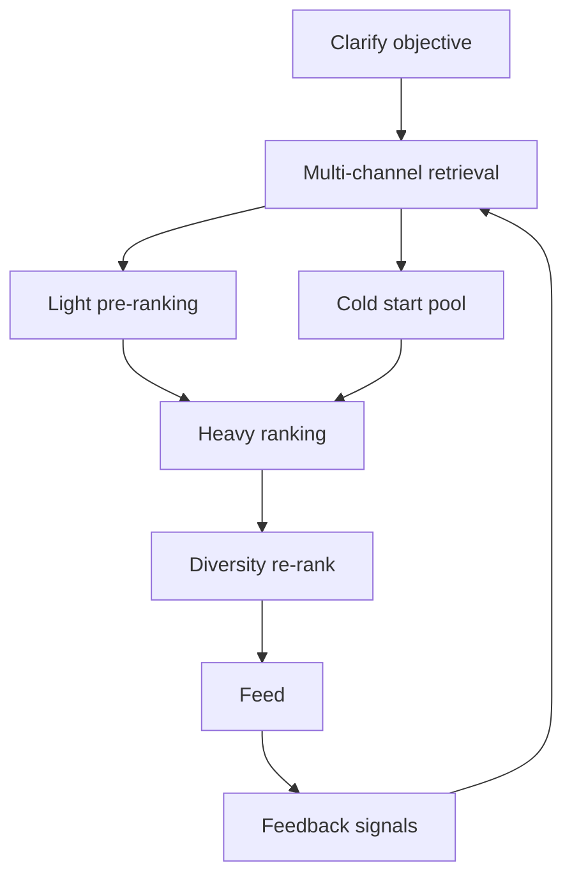

### Follow-ups

- What method do you use to set multi-objective weights? (Business formula vs. learned fusion)

- What method do you use to define positive/negative samples? (Completion threshold; does a quick swipe count as negative?)

- Explore one more angle: training data time window and label delay - how do you handle them?

## Architect the Retrieval and Ranking Stack for Search

[View this question on DeepOffer](https://getdeepoffer.com/questions/design-search-ranking.html)

**Source / companies:** Reported in public interview compilations — Google, Amazon, Meta

**Interview type:** Recommender Systems

**Tag:** confirmed

### Answer

<b>Query understanding first</b>: Tokenization, spell correction, rewriting, synonym expansion, intent classification. If the query is wrong, everything after it is wrong.

<b>Retrieval</b>: Inverted index (BM25) as the relevance floor plus vector retrieval for semantic matching. Merge and dedupe channels.

<b>Relevance labels</b>: Human labels set the scale (graded relevance). Click data provides large-scale weak supervision - but clicks have position bias, which must be corrected (inverse propensity weighting; position features in a two-tower setup that are not used online).

<b>Ranking</b>: Explain pointwise / pairwise / listwise tradeoffs in learning-to-rank. Final ranking fuses relevance, quality, freshness, and personalization - with a hard relevance floor that personalization cannot override.

### Mermaid diagram

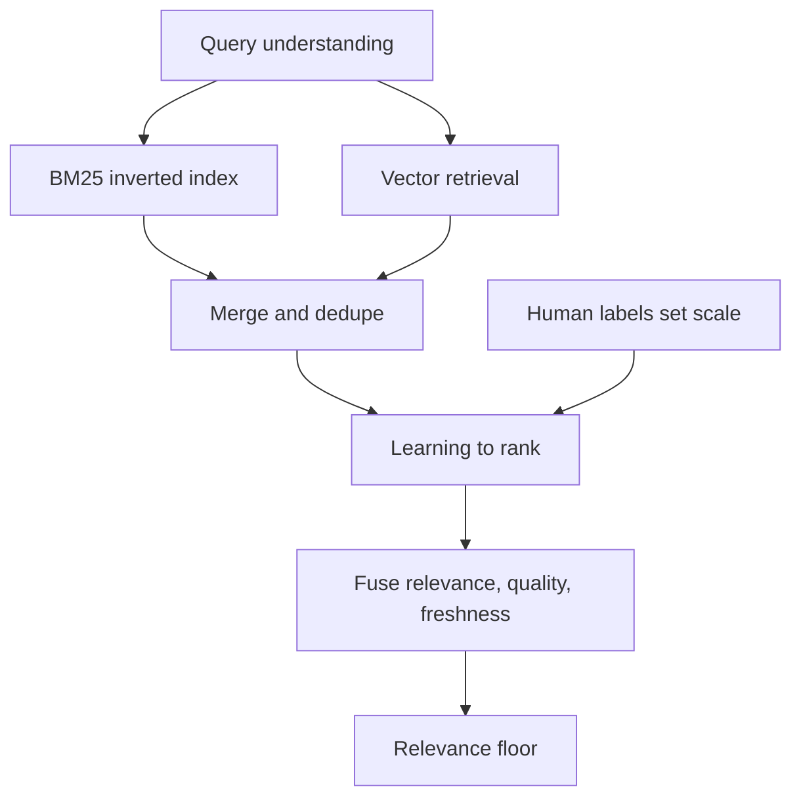

### Follow-ups

- What method do you use to correct position bias?

- Explore one more angle: long-tail queries have no click data - what do you do?

- What method do you use to evaluate a ranking change? (Human eval + interleaving + A/B)

## Architect a Low-Latency Model for Predicting Ad Click Probability

[View this question on DeepOffer](https://getdeepoffer.com/questions/design-ad-ctr-prediction.html)

**Source / companies:** Reported in public interview compilations — Google, Meta

**Interview type:** Ads & CTR

**Tag:** confirmed

### Answer

<b>Business constraints first</b>: Millisecond latency (online inference often under 10-50ms), massive request volume, and scores that go directly into bidding - so calibration matters as much as ranking.

<b>High-dimensional sparse features</b>: User / ad / context ID features become embeddings. Explain feature crossing evolution from FM to DeepFM/DIN and what each generation solves.

<b>Calibration</b>: Model output must map to true CTR (Platt scaling / isotonic / per-segment calibration), otherwise the bidding system systematically overpays or underpays.

<b>Freshness</b>: Streaming sample joins (impression-click join with click delay and attribution windows), near-real-time online learning for distribution drift, and probability correction after negative downsampling.

### Mermaid diagram

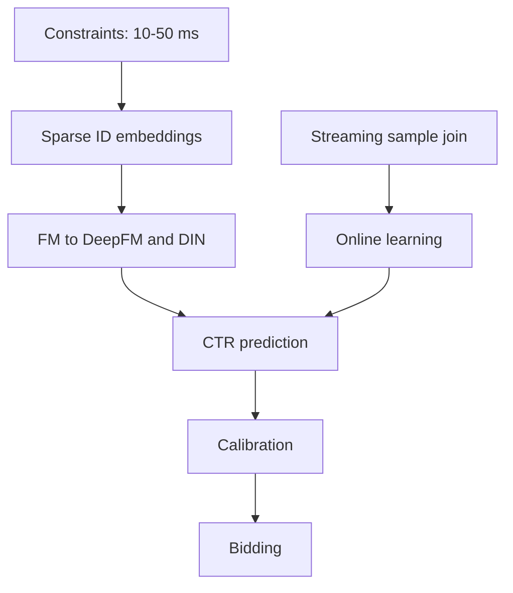

### Follow-ups

- For what reason correct probabilities after negative downsampling?

- As a follow-up, consider this: clicks can convert hours later - how do you handle delayed feedback?

- What method do you use to cold-start a new ad?

## Architect a Customer-Support Assistant Grounded in Company Knowledge

[View this question on DeepOffer](https://getdeepoffer.com/questions/design-llm-customer-service.html)

**Source / companies:** Reported in public interview compilations — Uber, Netflix, LinkedIn, Airbnb, Pinterest, Spotify, Sierra

**Interview type:** Conversational AI & Agents

**Tag:** confirmed

### Answer

<b>RAG vs. fine-tuning boundary first</b>: Frequently updated knowledge and enterprise docs go to RAG. Fixed style/format tasks go to fine-tuning. Most customer service is RAG-first with light fine-tuning as backup. Explaining this tradeoff matters more than stacking solutions.

<b>Retrieval quality is the bottleneck</b>: Chunk by semantic paragraphs, keep heading hierarchy, hybrid retrieval (keyword + vector), reranker on top. Build the retrieval eval set first - without it you cannot tune the pipeline.

<b>Hallucination control</b>: Force citations in answers, refuse or hand off to humans when there is no evidence, and route critical actions (refunds, order changes) through deterministic tool calls instead of free-form generation.

<b>Evaluation</b>: Layered eval - retrieval recall, answer faithfulness, end-to-end task resolution rate, plus human sampling. Online, watch handoff rate and first-contact resolution, not BLEU.

### Mermaid diagram

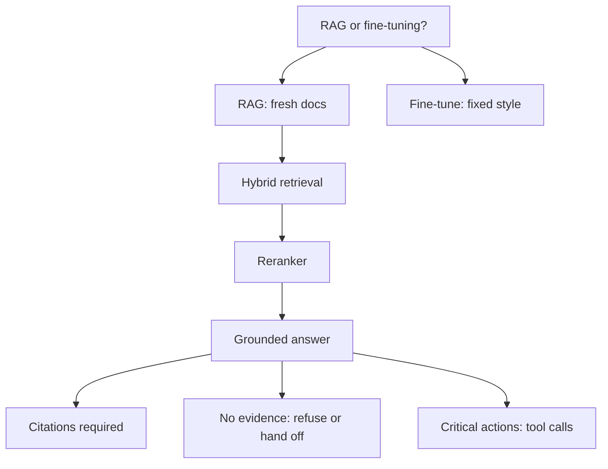

### Follow-ups

- As a follow-up, consider this: documents update - how do you refresh the index incrementally?

- Explore one more angle: user questions are colloquial with lots of pronouns - how do you rewrite queries for retrieval?

- What method do you use to control cost and latency? (Small-model routing, caching)

## Architect Monitoring and Alerts for a Production Model

[View this question on DeepOffer](https://getdeepoffer.com/questions/design-model-monitoring-alerting.html)

**Source / companies:** Reported in public interview compilations — Uber, Netflix, LinkedIn, Airbnb, Pinterest, Spotify

**Interview type:** ML Platform

**Tag:** confirmed

### Answer

<b>Four monitoring layers</b>: Input data (schema, missing rate, distribution), features (online/offline consistency), prediction output (score distribution, confidence), and business outcomes (real metrics when delayed labels arrive).

<b>Drift detection</b>: PSI / KS tests for numeric features, chi-square or distribution distance for categorical, overall shift for embeddings. Thresholds are tiered by feature importance - not every drift deserves an alert.

<b>Label delay</b>: Real labels arrive hours to days later. Run proxy signals (prediction distribution, weak feedback) alongside rolling evaluation on delayed labels. Be explicit about which layer is real-time and which is lagging.

<b>Alerting and response</b>: Tiered alerts to avoid alert fatigue, automatic rollback to the previous model or rule fallback, and one-click drill-down for drift attribution (which traffic segment / which feature moved first).

### Mermaid diagram

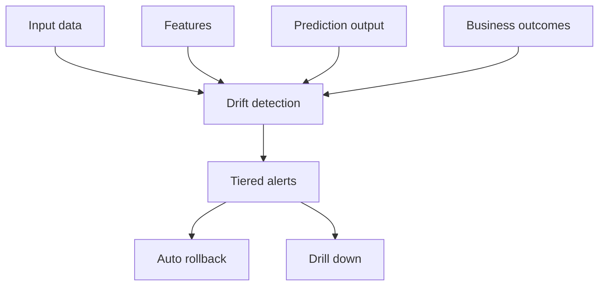

### Follow-ups

- What method do you use to set PSI thresholds? (Where do 0.1 / 0.25 come from?)

- As a follow-up, consider this: you detect drift but business metrics are flat - do you act?

- What method do you use to run champion-challenger canary releases?

## Architect a Shared Platform for Creating and Serving Features

[View this question on DeepOffer](https://getdeepoffer.com/questions/design-feature-platform.html)

**Source / companies:** Reported in public interview compilations — Uber, Netflix, LinkedIn, Airbnb, Pinterest, Spotify

**Interview type:** ML Platform

**Tag:** hot

### Answer

<b>Problems to solve first</b>: Duplicate feature work, online/offline inconsistency, and training-serving skew (point-in-time misalignment). The platform's value is these three things.

<b>Dual storage</b>: Offline store (data warehouse / lakehouse, time-partitioned history for training and backfills) plus online KV (low-latency point lookups for inference). One feature definition, written to both.

<b>Point-in-time correctness</b>: When building training samples, you must look up the feature value as of the sample timestamp - otherwise you leak the future. This is the core and hardest part to explain well.

Governance: feature registry and lineage, versioning, freshness SLAs, and reuse rate. Interviewers want to hear not just storage, but who uses it and how you prevent it from rotting.

### Mermaid diagram

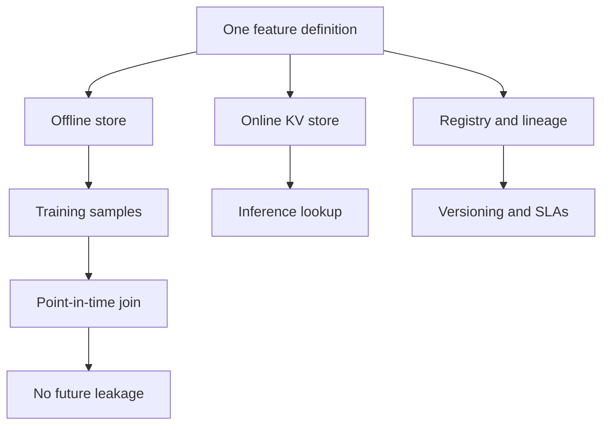

### Follow-ups

- As a follow-up, consider this: how do streaming features (like real-time click sequences) enter the platform?

- What method do you use to detect feature leakage/skew online?

- As a follow-up, consider this: build vs. buy (Feast / Tecton)

## Architect an Experimentation Platform with Sound Assignment and Analysis

[View this question on DeepOffer](https://getdeepoffer.com/questions/design-ab-testing-platform.html)

**Source / companies:** Reported in public interview compilations — Rapyd, Renew Power, Buffer

**Interview type:** Experimentation

**Tag:** hot

### Answer

<b>Splitting</b>: Hash user ID into buckets. Experiments are either mutually exclusive (layered orthogonal) or allowed to overlap. Assignment must be stable (same user, same group) and connected to the feature system.

<b>Sample size</b>: Fix baseline rate, minimum detectable effect (MDE), significance level, and power, then back out per-group sample size and runtime. Underestimating MDE is the top reason experiments drag on.

<b>Analysis</b>: SRM check first (if the actual split deviates from expected, the splitter or logging is broken - check that before results), multiple-metric correction, sequential testing to prevent p-value peeking.

Business side: run long enough to cover weekend effects, separate primary metrics from guardrails, and document negative results too.

### Mermaid diagram

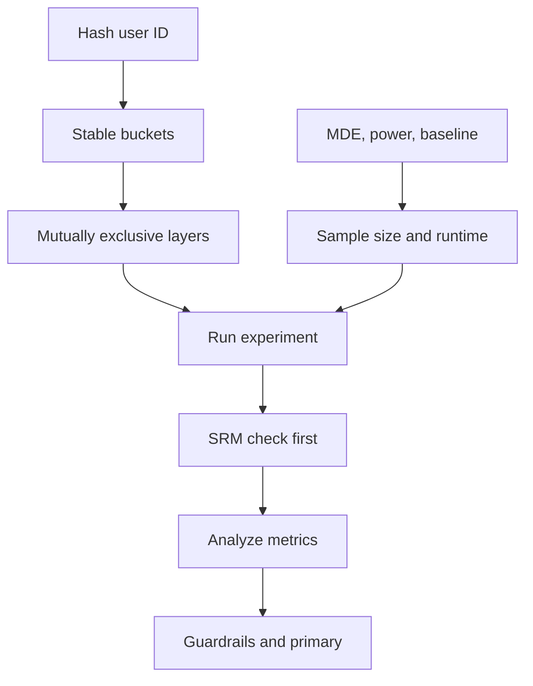

### Follow-ups

- For what reason is p-value peeking dangerous, and how do you prevent it?

- As a follow-up, consider this: experiment results conflict with business intuition - what do you do?

- Explore one more angle: split by user or by device?

## Architect Approximate Retrieval Over More Than 100 Million Embeddings

[View this question on DeepOffer](https://getdeepoffer.com/questions/design-embedding-retrieval-ann.html)

**Source / companies:** Reported in public interview compilations — Cohere

**Interview type:** Retrieval & RAG

**Tag:** hot

### Answer

<b>Brute force does not work</b>: 100M vectors times full inner product per query blows up latency and cost. You need approximate nearest neighbor (ANN) - trade a little recall for orders of magnitude in speed.

<b>Index choices</b>: IVF (cluster into buckets, search only nearby buckets) as the base, PQ to compress vectors and save memory, HNSW graph index for high recall at high memory cost. Explain the recall/latency/memory tradeoff for each.

<b>System side</b>: Sharding and replication, incremental index updates (new items go to a hot table, merged on offline rebuild), and inner product vs. cosine (normalization matters).

Report all three acceptance metrics together: recall@K against brute-force ground truth, P99 latency, and cost per QPS - not just speed.

### Mermaid diagram

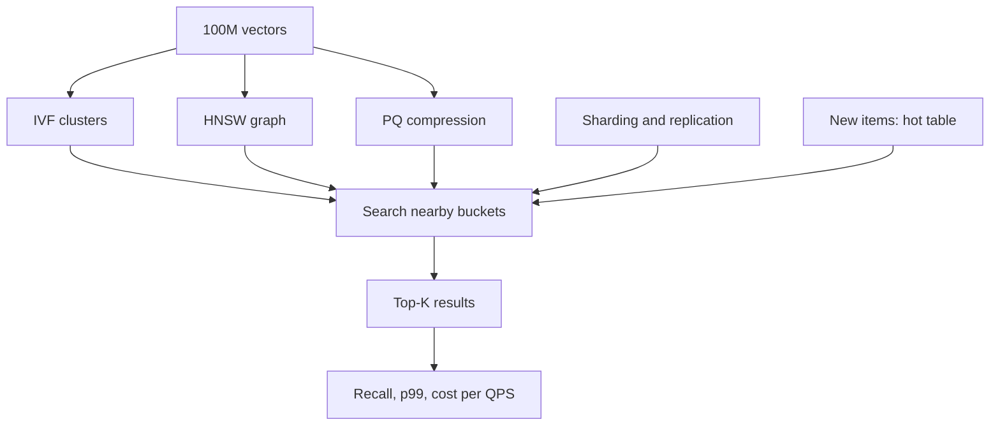

### Follow-ups

- For what reason is the two-tower model a good fit for vector retrieval?

- Explore one more angle: vectors updated but the index is stale - what do you do?

- What method do you use to choose between HNSW and IVF-PQ?

## Architect a Production Service for Autoregressive LLM Generation

[View this question on DeepOffer](https://getdeepoffer.com/questions/design-llm-inference-serving.html)

**Source / companies:** Reported in public interview compilations — Anthropic, OpenAI, Google, Meta

**Interview type:** LLM Inference & Serving

**Tag:** hot

### Answer

<b>Start with the bottleneck</b>: Autoregressive decoding is memory-bound. Each step computes one token; GPU compute sits idle while memory bandwidth is saturated. The whole design revolves around how to batch requests together.

<b>Batching</b>: Continuous batching joins requests at the token level instead of waiting for a whole batch (static batching), multiplying throughput. Prefill (compute-heavy) and decode (memory-heavy) can be deployed separately.

<b>KV cache management</b>: Paged attention allocates cache in pages to kill fragmentation; prefix cache reuses computation for shared prefixes (like system prompts).

<b>Serving layer</b>: Streaming responses cut time-to-first-token; SLO-tiered routing sends simple requests to small models; rate limiting and queueing. Judge by TTFT, TPOT, and tokens per dollar - all three.

### Mermaid diagram

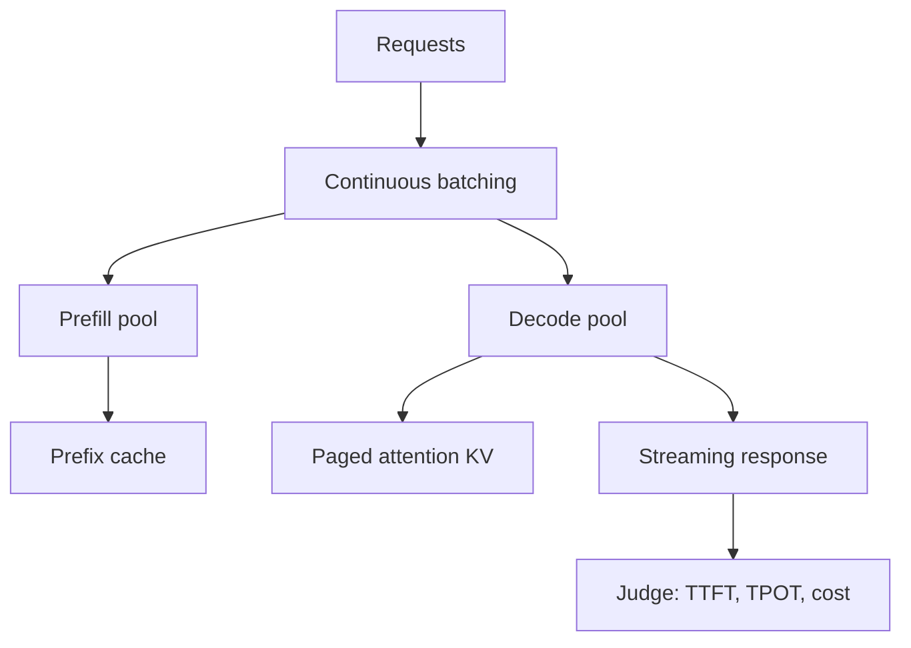

### Follow-ups

- As a follow-up, consider this: a very long-context request drags down the batch - how do you handle it?

- What method do you use to evaluate quantization (INT8/INT4) quality impact?

- As a follow-up, consider this: load balancing across replicas - how?

## Contrast the prefill and decode phases and explain why prefill is compute-bound while decode is memory-bandwidth-bound.

[View this question on DeepOffer](https://getdeepoffer.com/questions/reported-124-contrast-the-prefill-and-decode-phases-and-explain-why-prefill-is-comput.html)

**Source / companies:** Reported in public interview compilations — Moonshot AI, NVIDIA, Together AI

**Interview type:** LLM Inference & Serving

**Tag:** reported

**Source link:** <https://github.com/garliatsai/ai-engineering-interview-questions-company-wise>

### Answer

Prefill processes all prompt tokens in parallel and is usually matrix-multiply compute bound. Decode adds one token at a time while reading large weights and KV state, so memory bandwidth and batching dominate.

Make interfaces and ownership explicit; add versioning, access control, monitoring, canary rollout, rollback, and a plan for delayed labels or human review.

### Mermaid diagram

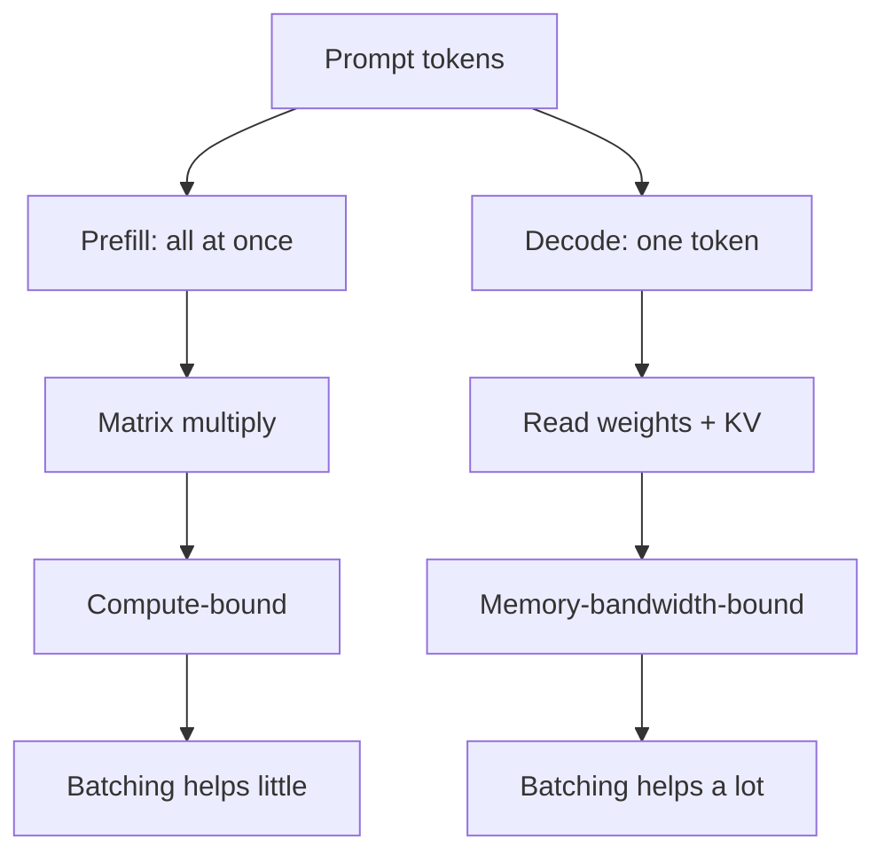

### Follow-ups

- What data or access-control failure is most dangerous?

- Which metric belongs on the first dashboard?

## Explain continuous (in-flight) batching and why it replaced static batching.

[View this question on DeepOffer](https://getdeepoffer.com/questions/reported-125-explain-continuous-in-flight-batching-and-why-it-replaced-static-batchin.html)

**Source / companies:** Reported in public interview compilations — Anthropic, xAI, Mistral AI, NVIDIA, Together AI

**Interview type:** LLM Inference & Serving

**Tag:** reported

**Source link:** <https://github.com/garliatsai/ai-engineering-interview-questions-company-wise>

### Answer

Continuous batching admits and retires requests at token boundaries instead of waiting for a static batch to finish. It improves device utilization and tail latency but needs careful scheduling, memory accounting, and fairness.

Make interfaces and ownership explicit; add versioning, access control, monitoring, canary rollout, rollback, and a plan for delayed labels or human review.

### Mermaid diagram

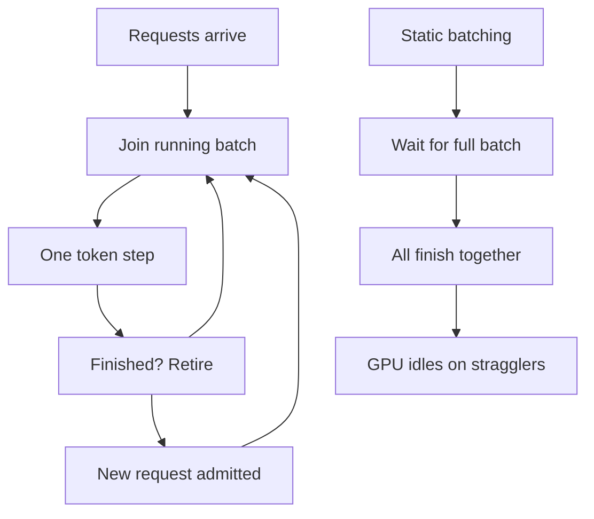

### Follow-ups

- Which SLO drives the architecture most strongly?

- What is your rollback trigger?

## Explain PagedAttention and the KV-cache fragmentation problem it solves.

[View this question on DeepOffer](https://getdeepoffer.com/questions/reported-126-explain-pagedattention-and-the-kv-cache-fragmentation-problem-it-solves.html)

**Source / companies:** Reported in public interview compilations — NVIDIA, Together AI

**Interview type:** LLM Inference & Serving

**Tag:** reported

**Source link:** <https://github.com/garliatsai/ai-engineering-interview-questions-company-wise>

### Answer

PagedAttention maps logical KV blocks to noncontiguous physical pages, much like virtual memory. It reduces fragmentation, enables prefix sharing and copy-on-write, and lets the scheduler pack more sequences safely.

Make interfaces and ownership explicit; add versioning, access control, monitoring, canary rollout, rollback, and a plan for delayed labels or human review.

### Mermaid diagram

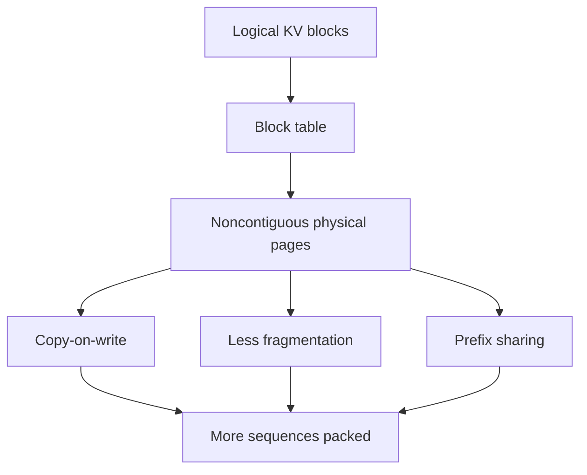

### Follow-ups

- What becomes the first bottleneck at 10× traffic?

- How do you obtain trustworthy ground truth?

## Explain speculative decoding: why output quality is preserved and when it does not help.

[View this question on DeepOffer](https://getdeepoffer.com/questions/reported-127-explain-speculative-decoding-why-output-quality-is-preserved-and-when-it.html)

**Source / companies:** Reported in public interview compilations — NVIDIA, Together AI

**Interview type:** LLM Inference & Serving

**Tag:** reported

### Answer

A small draft model proposes several tokens and the target model verifies them in parallel; rejection sampling preserves the target distribution. Speedup depends on acceptance rate and verification cost, so a poor draft or short outputs may lose.

Make interfaces and ownership explicit; add versioning, access control, monitoring, canary rollout, rollback, and a plan for delayed labels or human review.

### Mermaid diagram

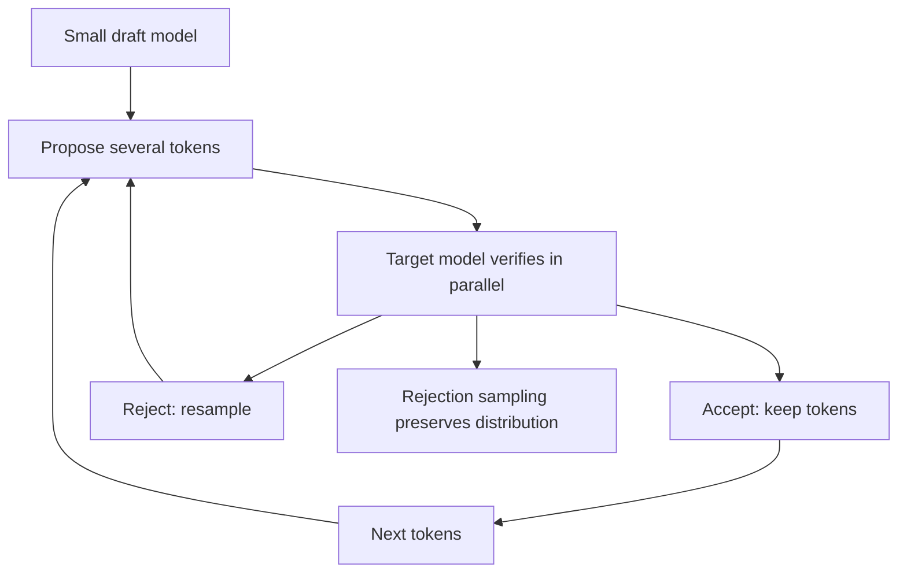

### Follow-ups

- Which component would you build first as the baseline?

- How would you test a migration safely?

## Explain prefix/prompt caching: when to use it and what invalidates a cached prefix.

[View this question on DeepOffer](https://getdeepoffer.com/questions/reported-128-explain-prefix-prompt-caching-when-to-use-it-and-what-invalidates-a-cach.html)

**Source / companies:** Reported in public interview compilations — Moonshot AI, Character.AI

**Interview type:** LLM Inference & Serving

**Tag:** reported

### Answer

Prefix caching reuses KV states for identical prompt prefixes. It helps shared system prompts and repeated documents; any token, position, model version, adapter, or decoding context that changes the computed states invalidates the entry.

Make interfaces and ownership explicit; add versioning, access control, monitoring, canary rollout, rollback, and a plan for delayed labels or human review.

### Mermaid diagram

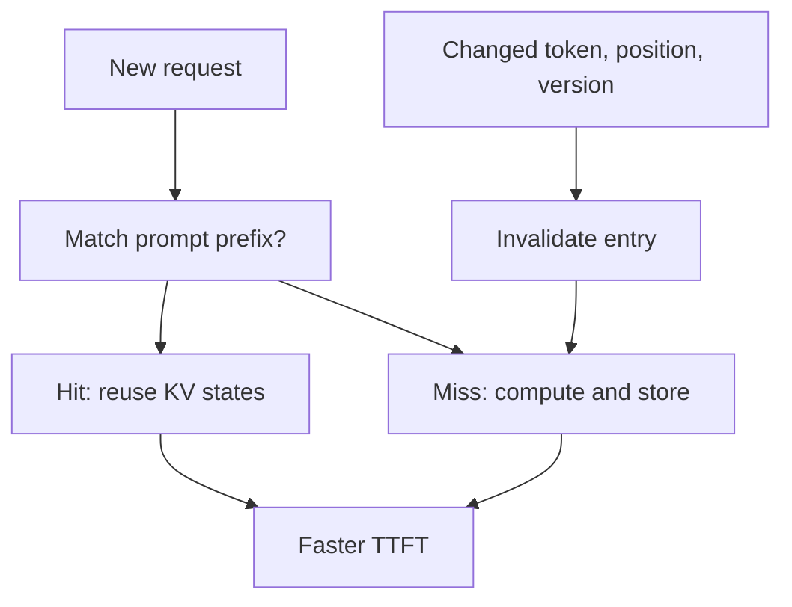

### Follow-ups

- What data or access-control failure is most dangerous?

- Which metric belongs on the first dashboard?

## Compare FP16, BF16, FP8, INT8, INT4, and FP4 for serving and name what breaks at each step down.

[View this question on DeepOffer](https://getdeepoffer.com/questions/reported-129-compare-fp16-bf16-fp8-int8-int4-and-fp4-for-serving-and-name-what-breaks.html)

**Source / companies:** Reported in public interview compilations — Mistral AI, Apple, NVIDIA, Together AI, Character.AI

**Interview type:** LLM Inference & Serving

**Tag:** reported

### Answer

<b>FP16 vs BF16 is a range-versus-precision trade:</b> FP16 (1 sign, 5 exponent, 10 mantissa bits) reaches only about $6\times10^{-5}$ to 65,504 with roughly 3 decimal digits, so large activations and accumulated sums overflow or underflow unless you add loss scaling and keep master weights in FP32; BF16 (1 sign, 8 exponent, 7 mantissa bits) keeps the full FP32 exponent range, about $1\times10^{-38}$ to $3\times10^{38}$, so it almost never overflows, but its roughly 2-3 decimal digits round small weight updates and long accumulations away — which is why BF16 is the safe default for serving weights and KV cache, while FP16 survives only where values are known to stay in range.

<b>FP8 halves memory and doubles tensor-core throughput over BF16, but only with scaling:</b> FP8 comes in two flavors, E4M3 (max about 448, finer steps) for weights and activations and E5M2 (max about 57,344, coarser steps) where range matters; in practice you scale each tensor or each block of 32-128 elements by its observed maximum, often recomputed per batch. What breaks is anything with outliers: a single huge activation channel forces the whole tensor's scale down and crushes small values to zero, and static scales calibrated on one dataset go stale on shifted inputs, so FP8 needs per-token activation scaling or microscaling to hold quality on long-tail prompts.

<b>INT8 is the integer cousin of FP8 with different failure modes:</b> weights are typically quantized per output channel and activations per token, symmetric (zero point 0) or asymmetric (with a zero point) depending on whether the distribution is centered. A 70B model drops from 140 GB in BF16 to about 70 GB in INT8, and integer tensor cores are fast, but INT8 breaks on activation outliers far more harshly than FP8 because integers have no exponent to absorb a 100x outlier channel — the standard fixes are smoothing outliers into weights, clipping, or keeping a handful of outlier channels in higher precision.

<b>INT4 and FP4 are the quality cliff, not a free 4x:</b> INT4 stores a 70B model in roughly 35 GB plus small scale tables, and FP4 (usually E2M1, with a tiny representable range) is similar in size, but both quantize in small groups of 32-128 weights with a shared scale, using methods that compensate for quantization error weight-by-weight. What breaks first is reasoning, code, and math, then small models generally: a 70B model often loses only a little on general chat at INT4 groupwise, while a 7B model at the same setting can collapse, and naive per-tensor INT4 without grouping is unusable — perplexity explodes because a single scale cannot cover a group's full dynamic range.

<b>The ladder, in one line each:</b> BF16 is the no-surprises baseline; FP8 is the first step down that keeps most quality if you scale per block and watch outliers; INT8 matches FP8 on size but demands outlier handling; INT4/FP4 buys another 2x over FP8 and is where you must accept measurable quality loss, verify it on your own evals (not just perplexity), and keep the most sensitive layers — typically the embedding-adjacent and final layers — in higher precision.

### Mermaid diagram

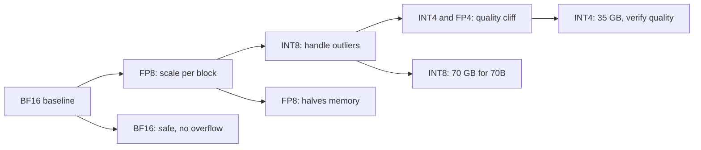

### Follow-ups

- You serve a model whose activations have one channel 100x larger than the rest. Which format in this ladder fails first, and what would you measure to prove the outlier — not the format in general — is the culprit?

- Your FP8 model passes perplexity but fails on multi-step math. Which part of the FP8 pipeline would you suspect first — the weight scale, the activation scale, or the accumulation precision — and what experiment separates them?

- A vendor claims INT4 with no quality loss on your 7B model. What two evals, beyond perplexity, would you run before believing it, and what degradation threshold would make you reject the claim?

## Compare tensor, pipeline, data, sequence, and expert parallelism and explain when to combine them.

[View this question on DeepOffer](https://getdeepoffer.com/questions/reported-130-compare-tensor-pipeline-data-sequence-and-expert-parallelism-and-explain.html)

**Source / companies:** Reported in public interview compilations — Google DeepMind, Meta, Amazon, NVIDIA

**Interview type:** ML Platform

**Tag:** reported

### Answer

<b>Data parallelism (DP):</b> every GPU holds a full copy of the model and processes a different slice of the batch; the only cross-GPU traffic is an all-reduce of gradients (or parameters) once per step, so its cost scales with model size, not with activations. It wins when the model fits comfortably on one GPU and you just want more throughput — but it stops helping once a single replica no longer fits in memory, and it wastes memory on redundant optimizer state unless you shard that state (ZeRO-style).

<b>Tensor parallelism (TP):</b> each layer's weight matrices are sharded across GPUs within a node, so a single matrix multiply is split column-wise then row-wise, with an all-reduce of partial activations after every sharded layer — typically two all-reduces per transformer block. That makes TP communication-heavy and latency-sensitive, which is why it lives inside a node on NVLink rather than across nodes; it wins when one layer's weights or activations alone exceed a GPU, and it shrinks per-GPU memory roughly by the TP degree at the price of the fastest interconnect you have.

<b>Pipeline parallelism (PP):</b> consecutive layers are assigned to different GPUs, so each device holds only its stage's weights and passes activations to the next stage, point-to-point, once per micro-batch. Communication is cheap and infrequent, but the pipeline drains and fills at every step — the 'bubble' — so efficiency depends on splitting each batch into many micro-batches (roughly 4–8× the number of stages) and on balancing stage runtimes; it wins when the model is deep enough that stages are meaty and the bubble fraction stays small.

<b>Sequence parallelism (SP):</b> the sequence dimension itself is sharded, so no single GPU holds a full sequence's activations — the attention and normalization blocks operate on sequence shards, with communication concentrated at layer-norm and attention boundaries rather than after every matmul. It wins specifically for very long contexts (tens to hundreds of thousands of tokens), where activations, not weights, are what blow up memory; it is usually paired with TP, sharing the same device group, because the two shard complementary dimensions of the same computation.

<b>Expert parallelism (EP):</b> in a mixture-of-experts model, different experts live on different GPUs and tokens are routed to the devices holding their assigned experts via all-to-all communication, whose volume scales with the number of tokens times hidden size times the experts each token touches. It wins when the expert count is large and routing is reasonably balanced; its failure mode is load imbalance — a hot expert (or a skewed token distribution) leaves some GPUs idle while others queue, which is why EP is paired with capacity factors, token dropping, or auxiliary load-balancing losses.

<b>Combining them:</b> production training is almost always a 3D or 4D mix — DP across replicas, TP within a node, PP across nodes, EP across expert groups, SP when context is long — and the ordering matters: put the most communication-hungry form (TP) on the fastest links, keep PP stages balanced so the bubble stays under ~10–20% of step time, and size DP last so the global batch still lands on a sensible number of optimizer steps. A good interview answer names the bottleneck each form attacks (memory vs throughput vs sequence length) and checks the combination against interconnect bandwidth before claiming it scales.

### Mermaid diagram

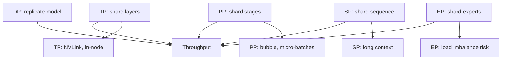

### Follow-ups

- You have 8 GPUs in one node with NVLink and a 70B model that fits on 2 GPUs with activation checkpointing. Sketch the TP/PP/DP split you would start with and say what measurement would make you change it.

- Your MoE training step shows one GPU at 100% utilization and the rest at 40%. Walk through how you would tell whether the cause is expert imbalance, a slow all-to-all, or a straggler stage.

- At what sequence length does sequence parallelism start to pay for itself, and what breaks first if you turn it on for short sequences instead?

## Estimate the GPU memory needed to serve a 70B model, accounting for weights, KV cache, activations, and fragmentation.

[View this question on DeepOffer](https://getdeepoffer.com/questions/reported-131-estimate-the-gpu-memory-needed-to-serve-a-70b-model-accounting-for-weigh.html)

**Source / companies:** Reported in public interview compilations — NVIDIA

**Interview type:** LLM Inference & Serving

**Tag:** reported

### Answer

PagedAttention maps logical KV blocks to noncontiguous physical pages, much like virtual memory. It reduces fragmentation, enables prefix sharing and copy-on-write, and lets the scheduler pack more sequences safely.

Make interfaces and ownership explicit; add versioning, access control, monitoring, canary rollout, rollback, and a plan for delayed labels or human review.

### Mermaid diagram


### Follow-ups

- Which component would you build first as the baseline?

- How would you test a migration safely?

## Define TTFT, TPOT, ITL, and throughput, and explain how they trade against each other.

[View this question on DeepOffer](https://getdeepoffer.com/questions/reported-132-define-ttft-tpot-itl-and-throughput-and-explain-how-they-trade-against-e.html)

**Source / companies:** Reported in public interview compilations — Microsoft, Apple, Perplexity

**Interview type:** LLM Inference & Serving

**Tag:** reported

### Answer

<b>TTFT (time to first token)</b> is the prefill phase: the time from request arrival until the first output token appears. For a 2,000-token prompt on a 70B model, prefill does $2\times70\times10^9\times2{,}000=280\text{ TFLOP}$ of work; at a realized ~500 TFLOPS that is ~0.56 s, so TTFT is dominated by prompt length and by how long the request waits in the prefill queue, not by decode speed.

<b>TPOT (time per output token) and ITL (inter-token latency)</b> are nearly the same number in steady decode: the time between consecutive tokens. At batch size 1 on one H100, one decode step reads all 140 GB of 70B BF16 weights at ~3.35 TB/s, so TPOT is about $140/3{,}350=0.042\text{ s}$, or ~42 ms per token, before any queueing or kernel overhead. ITL is just TPOT as the user experiences it, including scheduling gaps.

<b>End-to-end latency is $\mathrm{TTFT}+(n-1)\times\mathrm{TPOT}$.</b> A 200-token answer with TTFT 0.6 s and TPOT 42 ms takes $0.6+199\times0.042=8.96\text{ s}$. That split tells you where to optimize: for short answers TTFT dominates, so prefix caching and faster prefill matter most; for long answers TPOT dominates, so batching and decode efficiency matter most.

<b>Throughput is tokens per second across all concurrent requests, and it trades directly against TPOT.</b> Raising the batch from 1 to 64 on that same H100 pushes a decode step from ~42 ms to roughly ~90 ms (weights are read once for 64 tokens instead of once per token), so throughput jumps from $1/0.042=24\text{ tok/s}$ to $64/0.090=711\text{ tok/s}$, a ~30x gain, while each individual user's TPOT more than doubles from 42 ms to 90 ms.

<b>The three-way tension is queueing.</b> Continuous batching plus chunked prefill lets a server admit a new request mid-decode instead of waiting for a batch to finish, which cuts TTFT at high load; but every admitted request lengthens the next decode step, so beyond some batch size (often 64-256 for 70B on H100s) TPOT rises faster than throughput, p99 latency blows up, and the right move is to shed load or add replicas rather than grow the batch further.

### Mermaid diagram

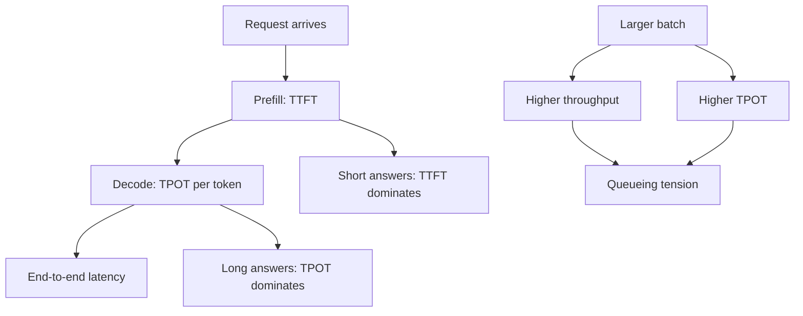

### Follow-ups

- A user complains that the first token arrives fast but the stream then stutters. Which metric do you look at first, and what would a TPOT of 40 ms with an ITL p99 of 400 ms tell you about scheduling gaps versus raw decode speed?

- Your TTFT p99 tripled after you enabled chunked prefill. Walk through why splitting a 4,000-token prompt into 512-token chunks could make TTFT worse for that prompt even while average throughput improves.

- Design an experiment that separates queueing delay from service time: which two timestamps do you log per request, and what would you conclude if TTFT rose 3x while prefill compute time stayed flat?

## Do the roofline math: how many tokens/sec can one H100 produce for a 70B model at batch size 1?

[View this question on DeepOffer](https://getdeepoffer.com/questions/reported-133-do-the-roofline-math-how-many-tokens-sec-can-one-h100-produce-for-a-70b.html)

**Source / companies:** Reported in public interview compilations — NVIDIA, Together AI

**Interview type:** LLM Inference & Serving

**Tag:** reported

### Answer

<b>Start from the H100's two ceilings.</b> An H100 SXM offers about 989 TFLOPS of dense BF16 compute and about 3.35 TB/s of HBM bandwidth, so the ridge point is $\frac{989\times10^{12}}{3.35\times10^{12}}=295\text{ FLOPs per byte}$: any workload below 295 FLOP/byte is memory-bound, above it is compute-bound.

<b>Decode at batch size 1 is brutally memory-bound.</b> One token needs $2\times70\times10^9=140\text{ GFLOP}$ of matrix math and must stream all 140 GB of BF16 weights, giving an arithmetic intensity of $\frac{140\times10^9}{140\times10^9}=1\text{ FLOP/byte}$, far below the ridge. Time per token is therefore set by memory: $\frac{140\text{ GB}}{3.35\text{ TB/s}}=0.0418\text{ s}$, so the roofline ceiling is $1/0.0418=23.9\text{ tokens/s}$. The compute time for the same step, $\frac{140\times10^9}{989\times10^{12}}=0.00014\text{ s}$, is 300x smaller and irrelevant.

<b>Reality lands below the ceiling.</b> Achieved bandwidth is typically 70-85% of peak, and attention, sampling, and kernel-launch overhead add a few ms per step, so a realistic batch-1 decode rate is 15-20 tok/s rather than 24. If someone reports 100 tok/s for 70B on one H100 at batch 1, the number is wrong or the batch is not 1.

<b>Prefill flips to compute-bound.</b> A 1,000-token prompt does $2\times70\times10^9\times1{,}000=140\text{ TFLOP}$ while still reading the weights only once (140 GB), so intensity is $\frac{140\times10^{12}}{140\times10^9}=1{,}000\text{ FLOP/byte}$, above the ridge. Prefill time is $\frac{140\times10^{12}}{989\times10^{12}}=0.142\text{ s}$, i.e. about 7,000 prompt tokens/s, and here quantization or a smaller model does not help much because the bottleneck is FLOPs, not bytes.

<b>Batching moves decode toward the ridge.</b> At batch 32, one step produces 32 tokens for the same 140 GB weight read, so intensity is 32 FLOP/byte and the memory time is still ~42 ms per step, giving $32/0.042=762\text{ tok/s}$ in the roofline limit. That is why serving systems batch aggressively: batching is the only lever that amortizes the weight read, and it works until attention/KV traffic or the compute ceiling (batch ~300 at this intensity) takes over.

### Mermaid diagram

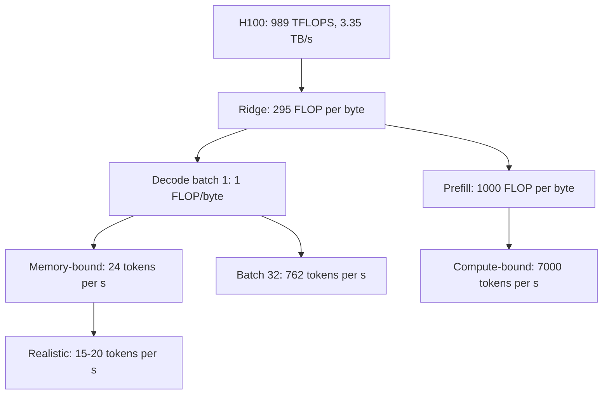

### Follow-ups

- Recompute the ceiling for the same 70B model quantized to FP8 (70 GB of weights). Which number changes, which stays the same, and why does the batch-1 rate roughly double while the prefill rate barely moves?

- Now add KV-cache traffic: at batch 64 with 8k-token contexts, how much KV data does one decode step read, and at what context length does KV traffic rival the 140 GB weight read?

- Your measured batch-1 rate is 12 tok/s, half the roofline. Name two measurements that would tell you whether the gap is bandwidth underutilization, kernel overhead, or something else entirely.

## Decide when to choose vLLM, SGLang, TensorRT-LLM, or a custom stack.

[View this question on DeepOffer](https://getdeepoffer.com/questions/reported-134-decide-when-to-choose-vllm-sglang-tensorrt-llm-or-a-custom-stack.html)

**Source / companies:** Reported in public interview compilations — NVIDIA, Together AI

**Interview type:** LLM Inference & Serving

**Tag:** reported

### Answer

<b>vLLM is the default for general-purpose LLM serving:</b> its PagedAttention eliminates KV-cache fragmentation so batching stays efficient under bursty, variable-length traffic, and its ecosystem (OpenAI-compatible API, broad model support, continuous batching, prefix caching, structured output) means most teams get to production fastest here. Choose it when you serve many different models or request shapes, iterate quickly, and value community support over squeezing the last 10–20% of latency or throughput.

<b>SGLang wins when your workload is structured or programmatic:</b> its RadixAttention reuses KV cache across requests sharing a prefix (system prompts, few-shot examples, multi-turn sessions), and its frontend language expresses multi-call programs (chaining, branching, constrained decoding) as first-class operations rather than round trips from your application. Choose it for agents, RAG pipelines, and eval harnesses where the same prompts recur and request logic is complex; its advantage shrinks on plain single-turn chat where prefix reuse is low.

<b>TensorRT-LLM wins when you have a fixed model, fixed hardware, and a hard latency or cost target:</b> it compiles the model into optimized engines for a specific GPU (fused kernels, tuned GEMM schedules, quantization support), which typically buys the best tokens-per-second-per-GPU and lowest time-to-first-token at the cost of a build step per model/hardware combination and slower support for brand-new architectures. Choose it for a stable production model on NVIDIA hardware where serving cost dominates engineering time — and budget for engine rebuilds on every model or driver update.

<b>A custom stack is justified only by a requirement none of the three meets:</b> exotic hardware or runtimes, a novel decoding algorithm (speculative decoding variants, custom sampling), tight coupling to an internal batching or scheduling system, or regulatory constraints on dependencies. The honest cost is owning kernel tuning, KV-cache management, continuous batching, and fault handling yourself — so the decision rule is to prototype on vLLM or SGLang first and only build custom once you can name the metric (e.g., p99 latency on your exact prompt mix) where the off-the-shelf engine demonstrably misses your target.

<b>Decision procedure:</b> start from the workload, not the engine — measure prompt-length distribution, prefix-sharing rate, latency SLOs, and how often models change. High prefix reuse points to SGLang; stable model plus cost pressure points to TensorRT-LLM; everything else points to vLLM; and any choice should be validated by benchmarking on your own traffic replay, since published tokens-per-second numbers rarely survive contact with your prompt mix.

### Mermaid diagram

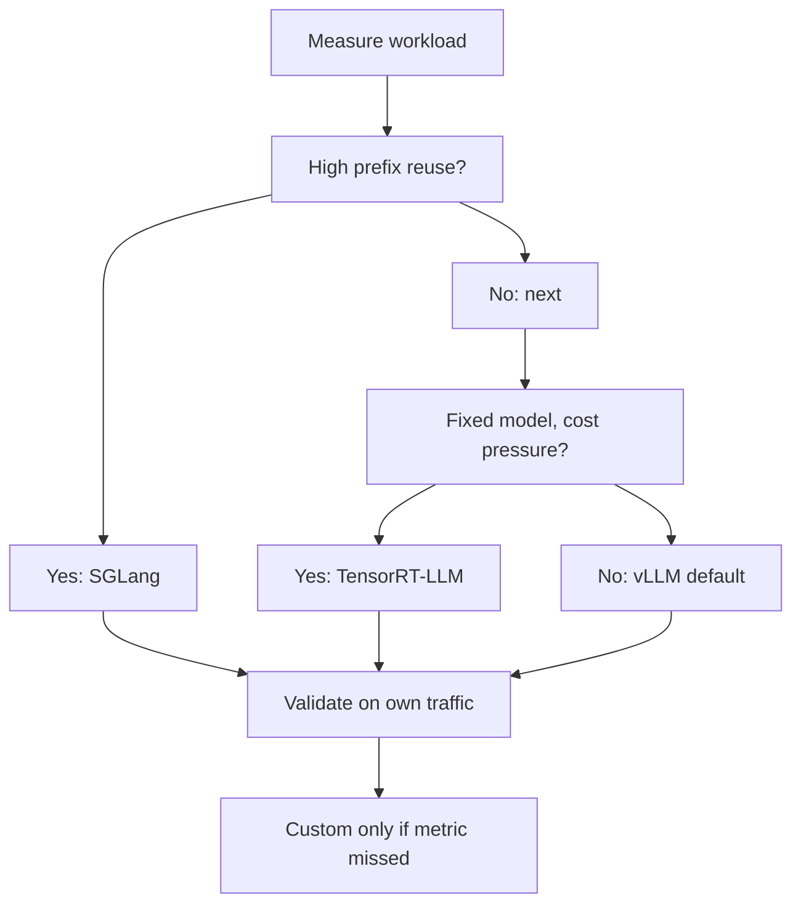

### Follow-ups

- Your agent workload makes 5 sequential LLM calls per user request with a shared 4K-token system prompt. Which engine would you pick, and what measurement would confirm the prefix-cache hit rate is actually paying off?

- You serve one 8B model on H100s and your cloud bill is dominated by serving cost. Walk through how you would decide whether TensorRT-LLM's build and maintenance overhead is worth it versus staying on vLLM.

- A new model architecture drops that none of these engines supports yet. What is your fallback serving plan for the first two weeks, and what would trigger building a custom path?

## Enumerate and rank every lever for cutting LLM serving cost by 10x.

[View this question on DeepOffer](https://getdeepoffer.com/questions/reported-135-enumerate-and-rank-every-lever-for-cutting-llm-serving-cost-by-10x.html)

**Source / companies:** Reported in public interview compilations — Microsoft, Amazon, NVIDIA, Cursor

**Interview type:** LLM Inference & Serving

**Tag:** reported

### Answer

<b>Rank 1 — serve a smaller or distilled model for most traffic:</b> cost per token scales roughly with parameters, so routing easy prompts from a 70B model to a well-distilled 8B model cuts compute about 8x on that traffic, dwarfing every infra trick. The honest version is a router or cascade: a small model answers first, and only low-confidence or hard prompts escalate. The catch is eval coverage — you must prove the small model holds quality on your actual traffic mix, not on a benchmark, or the savings are fake savings bought with wrong answers.

<b>Rank 2 — quantize and batch, the two multipliers that stack:</b> moving weights from BF16 to FP8 or INT4 roughly halves or quarters the bytes read per token, and since decode is memory-bandwidth-bound, that translates almost directly into tokens per GPU-second; continuous batching then fills the GPU so one weight read serves dozens of concurrent sequences instead of one. Together these commonly deliver 3-5x on real traffic, but they saturate: once the GPU is compute-bound during prefill or the KV cache fills, more batching adds latency without adding throughput.

<b>Rank 3 — stop paying for tokens you have already computed:</b> prefix caching reuses the KV cache for shared system prompts and repeated document prefixes, prompt caching across requests does the same across users, and response caching answers exact or near-duplicate prompts without invoking the model at all. On assistant traffic with long shared instructions these can remove 30-70% of prefill compute; they break down when every prompt is unique, when the cache key ignores a parameter that changes the answer, or when a stale cached answer is served after the underlying data changed.

<b>Rank 4 — speculative decoding and output-token reduction:</b> a small draft model proposes several tokens and the large model verifies them in one pass, which can roughly double decode speed when the draft agrees often — but it helps only if draft acceptance is high (typically above 60-70%), and it adds complexity and a second model to serve. Cheaper still is generating fewer tokens: shorter system prompts, structured outputs, and stopping rules that cut rambling answers often save 20-40% of output cost with no model change at all.

<b>Rank 5 — buy the GPU-hours cheaper and waste fewer of them:</b> spot or preemptible capacity, off-peak batch queues, autoscaling that actually scales to zero, and bin-packing models onto shared GPUs attack the price per GPU-hour and the utilization denominator rather than tokens per second. These deliver 30-60% on flexible workloads, but they are the wrong lever for latency-sensitive chat: preemption and cold starts show up directly as p99 spikes, so reserve them for offline, batch, or delay-tolerant traffic and keep interactive traffic on reserved capacity.

### Mermaid diagram

```mermaid
flowchart TD
    A["Rank 1: smaller model"] --> F["Biggest saving"]
    B["Rank 2: quantize and batch"] --> F
    C["Rank 3: reuse computed tokens"] --> F
    D["Rank 4: speculative decoding"] --> F
    E["Rank 5: cheaper GPU-hours"] --> F
    F --> G["10x cheaper serving"]
```

### Follow-ups

- You apply all five levers and measure only 3x instead of 10x. Which measurement would tell you whether the shortfall is a utilization problem, a cache-hit problem, or a routing problem?

- Your router sends 80% of traffic to the small model, but user complaints rise on exactly the prompts the router was most confident about. What does that pattern imply about your router's training data, and how would you fix it without abandoning routing?

- Prefix caching shows a 90% hit rate in staging but 15% in production. What differs between the two environments that could explain it, and what would you log to confirm?

## Your p99 latency doubled after a deploy with no model change — walk through the diagnosis.

[View this question on DeepOffer](https://getdeepoffer.com/questions/reported-136-your-p99-latency-doubled-after-a-deploy-with-no-model-change-walk-throug.html)

**Source / companies:** Reported in public interview compilations — OpenAI, Amazon, Databricks, Perplexity

**Interview type:** LLM Inference & Serving

**Tag:** reported

### Answer

<b>Split p99 into TTFT and TPOT before touching anything.</b> If p50 is flat at 3.0 s but p99 went from 6 s to 12 s, and the split shows TTFT p99 jumping from 1.0 s to 7.0 s while TPOT holds at 45 ms, the model is innocent and the prefill path or the queue is guilty. If instead TPOT p99 doubled to 90 ms, the decode step itself got slower, which points at batch size, KV pressure, or clocks. The split decides which half of the system you investigate.

<b>Diff the deploy against the serving config, not just the model.</b> The usual suspects that double p99 with zero model change: max concurrent sequences raised from 128 to 256 (decode step grows from ~60 ms to ~110 ms and queueing compounds), chunked-prefill size cut from 2,048 to 512 tokens (a 4,000-token prompt now needs 8 prefill rounds instead of 2), prefix-cache disabled or its block size changed (cache hit rate falling from 85% to 30% turns a 0.2 s cached prefill into a 1.5 s full prefill), and a quantization or kernel flag silently falling back to a slower path.

<b>Check the traffic mix, not just the code.</b> A p99 doubling with no deploy at all happens when average prompt length grows: moving from 1k to 4k mean prompt tokens quadruples prefill FLOPs per request ($2\times70\times10^9\times4{,}000=560\text{ TFLOP}$ versus 140 TFLOP), so prefill queueing grows roughly 4x at fixed capacity. Compare the prompt-length histogram and the requests-per-second before and after; if the 99th-percentile prompt went from 2k to 8k tokens, you have a capacity story, not a regression story.

<b>Check the hardware layer with numbers.</b> A GPU thermally throttling from 1,980 MHz to 1,200 MHz cuts both compute and effective bandwidth by ~40%, which alone pushes a 42 ms decode step toward 70 ms; a noisy neighbor sharing the host, a driver or CUDA version bump, or a switch from H100 to a slower SKU shows up as a uniform TPOT increase across all request shapes. Correlate per-GPU clock, temperature, and step time, and compare the same request shape on a canary running the old build.

<b>Confirm the fix with a controlled replay.</b> Re-run a fixed trace of 1,000 real requests from before the deploy against the new build and the old build on identical hardware: if new-build p99 is 12 s and old-build p99 is 6 s on the same trace, the deploy caused it; if both are 12 s, traffic or hardware changed. Roll back the single most suspicious config change first, re-measure, and only then reintroduce changes one at a time.

### Mermaid diagram

```mermaid
flowchart TD
    A["p99 doubled"] --> B["Split TTFT vs TPOT"]
    B --> C["TTFT up: prefill or queue"]
    B --> D["TPOT up: decode slower"]
    C --> E["Diff deploy config"]
    D --> E
    E --> F["Check traffic mix"]
    F --> G["Check hardware clocks"]
    G --> H["Replay 1000 requests"]
    H --> I["Rollback one change"]
```

### Follow-ups

- TTFT p99 doubled but TPOT and p50 are unchanged, and prompt lengths are flat. Which two config values do you diff first, and what would a prefix-cache hit rate dropping from 90% to 20% predict for TTFT on a 3,000-token repeated system prompt?

- The regression only appears between 18:00 and 20:00 daily. What does that time pattern rule out, and what load test would you run at noon to reproduce an evening-only p99 problem?

- Your canary on the old build also shows 12 s p99, but only on one of eight GPUs. Walk through how you would isolate whether that GPU is throttling, has a bad memory module, or is receiving a skewed share of long-context requests.

## Explain chunked prefill and why it improves tail latency under mixed traffic.

[View this question on DeepOffer](https://getdeepoffer.com/questions/pq-0178.html)

**Source / companies:** OpenAI

**Interview type:** LLM Inference & Serving

**Tag:** reported

### Answer

Prefill processes all prompt tokens in parallel and is usually matrix-multiply compute bound. Decode adds one token at a time while reading large weights and KV state, so memory bandwidth and batching dominate.

Make interfaces and ownership explicit; add versioning, access control, monitoring, canary rollout, rollback, and a plan for delayed labels or human review.

### Mermaid diagram

```mermaid
flowchart TD
    A["Long prompt arrives"] --> B["Split prefill into chunks"]
    B --> C["Chunk 1 runs"]
    C --> D["Decode step interleaved"]
    D --> C
    C --> E["All chunks done"]
    E --> F["Decode continues"]
    D --> G["Short requests not starved"]
    G --> H["Lower tail latency"]
```

### Follow-ups

- Which SLO drives the architecture most strongly?

- What is your rollback trigger?

## Explain disaggregated prefill/decode serving and when it pays for itself.

[View this question on DeepOffer](https://getdeepoffer.com/questions/reported-138-explain-disaggregated-prefill-decode-serving-and-when-it-pays-for-itself.html)

**Source / companies:** Reported in public interview compilations — Moonshot AI, Groq

**Interview type:** LLM Inference & Serving

**Tag:** reported

### Answer

Prefill processes all prompt tokens in parallel and is usually matrix-multiply compute bound. Decode adds one token at a time while reading large weights and KV state, so memory bandwidth and batching dominate.

Make interfaces and ownership explicit; add versioning, access control, monitoring, canary rollout, rollback, and a plan for delayed labels or human review.

### Mermaid diagram

```mermaid
flowchart TD
    A["Request arrives"] --> B["Prefill pool"]
    B --> C["Compute KV states"]
    C --> D["Ship KV to decode"]
    D --> E["Decode pool"]
    E --> F["Stream tokens"]
    B --> G["Scale prefill separately"]
    E --> H["Scale decode separately"]
    H --> I["Pays off: long context"]
    G --> I
```

### Follow-ups

- What becomes the first bottleneck at 10× traffic?

- How do you obtain trustworthy ground truth?

## Design a batched inference system in which 100 requests take the same time as one.

[View this question on DeepOffer](https://getdeepoffer.com/questions/reported-139-design-a-batched-inference-system-in-which-100-requests-take-the-same-ti.html)

**Source / companies:** Reported in a public interview report — Anthropic

**Interview type:** LLM Inference & Serving

**Tag:** reported

### Answer

<b>The core insight is that decode is a weight-read problem, not a compute problem:</b> generating one token from a 70B BF16 model requires reading about 140 GB of weights from GPU memory, which at roughly 3 TB/s takes around 45 ms regardless of whether one sequence or fifty are waiting — so up to the point where the GPU's compute units saturate, adding sequences to the same forward pass costs almost no extra wall-clock time. A batch of 100 therefore takes about the same time per token as a batch of 1, while delivering roughly 100x the tokens per second, as long as the batch stays memory-bound.

<b>Continuous batching is what makes this true in production:</b> instead of waiting for a whole batch to finish (static batching, where a short request waits for the longest one), the scheduler inserts newly arrived requests into the running batch at each decode step and retires finished ones immediately. Requests still share each weight read, but no request pays for another's tail, and the system never idles waiting to fill a batch — the batch size simply floats with demand.

<b>Prefill is the exception, and chunked prefill is the fix:</b> processing a new prompt's input tokens is compute-bound, not memory-bound, so stuffing a 2,000-token prompt into one step would stall every decoding sequence sharing the GPU. Chunked prefill caps the number of new prompt tokens admitted per step (for example 512) and spreads a long prompt over several steps, bounding the latency bump that decoders feel while keeping total throughput high.

<b>Two ceilings break the 'same time' claim, and a real design names them:</b> first, KV cache memory — each sequence's cached keys and values grow with its length (roughly 0.3 MB per token for a 70B-class model in BF16), so 100 long-context sequences can exhaust GPU memory and force queuing or preemption; second, the compute ceiling — once the batch is large enough that matrix math, not weight reads, dominates, each extra sequence adds real time. Paged KV allocation, admission control on total tokens in flight, and preemption of the lowest-priority sequences are how you stay below both ceilings.

<b>What to measure to prove it:</b> time per output token as batch size grows from 1 to 8, 32, and 128 at fixed sequence length, plus p99 token latency for a single interactive request while a background batch runs. The healthy curve is flat per-token latency up to a knee, then a rising slope; if latency rises from batch size 1, your kernels are not actually sharing weight reads (for example, padded batching with per-sequence kernel launches) and the batching is cosmetic.

### Mermaid diagram

```mermaid
flowchart TD
    A["One weight read: 140 GB"] --> B["Batch 1 or 100: same time"]
    B --> C["Continuous batching"]
    C --> D["Insert and retire per step"]
    D --> E["Chunked prefill"]
    E --> F["Cap new tokens per step"]
    B --> G["Ceiling 1: KV memory"]
    B --> H["Ceiling 2: compute"]
    G --> I["Paged KV, admission control"]
    H --> I
```

### Follow-ups

- One request in the batch has a 32k-token prompt while the rest have 100 tokens. Without chunked prefill, what exactly happens to the other 99 requests' token latency, and how large should the prefill chunk be to bound it?

- Your per-token latency stays flat to batch 64 but doubles at batch 128 while KV memory is only half full. Which ceiling did you hit, and what profiler counter would confirm it?

- A user complains that short requests finish slower under batching than they did alone. Under what batching discipline is that complaint valid, and what scheduling change answers it without giving up batching?

## Design the serving stack for a Claude-scale LLM API that maximizes GPU utilization without wrecking p99 latency.

[View this question on DeepOffer](https://getdeepoffer.com/questions/reported-140-design-the-serving-stack-for-a-claude-scale-llm-api-that-maximizes-gpu-u.html)

**Source / companies:** Reported in a public interview report — Anthropic

**Interview type:** LLM Inference & Serving

**Tag:** reported

### Answer

<b>Split prefill from decode, because they want opposite things from a GPU:</b> prefill is compute-bound and bursty (a long prompt wants the whole GPU at once), decode is memory-bandwidth-bound and steady (each step reads all weights for a thin slice of work). Running them on separate pools — prefill replicas optimized for throughput, decode replicas running large continuous batches — lets each pool be tuned and scaled independently, with KV cache shipped from prefill to decode over high-bandwidth interconnect. The price is a transfer hop and more complex scheduling; the payoff is that a giant prompt no longer stalls a hundred decoding users.

<b>Protect p99 with token budgets and admission control, not hope:</b> cap the tokens scheduled per decode step, cap prefill tokens per step via chunking, and admit new requests only while projected KV usage and queue wait stay under SLO. Requests that would breach the budget wait in a queue with a visible deadline rather than degrading everyone already running; when overload is unavoidable, shed the lowest tier first (batch and free-tier traffic) and preempt the longest-running low-priority sequence, since preemption with paged KV can resume cheaply while a p99 breach cannot be undone.

<b>Make utilization a scheduling problem across replicas:</b> a global router balances by current KV occupancy and queued tokens, not round-robin, and keeps some replicas warm for bursts while others run at high batch. Prefix caching across replicas (shared system prompts, repeated documents) removes redundant prefill, and speculative decoding on decode replicas lifts tokens per second where draft acceptance is high. Utilization is then measured as tokens per GPU-second at a stated p99, never as raw GPU busy percentage — a GPU can be 100% busy doing useless padded work.

<b>Isolate traffic classes so one class cannot eat another's latency:</b> interactive chat, long-context document work, and bulk/offline jobs run in separate pools or with strict priority bands, because a bulk job's 100k-token prompt and an interactive user's 20-token reply have nothing in common except the GPU they would fight over. Each class gets its own autoscaling policy: interactive scales on queue wait and p99, bulk scales on queue depth and cost, and the two never share a decode batch.

<b>Scale on the right signals and keep headroom deliberately:</b> scale decode replicas on tokens-in-flight and queue wait, prefill replicas on prefill queue depth, and hold roughly 15-25% headroom at peak so a replica failure or a traffic spike is absorbed without queue explosion — queuing delay grows nonlinearly near saturation, so running at 98% utilization is how a healthy system turns a small spike into a multi-second p99. Fallbacks include degrading gracefully (shorter max outputs, slower tier) before failing requests outright.

### Mermaid diagram

```mermaid
flowchart TD
    A["Requests"] --> B["Split prefill and decode"]
    B --> C["Prefill pool"]
    B --> D["Decode pool"]
    C --> E["KV shipped to decode"]
    E --> D
    D --> F["Token budgets"]
    F --> G["Admission control"]
    G --> H["Shed lowest tier first"]
    D --> I["Isolate traffic classes"]
    I --> J["Scale on queue wait"]
```

### Follow-ups

- Your p99 doubles every day at the same hour while average latency is flat. Which component — prefill queue, decode batch, or KV transfer — would you instrument first, and what pattern would finger each one?

- Disaggregation helps throughput but adds a KV transfer hop. At what point — what size of KV payload or network bandwidth — does the transfer cost erase the benefit, and how would you shrink the payload?

- A single customer sends a burst of 100k-token prompts and your interactive p99 collapses. Which isolation mechanism failed, and what admission rule would have contained the burst to that customer's own pool?

## Estimate the KV-cache memory to serve a 70B-class model at 128k context, and say what you do when it does not fit.

[View this question on DeepOffer](https://getdeepoffer.com/questions/reported-141-estimate-the-kv-cache-memory-to-serve-a-70b-class-model-at-128k-context.html)

**Source / companies:** Reported in a public interview report — xAI

**Interview type:** LLM Inference & Serving

**Tag:** reported

### Answer

<b>Per-token KV size for a Llama-3-style 70B.</b> The model has 80 layers, 8 key-value heads (grouped-query attention), and head dimension 128, stored in BF16 (2 bytes). One token's KV cache is $2\text{ (K and V)}\times80\text{ layers}\times8\text{ heads}\times128\text{ dim}\times2\text{ bytes}=327{,}680\text{ bytes}$, about 0.3125 MB per token. The grouped-query design is doing enormous work here: with 64 KV heads instead of 8, the same number would be 2.5 MB per token, 8x larger.

<b>One 128k-context sequence needs 40 GB.</b> $327{,}680\text{ bytes}\times131{,}072\text{ tokens}=42.95\text{ GB}$, i.e. 40 GiB. A single 80 GB H100 cannot even hold the 140 GB of 70B BF16 weights, let alone weights plus 40 GB of KV, so the premise of one GPU is dead on arrival: weights alone need 2 GPUs (70 GB each), leaving 10 GB of headroom per GPU, far short of one sequence's KV.

<b>Work out the fleet shape from the arithmetic.</b> With tensor parallelism across 4 H100s, weights take $140/4=35\text{ GB}$ per GPU and each GPU holds a quarter of every sequence's KV, 10 GB per sequence. That leaves $80-35=45\text{ GB}$ per GPU for KV, so at most 4 concurrent 128k sequences ($4\times10=40\text{ GB}$) fit, and the 5th either queues or spills. With 8 GPUs the same math gives 8 sequences, which is why long-context serving is sold in whole multi-GPU pods, not single cards.

<b>When it does not fit, cut bytes per token first.</b> Quantizing the KV cache to FP8 halves the per-token cost to 0.156 MB and the 128k sequence to 20 GB, doubling concurrency to 8 sequences on the 4-GPU pod at a small quality cost. Sliding-window attention caps the effective context (a 4k window on 128k of input cuts KV by 32x but loses distant recall), and MLA-style latent compression (a 576-dim latent instead of full heads) cuts per-token KV to roughly 80 KB, or about 10 GB per 128k sequence, which is the structural fix rather than a tuning tweak.

<b>Then manage what remains.</b> Paged attention eliminates fragmentation so the 45 GB of KV headroom is actually usable instead of stranding 20-30% in partially filled blocks; prefix caching means ten users sharing a 100k-token document pay that $31\text{ MB}\times100{,}000=31\text{ GB}$ once instead of ten times; and for sequences beyond the pod's capacity, offloading older KV blocks to CPU RAM (tens of GB/s over PCIe versus 3.35 TB/s HBM) keeps the request alive at the price of a visible latency cliff on cache misses, so it is a fallback for rare long tails, not a capacity plan.

### Mermaid diagram

```mermaid
flowchart TD
    A["70B, 128k context"] --> B["0.31 MB per token"]
    B --> C["One sequence: 40 GB KV"]
    C --> D["Weights 140 GB: needs 2+ GPUs"]
    D --> E["4 GPUs: 4 sequences fit"]
    E --> F["Does not fit?"]
    F --> G["FP8 KV: halve bytes"]
    F --> H["Sliding window or MLA"]
    F --> I["Paged attention, prefix cache"]
```

### Follow-ups

- Your product needs 16 concurrent 128k sessions on 70B. Using the 0.3125 MB/token figure, how many H100s do you need with BF16 KV, and how does that answer change with FP8 KV plus a 4k sliding window?

- A user reports that quality collapses exactly past 32k tokens after you enable KV quantization. What experiment distinguishes quantization error accumulating over long contexts from a positional-encoding limit?

- Prefix caching looks like free memory, but one tenant's 100k-token document now dominates the cache. What eviction policy and per-tenant cap would you set, and what hit-rate drop would you accept before disabling sharing?

## Design a rate limiter for an LLM API where cost scales with tokens rather than requests.

[View this question on DeepOffer](https://getdeepoffer.com/questions/reported-142-design-a-rate-limiter-for-an-llm-api-where-cost-scales-with-tokens-rathe.html)

**Source / companies:** Reported in a public interview report — xAI

**Interview type:** LLM Inference & Serving

**Tag:** reported

### Answer

<b>Count tokens, not requests, and weight them by model price:</b> a request that generates 5 tokens and one that generates 5,000 tokens differ by 1,000x in GPU cost, so the limiter's currency must be tokens, with each model tier carrying a multiplier (a flagship-model token costs several times a small-model token). Implement it as a token bucket per account and per model tier, refilled continuously at the purchased rate (for example 1M tokens per minute) with a bounded burst allowance, so steady users are never punished for one bursty minute while sustained abuse is impossible.

<b>Charge for output before it exists, then settle the difference:</b> input tokens are known up front and can be debited immediately, but output length is unknown until generation finishes. The workable pattern is to reserve an estimate — the client's declared max_tokens, or a running average for that client — hold that reservation for the request's lifetime, debit actual output tokens as they stream, and refund the unused reservation on completion. Without the hold, a client can open a thousand 'short' requests that all turn into long essays and blow past any per-minute cap before accounting catches up.

<b>Limit concurrency alongside rate, because tokens-per-minute alone cannot stop a stampede:</b> a client under its token cap can still open enough parallel streams to exhaust KV cache and queue everyone else. Pair the token bucket with a per-account concurrent-stream cap and a global admission queue that degrades gracefully: when the system is saturated, new requests wait with a deadline and a clear 429 carrying a retry-after and the reset time, rather than being accepted and then timing out mid-generation after burning GPU work.

<b>Make caching and retries first-class citizens of the limiter:</b> cache hits should cost a fraction of a full generation (or nothing, if the answer is served verbatim), prompt-cache hits should debit only the uncached prefix, and retries after a server-side failure must not double-charge — idempotency keys let a retried request reuse its original reservation. Expose per-key usage headers (tokens used, remaining, reset time) so clients can back off before they hit the wall, and log per-key token streams so a sudden 10x jump from one key is visible before the bill is.

<b>Enforce it where it cannot be bypassed, and make the failure mode legible:</b> the limiter runs at the gateway, backed by a fast store (in-memory counters with periodic persistence, or Redis with atomic increments) that every inference replica consults — a limiter that lives only in each replica is trivially bypassed by spreading load. Different plans get different buckets rather than different error messages, and the 429 body says which limit tripped (tokens, concurrency, or budget) so a legitimate customer can fix the right thing.

### Mermaid diagram

```mermaid
flowchart TD
    A["Request"] --> B["Token bucket per key"]
    B --> C["Debit input tokens"]
    C --> D["Reserve max output tokens"]
    D --> E["Stream and debit actual"]
    E --> F["Refund unused"]
    B --> G["Concurrency cap"]
    G --> H["429 with retry-after"]
    B --> I["Cache hits cost less"]
    I --> E
```

### Follow-ups

- A client stays under its tokens-per-minute cap but still degrades other tenants. Which limit is missing, and what metric would have caught the abuse before users noticed?

- Your refund-on-completion design is gamed: clients declare max_tokens of 10 but routinely generate 4,000 tokens. What reservation policy stops this without punishing honest clients whose outputs genuinely vary?

- Two requests are identical except one hits the prompt cache. Should they cost the same against the rate limit? Defend your answer from both the provider's cost view and the customer's fairness view.

## Design the scheduler for a continuous-batching inference engine.

[View this question on DeepOffer](https://getdeepoffer.com/questions/reported-143-design-the-scheduler-for-a-continuous-batching-inference-engine.html)

**Source / companies:** Reported in a public interview report — Together AI

**Interview type:** LLM Inference & Serving

**Tag:** reported

### Answer

Continuous batching admits and retires requests at token boundaries instead of waiting for a static batch to finish. It improves device utilization and tail latency but needs careful scheduling, memory accounting, and fairness.

Make interfaces and ownership explicit; add versioning, access control, monitoring, canary rollout, rollback, and a plan for delayed labels or human review.

### Mermaid diagram

```mermaid
flowchart TD
    A["Waiting queue"] --> B["Admit? KV budget fits"]
    B --> C["Running batch"]
    C --> D["One decode step"]
    D --> E["Request finished?"]
    E --> F["Retire and free KV"]
    F --> A
    E --> C
    B --> G["Else: wait to avoid OOM"]
    C --> H["Fairness: cap per user"]
```

### Follow-ups

- Which component would you build first as the baseline?

- How would you test a migration safely?

## Explain when speculative decoding helps, when it hurts, and why you would adapt the speculator to live traffic.

[View this question on DeepOffer](https://getdeepoffer.com/questions/reported-144-explain-when-speculative-decoding-helps-when-it-hurts-and-why-you-would.html)

**Source / companies:** Reported in a public interview report — Together AI

**Interview type:** LLM Inference & Serving

**Tag:** reported

### Answer

A small draft model proposes several tokens and the target model verifies them in parallel; rejection sampling preserves the target distribution. Speedup depends on acceptance rate and verification cost, so a poor draft or short outputs may lose.

Make interfaces and ownership explicit; add versioning, access control, monitoring, canary rollout, rollback, and a plan for delayed labels or human review.

### Mermaid diagram

```mermaid
flowchart TD
    A["Small draft model"] --> B["Propose several tokens"]
    B --> C["Target model verifies in parallel"]
    C --> D["Accept: keep tokens"]
    C --> E["Reject: resample"]
    E --> B
    D --> F["Next tokens"]
    F --> B
    C --> G["Rejection sampling preserves distribution"]
```

### Follow-ups

- What data or access-control failure is most dangerous?

- Which metric belongs on the first dashboard?

## Price a dedicated 70B endpoint: estimate cost per million output tokens and explain the throughput-latency trade.

[View this question on DeepOffer](https://getdeepoffer.com/questions/reported-145-price-a-dedicated-70b-endpoint-estimate-cost-per-million-output-tokens-a.html)

**Source / companies:** Reported in a public interview report — Together AI

**Interview type:** LLM Inference & Serving

**Tag:** reported

### Answer

<b>Start from the GPU-hour and the throughput you actually sustain.</b> Take an H100 at $2.50/hour on demand. At batch 64, a decode step of ~90 ms yields $64/0.090=711\text{ output tokens/s}$, or $711\times3{,}600=2.56\mathrm{M}\text{ tokens per GPU-hour}$, so the raw compute cost is $\$2.50/2.56=\$0.98$ per million output tokens. That is the floor before any overhead, and it already assumes the GPU is saturated every second of the hour.

<b>Utilization is where the price really lives.</b> At 30% average utilization the same GPU produces only 0.77M tokens per hour, so the cost triples to $\$2.50/0.77=\$3.25$ per million output tokens. A dedicated endpoint that idles overnight is paying for idle hours, which is why bursty products are usually cheaper on a shared or serverless endpoint even when the shared endpoint's sticker price per token looks higher.

<b>Prefill is a separate, smaller line item.</b> A 1,000-token prompt prefills at roughly 7,000 tokens/s, taking 0.14 s of GPU time, or $0.14\times(\$2.50/3{,}600)=\$0.000098$ per request. For a 300-token answer that is $\frac{\$0.000098}{0.0003\mathrm{M}\text{ tokens}}=\$0.33$ per million prompt tokens, but since most bills are dominated by decode volume, prompt cost only matters for long-document workloads where prefill FLOPs rival decode FLOPs.

<b>The throughput-latency trade is a pricing decision.</b> At batch 1, TPOT is 42 ms (great latency) but throughput is only 24 tok/s, so cost is $\frac{\$2.50}{24\times3{,}600/(1\times10^6)}=\$28.94$ per million output tokens, about 30x the batch-64 price. At batch 256, throughput climbs toward ~1,500 tok/s and cost falls below $0.50 per million, but TPOT stretches past 150 ms and a 200-token answer takes 30 s. The commercially sane operating point for 70B is usually batch 32-128, TPOT 60-120 ms, and $0.70-1.50 per million tokens at realistic utilization.

<b>Sanity-check against the market.</b> If your computed cost is $1.00 per million and hosted APIs charge $0.40-0.90 per million output tokens for comparable 70B-class models, your endpoint is not competitive unless you have steady high utilization, reserved pricing (a 1-year commitment can cut the $2.50/hr to ~$1.50/hr, taking cost to ~$0.59 per million at saturation), or a latency/SLO reason to stay dedicated. If your cost is $3.25 per million at 30% utilization, buying API tokens is cheaper and the dedicated endpoint needs a non-cost justification.

### Mermaid diagram

```mermaid
flowchart TD
    A["H100: $2.50 per hour"] --> B["Batch 64: 711 tokens per s"]
    B --> C["$0.98 per million tokens"]
    C --> D["30% utilization: $3.25"]
    B --> E["Batch 1: $28.94"]
    B --> F["Batch 256: under $0.50"]
    F --> G["TPOT over 150 ms"]
    E --> H["Sweet spot: batch 32-128"]
    F --> H
    C --> I["Check vs market price"]
```

### Follow-ups

- Your traffic doubles but becomes twice as bursty, so utilization falls from 60% to 30% while peak doubles. Does cost per million tokens rise or fall, and would you add a second replica, enable scale-to-zero, or move to a shared endpoint?

- A customer will pay a premium for TPOT under 50 ms. Using the batch-1 versus batch-64 numbers, what per-million price do you have to charge to keep margin, and how do you enforce that SLO without starving other tenants?

- Reserved pricing cuts your GPU-hour to $1.50 but commits you for a year. At what sustained utilization does the reservation break even against on-demand, and what happens to unit cost if traffic falls 40% in month six?

## Design a serverless inference platform serving 100+ open models on a shared GPU fleet.

[View this question on DeepOffer](https://getdeepoffer.com/questions/reported-146-design-a-serverless-inference-platform-serving-100-open-models-on-a-shar.html)

**Source / companies:** Reported in a public interview report — Together AI

**Interview type:** Applied ML Systems

**Tag:** reported

### Answer

<b>The whole design is a fight against cold starts, because weights are the startup cost:</b> loading a 70B model in FP8 is about 70 GB from storage, which takes tens of seconds even from fast object storage, so a naive scale-to-zero platform pays that cost on the first request after every idle period. The fixes stack: keep hot models resident on a warm pool, cache weights on local NVMe on every GPU host so a reload is a local copy rather than a network fetch, stream weights layer-by-layer so generation can begin before the full model is resident, and share one base model across many fine-tunes by serving adapters (LoRA) on top of a single resident base instead of loading a full copy per variant.

<b>Popularity is Zipf, so tier the fleet by it:</b> a handful of models will take most traffic, a long tail will be requested rarely. Run the top tier always-warm on dedicated GPUs, the middle tier on a shared pool with predictive prewarming (scale up before the known daily peak, keep a model warm for some minutes after its last request), and the tail truly scale-to-zero with an honest latency contract — the first request may take 30-60 seconds, and the API should say so rather than time out mysteriously. Bin-packing matters here: several small models can share one GPU via partitioning or multi-process serving, while a 70B model needs the whole card.

<b>Route at the model level, not just the request level:</b> the gateway maps each request to a model id, checks which hosts already hold that model's weights (or its base plus adapter), and prefers those hosts even at the cost of slightly uneven load, because a cache hit on weights is worth more than perfect balance. Per-model concurrency limits protect a suddenly popular tail model from evicting the warm pool, and per-model autoscaling — replicas proportional to that model's queue depth, not global QPS — stops one viral model from starving the other 99.

<b>Price and isolate so the tail cannot bankrupt the platform:</b> serverless users should pay per token with a minimum that reflects the cold-start cost, or per-second GPU time including load time, otherwise the platform subsidizes every one-off request. Isolation is equally financial and technical: a runaway model (a request that generates forever, a model that leaks memory) must be contained by per-request token caps, per-replica memory limits, and timeouts that kill the replica rather than the host, so one bad model cannot take down the shared fleet.

<b>Keep the serving stack boring and the model catalog declarative:</b> every model ships as a versioned artifact with its quantization, context length, and hardware requirements declared up front, validated once at registration (does it load, does it produce sane output on a smoke prompt) rather than discovered at first request. Standardize on one inference engine with paged KV and continuous batching across all models, so an operator fixes one engine, not a hundred bespoke servers, and canary a new engine version on one tail model before rolling it to the fleet.

### Mermaid diagram

```mermaid
flowchart TD
    A["100+ models"] --> B["Cold start: load weights"]
    B --> C["Warm pool for hot models"]
    B --> D["Local NVMe weight cache"]
    B --> E["Adapters share one base"]
    A --> F["Zipf tiers"]
    F --> G["Hot: always warm"]
    F --> H["Tail: scale to zero"]
    G --> I["Route to host with weights"]
    H --> I
```

### Follow-ups

- A tail model suddenly goes viral and your warm pool evicts the top-5 models to make room. What eviction policy would have prevented that, and what signal should trigger prewarming instead of eviction?

- Two fine-tunes share a base model but their adapters conflict on one host. How does adapter-based sharing change the memory math versus loading two full models, and where does it break down?

- Your p99 for warm models is fine but cold-start requests time out at the gateway before the model finishes loading. Which timeout is wrong — the gateway's, the client's, or the load path's — and what would you change first?

## Design the serving stack for a ChatGPT-scale consumer assistant: hundreds of millions of weekly users, streaming chat, multiple model tiers.

[View this question on DeepOffer](https://getdeepoffer.com/questions/reported-147-design-the-serving-stack-for-a-chatgpt-scale-consumer-assistant-hundreds.html)

**Source / companies:** Reported in a public interview report — OpenAI

**Interview type:** LLM Inference & Serving

**Tag:** reported

### Answer

<b>Tier the models and route by difficulty, because one model cannot serve hundreds of millions of users:</b> a small, fast model (single-digit billions of parameters) answers the large majority of everyday prompts at low latency and low cost, a mid-tier model handles harder reasoning, and the flagship model is reserved for prompts a router or the user explicitly escalates. The router can be a tiny classifier on the prompt, a confidence check on the small model's draft, or user choice — but the economic point is the same: if even 70% of traffic never touches the flagship, total GPU demand falls by multiples, which is the only way the arithmetic closes at this scale.

<b>Stream everything and design for the tail of the session, not the average:</b> responses stream token-by-token over persistent connections, so time-to-first-token (target well under a second for the fast tier) matters more than total generation time, and the system must hold hundreds of thousands of concurrent streams open. That pushes the design toward many decode replicas running large continuous batches, connection handling separated from inference (edge proxies terminate connections and buffer), and backpressure that slows admission rather than dropping live streams mid-sentence.

<b>Cache aggressively at every layer the user cannot see:</b> shared system prompts and common document prefixes reuse KV cache across users, exact-duplicate prompts (common greetings, repeated questions) are served from a response cache, and popular factual answers can be served from a fast retrieval layer before the model is even invoked. At hundreds of millions of weekly users, even a 5% cache hit rate removes a fleet-sized amount of GPU work, and the cache must be keyed carefully — a cached answer that ignores the user's locale, date, or conversation history is a correctness bug, not a saving.

<b>Run globally, fail over regionally, and isolate the blast radius:</b> inference capacity lives in multiple regions close to users to keep network round-trips low, with traffic shifted by latency and capacity rather than a single global queue; each region can serve its own traffic if inter-region links degrade, and a bad model rollout is contained by canarying to a small percentage of traffic in one region first. Persistent state that matters — conversation history, user settings — lives in a replicated store separate from the stateless inference tier, so inference replicas can be replaced without losing a user's thread.

<b>Scale on queue wait and stream count, and budget for the peak, not the mean:</b> weekly users translate into sharp daily and hourly peaks (evenings, school and work hours), so autoscaling keys off queue wait and concurrent streams with headroom held for spikes, while delay-tolerant work (background summaries, bulk processing) is pushed to off-peak hours on cheaper capacity. Cost control at this scale is mostly about the fast tier's efficiency and the router's accuracy: a router that escalates 10% too much traffic to the flagship can cost more than an entire infra optimization program saves.

### Mermaid diagram

```mermaid
flowchart TD
    A["Users"] --> B["Router by difficulty"]
    B --> C["Small model: most traffic"]
    B --> D["Mid model"]
    B --> E["Flagship: escalated only"]
    C --> F["Stream responses"]
    D --> F
    E --> F
    F --> G["Cache at every layer"]
    G --> H["Multi-region failover"]
```

### Follow-ups

- Your router escalates 40% of traffic to the flagship, but human evals say only 15% of prompts need it. How do you tell whether the router is too cautious, the small model is too weak, or the escalation signal itself is miscalibrated?

- A response-cache hit serves a user an answer that was correct yesterday but wrong today. What cache-key or invalidation rule would have prevented it, and what class of prompts should never be cached at all?

- One region loses half its GPU capacity during the evening peak. What degrades first — time-to-first-token, stream continuity, or availability — and which degradation would you choose deliberately?

## Design a 70B+ model serving stack for hundreds of millions of assistant users and explain where the money goes.

[View this question on DeepOffer](https://getdeepoffer.com/questions/reported-148-design-a-70b-model-serving-stack-for-hundreds-of-millions-of-assistant-u.html)

**Source / companies:** Reported in a public interview report — Meta

**Interview type:** LLM Inference & Serving

**Tag:** reported

### Answer

<b>Start from the per-token arithmetic, because it sets the whole budget:</b> a 70B model needs about 140 billion multiply-adds, or roughly 280 GFLOPs, per generated token in the naive count (2 FLOPs per parameter per token), but decode is memory-bound, not compute-bound: each token requires reading the full weights, about 140 GB in BF16 or 70 GB in FP8, so at 3 TB/s a single GPU produces on the order of 20-45 tokens per second per stream before batching. With continuous batching, one GPU serves dozens of concurrent streams at a similar per-token latency, which is why batch size, not raw FLOPs, is the first number in any cost model.

<b>Where the money goes, in order:</b> first, GPU-hours for decode — the long tail of generation, where every output token re-reads the weights, dominates total compute on a chat product because answers are far longer than prompts are expensive. Second, idle and headroom capacity held for peaks and failures, which is pure cost with no tokens produced. Third, prefill for long contexts and document uploads, which is compute-heavy but one-off per request. Fourth, everything else — KV cache memory, networking between replicas, storage for conversation history — which is real but an order of magnitude smaller than GPU-hours. Anyone whose cost breakdown leads with storage or networking has mismeasured.

<b>The stack that follows from that breakdown:</b> FP8 (or INT8 where quality allows) weights to halve the bytes per token, disaggregated prefill and decode pools so long uploads never stall chat, continuous batching with large decode batches, prefix caching for shared instructions, and a router that keeps the 70B model off the easy traffic — a smaller model answering even half of all prompts roughly halves the 70B fleet. Each of these attacks the decode GPU-hour line directly; skipping any one of them shows up as a proportionally larger fleet.

<b>KV cache is the hidden capacity tax on long conversations:</b> at roughly 0.3 MB per token for a 70B-class model in BF16, a single 32k-token conversation holds about 10 GB of KV cache, so a GPU with 80 GB can hold only a handful of long conversations alongside weights. The design response is paged KV allocation (no pre-allocation for the maximum length), KV offload to host memory for idle conversations, and context-window policies that summarize or truncate old turns rather than carrying full history forever — otherwise long-context power users silently consume the fleet.

<b>Measure cost per million output tokens by tier, and report it that way:</b> the honest unit is dollars per million tokens actually delivered (not requested, not attempted), split by model tier and by traffic class, because a fleet that looks efficient on average can be bleeding on one class — for example, free-tier users with long outputs, or a feature that re-generates answers on every retry. If cost per million tokens rises while tokens per GPU-second is flat, the problem is utilization or pricing, not the model; if tokens per GPU-second falls, the problem is batching, quantization, or KV pressure.

### Mermaid diagram

```mermaid
flowchart TD
    A["Decode GPU-hours"] --> E["Largest cost"]
    B["Idle and headroom"] --> E
    C["Prefill long context"] --> E
    D["KV, network, storage"] --> E
    E --> F["FP8 weights"]
    F --> G["Disaggregate prefill, decode"]
    G --> H["Continuous batching"]
    H --> I["Router keeps 70B off easy traffic"]
```

### Follow-ups

- Your cost per million output tokens doubles after launching long-context document chat, while short chat is unchanged. Which line in the cost breakdown moved, and what single design change attacks it without capping context length?

- Two replicas serve identical traffic, but one delivers half the tokens per GPU-second. What would you compare first — batch size distribution, KV occupancy, or quantization setting — and what would each pattern look like?

- Finance asks whether to buy more GPUs or quantize to INT4. What measurement would let you answer with a number rather than an opinion, and what quality evidence would you demand before accepting INT4?

## Design the parallelism strategy for serving a 405B dense model: where TP, PP, and EP go and why.

[View this question on DeepOffer](https://getdeepoffer.com/questions/reported-149-design-the-parallelism-strategy-for-serving-a-405b-dense-model-where-tp.html)

**Source / companies:** Reported in a public interview report — NVIDIA

**Interview type:** LLM Inference & Serving

**Tag:** reported

### Answer

<b>Start with the size: a 405B dense model in BF16 needs about 810 GB just for weights, plus KV cache and activations, so no single GPU holds it and the parallelism strategy is decided by that fact:</b> the model must be sharded across many GPUs, and the question is only how the shards communicate. Tensor parallelism (TP) splits individual layers across GPUs, pipeline parallelism (PP) assigns whole layers to different stages, data parallelism (DP) replicates the model for independent requests, and expert parallelism (EP) splits mixture-of-experts experts across devices — for a dense model EP is a non-answer, because there are no experts to split, and claiming EP for a dense 405B model is a category error worth naming in the interview.

<b>Put TP inside the node, where bandwidth is cheapest:</b> TP shards each attention head set and each MLP matrix across GPUs, which requires an all-reduce of activations after every sharded layer — twice per layer, every token. That communication is affordable over NVLink-class interconnect (hundreds of GB/s within a node) but punishing across nodes over Ethernet or even InfiniBand, so TP degree is typically capped at the GPUs per node (commonly 8). $\mathrm{TP}=8$ cuts the per-GPU weight footprint to about 100 GB, which fits on an 80 GB card only with quantization, or needs larger-memory cards or a TP-plus-PP combination.

<b>Put PP across nodes, and pay the pipeline bubble honestly:</b> PP assigns consecutive layer blocks to successive stages, so a request flows through stages like an assembly line; the cost is the bubble — the fraction of time stages idle waiting for work — which shrinks as you split each request into more micro-batches but never vanishes, and grows with the number of stages. A realistic shape for 405B is $\mathrm{TP}=8$ within each node times $\mathrm{PP}=4\text{–}8$ across nodes (32-64 GPUs per replica), with enough concurrent sequences in flight to keep every stage busy; too few sequences and the bubble eats your throughput, too many and KV memory across stages explodes.

<b>Use DP for throughput, not for fitting the model:</b> once one TP-times-PP replica holds the model, additional replicas are DP copies serving independent requests, and total throughput scales with the number of replicas. DP is where batching and request routing live: the load balancer spreads requests across replicas, each replica runs continuous batching internally, and a replica can be taken out for a model update without stopping the service. The trap is confusing DP with TP — adding DP replicas never reduces per-GPU memory, so it cannot rescue a model that does not fit in one TP-times-PP group.

<b>The failure modes to name:</b> TP too large across nodes makes all-reduce latency dominate token latency; PP too deep makes the bubble and the cross-stage KV handoff dominate; a single slow or failed GPU stalls its whole replica (TP and PP are both synchronous), so health checking and fast replica replacement matter more than squeezing one more percent of theoretical throughput. In practice you validate with a real benchmark: tokens per second and time-to-first-token at $\mathrm{TP}=8,\ \mathrm{PP}=4$ versus $\mathrm{TP}=8,\ \mathrm{PP}=8$ on your hardware, because the right split depends on your interconnect, not on a textbook diagram.

### Mermaid diagram

```mermaid
flowchart TD
    A["405B BF16: 810 GB"] --> B["Must shard"]
    B --> C["TP inside node"]
    C --> D["TP 8: 100 GB per GPU"]
    B --> E["PP across nodes"]
    E --> F["PP 4 to 8: bubble cost"]
    B --> G["DP: extra replicas"]
    G --> H["Throughput scales"]
    B --> I["EP: no experts, skip"]
```

### Follow-ups

- An interviewer insists on using expert parallelism for this dense 405B model. How do you correct them without sounding pedantic, and what parallelism would you propose in its place?

- Your TP=8/PP=8 replica is slower per token than TP=8/PP=4 despite using more GPUs. Which cost grew — all-reduce, pipeline bubble, or cross-stage transfer — and how would you measure each separately?

- One GPU in a PP stage fails mid-generation. What happens to the requests in flight on that replica, and what design choice determines whether they resume, restart, or fail visibly to users?

## Design the serving stack for a consumer chatbot with real-time search over a social-media firehose.

[View this question on DeepOffer](https://getdeepoffer.com/questions/reported-150-design-the-serving-stack-for-a-consumer-chatbot-with-real-time-search-ov.html)

**Source / companies:** Reported in a public interview report — xAI

**Interview type:** LLM Inference & Serving

**Tag:** reported

### Answer

<b>Separate the firehose from the chat, and index in seconds, not hours:</b> the ingestion path consumes the social stream continuously (a durable log like Kafka), normalizes and dedupes posts, and updates two indexes incrementally: a keyword index for exact names, hashtags, and phrases, and a vector index for semantic match. Full reindexing is impossible at firehose rates, so the design uses small, frequently merged index segments with a freshness SLA (for example, a post searchable within 5-30 seconds), and accepts that the freshest seconds of data live in a small in-memory buffer queried alongside the main index.

<b>Rank by recency and relevance jointly, because either alone is wrong:</b> pure recency surfaces noise and spam; pure relevance surfaces yesterday's viral post for a breaking story. A workable ranking blends semantic similarity, keyword match, engagement velocity (how fast a post is gaining traction, not just its total count), author credibility, and a time-decay factor, with spam, duplicates, and low-quality content filtered before ranking rather than after. For breaking news the time-decay half-life is minutes; for evergreen questions it is days, and the query type should pick the decay.

<b>Ground the answer and show the receipts:</b> the language model never answers from its own memory about fast-moving events — it answers from the retrieved posts, with citations to the specific posts used, and the response says when the information is current as of (a timestamp) so a user can see staleness. If retrieval returns nothing credible, the honest answer is 'nothing reliable yet' rather than a fluent guess; hallucinating a breaking-news detail is the one failure mode that destroys trust in a real-time product faster than any latency miss.

<b>Protect the stack from the firehose's worst properties:</b> bursts (a viral event can multiply post volume 10-100x in minutes) are absorbed by backpressure and sampling at ingestion — shed low-value posts first, never the query path — while abuse (coordinated spam, brigading, manipulated engagement) is fought with rate limits per author, bot detection, and engagement-velocity caps that prevent a coordinated push from gaming the ranking. Query fan-out is bounded too: a single user question fans out to a limited number of index shards with a strict timeout, and partial results are better than a timeout that returns nothing.

<b>Keep the chat path fast by keeping retrieval cheap:</b> the retrieval step gets a tight budget (on the order of a few hundred milliseconds), runs in parallel with any model prefill that does not depend on it, and caches aggressively for repeated queries (the same breaking story asked by a thousand users should hit the cache, with a short TTL measured in seconds to minutes for fresh topics). Long-tail, low-traffic queries skip the cache and pay the full retrieval cost, which is fine — the cache exists for the viral head, not the tail.

### Mermaid diagram

```mermaid
flowchart TD
    A["Firehose"] --> B["Kafka log"]
    B --> C["Keyword index"]
    B --> D["Vector index"]
    C --> E["Rank: recency plus relevance"]
    D --> E
    E --> F["Grounded answer with citations"]
    F --> G["Nothing credible: say so"]
    A --> H["Backpressure and sampling"]
    H --> B
```

### Follow-ups

- A breaking story breaks, and your chatbot confidently reports a rumor that was later debunked. Which layer failed — ingestion, ranking, or grounding — and what signal available at query time could have flagged the post as unreliable?

- Post volume spikes 50x during a viral event. What do you shed first at ingestion, and what breaks if you shed uniformly at random instead?

- Two users ask the same question 30 seconds apart and get different answers. Under what conditions is that correct behavior for a real-time system, and under what conditions is it a caching bug?

## Sketch how you would serve a 671B-parameter MoE with low latency under GPU-memory constraints.

[View this question on DeepOffer](https://getdeepoffer.com/questions/reported-151-sketch-how-you-would-serve-a-671b-parameter-moe-with-low-latency-under-g.html)

**Source / companies:** Reported in a public interview report — DeepSeek

**Interview type:** LLM Inference & Serving

**Tag:** reported

### Answer

<b>The headline number is 671 GB, not 671B.</b> In FP8 the full weight set is $671\times10^9\times1\text{ byte}=671\text{ GB}$, which needs at least $9\times80\text{ GB}$ GPUs just to hold weights ($671/80=8.4$), and realistically 16, because KV cache, activations, and fragmentation need headroom. In BF16 it would be 1,342 GB, or 17 GPUs minimum. FP8 quantization is therefore not an optimization here, it is the precondition for serving at all, and it is why this class of model is deployed in FP8 by default.

<b>Only a fraction of the weights move per token.</b> A 671B MoE with 256 routed experts activates 8 experts plus shared experts per token, about 37B active parameters. One decode step therefore reads roughly 37 GB of expert weights (FP8) rather than 671 GB, which is the entire economic reason MoE serving works: the memory traffic per token is comparable to a 37B dense model, while the total memory footprint is that of a 671B model. The cost you pay instead is communication.

<b>Expert parallelism is the serving topology.</b> Spread the 256 experts across, say, 8 GPUs (32 experts each) so each GPU holds $671/8=84\text{ GB}$ of weights, which already exceeds 80 GB, so in practice you use 16 GPUs or H200s with 141 GB each ($671/141=4.8$, so $8\times\text{H200}$ fits weights with room for KV). Each token's router sends its hidden state to the 8 GPUs holding its chosen experts and gathers the results back, an all-to-all exchange of a few MB per token per layer; with 61 layers that communication, not the expert math, is usually the latency floor, which is why these deployments live or die on NVLink/NVSwitch bandwidth inside a node and InfiniBand between nodes.

<b>KV cache is the second memory sink, and MLA is the answer.</b> With multi-head latent attention, each token's KV is a 576-dim compressed latent plus a 64-dim rotary key, about $(576+64)\times2\text{ bytes}=1{,}280\text{ bytes}$ per layer, $\times61\text{ layers}=78\text{ KB per token}$. A 128k context then needs $78{,}000\times131{,}072=10.2\text{ GB}$ per sequence, versus roughly 40 GB for a comparable 70B dense model with grouped-query attention. That 4x saving is what makes long context feasible on an MoE pod at all.

<b>Latency math for one user.</b> At batch 1, one decode step reads ~37 GB of active weights spread across the pod; at an effective aggregate 10 TB/s of HBM bandwidth that is 3.7 ms of memory time, plus roughly 61 all-to-all hops at ~0.1 ms each in-node, giving a realistic 15-30 ms per token, or 33-66 tok/s for a single user. Batching 32 users amortizes the expert reads and can push aggregate throughput past 1,000 tok/s, but each user's TPOT rises toward 100 ms, so the low-latency tier is deliberately kept at small batch with more pods, and the throughput tier is a separate deployment with different batching limits.

### Mermaid diagram

```mermaid
flowchart TD
    A["671B FP8: 671 GB"] --> B["Needs 9+ GPUs"]
    B --> C["Active per token: 37B"]
    C --> D["Expert parallelism"]
    D --> E["All-to-all routing"]
    E --> F["Latency floor: interconnect"]
    C --> G["MLA KV: 78 KB per token"]
    G --> H["128k context: 10 GB"]
    D --> I["Batch 1: 15-30 ms per token"]
```

### Follow-ups

- One expert becomes a hotspot and receives 5x the average traffic. What breaks first, the all-to-all balance or the GPU holding that expert, and what routing change (capacity factor, auxiliary-loss weight, expert duplication) fixes it without retraining?

- You have 8 x H200 (141 GB each) versus 16 x H100 (80 GB each). Which pod serves a 671B FP8 MoE at lower single-user latency, and what does the cross-node all-to-all cost you if the 16-GPU pod spans two nodes?

- A new checkpoint doubles the number of routed experts but keeps active parameters at 37B. Which serving numbers change (memory footprint, per-token traffic, latency) and which stay the same?

## Walk through serving a 70B model on a single 80GB GPU: whether it fits and the expected single-stream tokens/sec.

[View this question on DeepOffer](https://getdeepoffer.com/questions/reported-152-walk-through-serving-a-70b-model-on-a-single-80gb-gpu-whether-it-fits-an.html)

**Source / companies:** Reported in a public interview report — NVIDIA

**Interview type:** LLM Inference & Serving

**Tag:** reported

### Answer

<b>Do the weight math first, because it decides everything:</b> 70 billion parameters in BF16 at 2 bytes each is about 140 GB, which does not fit on an 80 GB card at all — so BF16 single-GPU serving is off the table without offloading part of the model to host memory (which collapses speed). In FP8 at 1 byte each the weights are about 70 GB, which technically fits but leaves only about 10 GB for KV cache, activations, and framework overhead — workable for one short conversation, fragile for anything longer. In INT4 at roughly 0.5 bytes each the weights are about 35 GB plus a few GB of scales, leaving roughly 40 GB for KV cache and batching, which is the only comfortable single-GPU configuration.

<b>Now the KV cache math, because it sets your context and batch limits:</b> a 70B-class model with grouped-query attention (for example 80 layers, 8 key-value heads, 128 dimensions per head) stores about 0.3 MB per token in BF16 (80 layers x 8 heads x 128 dims x 2 for keys and values x 2 bytes), or about half that in FP8. A single 8k-token conversation therefore needs roughly 2.6 GB of KV in BF16, so the FP8 configuration above can hold only a few such conversations, while the INT4 configuration can hold a dozen or more — and a 32k context on one sequence alone eats about 10 GB before a single token is generated.

<b>Single-stream speed is set by memory bandwidth, and the number is easy to derive:</b> each generated token re-reads all the weights, so tokens per second is roughly memory bandwidth divided by weight bytes per token. On a card with about 3 TB/s of bandwidth, INT4 weights (35 GB) give a theoretical ceiling near 85 tokens per second, FP8 (70 GB) near 45, and realistic measured throughput lands lower — roughly 40-70 tokens per second for INT4 and 25-40 for FP8 after kernel overhead, attention compute, and imperfect bandwidth utilization. Offloaded BF16, by contrast, reads weights over a host link orders of magnitude slower and typically falls to single-digit tokens per second.

<b>The honest verdict, stated plainly:</b> yes, a 70B model serves on a single 80 GB GPU, but only quantized — INT4 comfortably, FP8 tightly — and only for low concurrency and moderate context. The moment you need many simultaneous users, long contexts, or guaranteed BF16 quality, you need a second GPU (tensor parallelism across two cards) or a smaller model. Single-stream latency is also worth stating: at 40 tokens per second, a 200-token answer takes about 5 seconds of decode plus prefill time, which is fine for a personal assistant and too slow for a real-time voice agent without speculative decoding.

<b>What breaks first as you push it:</b> context length, then batch size, then quality — in that order. Doubling context doubles KV memory and can push an FP8 setup into out-of-memory; doubling batch doubles KV and attention work but barely changes weight-read time, so throughput rises until KV or compute saturates; and dropping to INT4 to make room costs measurable quality on math and code, which you should verify on your own evals rather than trusting a vendor's perplexity number.

### Mermaid diagram

```mermaid
flowchart TD
    A["70B BF16: 140 GB"] --> B["Does not fit 80 GB"]
    A --> C["FP8: 70 GB, tight"]
    A --> D["INT4: 35 GB, comfortable"]
    D --> E["KV: 0.3 MB per token"]
    E --> F["8k context: 2.6 GB"]
    D --> G["INT4: 40-70 tokens per s"]
    C --> H["FP8: 25-40 tokens per s"]
    G --> I["Breaks first: context, batch, quality"]
```

### Follow-ups

- You have 10 GB free after loading FP8 weights and a user opens a 32k-token conversation. Exactly how much KV does that conversation need in BF16, and what happens when the second such user arrives?

- Your measured single-stream speed is 20 tokens per second on INT4, well below the bandwidth-derived ceiling. Which overhead — kernel launches, attention compute, or quantization dequantization — would you profile first, and what would each suspect look like in the profile?

- A colleague proposes offloading half the BF16 model to host memory to 'keep full quality on one GPU.' What token rate would you predict, and why is that prediction enough to reject the idea for interactive use?

## Explain what TensorRT/TensorRT-LLM actually does to speed up a model and when it will not help.

[View this question on DeepOffer](https://getdeepoffer.com/questions/reported-153-explain-what-tensorrt-tensorrt-llm-actually-does-to-speed-up-a-model-and.html)

**Source / companies:** Reported in a public interview report — NVIDIA

**Interview type:** LLM Inference & Serving

**Tag:** reported

### Answer

<b>Graph optimization and layer fusion:</b> TensorRT first rewrites the model's computation graph — it folds constants, eliminates dead layers, and fuses sequences of operations (for example, a convolution or matmul followed by bias-add and activation) into single kernels. Each fusion removes intermediate tensors that would otherwise be written to and read back from GPU memory, which matters because LLM inference at small batch sizes is usually memory-bandwidth-bound, not compute-bound — fewer memory round trips directly translate into lower latency.

<b>Kernel auto-tuning:</b> for each operation, TensorRT benchmarks multiple kernel implementations and tiling strategies against your specific GPU and picks the fastest for the shapes you actually serve (the 'builder' phase). This is why an engine is hardware-specific: a kernel schedule tuned for an H100 may be suboptimal on an A100, and why rebuilding after a GPU or driver change is part of the workflow rather than an optional refresh.

<b>Precision reduction and quantization:</b> TensorRT supports FP16, BF16, FP8, and INT8 execution, and TensorRT-LLM adds weight-only and activation quantization schemes (including KV-cache quantization). Halving or quartering the bytes per weight both shrinks the model footprint and, more importantly, halves the memory traffic per token generated — often the single biggest speedup for decode. The trade is accuracy: aggressive quantization needs calibration data and quality checks, and some layers (notably final logits or sensitive attention heads) may need to stay in higher precision.

<b>KV-cache and attention handling in TensorRT-LLM:</b> the LLM variant adds paged KV-cache management (allocating cache in blocks so variable-length sequences do not fragment memory), fused multi-head attention kernels including FlashAttention-style tiling, and in-flight batching that lets new requests join a running batch without waiting for the whole batch to finish. Together these raise throughput under concurrent load: the batch stays full, memory is not wasted on padding, and attention — the operation whose cost grows with context length — runs in a memory-efficient form.

<b>When it will not help:</b> if your bottleneck is elsewhere, TensorRT cannot fix it — a model that is already memory-bandwidth-saturated at large batch sizes gains little from fusion; tiny models on small GPUs may be dominated by launch overhead and Python-side scheduling rather than kernel time; dynamic shapes outside the engine's optimization profiles fall back to slower generic kernels; and if your deployment changes models weekly, the engine-build and validation time can erase the runtime gains. It also cannot help non-GPU bottlenecks: slow tokenizers, network-bound distributed serving, or a queueing design that leaves GPUs idle.

### Mermaid diagram

```mermaid
flowchart TD
    A["Model graph"] --> B["Fusion: fewer memory trips"]
    B --> C["Kernel auto-tuning"]
    C --> D["Quantization: FP8, INT8"]
    D --> E["Paged KV and attention"]
    E --> F["In-flight batching"]
    F --> G["Higher throughput"]
    G --> H["No help: bottleneck elsewhere"]
```

### Follow-ups

- You quantize a 70B model to FP8 with TensorRT-LLM and see a quality regression on long-form generation but not on short answers. How would you isolate which layers or stages are responsible?

- Your engine build takes 40 minutes and your team ships a fine-tuned checkpoint twice a week. What would you change in the build or deployment pipeline so the optimization still pays for itself?

- A request mix with highly variable prompt lengths shows worse p99 latency on TensorRT-LLM than on your previous engine. What would you check first — optimization profiles, KV-cache block size, or batching settings — and why?

## Estimate what one message costs to serve and identify which lever moves that cost most.

[View this question on DeepOffer](https://getdeepoffer.com/questions/reported-154-estimate-what-one-message-costs-to-serve-and-identify-which-lever-moves.html)

**Source / companies:** Reported in a public interview report — Character.AI

**Interview type:** LLM Inference & Serving

**Tag:** reported

### Answer

<b>Define the message first, then price it.</b> Take a typical chat message: a 500-token prompt (including conversation history) and a 300-token reply on a 70B model, served on an H100 at $2.50/hour, which is $\$2.50/3{,}600=\$0.000694$ per GPU-second. Every cost below is GPU-seconds times that rate.

<b>Prefill costs almost nothing; decode costs almost everything.</b> The 500-token prompt prefills at ~7,000 tokens/s, taking 0.071 s, or $0.071\times\$0.000694=\$0.000049$. The 300-token reply is the bill: at batch 1 (24 tok/s) it takes $300/24=12.5\text{ GPU-seconds}$, or $12.5\times\$0.000694=\$0.0087$ per message. At batch 64 (711 tok/s) the same reply takes $300/711=0.42\text{ s}$, or $0.00029. The same message is 30x cheaper depending only on how much company it keeps in the batch.

<b>The lever that moves cost most is batch size via utilization, not model size.</b> Cutting the model from 70B to 8B cuts weight traffic roughly 8.75x, but moving from batch 1 to batch 64 already cut this message's cost 30x, and moving from 30% to 90% utilization cuts it another 3x, for a combined ~90x from serving discipline alone. In practice the ranking is: batching/utilization first (10-30x), prefix caching second (it erases the 500-token prefill and, with long shared histories, can erase most of the prompt cost: a 4,000-token cached history saves $4{,}000/7{,}000=0.57\text{ s}$, or $0.0004, per message), speculative decoding third (a 2x accepted-token speedup roughly halves decode GPU-seconds), and quantization fourth (FP8 halves weight bytes, roughly doubling batch-1 throughput but mattering less once batching saturates bandwidth).

<b>Translate to a monthly bill to check plausibility.</b> At the batch-64 price of $\$0.00029\text{ decode}+\$0.000049\text{ prefill}=\$0.00034$ per message, one million messages cost $340 in GPU time; at the batch-1 price of $0.0087 per message the same million costs $8,700. If your product has 100k daily active users sending 10 messages each, that is 1M messages a day, so the difference between good and bad batching is $340 versus $8,700 per day, or about $10k versus $260k per month, before staff, bandwidth, and overhead.

<b>The trap is optimizing the wrong line item.</b> Teams often chase a 20% cheaper GPU or a smaller model while running at 15% utilization, where a 3x utilization improvement is sitting untouched. Measure GPU-seconds per message in production first; if it is above ~1 s for a 300-token reply on 70B, you have a batching or scheduling problem, not a model problem, and no amount of prompt engineering will fix a 30x serving inefficiency.

### Mermaid diagram

```mermaid
flowchart TD
    A["500-token prompt, 300-token reply"] --> B["Prefill: $0.000049"]
    A --> C["Decode batch 1: $0.0087"]
    A --> D["Decode batch 64: $0.00029"]
    C --> E["30x gap from batching"]
    D --> E
    E --> F["Levers: batching, cache, spec decode"]
    F --> G["1M messages: $340 vs $8700"]
```

### Follow-ups

- Your users send 10x more messages at night, when utilization is 10%, than at midday, when it is 80%. Do you serve nights on the same dedicated fleet, spin up a shared endpoint, or queue night traffic, and what does each choice do to per-message cost?

- Prefix caching cuts prefill to zero for returning users, but your GPU-seconds per message barely move. Using the prefill versus decode split above, explain why, and name the workload where prefix caching would move the total by more than 2x.

- Speculative decoding promises 2x faster replies. Under what acceptance-rate condition does it actually raise cost instead of lowering it, and how would you detect that in production within a day?

## Our serving cost is dominated by KV cache, not weights — cut it by an order of magnitude and name what you give up.

[View this question on DeepOffer](https://getdeepoffer.com/questions/pq-0196.html)

**Source / companies:** Reported in public interview compilations — Character.AI

**Interview type:** LLM Inference & Serving

**Tag:** reported

### Answer

Define latency, throughput, context, quality, and cost SLOs; route requests by model capability, batch continuously, manage KV memory, and stream output. Add admission control, fallbacks, versioned prompts, safety filters, canaries, and token-level telemetry.

Make interfaces and ownership explicit; add versioning, access control, monitoring, canary rollout, rollback, and a plan for delayed labels or human review.

### Mermaid diagram

```mermaid
flowchart TD
    A["KV dominates cost"] --> B["Quantize KV to FP8"]
    A --> C["Share prefix KV"]
    A --> D["Sliding window or MLA"]
    A --> E["Evict cold KV"]
    B --> F["Half the bytes"]
    C --> F
    D --> F
    E --> F
    F --> G["Give up: some quality"]
    G --> H["Give up: long recall"]
```

### Follow-ups

- Which component would you build first as the baseline?

- How would you test a migration safely?

## Design the cache that sits between turns for dialogues averaging ~180 messages.

[View this question on DeepOffer](https://getdeepoffer.com/questions/pq-0197.html)

**Source / companies:** Reported in public interview compilations — Character.AI

**Interview type:** Conversational AI & Agents

**Tag:** reported

### Answer

A production RAG path parses and chunks trusted content, builds sparse and dense indexes, retrieves broadly, reranks narrowly, assembles cited context, and evaluates both retrieval and grounded generation. Freshness, ACL filtering, latency, and failure observability are first-class.

Make interfaces and ownership explicit; add versioning, access control, monitoring, canary rollout, rollback, and a plan for delayed labels or human review.

### Mermaid diagram

```mermaid
flowchart TD
    A["180-message dialogue"] --> B["Cache shared prefix"]
    B --> C["System prompt once"]
    B --> D["Early turns once"]
    C --> E["New turn: reuse KV"]
    D --> E
    E --> F["Append only new tokens"]
    F --> G["LRU evict idle chats"]
    G --> H["Per-user isolation"]
```

### Follow-ups

- What data or access-control failure is most dangerous?

- Which metric belongs on the first dashboard?

## Design a routing layer that decides whether a request runs on-device, on a first-party server model, or on a third-party model.

[View this question on DeepOffer](https://getdeepoffer.com/questions/pq-0198.html)

**Source / companies:** Reported in public interview compilations — Apple

**Interview type:** LLM Inference & Serving

**Tag:** reported

### Answer

Start with workload, users, data, quality metrics, latency, throughput, freshness, reliability, and cost targets. Choose a simple baseline, then separate offline data/training/evaluation from online serving and feedback collection.

Make interfaces and ownership explicit; add versioning, access control, monitoring, canary rollout, rollback, and a plan for delayed labels or human review.

### Mermaid diagram

```mermaid
flowchart TD
    A["Request arrives"] --> B["Needs privacy?"]
    B --> C["Yes: on-device"]
    B --> D["Needs big model?"]
    D --> E["Yes: first-party server"]
    D --> F["No: third-party model"]
    C --> G["Small model offline"]
    E --> H["Full capability at higher cost"]
    F --> I["Cheapest but data leaves"]
```

### Follow-ups

- Which SLO drives the architecture most strongly?

- What is your rollback trigger?

## Explain how you would run a ~3B model on a phone with tight memory and power budgets versus in a datacenter.

[View this question on DeepOffer](https://getdeepoffer.com/questions/pq-0199.html)

**Source / companies:** Reported in public interview compilations — Apple

**Interview type:** LLM Inference & Serving

**Tag:** reported

### Answer

Data parallelism replicates the model, tensor parallelism splits individual operations, pipeline parallelism splits layers, sequence parallelism splits token work, and expert parallelism distributes MoE experts. Real systems combine them to fit memory while minimizing communication bubbles.

Make interfaces and ownership explicit; add versioning, access control, monitoring, canary rollout, rollback, and a plan for delayed labels or human review.

### Mermaid diagram

```mermaid
flowchart TD
    A["3B model"] --> B["Phone: quantize INT4"]
    A --> C["Datacenter: BF16 batch"]
    B --> D["Fits memory and low power"]
    B --> E["NPU with slower prefill"]
    C --> F["High throughput"]
    C --> G["Continuous batching"]
    D --> H["Trade-off: quality vs size"]
    F --> H
```

### Follow-ups

- What becomes the first bottleneck at 10× traffic?

- How do you obtain trustworthy ground truth?

## Contrast post-training quantization with quantization-aware training, and explain what breaks at 2–4 bits and how to recover quality.

[View this question on DeepOffer](https://getdeepoffer.com/questions/pq-0200.html)

**Source / companies:** Reported in public interview compilations — Apple

**Interview type:** LLM Inference & Serving

**Tag:** reported

### Answer

Start with workload, users, data, quality metrics, latency, throughput, freshness, reliability, and cost targets. Choose a simple baseline, then separate offline data/training/evaluation from online serving and feedback collection.

Make interfaces and ownership explicit; add versioning, access control, monitoring, canary rollout, rollback, and a plan for delayed labels or human review.

### Mermaid diagram

```mermaid
flowchart TD
    A["Trained model"] --> B["PTQ: quantize after"]
    A --> C["QAT: train with quant"]
    B --> D["Fast and needs calibration"]
    C --> E["Slower but recovers quality"]
    D --> F["2 to 4 bits: outliers break"]
    E --> F
    F --> G["Recover: mixed precision"]
    F --> H["Recover: QAT and outlier keep"]
```

### Follow-ups

- Which component would you build first as the baseline?

- How would you test a migration safely?

## Walk through diagnosing and fixing an on-device feature whose time-to-first-token is 1.8s.

[View this question on DeepOffer](https://getdeepoffer.com/questions/pq-0201.html)

**Source / companies:** Reported in public interview compilations — Apple

**Interview type:** LLM Inference & Serving

**Tag:** reported

### Answer

Start with workload, users, data, quality metrics, latency, throughput, freshness, reliability, and cost targets. Choose a simple baseline, then separate offline data/training/evaluation from online serving and feedback collection.

Make interfaces and ownership explicit; add versioning, access control, monitoring, canary rollout, rollback, and a plan for delayed labels or human review.

### Mermaid diagram

```mermaid
flowchart TD
    A["TTFT 1.8 seconds"] --> B["Split: load weights"]
    A --> C["Split: prefill"]
    A --> D["Split: first token"]
    B --> E["Slow load: cache weights"]
    C --> F["Slow prefill: chunk it"]
    D --> G["Slow token: smaller model"]
    E --> H["Re-measure TTFT"]
    F --> H
    G --> H
```

### Follow-ups

- What data or access-control failure is most dangerous?

- Which metric belongs on the first dashboard?

## Explain why serving real-time TTS is a different capacity problem from serving a text LLM, and how you would plan capacity.

[View this question on DeepOffer](https://getdeepoffer.com/questions/pq-0202.html)

**Source / companies:** Reported in public interview compilations — ElevenLabs

**Interview type:** LLM Inference & Serving

**Tag:** reported

### Answer

Define latency, throughput, context, quality, and cost SLOs; route requests by model capability, batch continuously, manage KV memory, and stream output. Add admission control, fallbacks, versioned prompts, safety filters, canaries, and token-level telemetry.

Make interfaces and ownership explicit; add versioning, access control, monitoring, canary rollout, rollback, and a plan for delayed labels or human review.

### Mermaid diagram

```mermaid
flowchart TD
    A["Text LLM"] --> B["Batch tokens freely"]
    B --> C["Throughput scales"]
    D["Real-time TTS"] --> E["Audio must keep pace"]
    E --> F["Small batches only"]
    F --> G["Capacity: concurrent streams"]
    G --> H["Plan by peak streams"]
    C --> I["Plan by tokens per sec"]
```

### Follow-ups

- Which SLO drives the architecture most strongly?

- What is your rollback trigger?

## Budget end-to-end latency for a real-time voice agent and explain why time-to-first-audio differs from time-to-first-token.

[View this question on DeepOffer](https://getdeepoffer.com/questions/pq-0203.html)

**Source / companies:** Reported in public interview compilations — ElevenLabs

**Interview type:** LLM Inference & Serving

**Tag:** reported

### Answer

An agent loop alternates model planning, typed tool calls, observation, and stopping. Constrain tools and permissions, validate arguments, cap steps and spend, isolate failures, record traces, and evaluate end-to-end task completion plus safety.

Make interfaces and ownership explicit; add versioning, access control, monitoring, canary rollout, rollback, and a plan for delayed labels or human review.

### Mermaid diagram

```mermaid
flowchart TD
    A["User stops speaking"] --> B["VAD detects end"]
    B --> C["ASR partial transcript"]
    C --> D["LLM first token: TTFT"]
    D --> E["TTS first chunk"]
    E --> F["First audio: TTFA"]
    F --> G["TTFA is after TTFT"]
    C --> H["Overlap ASR and LLM"]
    H --> F
```

### Follow-ups

- What becomes the first bottleneck at 10× traffic?

- How do you obtain trustworthy ground truth?

## Budget latency for a real-time voice agent across VAD, ASR, LLM, TTS, and network, and say where the time goes.

[View this question on DeepOffer](https://getdeepoffer.com/questions/reported-163-budget-latency-for-a-real-time-voice-agent-across-vad-asr-llm-tts-and-ne.html)

**Source / companies:** Reported in public interview compilations — Sarvam AI, ElevenLabs

**Interview type:** LLM Inference & Serving

**Tag:** reported

### Answer

<b>Set the target first: a voice agent feels responsive below about 800 ms from end-of-speech to first audible word, feels sluggish around 1.2-1.5 seconds, and feels broken beyond 2 seconds,</b> because humans expect conversational turn-taking gaps of roughly 200-600 ms and will start talking over an agent that takes longer. Every millisecond in the budget below is therefore spent against that bar, and the budget must be measured end-to-end on real networks, not summed from component benchmarks that each assume ideal conditions.

<b>A realistic budget, and where the time actually goes:</b> voice activity detection to confirm the user finished speaking, roughly 30-100 ms (endpointing deliberately waits a beat to avoid cutting the user off); streaming speech recognition producing a partial transcript, roughly 150-300 ms for the first stable partials, though recognition continues refining while the user speaks; network round-trips, roughly 50-150 ms depending on region; the language model's time-to-first-token, roughly 300-700 ms for a mid-size model with a short prompt, which is usually the single largest line item; and text-to-speech synthesis of the first audio chunk, roughly 150-300 ms. Summed honestly, a typical pipeline lands around 700 ms to 1.4 seconds — which is why the largest line item, model time-to-first-token, is where optimization pays most.

<b>The key trick is overlap, not just speed:</b> a streaming pipeline does not wait for each stage to finish before starting the next. ASR emits partial transcripts while the user is still speaking, the language model begins prefilling on a stable partial (and re-prefills if the final transcript differs), and TTS begins synthesizing the first sentence before the model finishes the full answer. Done well, the user-perceived latency is closer to the slowest single stage than to the sum of all stages — but every overlap adds a failure mode: a revised transcript invalidates in-flight work, and a TTS chunk synthesized from a sentence the model later revises must be discarded, not played.

<b>Interruptions (barge-in) are a latency requirement, not a feature:</b> when the user speaks over the agent, the pipeline must detect speech within roughly 100-200 ms, stop TTS playback, cancel in-flight model generation, and flush stale audio — otherwise the agent talks over the user for a full second after being interrupted, which reads as deafness. This needs a dedicated fast path (VAD running continuously, even during playback, with echo cancellation so the agent's own voice does not trigger it) rather than a polite check between sentences.

<b>What to cut when the budget is blown, in order:</b> first, shrink the model's time-to-first-token with a smaller model, prefix caching, or speculative first tokens; second, shorten TTS first-chunk latency by synthesizing smaller chunks; third, move inference closer to the user (regional deployment) to cut network time; last, shave endpointing delay, because cutting it makes the agent interrupt users mid-thought, which users experience as worse than a slightly slower answer. Measure with percentile budgets per stage (p50 and p95 separately), because a stage that is fast on average but spikes to a second under load is what users actually complain about.

### Mermaid diagram

```mermaid
flowchart TD
    A["End of speech"] --> B["VAD: 30-100 ms"]
    B --> C["ASR partials: 150-300 ms"]
    C --> D["LLM TTFT: 300-700 ms"]
    D --> E["TTS first chunk: 150-300 ms"]
    E --> F["First audible word"]
    F --> G["Target: under 800 ms"]
    H["Overlap: ASR, LLM, TTS in parallel"] --> F
    F --> I["Barge-in: stop in 100-200 ms"]
```

### Follow-ups

- Your p50 end-to-end latency is 600 ms but users still complain the agent feels slow. Which stage's p95 would you check first, and why might a single stage's tail dominate perception even when its median is small?

- You overlap ASR partials with model prefill, but final transcripts often differ from the partials. How do you decide when a partial is stable enough to prefill on, and what do you do with the wasted work when it changes?

- A user interrupts the agent, but the agent keeps talking for a full second. Trace the exact path — VAD, playback stop, generation cancel — and name the most likely stage to blame if playback stops promptly but new speech still takes a second to start.

## Quantize and prune a vision model for a fixed onboard compute budget without losing recall on small objects.

[View this question on DeepOffer](https://getdeepoffer.com/questions/pq-0205.html)

**Source / companies:** Reported in public interview compilations — Tesla

**Interview type:** LLM Inference & Serving

**Tag:** reported

### Answer

Start with workload, users, data, quality metrics, latency, throughput, freshness, reliability, and cost targets. Choose a simple baseline, then separate offline data/training/evaluation from online serving and feedback collection.

Make interfaces and ownership explicit; add versioning, access control, monitoring, canary rollout, rollback, and a plan for delayed labels or human review.

### Mermaid diagram

```mermaid
flowchart TD
    A["Fixed onboard budget"] --> B["Profile: find hot ops"]
    B --> C["Quantize backbone"]
    C --> D["Keep small-object head"]
    D --> E["Structured prune first"]
    E --> F["Measure recall small objects"]
    F --> G["Recall drops: restore head"]
    F --> H["Recall holds: ship"]
```

### Follow-ups

- What data or access-control failure is most dangerous?

- Which metric belongs on the first dashboard?

## Redo the decode roofline argument for an LPU with no HBM — only on-die SRAM — and explain what changes.

[View this question on DeepOffer](https://getdeepoffer.com/questions/pq-0206.html)

**Source / companies:** Reported in public interview compilations — Groq

**Interview type:** LLM Inference & Serving

**Tag:** reported

### Answer

Prefill processes all prompt tokens in parallel and is usually matrix-multiply compute bound. Decode adds one token at a time while reading large weights and KV state, so memory bandwidth and batching dominate.

Make interfaces and ownership explicit; add versioning, access control, monitoring, canary rollout, rollback, and a plan for delayed labels or human review.

### Mermaid diagram

```mermaid
flowchart TD
    A["LPU: SRAM only no HBM"] --> B["Huge bandwidth tiny capacity"]
    B --> C["Weights must fit SRAM"]
    C --> D["Shard model across chips"]
    D --> E["Decode no longer bandwidth-bound"]
    E --> F["New bound: SRAM capacity"]
    F --> G["New bound: chip interconnect"]
    G --> H["Batching gains shrink"]
```

### Follow-ups

- Which SLO drives the architecture most strongly?

- What is your rollback trigger?

## Walk through deploying a 70B dense model at 8-bit weights on chips with ~230MB of SRAM each, including unit economics.

[View this question on DeepOffer](https://getdeepoffer.com/questions/pq-0207.html)

**Source / companies:** Reported in public interview compilations — Groq

**Interview type:** LLM Inference & Serving

**Tag:** reported

### Answer

Start with workload, users, data, quality metrics, latency, throughput, freshness, reliability, and cost targets. Choose a simple baseline, then separate offline data/training/evaluation from online serving and feedback collection.

Make interfaces and ownership explicit; add versioning, access control, monitoring, canary rollout, rollback, and a plan for delayed labels or human review.

### Mermaid diagram

```mermaid
flowchart TD
    A["70B weights at 8-bit"] --> B["70 GB total"]
    B --> C["230 MB SRAM per chip"]
    C --> D["300 plus chips"]
    D --> E["Plus KV and overhead"]
    E --> F["Cost per token"]
    F --> G["Compare vs GPU serving"]
    G --> H["Breaks first: context length"]
```

### Follow-ups

- What becomes the first bottleneck at 10× traffic?

- How do you obtain trustworthy ground truth?

## A customer's distributed training job gets 55% scaling efficiency at 64 nodes — debug it.

[View this question on DeepOffer](https://getdeepoffer.com/questions/pq-0208.html)

**Source / companies:** Reported in public interview compilations — Together AI

**Interview type:** Distributed Training

**Tag:** reported

### Answer

Start with workload, users, data, quality metrics, latency, throughput, freshness, reliability, and cost targets. Choose a simple baseline, then separate offline data/training/evaluation from online serving and feedback collection.

Make interfaces and ownership explicit; add versioning, access control, monitoring, canary rollout, rollback, and a plan for delayed labels or human review.

### Mermaid diagram

```mermaid
flowchart TD
    A["55 percent at 64 nodes"] --> B["Measure compute vs comm"]
    B --> C["Comm dominates: overlap it"]
    B --> D["Straggler: slow node"]
    C --> E["Check all-reduce time"]
    D --> F["Check data loading"]
    E --> G["Fix: larger micro-batch"]
    F --> G
    G --> H["Re-measure scaling"]
```

### Follow-ups

- Which component would you build first as the baseline?

- How would you test a migration safely?

## Explain what breaks when scaling LLM training from 8 GPUs to thousands, and how modern stacks handle it.

[View this question on DeepOffer](https://getdeepoffer.com/questions/pq-0209.html)

**Source / companies:** Reported in public interview compilations — Meta

**Interview type:** Distributed Training

**Tag:** reported

### Answer

Define latency, throughput, context, quality, and cost SLOs; route requests by model capability, batch continuously, manage KV memory, and stream output. Add admission control, fallbacks, versioned prompts, safety filters, canaries, and token-level telemetry.

Make interfaces and ownership explicit; add versioning, access control, monitoring, canary rollout, rollback, and a plan for delayed labels or human review.

### Mermaid diagram

```mermaid
flowchart TD
    A["8 GPUs to thousands"] --> B["Add data parallelism"]
    B --> C["Add tensor parallelism"]
    C --> D["Add pipeline parallelism"]
    D --> E["Communication explodes"]
    E --> F["Overlap comm and compute"]
    F --> G["Checkpoint often"]
    G --> H["Elastic restart on failure"]
```

### Follow-ups

- What data or access-control failure is most dangerous?

- Which metric belongs on the first dashboard?

## You are training on tens of thousands of GPUs with constant hardware failures — how do you keep goodput high?

[View this question on DeepOffer](https://getdeepoffer.com/questions/pq-0210.html)

**Source / companies:** Reported in public interview compilations — xAI

**Interview type:** Distributed Training

**Tag:** reported

### Answer

Start with workload, users, data, quality metrics, latency, throughput, freshness, reliability, and cost targets. Choose a simple baseline, then separate offline data/training/evaluation from online serving and feedback collection.

Make interfaces and ownership explicit; add versioning, access control, monitoring, canary rollout, rollback, and a plan for delayed labels or human review.

### Mermaid diagram

```mermaid
flowchart TD
    A["Hardware fails constantly"] --> B["Checkpoint frequently"]
    B --> C["Detect failed node fast"]
    C --> D["Restart from checkpoint"]
    D --> E["Exclude bad node"]
    E --> F["Resume training"]
    F --> G["Goodput: useful steps"]
    G --> H["Spare nodes absorb failures"]
```

### Follow-ups

- Which SLO drives the architecture most strongly?

- What is your rollback trigger?

## Diagnose and fix a pretraining loss that suddenly diverges at step 300k of a long run.

[View this question on DeepOffer](https://getdeepoffer.com/questions/pq-0211.html)

**Source / companies:** Reported in public interview compilations — Google

**Interview type:** Distributed Training

**Tag:** reported

### Answer

Start with workload, users, data, quality metrics, latency, throughput, freshness, reliability, and cost targets. Choose a simple baseline, then separate offline data/training/evaluation from online serving and feedback collection.

Make interfaces and ownership explicit; add versioning, access control, monitoring, canary rollout, rollback, and a plan for delayed labels or human review.

### Mermaid diagram

```mermaid
flowchart TD
    A["Loss diverges step 300k"] --> B["Check learning rate"]
    A --> C["Check data spike"]
    A --> D["Check gradient norms"]
    B --> E["Found: roll back checkpoint"]
    C --> E
    D --> E
    E --> F["Lower LR and clip grads"]
    F --> G["Resume and watch loss"]
```

### Follow-ups

- What becomes the first bottleneck at 10× traffic?

- How do you obtain trustworthy ground truth?

## Design the training setup for a 70B-parameter model that does not fit on one accelerator.

[View this question on DeepOffer](https://getdeepoffer.com/questions/pq-0212.html)

**Source / companies:** Reported in public interview compilations — Google

**Interview type:** LLM Inference & Serving

**Tag:** reported

### Answer

Start with workload, users, data, quality metrics, latency, throughput, freshness, reliability, and cost targets. Choose a simple baseline, then separate offline data/training/evaluation from online serving and feedback collection.

Make interfaces and ownership explicit; add versioning, access control, monitoring, canary rollout, rollback, and a plan for delayed labels or human review.

### Mermaid diagram

```mermaid
flowchart TD
    A["70B does not fit"] --> B["Tensor parallel: split layers"]
    A --> C["Pipeline parallel: split stages"]
    A --> D["Data parallel: replicas"]
    B --> E["Shards fit memory"]
    C --> E
    D --> E
    E --> F["ZeRO shards optimizer state"]
    F --> G["Micro-batches fill pipeline"]
```

### Follow-ups

- Which component would you build first as the baseline?

- How would you test a migration safely?

## Design a deduplication pipeline for a web-scale pretraining corpus that runs as a streaming process.

[View this question on DeepOffer](https://getdeepoffer.com/questions/pq-0213.html)

**Source / companies:** Reported in public interview compilations — xAI

**Interview type:** ML Platform

**Tag:** reported

### Answer

Data parallelism replicates the model, tensor parallelism splits individual operations, pipeline parallelism splits layers, sequence parallelism splits token work, and expert parallelism distributes MoE experts. Real systems combine them to fit memory while minimizing communication bubbles.

Make interfaces and ownership explicit; add versioning, access control, monitoring, canary rollout, rollback, and a plan for delayed labels or human review.

### Mermaid diagram

```mermaid
flowchart TD
    A["Web crawl stream"] --> B["Normalize text"]
    B --> C["Hash: MinHash sketch"]
    C --> D["Seen before? Drop"]
    C --> E["New: exact check"]
    E --> F["Keep unique docs"]
    F --> G["Streaming with bounded memory"]
    D --> H["Track duplicate rate"]
```

### Follow-ups

- What data or access-control failure is most dangerous?

- Which metric belongs on the first dashboard?

## Walk through building a web-scale pretraining corpus pipeline and deciding whether each filter earns its place.

[View this question on DeepOffer](https://getdeepoffer.com/questions/pq-0214.html)

**Source / companies:** Reported in public interview compilations — Hugging Face

**Interview type:** ML Platform

**Tag:** reported

### Answer

Data parallelism replicates the model, tensor parallelism splits individual operations, pipeline parallelism splits layers, sequence parallelism splits token work, and expert parallelism distributes MoE experts. Real systems combine them to fit memory while minimizing communication bubbles.

Make interfaces and ownership explicit; add versioning, access control, monitoring, canary rollout, rollback, and a plan for delayed labels or human review.

### Mermaid diagram

```mermaid
flowchart TD
    A["Raw web crawl"] --> B["Deduplicate"]
    B --> C["Language filter"]
    C --> D["Quality filter"]
    D --> E["Toxicity filter"]
    E --> F["Tokenize and pack"]
    F --> G["Each filter: ablation test"]
    G --> H["Keep only filters that help"]
```

### Follow-ups

- Which SLO drives the architecture most strongly?

- What is your rollback trigger?

## Choose a chunking strategy for a large technical-documentation corpus and justify it.

[View this question on DeepOffer](https://getdeepoffer.com/questions/pq-0215.html)

**Source / companies:** Reported in public interview compilations — Glean

**Interview type:** Retrieval & RAG

**Tag:** reported

### Answer

Start with workload, users, data, quality metrics, latency, throughput, freshness, reliability, and cost targets. Choose a simple baseline, then separate offline data/training/evaluation from online serving and feedback collection.

Make interfaces and ownership explicit; add versioning, access control, monitoring, canary rollout, rollback, and a plan for delayed labels or human review.

### Mermaid diagram

```mermaid
flowchart TD
    A["Technical docs corpus"] --> B["Chunk by section"]
    B --> C["Keep headings with chunk"]
    C --> D["Overlap at boundaries"]
    D --> E["Embed chunks"]
    E --> F["Test retrieval recall"]
    F --> G["Too big: misses detail"]
    F --> H["Too small: loses context"]
    G --> I["Tune size and retest"]
    H --> I
```

### Follow-ups

- What becomes the first bottleneck at 10× traffic?

- How do you obtain trustworthy ground truth?

## Decide between a sparse BM25 retriever and a dense retriever, and explain when you need both.

[View this question on DeepOffer](https://getdeepoffer.com/questions/reported-175-decide-between-a-sparse-bm25-retriever-and-a-dense-retriever-and-explain.html)

**Source / companies:** Reported in public interview compilations — Microsoft, Perplexity, Glean

**Interview type:** Retrieval & RAG

**Tag:** reported

### Answer

Use a two-stage retrieval design: high-recall candidate generation followed by a more expensive reranker. Partition indexes, version embeddings, filter by permissions, monitor recall and drift, and keep a lexical fallback for exact terms.

Make interfaces and ownership explicit; add versioning, access control, monitoring, canary rollout, rollback, and a plan for delayed labels or human review.

### Mermaid diagram

```mermaid
flowchart TD
    A["Query arrives"] --> B["BM25: exact terms"]
    A --> C["Dense: meaning"]
    B --> D["Cheap but misses synonyms"]
    C --> E["Semantic but misses exact codes"]
    D --> F["Use both: hybrid"]
    E --> F
    F --> G["Merge and rerank"]
    G --> H["Best of both"]
```

### Follow-ups

- Which component would you build first as the baseline?

- How would you test a migration safely?

## Explain what a reranker is, when to use one, and what a cross-encoder costs you.

[View this question on DeepOffer](https://getdeepoffer.com/questions/reported-176-explain-what-a-reranker-is-when-to-use-one-and-what-a-cross-encoder-cost.html)

**Source / companies:** Reported in public interview compilations — Cohere, Microsoft, Perplexity

**Interview type:** Retrieval & RAG

**Tag:** reported

### Answer

<b>A reranker is a second, more expensive scoring pass over a shortlist.</b> A bi-encoder retriever embeds the query and every document independently and returns the top 100 by vector similarity in roughly 5-10 ms via approximate nearest neighbors. A cross-encoder reranker then feeds each (query, document) pair jointly through one transformer, letting query tokens attend to document tokens, and scores the 100 pairs to produce a final top 10. The joint attention is why it is more accurate: the bi-encoder never lets the query and the document see each other.

<b>The accuracy gain is measurable and concentrated at the top.</b> On a typical enterprise corpus, a bi-encoder alone might put a correct answer in the top 10 for 78% of queries; reranking its top 100 with a cross-encoder commonly lifts that to 86-90%, an 8-12 point gain in top-10 accuracy, because the reranker fixes exactly the near-miss cases where vector similarity confuses topical similarity with actual answer relevance. The gain shrinks fast past the top 20: reranking 100 candidates instead of 20 buys most of its value in positions 11-100, which only matters if your generator reads more than 20 passages.

<b>The cost is linear in candidates times sequence length, and it is not small.</b> A BERT-base cross-encoder (110M parameters) scoring one 256-token pair does about $2\times110\times10^6\times256=56\text{ GFLOP}$. Scoring 100 pairs is 5.6 TFLOP; at a realized ~50 TFLOPS on a small GPU that is 0.11 s if perfectly batched, and 100 sequential unbatched calls at ~8 ms each would be 0.8 s. Doubling the pair length to 512 tokens roughly quadruples attention cost, pushing the same 100 pairs toward 0.3-0.4 s. Budget accordingly: reranking is a 50-150 ms line item in a pipeline whose total latency budget is often 500 ms.

<b>Use it when ranking quality at the top is the bottleneck, skip it when it is not.</b> Rerank when the generator's answer quality is limited by retrieval precision (support tickets, legal or medical lookup, any RAG system where a wrong passage produces a confident wrong answer), when the candidate set is small enough that 50-150 ms is affordable, and when you have relevance labels to distill or fine-tune the cross-encoder. Skip it when the bi-encoder already achieves your target accuracy, when latency budget is under ~100 ms end to end, or when the corpus is small enough that a single-stage cross-encoder over all documents is feasible.

<b>The cheap middle ground is a distilled or late-interaction reranker.</b> A 6-layer MiniLM cross-encoder cuts the 56 GFLOP per pair to roughly 15 GFLOP, bringing 100 pairs to ~0.03 s batched, at a cost of 1-3 points of top-10 accuracy versus BERT-base. ColBERT-style late interaction precomputes document token vectors once and only computes query-document interactions at query time, which moves most of the cost offline and makes reranking 1,000 candidates feasible where a full cross-encoder caps out around 100.

### Mermaid diagram

```mermaid
flowchart TD
    A["Bi-encoder retriever"] --> B["Top 100 in 5-10 ms"]
    B --> C["Cross-encoder reranker"]
    C --> D["Top 10 final"]
    D --> E["Top-10 accuracy: 78 to 88 percent"]
    C --> F["Cost: 50-150 ms"]
    F --> G["Linear in candidates"]
    G --> H["Cheaper: MiniLM or ColBERT"]
```

### Follow-ups

- Your reranker improves top-10 accuracy by 10 points but end-to-end answer quality is flat. What measurement would tell you whether the generator is ignoring passages, the evaluation is saturated, or the reranker is promoting plausible-but-wrong documents?

- Latency budget is 200 ms total and the cross-encoder needs 110 ms for 100 pairs. Do you rerank 30 pairs, switch to a distilled model, or cache rerank scores, and what accuracy trade does each choice imply in points?

- A new document version changes one paragraph. Which reranking architecture (full cross-encoder, distilled cross-encoder, ColBERT-style) requires reprocessing what, and how does that change your indexing cost per document update?

## Evaluate a RAG pipeline's retrieval and generation quality separately.

[View this question on DeepOffer](https://getdeepoffer.com/questions/pq-0218.html)

**Source / companies:** Reported in public interview compilations — Cohere

**Interview type:** ML Platform

**Tag:** reported

### Answer

Data parallelism replicates the model, tensor parallelism splits individual operations, pipeline parallelism splits layers, sequence parallelism splits token work, and expert parallelism distributes MoE experts. Real systems combine them to fit memory while minimizing communication bubbles.

Make interfaces and ownership explicit; add versioning, access control, monitoring, canary rollout, rollback, and a plan for delayed labels or human review.

### Mermaid diagram

```mermaid
flowchart TD
    A["RAG pipeline"] --> B["Retrieval eval"]
    A --> C["Generation eval"]
    B --> D["Recall at k"]
    B --> E["MRR and precision"]
    C --> F["Faithfulness to sources"]
    C --> G["Citation coverage"]
    F --> H["Fix retrieval or generation"]
    D --> H
```

### Follow-ups

- Which SLO drives the architecture most strongly?

- What is your rollback trigger?

## Design permission-aware retrieval so users never see content they cannot access in the source system.

[View this question on DeepOffer](https://getdeepoffer.com/questions/reported-178-design-permission-aware-retrieval-so-users-never-see-content-they-cannot.html)

**Source / companies:** Reported in public interview compilations — Microsoft, Databricks, Glean, Palantir

**Interview type:** Retrieval & RAG

**Tag:** reported

### Answer

Use a two-stage retrieval design: high-recall candidate generation followed by a more expensive reranker. Partition indexes, version embeddings, filter by permissions, monitor recall and drift, and keep a lexical fallback for exact terms.

Make interfaces and ownership explicit; add versioning, access control, monitoring, canary rollout, rollback, and a plan for delayed labels or human review.

### Mermaid diagram

```mermaid
flowchart TD
    A["Document ingested"] --> B["Tag with ACL"]
    B --> C["Index with permissions"]
    C --> D["Query arrives"]
    D --> E["Filter by user ACL"]
    E --> F["Retrieve allowed only"]
    F --> G["Generate cited answer"]
    G --> H["Leak test: forbidden doc"]
```

### Follow-ups

- What becomes the first bottleneck at 10× traffic?

- How do you obtain trustworthy ground truth?

## Compare HNSW, IVF-PQ, and flat indexes: how to pick, and what recall@k costs in latency.

[View this question on DeepOffer](https://getdeepoffer.com/questions/pq-0220.html)

**Source / companies:** Google

**Interview type:** LLM Inference & Serving

**Tag:** reported

### Answer

Start with workload, users, data, quality metrics, latency, throughput, freshness, reliability, and cost targets. Choose a simple baseline, then separate offline data/training/evaluation from online serving and feedback collection.

Make interfaces and ownership explicit; add versioning, access control, monitoring, canary rollout, rollback, and a plan for delayed labels or human review.

### Mermaid diagram

```mermaid
flowchart TD
    A["Vector index choice"] --> B["Flat: exact but slow"]
    A --> C["IVF-PQ: compressed and fast"]
    A --> D["HNSW: graph high recall"]
    B --> E["Small data only"]
    C --> F["Big data some recall loss"]
    D --> G["Big data more memory"]
    F --> H["Pick by recall and latency"]
    G --> H
```

### Follow-ups

- Which component would you build first as the baseline?

- How would you test a migration safely?

## Design an enterprise RAG assistant over 10M documents with per-user permissions.

[View this question on DeepOffer](https://getdeepoffer.com/questions/reported-180-design-an-enterprise-rag-assistant-over-10m-documents-with-per-user-perm.html)

**Source / companies:** Reported in public interview compilations — OpenAI, Microsoft, Amazon, Databricks, Scale AI

**Interview type:** Retrieval & RAG

**Tag:** reported

### Answer

A production RAG path parses and chunks trusted content, builds sparse and dense indexes, retrieves broadly, reranks narrowly, assembles cited context, and evaluates both retrieval and grounded generation. Freshness, ACL filtering, latency, and failure observability are first-class.

Make interfaces and ownership explicit; add versioning, access control, monitoring, canary rollout, rollback, and a plan for delayed labels or human review.

### Mermaid diagram

```mermaid
flowchart TD
    A["10M documents"] --> B["Parse and chunk"]
    B --> C["Tag ACL per doc"]
    C --> D["Sparse plus dense index"]
    D --> E["User query"]
    E --> F["Permission-filtered retrieval"]
    F --> G["Rerank top results"]
    G --> H["Cited answer"]
```

### Follow-ups

- What data or access-control failure is most dangerous?

- Which metric belongs on the first dashboard?

## Explain the full RAG pipeline plus embedding training details.

[View this question on DeepOffer](https://getdeepoffer.com/questions/pq-0222.html)

**Source / companies:** OpenAI

**Interview type:** ML Platform

**Tag:** reported

### Answer

Data parallelism replicates the model, tensor parallelism splits individual operations, pipeline parallelism splits layers, sequence parallelism splits token work, and expert parallelism distributes MoE experts. Real systems combine them to fit memory while minimizing communication bubbles.

Make interfaces and ownership explicit; add versioning, access control, monitoring, canary rollout, rollback, and a plan for delayed labels or human review.

### Mermaid diagram

```mermaid
flowchart TD
    A["Documents"] --> B["Chunk and embed"]
    B --> C["Build index"]
    C --> D["Retrieve top k"]
    D --> E["Rerank"]
    E --> F["Generate answer"]
    B --> G["Train embeddings: contrastive pairs"]
    G --> H["Hard negatives matter"]
    H --> B
```

### Follow-ups

- Which SLO drives the architecture most strongly?

- What is your rollback trigger?

## Design the ranking system combining BM25, dense retrieval, and LLM reranking across multiple indexes.

[View this question on DeepOffer](https://getdeepoffer.com/questions/pq-0223.html)

**Source / companies:** Reported in public interview compilations — Perplexity

**Interview type:** Recommender Systems

**Tag:** reported

### Answer

Use a two-stage retrieval design: high-recall candidate generation followed by a more expensive reranker. Partition indexes, version embeddings, filter by permissions, monitor recall and drift, and keep a lexical fallback for exact terms.

Make interfaces and ownership explicit; add versioning, access control, monitoring, canary rollout, rollback, and a plan for delayed labels or human review.

### Mermaid diagram

```mermaid
flowchart TD
    A["Query"] --> B["BM25 index"]
    A --> C["Dense index"]
    A --> D["Keyword index"]
    B --> E["Merge candidates"]
    C --> E
    D --> E
    E --> F["LLM rerank top"]
    F --> G["Final ranked list"]
```

### Follow-ups

- What becomes the first bottleneck at 10× traffic?

- How do you obtain trustworthy ground truth?

## With 50 retrieved passages but a useful context budget of ~10, explain how you choose and how you know the choices are good.

[View this question on DeepOffer](https://getdeepoffer.com/questions/pq-0224.html)

**Source / companies:** Reported in public interview compilations — Perplexity

**Interview type:** Retrieval & RAG

**Tag:** reported

### Answer

Use a two-stage retrieval design: high-recall candidate generation followed by a more expensive reranker. Partition indexes, version embeddings, filter by permissions, monitor recall and drift, and keep a lexical fallback for exact terms.

Make interfaces and ownership explicit; add versioning, access control, monitoring, canary rollout, rollback, and a plan for delayed labels or human review.

### Mermaid diagram

```mermaid
flowchart TD
    A["50 passages retrieved"] --> B["Score relevance"]
    B --> C["Dedupe near copies"]
    C --> D["Keep diverse angles"]
    D --> E["Top 10 fit budget"]
    E --> F["Check: answer supported?"]
    F --> G["Judge by recall and faithfulness"]
    G --> H["Tune cutoff and retest"]
```

### Follow-ups

- Which component would you build first as the baseline?

- How would you test a migration safely?

## Design an answer engine that returns a cited, streamed answer within a 3-second end-to-end budget.

[View this question on DeepOffer](https://getdeepoffer.com/questions/pq-0225.html)

**Source / companies:** Reported in public interview compilations — Perplexity

**Interview type:** Retrieval & RAG

**Tag:** reported

### Answer

Start with workload, users, data, quality metrics, latency, throughput, freshness, reliability, and cost targets. Choose a simple baseline, then separate offline data/training/evaluation from online serving and feedback collection.

Make interfaces and ownership explicit; add versioning, access control, monitoring, canary rollout, rollback, and a plan for delayed labels or human review.

### Mermaid diagram

```mermaid
flowchart TD
    A["3 second budget"] --> B["Retrieve: 500 ms"]
    B --> C["Rerank: 300 ms"]
    C --> D["Generate: stream fast"]
    D --> E["First token early"]
    E --> F["Citations attached"]
    F --> G["Over budget: shrink retrieval"]
    G --> B
```

### Follow-ups

- What data or access-control failure is most dangerous?

- Which metric belongs on the first dashboard?

## Build retrieval over a 200-page credit agreement where the operative clause on page 140 depends on a defined term on page 8.

[View this question on DeepOffer](https://getdeepoffer.com/questions/pq-0226.html)

**Source / companies:** Reported in public interview compilations — Harvey

**Interview type:** Retrieval & RAG

**Tag:** reported

### Answer

Use a two-stage retrieval design: high-recall candidate generation followed by a more expensive reranker. Partition indexes, version embeddings, filter by permissions, monitor recall and drift, and keep a lexical fallback for exact terms.

Make interfaces and ownership explicit; add versioning, access control, monitoring, canary rollout, rollback, and a plan for delayed labels or human review.

### Mermaid diagram

```mermaid
flowchart TD
    A["200-page agreement"] --> B["Clause page 140"]
    B --> C["Depends on term page 8"]
    C --> D["Chunking alone misses link"]
    D --> E["Resolve defined terms"]
    E --> F["Link clause to definition"]
    F --> G["Retrieve both together"]
    G --> H["Answer with full context"]
```

### Follow-ups

- Which SLO drives the architecture most strongly?

- What is your rollback trigger?

## Argue with numbers for when to put a whole contract in context versus retrieving over it.

[View this question on DeepOffer](https://getdeepoffer.com/questions/pq-0227.html)

**Source / companies:** Reported in public interview compilations — Harvey

**Interview type:** Retrieval & RAG

**Tag:** reported

### Answer

Use a two-stage retrieval design: high-recall candidate generation followed by a more expensive reranker. Partition indexes, version embeddings, filter by permissions, monitor recall and drift, and keep a lexical fallback for exact terms.

Make interfaces and ownership explicit; add versioning, access control, monitoring, canary rollout, rollback, and a plan for delayed labels or human review.

### Mermaid diagram

```mermaid
flowchart TD
    A["Whole contract in context"] --> B["Cost: all tokens"]
    B --> C["Simple with no retrieval miss"]
    A --> D["Retrieval over contract"]
    D --> E["Cost: top k only"]
    E --> F["Risk: miss key clause"]
    C --> G["Pick by length and cost"]
    F --> G
```

### Follow-ups

- What becomes the first bottleneck at 10× traffic?

- How do you obtain trustworthy ground truth?

## Explain why plain RAG gets "how many open orders are blocked on a supplier issue?" wrong, and name the right architecture.

[View this question on DeepOffer](https://getdeepoffer.com/questions/pq-0228.html)

**Source / companies:** Reported in public interview compilations — Palantir

**Interview type:** Retrieval & RAG

**Tag:** reported

### Answer

A production RAG path parses and chunks trusted content, builds sparse and dense indexes, retrieves broadly, reranks narrowly, assembles cited context, and evaluates both retrieval and grounded generation. Freshness, ACL filtering, latency, and failure observability are first-class.

Make interfaces and ownership explicit; add versioning, access control, monitoring, canary rollout, rollback, and a plan for delayed labels or human review.

### Mermaid diagram

```mermaid
flowchart TD
    A["How many blocked orders?"] --> B["Plain RAG: text chunks"]
    B --> C["Cannot count or join"]
    C --> D["Right tool: structured query"]
    D --> E["Query orders table"]
    E --> F["Filter blocked supplier orders"]
    F --> G["Count and cite rows"]
    G --> H["Text RAG explains why"]
```

### Follow-ups

- Which component would you build first as the baseline?

- How would you test a migration safely?

## Merge ranked results from N connector shards into a global top-k with a per-user permission filter, efficiently.

[View this question on DeepOffer](https://getdeepoffer.com/questions/pq-0229.html)

**Source / companies:** Reported in public interview compilations — Glean

**Interview type:** Retrieval & RAG

**Tag:** reported

### Answer

Start with workload, users, data, quality metrics, latency, throughput, freshness, reliability, and cost targets. Choose a simple baseline, then separate offline data/training/evaluation from online serving and feedback collection.

Make interfaces and ownership explicit; add versioning, access control, monitoring, canary rollout, rollback, and a plan for delayed labels or human review.

### Mermaid diagram

```mermaid
flowchart TD
    A["N connector shards"] --> B["Each returns top k"]
    B --> C["Merge sorted streams"]
    C --> D["Apply permission filter"]
    D --> E["Global top k"]
    E --> F["Filter before merge leaks rank"]
    F --> G["Filter after merge costs more"]
    G --> H["Trade-off: push filter down"]
```

### Follow-ups

- What data or access-control failure is most dangerous?

- Which metric belongs on the first dashboard?

## Design a connector framework syncing content and permissions from 100+ SaaS apps into one index.

[View this question on DeepOffer](https://getdeepoffer.com/questions/pq-0230.html)

**Source / companies:** Reported in public interview compilations — Glean

**Interview type:** Retrieval & RAG

**Tag:** reported

### Answer

Start with workload, users, data, quality metrics, latency, throughput, freshness, reliability, and cost targets. Choose a simple baseline, then separate offline data/training/evaluation from online serving and feedback collection.

Make interfaces and ownership explicit; add versioning, access control, monitoring, canary rollout, rollback, and a plan for delayed labels or human review.

### Mermaid diagram

```mermaid
flowchart TD
    A["100 plus SaaS apps"] --> B["One connector each"]
    B --> C["Normalize content"]
    C --> D["Sync permissions"]
    D --> E["Single unified index"]
    E --> F["Search across apps"]
    F --> G["Incremental sync and deletions"]
    G --> H["Stale perms: re-sync fast"]
```

### Follow-ups

- Which SLO drives the architecture most strongly?

- What is your rollback trigger?

## Design cross-lingual RAG where the knowledge base is English and Hindi but users ask in Tamil, Telugu, or transliterated Hinglish.

[View this question on DeepOffer](https://getdeepoffer.com/questions/pq-0231.html)

**Source / companies:** Reported in public interview compilations — Sarvam AI

**Interview type:** Retrieval & RAG

**Tag:** reported

### Answer

A production RAG path parses and chunks trusted content, builds sparse and dense indexes, retrieves broadly, reranks narrowly, assembles cited context, and evaluates both retrieval and grounded generation. Freshness, ACL filtering, latency, and failure observability are first-class.

Make interfaces and ownership explicit; add versioning, access control, monitoring, canary rollout, rollback, and a plan for delayed labels or human review.

### Mermaid diagram

```mermaid
flowchart TD
    A["Tamil Telugu Hinglish query"] --> B["Multilingual embedder"]
    B --> C["Retrieve English and Hindi docs"]
    C --> D["Rerank cross-lingual"]
    D --> E["Generate in query language"]
    E --> F["Cite original sources"]
    F --> G["Test per language"]
```

### Follow-ups

- What becomes the first bottleneck at 10× traffic?

- How do you obtain trustworthy ground truth?

## Explain when a 1M-token context window is the right tool versus retrieval for a long-context assistant.

[View this question on DeepOffer](https://getdeepoffer.com/questions/pq-0232.html)

**Source / companies:** Reported in public interview compilations — Moonshot AI

**Interview type:** Retrieval & RAG

**Tag:** reported

### Answer

Use a two-stage retrieval design: high-recall candidate generation followed by a more expensive reranker. Partition indexes, version embeddings, filter by permissions, monitor recall and drift, and keep a lexical fallback for exact terms.

Make interfaces and ownership explicit; add versioning, access control, monitoring, canary rollout, rollback, and a plan for delayed labels or human review.

### Mermaid diagram

```mermaid
flowchart TD
    A["Long-context assistant"] --> B["1M-token context"]
    A --> C["Retrieval"]
    B --> D["Simple and sees everything"]
    B --> E["Costly and slow"]
    C --> F["Cheap and focused"]
    C --> G["May miss key passage"]
    D --> H["Pick by task and length"]
    F --> H
```

### Follow-ups

- Which component would you build first as the baseline?

- How would you test a migration safely?

## Explain what causes semantic drift in embedding search and how to detect it.

[View this question on DeepOffer](https://getdeepoffer.com/questions/pq-0233.html)

**Source / companies:** Reported in public interview compilations — Cohere

**Interview type:** Retrieval & RAG

**Tag:** reported

### Answer

Use a two-stage retrieval design: high-recall candidate generation followed by a more expensive reranker. Partition indexes, version embeddings, filter by permissions, monitor recall and drift, and keep a lexical fallback for exact terms.

Make interfaces and ownership explicit; add versioning, access control, monitoring, canary rollout, rollback, and a plan for delayed labels or human review.

### Mermaid diagram

```mermaid
flowchart TD
    A["Embedding search drifts"] --> B["Cause: data shifts"]
    A --> C["Cause: model stale"]
    B --> D["Detect: recall drops"]
    C --> D
    D --> E["Detect: embedding distribution"]
    E --> F["Re-embed and re-index"]
    F --> G["Monitor recall weekly"]
```

### Follow-ups

- What data or access-control failure is most dangerous?

- Which metric belongs on the first dashboard?

## Design a two-stage retrieval pipeline with an embedding model and a reranker, and explain when the reranker earns its latency.

[View this question on DeepOffer](https://getdeepoffer.com/questions/pq-0234.html)

**Source / companies:** Reported in public interview compilations — Cohere

**Interview type:** ML Platform

**Tag:** reported

### Answer

Data parallelism replicates the model, tensor parallelism splits individual operations, pipeline parallelism splits layers, sequence parallelism splits token work, and expert parallelism distributes MoE experts. Real systems combine them to fit memory while minimizing communication bubbles.

Make interfaces and ownership explicit; add versioning, access control, monitoring, canary rollout, rollback, and a plan for delayed labels or human review.

### Mermaid diagram

```mermaid
flowchart TD
    A["Query"] --> B["Bi-encoder: top 100 fast"]
    B --> C["Cross-encoder: rerank"]
    C --> D["Top 10 final"]
    D --> E["Accuracy up and latency up"]
    E --> F["Reranker earns it: precision matters"]
    F --> G["Skip it: recall already good"]
    G --> H["Cheap reranker: MiniLM"]
```

### Follow-ups

- Which SLO drives the architecture most strongly?

- What is your rollback trigger?

## Defend RAG over fine-tuning for an enterprise assistant, and say where RAG breaks.

[View this question on DeepOffer](https://getdeepoffer.com/questions/pq-0235.html)

**Source / companies:** Reported in public interview compilations — Google

**Interview type:** Retrieval & RAG

**Tag:** reported

### Answer

A production RAG path parses and chunks trusted content, builds sparse and dense indexes, retrieves broadly, reranks narrowly, assembles cited context, and evaluates both retrieval and grounded generation. Freshness, ACL filtering, latency, and failure observability are first-class.

Make interfaces and ownership explicit; add versioning, access control, monitoring, canary rollout, rollback, and a plan for delayed labels or human review.

### Mermaid diagram

```mermaid
flowchart TD
    A["Enterprise assistant"] --> B["RAG: fresh facts"]
    B --> C["Citations without retrain"]
    A --> D["Fine-tune: style and reasoning"]
    D --> E["Stale facts and costly updates"]
    C --> F["RAG wins: changing knowledge"]
    E --> G["RAG breaks: deep reasoning"]
    G --> H["Combine: RAG plus tuned model"]
```

### Follow-ups

- What becomes the first bottleneck at 10× traffic?

- How do you obtain trustworthy ground truth?

## Explain how an answer engine handles breaking news — a query about something that happened 20 minutes ago.

[View this question on DeepOffer](https://getdeepoffer.com/questions/pq-0236.html)

**Source / companies:** Reported in public interview compilations — Perplexity

**Interview type:** Retrieval & RAG

**Tag:** reported

### Answer

Start with workload, users, data, quality metrics, latency, throughput, freshness, reliability, and cost targets. Choose a simple baseline, then separate offline data/training/evaluation from online serving and feedback collection.

Make interfaces and ownership explicit; add versioning, access control, monitoring, canary rollout, rollback, and a plan for delayed labels or human review.

### Mermaid diagram

```mermaid
flowchart TD
    A["News 20 minutes ago"] --> B["Index is stale"]
    B --> C["Fresh ingest fast path"]
    C --> D["Rank by recency"]
    D --> E["Answer with timestamp"]
    E --> F["Nothing credible: say so"]
    F --> G["Never invent from old index"]
```

### Follow-ups

- Which component would you build first as the baseline?

- How would you test a migration safely?

## Explain the ReAct pattern and what it solves beyond chain-of-thought alone.

[View this question on DeepOffer](https://getdeepoffer.com/questions/reported-196-explain-the-react-pattern-and-what-it-solves-beyond-chain-of-thought-alo.html)

**Source / companies:** Reported in public interview reports · Anthropic

**Interview type:** Conversational AI & Agents

**Tag:** reported

### Answer

<b>ReAct interleaves reasoning with actions and observations.</b> Instead of one long chain-of-thought that ends in an answer, the model loops: Thought (what do I need next?) -> Action (call a tool, e.g. search, calculator, database query) -> Observation (the tool's result) -> next Thought. A question like 'which company acquired the startup founded by the author of paper X?' becomes: search for the paper, read the author, search the author's startup, search the acquisition, then answer, with each step grounded in a returned observation rather than recalled from weights.

<b>What it solves is CoT's blindness.</b> Pure chain-of-thought can only reason about what the model already knows, so it hallucinates citations, stale facts, and arithmetic with high confidence, and it cannot recover when an intermediate step is wrong because there is no external signal to contradict it. ReAct's observations provide that signal: a search result that contradicts the model's guess forces a revised Thought, and a failed tool call (empty result, API error) is visible to the model, which can retry with a different query instead of confidently proceeding on a false premise.

<b>The price is calls, tokens, and latency, and it compounds.</b> A 5-step ReAct trajectory is 5 LLM calls, not 1, and the prompt grows each step because the full history of thoughts, actions, and observations is carried forward: a trajectory starting at 500 tokens can reach 3,000 tokens by step 5, so total tokens processed are roughly $500+1{,}100+1{,}700+2{,}300+3{,}000=8{,}600$ input tokens plus ~800 output tokens, versus ~1,300 tokens for a single CoT call. At 40 ms per output token for 70B-class serving, latency goes from ~2 s for one call to $5\text{ calls}\times{\sim}2\text{ s}={\sim}10\text{ s}$, plus tool latency. ReAct is a 5-7x cost multiplier on the questions where it is used, which is why it is applied selectively, not by default.

<b>It also changes the failure modes, it does not remove them.</b> ReAct trajectories fail by looping (the model repeats the same failed search 4 times), by tool misuse (querying a calculator with prose, or a database with the wrong schema), and by observation overload (a 10,000-token search dump crowds out the reasoning context). Production ReAct systems therefore cap steps (commonly 8-12), cap total tokens, add a 'give up and answer with uncertainty' exit, and parse actions strictly so a malformed tool call is retried once and then treated as an observation of failure rather than crashing the loop.

<b>Use ReAct where the answer is not in the weights.</b> It wins on multi-hop research, questions needing current data (prices, news, post-cutoff facts), tasks requiring computation or database lookups, and agentic workflows where each step's output determines the next step. It loses to plain CoT or direct answering on single-hop factual questions, math the model can do reliably in one pass, and anything with a sub-second latency budget, where the 5-call overhead buys nothing because there is no external fact to fetch.

### Mermaid diagram

```mermaid
flowchart TD
    A["Thought"] --> B["Action: tool call"]
    B --> C["Observation"]
    C --> D["Revise thought"]
    D --> A
    D --> E["Answer"]
    C --> F["Failed tool: retry once"]
    F --> B
```

### Follow-ups

- Your ReAct agent loops: it issues the same failing search query four times in a row. What mechanism (step cap, observation summarization, action diversity penalty, or giving up) do you add first, and what does each one cost you on successful trajectories?

- A trajectory's prompt grows from 500 to 6,000 tokens by step 8. At what point does carrying full observations become more expensive than the reasoning it enables, and how would you compress observations without losing the fact that changed the model's mind?

- Design a falsifying test: a question where CoT and ReAct should disagree, and where the tool result is deliberately wrong. What does the agent's behavior on that question tell you about whether it trusts observations or its own priors?

## Describe how to make a production tool-calling agent loop reliable enough to ship.

[View this question on DeepOffer](https://getdeepoffer.com/questions/pq-0238.html)

**Source / companies:** Reported in public interview compilations — OpenAI

**Interview type:** Conversational AI & Agents

**Tag:** reported

### Answer

An agent loop alternates model planning, typed tool calls, observation, and stopping. Constrain tools and permissions, validate arguments, cap steps and spend, isolate failures, record traces, and evaluate end-to-end task completion plus safety.

Make interfaces and ownership explicit; add versioning, access control, monitoring, canary rollout, rollback, and a plan for delayed labels or human review.

### Mermaid diagram

```mermaid
flowchart TD
    A["User task"] --> B["Plan next tool call"]
    B --> C["Validate arguments"]
    C --> D["Call tool"]
    D --> E["Observe result"]
    E --> F["Done? Stop"]
    E --> B
    F --> G["Cap steps and spend"]
    G --> H["Log full trace"]
```

### Follow-ups

- Which SLO drives the architecture most strongly?

- What is your rollback trigger?

## Design the harness for an agent making multi-file changes from a natural-language task without wrecking the codebase.

[View this question on DeepOffer](https://getdeepoffer.com/questions/pq-0239.html)

**Source / companies:** Reported in public interview compilations — Cursor

**Interview type:** Conversational AI & Agents

**Tag:** reported

### Answer

An agent loop alternates model planning, typed tool calls, observation, and stopping. Constrain tools and permissions, validate arguments, cap steps and spend, isolate failures, record traces, and evaluate end-to-end task completion plus safety.

Make interfaces and ownership explicit; add versioning, access control, monitoring, canary rollout, rollback, and a plan for delayed labels or human review.

### Mermaid diagram

```mermaid
flowchart TD
    A["Natural-language task"] --> B["Plan multi-file change"]
    B --> C["Edit in sandbox"]
    C --> D["Run tests"]
    D --> E["Tests pass?"]
    E --> F["Yes: show diff for review"]
    E --> C
    F --> G["Apply and keep rollback"]
    G --> H["Log all changes"]
```

### Follow-ups

- What becomes the first bottleneck at 10× traffic?

- How do you obtain trustworthy ground truth?

## Design human-in-the-loop approval for an agent that takes consequential actions.

[View this question on DeepOffer](https://getdeepoffer.com/questions/reported-199-design-human-in-the-loop-approval-for-an-agent-that-takes-consequential.html)

**Source / companies:** Reported in public interview compilations — OpenAI, Palantir

**Interview type:** Conversational AI & Agents

**Tag:** reported

### Answer

An agent loop alternates model planning, typed tool calls, observation, and stopping. Constrain tools and permissions, validate arguments, cap steps and spend, isolate failures, record traces, and evaluate end-to-end task completion plus safety.

Make interfaces and ownership explicit; add versioning, access control, monitoring, canary rollout, rollback, and a plan for delayed labels or human review.

### Mermaid diagram

```mermaid
flowchart TD
    A["Agent proposes action"] --> B["Classify risk"]
    B --> C["Low risk: auto-run"]
    B --> D["High risk: ask human"]
    D --> E["Human approves?"]
    E --> F["Yes: run and log"]
    E --> G["No: stop and explain"]
    C --> H["Audit trail always"]
    F --> H
```

### Follow-ups

- Which component would you build first as the baseline?

- How would you test a migration safely?

## Walk through the prompt-injection attack surface and defenses for an agent that reads inbound email and can reply and search internal docs.

[View this question on DeepOffer](https://getdeepoffer.com/questions/pq-0241.html)

**Source / companies:** Reported in public interview compilations — Anthropic

**Interview type:** Conversational AI & Agents

**Tag:** reported

### Answer

An ads stack retrieves eligible candidates, predicts outcomes such as click and conversion, calibrates values, and ranks by expected utility under auction and policy constraints. Delayed labels, selection bias, pacing, and feedback loops need explicit treatment.

Make interfaces and ownership explicit; add versioning, access control, monitoring, canary rollout, rollback, and a plan for delayed labels or human review.

### Mermaid diagram

```mermaid
flowchart TD
    A["Eligible candidates"] --> B["Predict click and conversion"]
    B --> C["Calibrate values"]
    C --> D["Rank by expected utility"]
    D --> E["Auction and policy"]
    E --> F["Serve ad"]
    F --> G["Delayed labels"]
    G --> B
    F --> H["Watch selection bias, pacing"]
```

### Follow-ups

- What data or access-control failure is most dangerous?

- Which metric belongs on the first dashboard?

## Design guardrails for a consumer-facing assistant: input filters, output filters, or both?

[View this question on DeepOffer](https://getdeepoffer.com/questions/reported-201-design-guardrails-for-a-consumer-facing-assistant-input-filters-output-f.html)

**Source / companies:** Reported in public interview compilations — Sierra, Character.AI

**Interview type:** LLM Eval & Safety

**Tag:** reported

### Answer

Combine fast deterministic rules with learned risk scores and a review path. Optimize at the operating capacity, use time-based backtests and adversarial slices, log decisions, and support rapid rule or model rollback.

Make interfaces and ownership explicit; add versioning, access control, monitoring, canary rollout, rollback, and a plan for delayed labels or human review.

### Mermaid diagram

```mermaid
flowchart TD
    A["User input"] --> B["Input filter"]
    B --> C["Model"]
    C --> D["Output filter"]
    D --> E["Safe reply"]
    B --> F["Blocks prompt injection"]
    D --> G["Blocks harmful output"]
    F --> H["Need both: different threats"]
    G --> H
```

### Follow-ups

- Which SLO drives the architecture most strongly?

- What is your rollback trigger?

## Explain how to detect and measure hallucinations in a production RAG system.

[View this question on DeepOffer](https://getdeepoffer.com/questions/reported-202-explain-how-to-detect-and-measure-hallucinations-in-a-production-rag-sys.html)

**Source / companies:** Reported in public interview compilations — Anthropic, OpenAI, Cursor

**Interview type:** Retrieval & RAG

**Tag:** reported

### Answer

A production RAG path parses and chunks trusted content, builds sparse and dense indexes, retrieves broadly, reranks narrowly, assembles cited context, and evaluates both retrieval and grounded generation. Freshness, ACL filtering, latency, and failure observability are first-class.

Make interfaces and ownership explicit; add versioning, access control, monitoring, canary rollout, rollback, and a plan for delayed labels or human review.

### Mermaid diagram

```mermaid
flowchart TD
    A["RAG answer"] --> B["Check vs retrieved passages"]
    B --> C["Claim supported?"]
    C --> D["Yes: keep"]
    C --> E["No: flag hallucination"]
    E --> F["Measure: unsupported rate"]
    F --> G["Human spot-check sample"]
    G --> H["Track trend per release"]
```

### Follow-ups

- What becomes the first bottleneck at 10× traffic?

- How do you obtain trustworthy ground truth?

## Design an LLM-as-judge evaluation, name its known biases, and explain how to correct them.

[View this question on DeepOffer](https://getdeepoffer.com/questions/pq-0244.html)

**Source / companies:** Reported in public interview compilations — Perplexity

**Interview type:** LLM Eval & Safety

**Tag:** reported

### Answer

Define latency, throughput, context, quality, and cost SLOs; route requests by model capability, batch continuously, manage KV memory, and stream output. Add admission control, fallbacks, versioned prompts, safety filters, canaries, and token-level telemetry.

Make interfaces and ownership explicit; add versioning, access control, monitoring, canary rollout, rollback, and a plan for delayed labels or human review.

### Mermaid diagram

```mermaid
flowchart TD
    A["LLM as judge"] --> B["Bias: position"]
    A --> C["Bias: verbosity"]
    A --> D["Bias: self-preference"]
    B --> E["Fix: swap order"]
    C --> F["Fix: blind length"]
    D --> G["Fix: different judge model"]
    E --> H["Calibrate vs human labels"]
    F --> H
    G --> H
```

### Follow-ups

- Which component would you build first as the baseline?

- How would you test a migration safely?

## Explain how you would evaluate an autonomous software-engineering agent and why SWE-bench pass rates mislead.

[View this question on DeepOffer](https://getdeepoffer.com/questions/pq-0245.html)

**Source / companies:** Reported in public interview compilations — Cognition

**Interview type:** Conversational AI & Agents

**Tag:** reported

### Answer

An agent loop alternates model planning, typed tool calls, observation, and stopping. Constrain tools and permissions, validate arguments, cap steps and spend, isolate failures, record traces, and evaluate end-to-end task completion plus safety.

Make interfaces and ownership explicit; add versioning, access control, monitoring, canary rollout, rollback, and a plan for delayed labels or human review.

### Mermaid diagram

```mermaid
flowchart TD
    A["SWE agent eval"] --> B["SWE-bench pass rate"]
    B --> C["Misleads: narrow tests"]
    C --> D["Real tasks: messy repos"]
    D --> E["Measure: end-to-end completion"]
    E --> F["Measure: held-out tests"]
    F --> G["Measure: time and cost"]
    G --> H["Judge by real tasks"]
```

### Follow-ups

- What data or access-control failure is most dangerous?

- Which metric belongs on the first dashboard?

## Design the evaluation system for an AI assistant before and after each model release.

[View this question on DeepOffer](https://getdeepoffer.com/questions/pq-0246.html)

**Source / companies:** Reported in public interview compilations — Meta

**Interview type:** Conversational AI & Agents

**Tag:** reported

### Answer

Start with workload, users, data, quality metrics, latency, throughput, freshness, reliability, and cost targets. Choose a simple baseline, then separate offline data/training/evaluation from online serving and feedback collection.

Make interfaces and ownership explicit; add versioning, access control, monitoring, canary rollout, rollback, and a plan for delayed labels or human review.

### Mermaid diagram

```mermaid
flowchart TD
    A["Before release"] --> B["Pinned eval suite"]
    B --> C["Baseline scores"]
    C --> D["New model scores"]
    D --> E["Gate: no regression"]
    E --> F["Canary to small traffic"]
    F --> G["Monitor and roll back"]
    G --> H["After: re-run suite"]
```

### Follow-ups

- Which SLO drives the architecture most strongly?

- What is your rollback trigger?

## Design an evaluation framework for ads ranking.

[View this question on DeepOffer](https://getdeepoffer.com/questions/pq-0247.html)

**Source / companies:** Reported in public interview compilations — Meta

**Interview type:** Ads & CTR

**Tag:** reported

### Answer

Separate candidate generation from ranking and policy. Train on impression-aware labels, correct exposure bias where possible, combine relevance with diversity and constraints, then validate with offline ranking metrics and guarded online experiments.

Make interfaces and ownership explicit; add versioning, access control, monitoring, canary rollout, rollback, and a plan for delayed labels or human review.

### Mermaid diagram

```mermaid
flowchart TD
    A["Candidate generation"] --> B["Ranking"]
    B --> C["Policy constraints"]
    C --> D["Offline ranking metrics"]
    D --> E["Guarded online experiments"]
    E --> F["Ship or roll back"]
    B --> G["Impression-aware labels"]
    G --> H["Correct exposure bias"]
    H --> B
```

### Follow-ups

- What becomes the first bottleneck at 10× traffic?

- How do you obtain trustworthy ground truth?

## A customer says "the model got worse" after a model-version upgrade — how do you verify and respond?

[View this question on DeepOffer](https://getdeepoffer.com/questions/pq-0248.html)

**Source / companies:** Reported in public interview compilations — OpenAI

**Interview type:** LLM Eval & Safety

**Tag:** reported

### Answer

Start with workload, users, data, quality metrics, latency, throughput, freshness, reliability, and cost targets. Choose a simple baseline, then separate offline data/training/evaluation from online serving and feedback collection.

Make interfaces and ownership explicit; add versioning, access control, monitoring, canary rollout, rollback, and a plan for delayed labels or human review.

### Mermaid diagram

```mermaid
flowchart TD
    A["Model got worse"] --> B["Re-run pinned evals"]
    B --> C["Compare old vs new"]
    C --> D["Check traffic mix shift"]
    D --> E["Check prompt changes"]
    E --> F["A/B test both versions"]
    F --> G["Confirmed: roll back"]
    F --> H["Not confirmed: explain data"]
```

### Follow-ups

- Which component would you build first as the baseline?

- How would you test a migration safely?

## An eval pipeline reports a 6-point drop for a customer's model between Tuesday and Wednesday with no model change — debug it.

[View this question on DeepOffer](https://getdeepoffer.com/questions/pq-0249.html)

**Source / companies:** Reported in public interview compilations — Scale AI

**Interview type:** ML Platform

**Tag:** reported

### Answer

Data parallelism replicates the model, tensor parallelism splits individual operations, pipeline parallelism splits layers, sequence parallelism splits token work, and expert parallelism distributes MoE experts. Real systems combine them to fit memory while minimizing communication bubbles.

Make interfaces and ownership explicit; add versioning, access control, monitoring, canary rollout, rollback, and a plan for delayed labels or human review.

### Mermaid diagram

```mermaid
flowchart TD
    A["Eval drops 6 points"] --> B["No model change"]
    B --> C["Check eval data changed?"]
    B --> D["Check harness changed?"]
    B --> E["Check sampling seed?"]
    C --> F["Found: fix data"]
    D --> F
    E --> F
    F --> G["Re-run and confirm recovery"]
```

### Follow-ups

- What data or access-control failure is most dangerous?

- Which metric belongs on the first dashboard?

## Explain how benchmark scores can improve while users say the system got worse.

[View this question on DeepOffer](https://getdeepoffer.com/questions/pq-0250.html)

**Source / companies:** Reported in public interview compilations — Cognition

**Interview type:** LLM Eval & Safety

**Tag:** reported

### Answer

Start with workload, users, data, quality metrics, latency, throughput, freshness, reliability, and cost targets. Choose a simple baseline, then separate offline data/training/evaluation from online serving and feedback collection.

Make interfaces and ownership explicit; add versioning, access control, monitoring, canary rollout, rollback, and a plan for delayed labels or human review.

### Mermaid diagram

```mermaid
flowchart TD
    A["Benchmarks up but users unhappy"] --> B["Benchmark: narrow tasks"]
    B --> C["Users: real distribution"]
    C --> D["Gap: benchmark gaming"]
    D --> E["Gap: UX regression"]
    E --> F["Measure user outcomes"]
    F --> G["Add user-task evals"]
    G --> H["Trust users over benchmarks"]
```

### Follow-ups

- Which SLO drives the architecture most strongly?

- What is your rollback trigger?

## Design the safety system for open-ended character chat.

[View this question on DeepOffer](https://getdeepoffer.com/questions/pq-0251.html)

**Source / companies:** Reported in public interview compilations — Character.AI

**Interview type:** LLM Eval & Safety

**Tag:** reported

### Answer

Combine fast deterministic rules with learned risk scores and a review path. Optimize at the operating capacity, use time-based backtests and adversarial slices, log decisions, and support rapid rule or model rollback.

Make interfaces and ownership explicit; add versioning, access control, monitoring, canary rollout, rollback, and a plan for delayed labels or human review.

### Mermaid diagram

```mermaid
flowchart TD
    A["Open-ended character chat"] --> B["Persona bounds"]
    B --> C["Input filter"]
    C --> D["Model reply"]
    D --> E["Output filter"]
    E --> F["User"]
    F --> G["Report abuse path"]
    G --> H["Escalate and retrain filters"]
```

### Follow-ups

- What becomes the first bottleneck at 10× traffic?

- How do you obtain trustworthy ground truth?

## Design the voice-cloning safety stack: consent, watermarking, and abuse response.

[View this question on DeepOffer](https://getdeepoffer.com/questions/pq-0252.html)

**Source / companies:** Reported in public interview compilations — ElevenLabs

**Interview type:** LLM Eval & Safety

**Tag:** reported

### Answer

Combine fast deterministic rules with learned risk scores and a review path. Optimize at the operating capacity, use time-based backtests and adversarial slices, log decisions, and support rapid rule or model rollback.

Make interfaces and ownership explicit; add versioning, access control, monitoring, canary rollout, rollback, and a plan for delayed labels or human review.

### Mermaid diagram

```mermaid
flowchart TD
    A["Voice clone request"] --> B["Verify consent"]
    B --> C["No consent: refuse"]
    B --> D["Consent: generate"]
    D --> E["Embed watermark"]
    E --> F["Log creation"]
    F --> G["Abuse report: detect"]
    G --> H["Revoke and block voice"]
```

### Follow-ups

- Which component would you build first as the baseline?

- How would you test a migration safely?

## Design a fraud-detection system with heavy class imbalance and an adversarial opponent.

[View this question on DeepOffer](https://getdeepoffer.com/questions/reported-226-design-a-fraud-detection-system-with-heavy-class-imbalance-and-an-advers.html)

**Source / companies:** Reported in a public interview report — Consumer-scale ML companies · Stripe

**Interview type:** Computer Vision

**Tag:** reported

### Answer

Combine fast deterministic rules with learned risk scores and a review path. Optimize at the operating capacity, use time-based backtests and adversarial slices, log decisions, and support rapid rule or model rollback.

Make interfaces and ownership explicit; add versioning, access control, monitoring, canary rollout, rollback, and a plan for delayed labels or human review.

### Mermaid diagram

```mermaid
flowchart TD
    A["Fraud: rare and adversarial"] --> B["Fast rules first"]
    B --> C["Model scores risk"]
    C --> D["Imbalance: weight positives"]
    D --> E["Imbalance: precision and recall"]
    E --> F["Adversary adapts"]
    F --> G["Retrain on new fraud"]
    G --> C
    G --> H["Backtest before deploy"]
```

### Follow-ups

- What becomes the first bottleneck at 10× traffic?

- How do you obtain trustworthy ground truth?

## Design a Text-to-SQL system over a warehouse with thousands of tables.

[View this question on DeepOffer](https://getdeepoffer.com/questions/reported-244-design-a-text-to-sql-system-over-a-warehouse-with-thousands-of-tables.html)

**Source / companies:** Reported in public interview compilations — Databricks, Palantir

**Interview type:** Applied ML Systems

**Tag:** reported

### Answer

<b>The core constraint is that the schema does not fit in context.</b> A warehouse with 5,000 tables averaging 30 columns each, described at roughly 100 tokens per table (name, description, key columns), is 500,000 tokens of schema, far beyond a 128k context window and absurdly expensive per question even if it fit. The system therefore never shows the model the whole warehouse; it retrieves a small relevant slice per question and generates SQL against that slice.

<b>Stage one is table retrieval, not SQL generation.</b> Index every table with a text description (name, business description, column names, sample values) and retrieve the top 20 tables per question using embeddings plus keyword matching over table and column names. That cuts schema tokens from 500,000 to about $20\times100=2{,}000\text{ tokens}$. Retrieval quality is the system's ceiling: if the right table is not in the top 20, no amount of generation skill recovers, so this stage gets its own evaluation (recall@20 on a labeled question set, target above 95%) and its own fixes (synonym maps for business terms, e.g. 'revenue' matching 'net_sales_amt', and usage logs that boost frequently joined tables).

<b>Stage two is schema linking plus generation against the retrieved slice.</b> The model receives the 20 tables' full column lists, primary/foreign keys, and a few sample values per column (critical for knowing that 'region' holds 'NA'/'EU' codes rather than full names), then produces one SQL query. Sample values prevent the largest single class of generation error: filtering on a value format that does not exist in the data. Generation typically takes 3,000-5,000 tokens of context and produces 100-300 tokens of SQL, so one question costs roughly 5,000 input tokens plus one generation call.

<b>Stage three is execution feedback, which is the system's real advantage over one-shot generation.</b> Run the SQL read-only against the warehouse with a row cap (say LIMIT 1,000) and a 30-second timeout; if it errors, feed the database error message back to the model for one repair attempt. In published text-to-SQL evaluations, this loop fixes roughly a third of first-attempt failures (syntax errors, missing joins, wrong column names), lifting execution accuracy from the mid-60% range to the mid-70s on hard benchmarks. Cap repairs at 2 attempts: beyond that the model is usually guessing, and each attempt costs another full generation call.

<b>Guardrails and evaluation close the design.</b> Only SELECT/WITH queries are allowed (reject INSERT, UPDATE, DELETE, DROP at the parser level, not by prompting), every query runs as a low-privilege role against a read replica, and results are capped before reaching the user. Evaluation is execution accuracy on a held-out set of business questions with known answers, split by difficulty: single-table lookups should exceed 95%, two-to-three-table joins 80%+, and ambiguous questions (where the business term maps to two plausible columns) are routed to a clarification question instead of a guessed query, because a confident wrong number is worse than one follow-up question.

### Mermaid diagram

```mermaid
flowchart TD
    A["5000 tables: 500k tokens"] --> B["Table retrieval: top 20"]
    B --> C["2000 tokens"]
    C --> D["Schema linking and generation"]
    D --> E["One SQL query"]
    E --> F["Execute read-only, capped"]
    F --> G["Error? Repair once"]
    G --> D
    F --> H["Guardrails: SELECT only"]
    H --> I["Clarify ambiguous terms"]
```

### Follow-ups

- A question needs a table ranked 47th by your retriever, so recall@20 misses it. Do you raise the retrieval cutoff to 50, improve table descriptions, or add a join-graph expansion step, and what does each choice cost in tokens per question?

- The model generates SQL that is syntactically valid and executes, but returns a subtly wrong number because it joined on a column with duplicate values. How do you catch that class of error, given that execution feedback alone cannot?

- Your warehouse adds 200 tables a month. What breaks first in this design (the retriever index, the description quality, or the evaluation set), and what monthly process keeps each one current?

## Design an LLM gateway with routing across providers, failover, caching, budgets, and rate limits.

[View this question on DeepOffer](https://getdeepoffer.com/questions/reported-247-design-an-llm-gateway-with-routing-across-providers-failover-caching-bud.html)

**Source / companies:** Reported in public interview compilations — Perplexity, Palantir

**Interview type:** LLM Inference & Serving

**Tag:** reported

### Answer

<b>Routing is a policy engine, not a load balancer:</b> each request carries (or is assigned) a route — a model class, a provider, a cost ceiling, and a latency SLO — and the gateway picks the provider and model that satisfy them, typically in this order: exact-match cache, then the cheapest provider that meets the quality bar for that prompt class, then the fastest, with a router model or simple rules (prompt length, task type, user tier) deciding which class a prompt belongs to. Provider choice must be dynamic, not configured once: prices, rate limits, and outages change, so the gateway tracks each provider's recent error rate, latency, and remaining quota and re-routes accordingly.

<b>Failover must be fast, bounded, and non-cascading:</b> on a provider error or timeout, the gateway retries once against a different provider (or a smaller model from the same provider) with the same request, but retries are capped and carry idempotency keys so a retried request is never billed twice for the same generation. A circuit breaker trips a provider out of rotation after a threshold of consecutive failures and probes it periodically before readmitting it — without the breaker, every request retries against a dead provider and the retry storm becomes the outage. Failover changes the answer's model, so the response should record which provider actually served it for debugging and billing.

<b>Caching is two different systems with different rules:</b> exact caching (same prompt, same parameters, same model class) serves verbatim answers with a TTL measured in hours to days and is safe for deterministic, non-personal prompts; semantic caching (a new prompt close in meaning to a cached one) is riskier and needs a similarity threshold high enough that paraphrases do not get wrong answers, plus exclusion rules — never semantically cache prompts containing personal data, and never cache answers that depend on current events or the user's own data. Cache hits bypass provider calls entirely, which is why they are the cheapest 'provider' of all, but a cache that serves a stale or mismatched answer is worse than no cache.

<b>Budgets and rate limits are enforced at the gateway, in tokens and dollars:</b> each API key, team, or user gets a token bucket (tokens per minute, as in a token-scaled limiter) plus a spend budget (dollars per day or month, computed from each provider's per-token price for the model actually used), with soft warnings at 80% and hard stops at 100%. Because providers price differently, the gateway normalizes usage into dollars at request time using the serving provider's price table, and attributes every token — including cached-prompt discounts, retries, and failover generations — to the right key, or the budget is fiction.

<b>Observability is what makes the gateway trustworthy rather than merely functional:</b> every request logs provider, model, tokens in and out, cache status, latency split (gateway, provider, retries), cost, and the routing decision and its reason, in a form that can answer 'why did this request cost $0.40 and take 9 seconds?' without guessing. That log feeds the dashboards that matter: cost per team per day, cache hit rate by prompt class, provider error rates, and failover frequency — and it is also the audit trail when a customer disputes a bill or a provider disputes usage.

### Mermaid diagram

```mermaid
flowchart TD
    A["Request"] --> B["Exact cache?"]
    B --> C["Hit: serve"]
    B --> D["Route by policy"]
    D --> E["Cheapest provider meeting bar"]
    E --> F["Provider fails?"]
    F --> G["Retry once, other provider"]
    G --> H["Circuit breaker"]
    H --> E
    F --> I["Log cost, latency, provider"]
    D --> J["Token bucket and budget"]
    J --> K["80% warn, 100% stop"]
```

### Follow-ups

- Provider A is cheapest but its p99 latency just tripled, while provider B is pricier and stable. What routing rule moves traffic without oscillating between the two every minute, and what metric triggers the move back?

- A semantic cache hit serves an answer that is subtly wrong for the new prompt's context. What threshold or exclusion rule would have prevented it, and how do you detect such mismatches in production without reading every cached answer?

- A customer blows their monthly budget on the 5th, but claims most of the spend was retries after your gateway's own failover. What log fields would settle the dispute, and what billing policy would have prevented it?

