# ML Theory

Topic: `theory`. 80 free questions.

## Explain a Single K-Means Update Step by Step

[View this question on DeepOffer](https://getdeepoffer.com/questions/handwrite-kmeans-iteration.html)

**Source / companies:** Reported in public interview compilations — Google, Amazon, Uber, LinkedIn, Microsoft, Lyft

**Interview type:** Classical ML

**Tag:** confirmed

### Answer

<b>Assignment step (E-step)</b>: For each point, compute its distance to every centroid (usually Euclidean distance). Assign the point to the nearest centroid.

<b>Update step (M-step)</b>: The new centroid of each cluster is the mean vector of all points in that cluster.

<b>Empty clusters</b>: If a centroid gets no points, a common fix is to move the farthest point from its own centroid into that cluster, or reinitialize the centroid at random. Mentioning this proactively is a plus.

The objective is the within-cluster sum of squares (WCSS). Alternating the two steps makes WCSS decrease monotonically, but it only guarantees convergence to a <b>local optimum</b>.

### Mermaid diagram

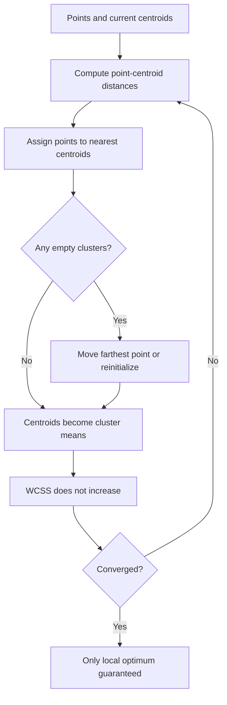

### Follow-ups

- What method do you use to choose k? (Elbow method on WCSS, silhouette score, gap statistic)

- Suppose initialization is bad. How should the answer change? (k-means++, multiple restarts and keep the best)

- What method do you use to speed it up on very large data? (MiniBatch KMeans)

## How Can Softmax Be Calculated Without Numerical Overflow?

[View this question on DeepOffer](https://getdeepoffer.com/questions/numerically-stable-softmax.html)

**Source / companies:** Reported in public interview compilations — Apple, Meta, Google, Amazon

**Interview type:** Classical ML

**Tag:** confirmed

### Answer

Formula: $\operatorname{softmax}(x_i) = \frac{\exp(x_i)}{\sum \exp(x_j)}$. If logits are large, exp overflows to inf.

<b>Stable version</b>: Subtract the maximum first: $m = \max(x),\quad \operatorname{softmax}(x_i) = \frac{\exp(x_i-m)}{\sum \exp(x_j-m)}$.

Why it is equivalent: numerator and denominator are both multiplied by $\exp(-m)$, so the math does not change. After subtraction the largest exponent is 0, so exp results are at most 1 and never overflow.

Log-softmax computes $x_i-m-\log\sum\exp(x_j-m)$ directly. It avoids the precision loss of exp then log, and is often fused with cross-entropy in training.

### Mermaid diagram

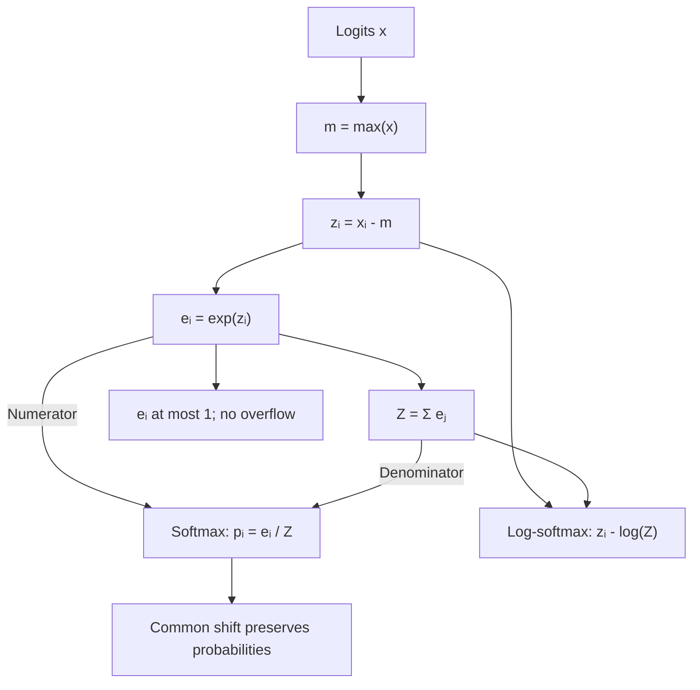

### Follow-ups

- For what reason does direct exp overflow? (float32 max is about 3.4e38; exp(89) already overflows)

- What method do you use to write log-softmax?

- How should we interpret what temperature T do to softmax output?

## For Classification, Why Is Cross-Entropy Usually a Better Loss Than Squared Error?

[View this question on DeepOffer](https://getdeepoffer.com/questions/why-cross-entropy-not-mse.html)

**Source / companies:** Source: March 2026 MLE interview report · Google

**Interview type:** Classical ML

**Tag:** confirmed

### Answer

<b>Clean gradient</b>: With cross-entropy + sigmoid/softmax, the gradient with respect to logits is simply prediction minus label. Bigger error means bigger gradient, so the learning signal is strong.

<b>MSE gradient vanishes</b>: With MSE + sigmoid, the gradient contains the sigmoid derivative. When the prediction is badly wrong, sigmoid is in the saturated region, its derivative is near 0, and parameters barely move - the more wrong, the slower it learns.

Probability view: cross-entropy is equivalent to maximum likelihood estimation (minimizing KL divergence between predicted and true distributions). It matches probabilistic classification naturally. MSE assumes Gaussian noise and fits regression better.

### Mermaid diagram

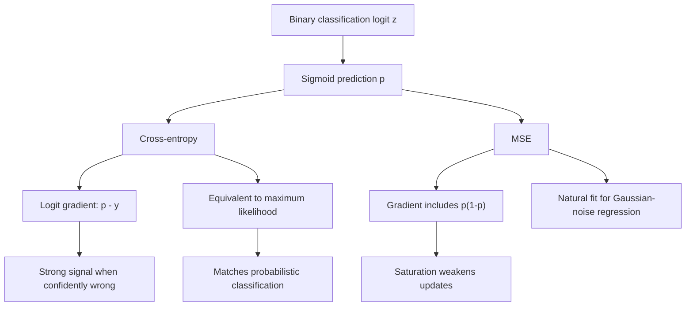

### Follow-ups

- Show the derivation of the gradient of cross-entropy with respect to logits by hand.

- As a follow-up, consider this: what goes wrong with cross-entropy under class imbalance? (How does focal loss fix it?)

- Could you use cross-entropy for regression? (You can discretize into bins, but it is rarely done)

## What Causes Gradient Signals to Vanish or Blow Up, and How Can You Stabilize Them?

[View this question on DeepOffer](https://getdeepoffer.com/questions/gradient-vanishing-exploding.html)

**Source / companies:** Reported in public interview compilations — Robinhood, Asana, Onfido, Groupon, Square, Plaid

**Interview type:** Classical ML

**Tag:** confirmed

### Answer

<b>Cause</b>: Backpropagation in deep networks is a chain of multiplications. If Jacobians have eigenvalues mostly below 1, gradients shrink exponentially (vanish); if above 1, they grow exponentially (explode). Sigmoid/tanh derivatives at most 0.25 make it worse.

<b>Fixes</b>: Good initialization (Xavier for tanh, He for ReLU), normalization (BatchNorm/LayerNorm keeps distributions stable), residual connections (an identity path for gradients), ReLU-family activations, and gradient clipping (for exploding gradients).

How to present it: start with the chain-multiplication cause, then list fixes by category - initialization / normalization / architecture / activation / clipping - with one example each.

### Mermaid diagram

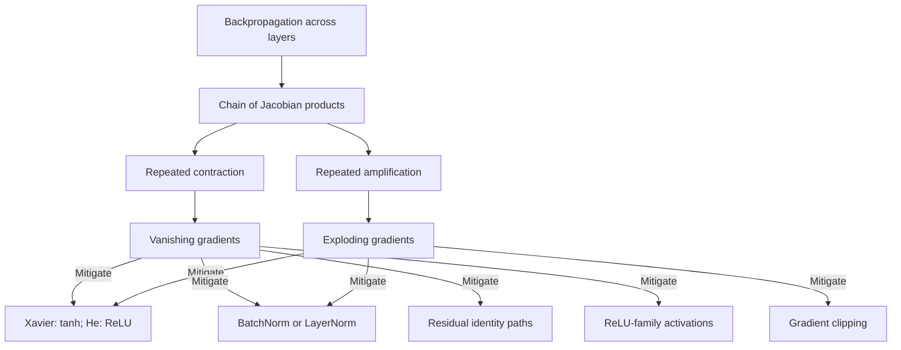

### Follow-ups

- For what reason does BatchNorm help with vanishing gradients?

- Explore one more angle: how do LSTM gates solve long-term vanishing gradients?

- What method do you use to pick the gradient clipping threshold?

## Compare Plain SGD, Momentum, and Adam—Where Can Adam Fall Short?

[View this question on DeepOffer](https://getdeepoffer.com/questions/sgd-momentum-adam.html)

**Source / companies:** Reported in public interview compilations — NVIDIA

**Interview type:** Classical ML

**Tag:** confirmed

### Answer

<b>SGD</b>: Takes a fixed-size step along the current mini-batch gradient. Noisy, but often generalizes well.

<b>Momentum</b>: Keeps a velocity variable as an exponential average of gradients. Steps speed up in consistent directions and cancel out in oscillating directions - like adding inertia to SGD.

<b>Adam</b>: Combines first moment (momentum), second moment (per-dimension adaptive learning rate, RMSProp idea), and bias correction. Less sensitive to learning rate, converges fast, and is the default choice.

<b>Adam's weaknesses</b>: Sometimes generalizes worse than well-tuned SGD+Momentum (common in CV tasks). Second-moment estimates can become unstable late in training. AdamW decouples weight decay from the gradient and is now the standard fix for large-model training.

### Mermaid diagram

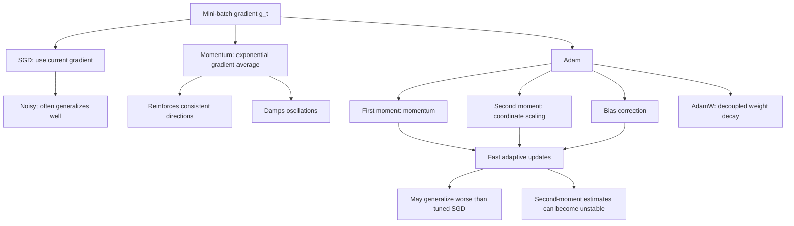

### Follow-ups

- How should we interpret what bias correction correct? (Initial moment estimates biased toward 0)

- Under which conditions would you still choose SGD?

- How would you define warmup for?

## How Do L1 and L2 Penalties Shape a Model Differently?

[View this question on DeepOffer](https://getdeepoffer.com/questions/l1-vs-l2-regularization.html)

**Source / companies:** Reported in public interview compilations — Apple, Palantir, Meta, Amazon

**Interview type:** Classical ML

**Tag:** confirmed

### Answer

<b>L1 ($\sum |w|$) produces sparse solutions</b>: Many weights are pushed exactly to 0, so it does feature selection automatically. Geometrically, the diamond-shaped constraint tends to meet loss contours at sharp corners.

<b>L2 ($\sum w^2$) shrinks weights smoothly</b> but rarely to 0. The circular constraint shrinks evenly and splits weight across correlated features.

Probability view: L1 corresponds to a Laplace prior, L2 to a Gaussian prior. In practice: pick L1 for interpretability or dimensionality reduction, L2 to prevent overfitting while keeping performance, Elastic Net for both.

### Mermaid diagram

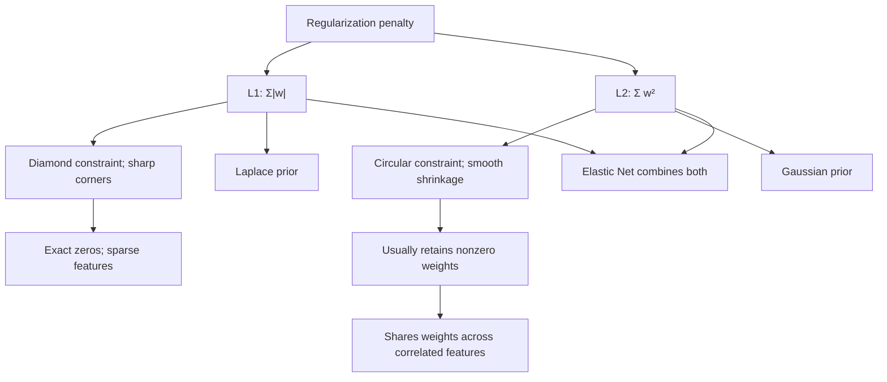

### Follow-ups

- As a follow-up, consider this: l1 is not differentiable at 0 - how do you optimize it? (Subgradient / proximal gradient)

- What method do you use to tune the two Elastic Net coefficients?

- In what way are Dropout and L2 related? (Dropout approximates a form of adaptive L2)

## Validation Error Starts Rising While Training Error Keeps Falling—What Should You Change?

[View this question on DeepOffer](https://getdeepoffer.com/questions/overfitting-train-val-loss.html)

**Source / companies:** Source: June 2026 MLE interview report · Google

**Interview type:** Classical ML

**Tag:** confirmed

### Answer

First, name it: this is a <b>classic overfitting</b> curve - the model starts memorizing training noise. Before changing anything, check the validation split for leakage and distribution mismatch.

<b>Data level</b>: Add more data, use data augmentation, check label noise.

<b>Model level</b>: Reduce capacity, add regularization (L2/Dropout), simplify features.

<b>Training level</b>: Early stopping (watch validation loss with patience), lower learning rate, larger batch for smoother gradients.

Suggested order: data, then model, then training. Presenting in this order shows good engineering habits.

### Mermaid diagram

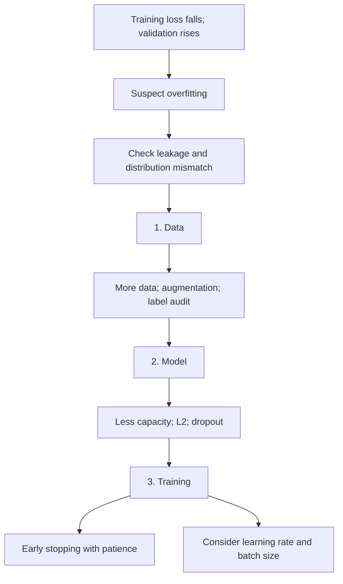

### Follow-ups

- What method do you use to set patience for early stopping?

- What method do you use to tell overfitting apart from train/validation distribution shift?

- Explore one more angle: validation set is small and loss is noisy - how do you judge?

## How Should You Explain the Trade-Off Between Model Bias and Variance?

[View this question on DeepOffer](https://getdeepoffer.com/questions/bias-variance-tradeoff.html)

**Source / companies:** Reported in public interview compilations — Google, Amazon

**Interview type:** Classical ML

**Tag:** confirmed

### Answer

Expected generalization error = <b>$\text{bias}^2 + \text{variance} + \text{irreducible noise}$</b>. Bias comes from the gap between model assumptions and the true pattern (underfitting). Variance comes from sensitivity to training data (overfitting).

As model complexity grows: bias falls, variance rises, total error is U-shaped. The sweet spot is in the middle.

Levers: reduce bias with more features / stronger model / less regularization; reduce variance with more data / regularization / ensembling. You explain it well only if you can say which term each trick moves on the U-curve.

### Mermaid diagram

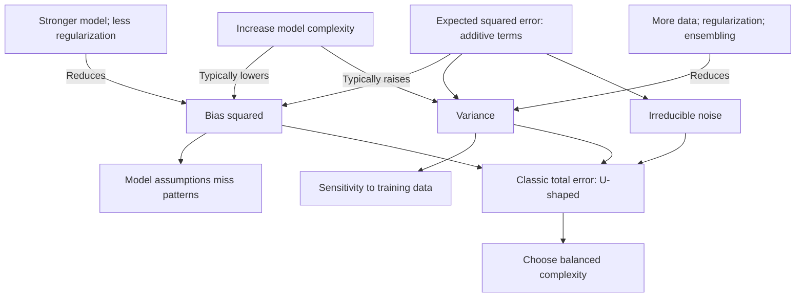

### Follow-ups

- In what way does double descent challenge the classic picture?

- For what reason is bagging said to reduce variance and boosting to reduce bias?

- As a follow-up, consider this: does this tradeoff still hold in deep learning?

## Which Forms of Data Leakage Matter Most, and How Can You Block Them?

[View this question on DeepOffer](https://getdeepoffer.com/questions/data-leakage-types.html)

**Source / companies:** Source: July 2026 MLE interview report · Google

**Interview type:** Classical ML

**Tag:** confirmed

### Answer

<b>Temporal leakage</b>: Using data that only exists after prediction time (e.g., using a field generated after checkout to predict whether checkout happens).

<b>Preprocessing leakage</b>: Computing normalization stats, feature selection, or target encoding on the full dataset before splitting - validation info leaks into training.

<b>Label leakage</b>: Features contain proxies of the label (e.g., using refund reason to predict whether a refund happens).

Prevention: split by time, put all preprocessing inside a pipeline fit only on training data, audit every feature for availability at prediction time, and run online/offline consistency checks before launch.

### Mermaid diagram

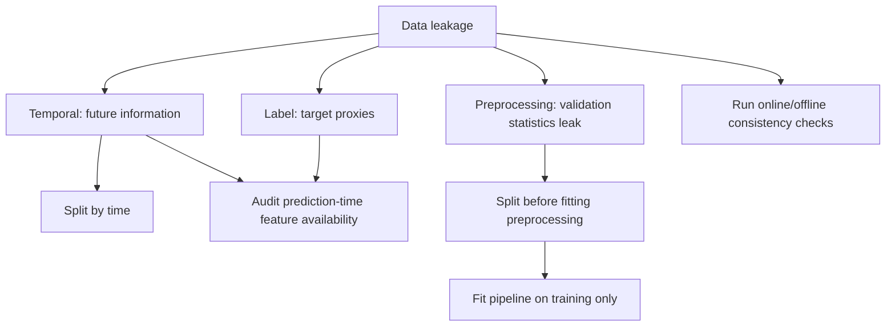

### Follow-ups

- What method do you use to detect online/offline feature mismatch? (Distribution monitoring, replay checks)

- What method do you use to prevent leakage in target encoding? (Out-of-fold encoding + smoothing)

- Provide one real leakage case you know.

## How Does XGBoost Use Curvature and Regularization in Its Objective?

[View this question on DeepOffer](https://getdeepoffer.com/questions/xgboost-objective-second-order.html)

**Source / companies:** Source: May 2026 MLE interview report · Amazon

**Interview type:** Classical ML

**Tag:** confirmed

### Answer

Objective: tree $t$ minimizes $\sum l(y_i,\hat{y}_i+f_t(x_i))+\Omega(f_t)$. Expand the loss around the current prediction with a <b>second-order Taylor expansion</b>, giving an approximate objective that only needs first-order gradients $g_i$ and second-order gradients $h_i$.

Optimal leaf weight has a closed form: <b>$w^* = -\frac{G}{H+\lambda}$</b>, where $G$ and $H$ are sums of $g$ and $h$ in the leaf, and $\lambda$ comes from $\Omega = \gamma\cdot T+0.5\cdot\lambda\cdot\sum w^2$.

Why second order: it captures both direction and curvature, so steps are more accurate and convergence is faster. First order only degrades to plain GBDT. Second-order info also gives a closed-form split Gain, enabling exact greedy or histogram-based split finding.

### Mermaid diagram

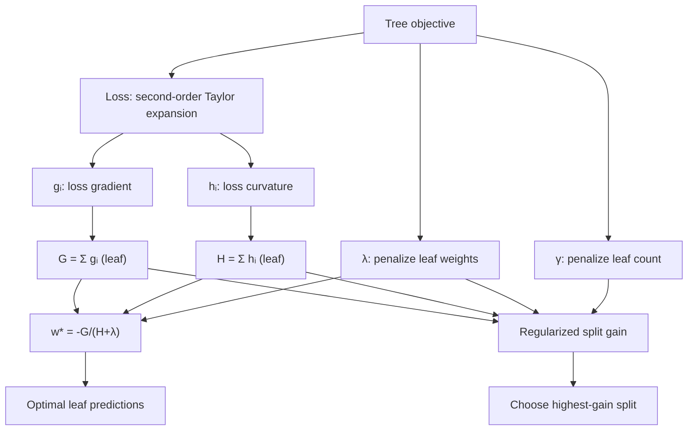

### Follow-ups

- Which steps do gamma and lambda control? (gamma penalizes leaf count, lambda penalizes leaf weight magnitude)

- In what way are missing values handled? (The split learns a default direction automatically)

- In what way does XGBoost parallelize? (Pre-sorted features + blocks by feature dimension)

## In What Ways Does LightGBM Differ from XGBoost?

[View this question on DeepOffer](https://getdeepoffer.com/questions/lightgbm-vs-xgboost.html)

**Source / companies:** Source: April 2026 MLE interview report · Microsoft

**Interview type:** Classical ML

**Tag:** confirmed

### Answer

<b>Histogram algorithm</b>: Discretizes continuous features into about 255 bins. Split finding scans only bins, which is much faster and uses far less memory.

<b>GOSS</b>: Keeps large-gradient samples, randomly samples small-gradient samples and reweights them. Informative samples are kept; long-tail samples are downsampled for speed.

<b>EFB</b>: Bundles mutually exclusive features. High-dimensional sparse features (like one-hot) get merged into one feature to reduce dimension.

<b>Leaf-wise growth</b>: Always splits the leaf with the largest gain. With the same number of leaves it fits stronger, but overfits more easily. On small data, control num_leaves and min_data_in_leaf.

### Mermaid diagram

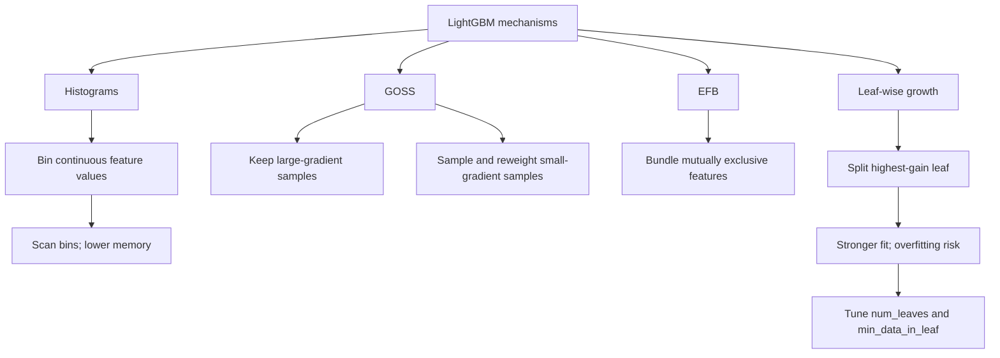

### Follow-ups

- For what reason does leaf-wise overfit more than level-wise?

- In what way does LightGBM handle categorical features?

- Under which conditions would you still pick XGBoost?

## How Should an MLE Interpret the Meaning of ROC-AUC?

[View this question on DeepOffer](https://getdeepoffer.com/questions/auc-physical-meaning.html)

**Source / companies:** Reported in public interview compilations — Meta

**Interview type:** Classical ML

**Tag:** confirmed

### Answer

<b>Physical meaning</b>: Pick a random positive and a random negative sample. AUC is the probability the model scores the positive higher. $\mathrm{AUC} = 0.5$ is random guessing; 1.0 is perfect ranking.

It only cares about <b>ranking</b> - not thresholds, not absolute score values. It is invariant to monotonic transforms.

Implication: high AUC does not mean calibrated probabilities. For CTR prediction, where scores drive bidding and money, you must check calibration on top of AUC (e.g., bucket predicted mean vs. actual CTR).

### Mermaid diagram

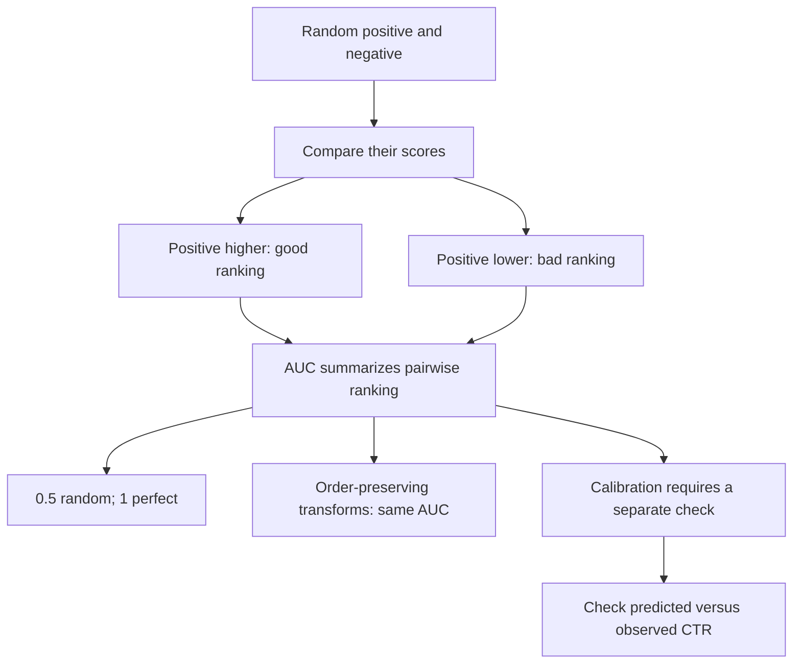

### Follow-ups

- How should we interpret what AUC = 0.5 mean? What about AUC below 0.5?

- For what reason is AUC not enough for CTR prediction?

- As a follow-up, consider this: aUC is high but calibration is bad - what breaks online?

- Explore one more angle: under heavy class imbalance, can AUC be too optimistic? (Look at PR-AUC)

## How Would You Tackle a Severely Imbalanced Classification Dataset?

[View this question on DeepOffer](https://getdeepoffer.com/questions/class-imbalance-playbook.html)

**Source / companies:** Source: July 2026 MLE interview report · Google

**Interview type:** Classical ML

**Tag:** confirmed

### Answer

<b>Data level</b>: Oversampling / undersampling, SMOTE-style synthetic samples. Always split first, then sample, to avoid leakage.

<b>Algorithm level</b>: class_weight / scale_pos_weight, focal loss to downweight easy samples, threshold moving (tune the decision threshold by business cost, not always 0.5).

<b>Evaluation level</b>: Do not look at accuracy. Use PR-AUC, F1, recall at fixed precision, and report the confusion matrix.

First separate sample-count imbalance from difficulty imbalance. Often the problem is not the ratio - the minority class has too few samples to learn patterns. More data fixes the root cause better than resampling tricks.

### Mermaid diagram

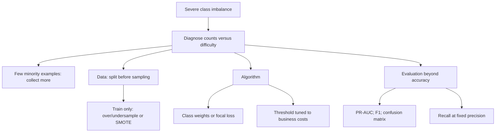

### Follow-ups

- How would you characterize SMOTE's downsides?

- As a follow-up, consider this: false positives and false negatives have different business costs - how do you pick the threshold?

- Which steps do you do at 1:10000 imbalance?

## How Would You Engineer Numeric, Categorical, and Temporal Inputs?

[View this question on DeepOffer](https://getdeepoffer.com/questions/pq-0014.html)

**Source / companies:** Google

**Interview type:** Classical ML

**Tag:** confirmed

### Answer

<b>Numeric</b>: Fill missing values (and add a missing indicator), normalize/standardize (tree models can skip this), log-transform or bin long tails, clip outliers.

<b>Categorical</b>: One-hot for low cardinality; target encoding (must prevent leakage) or embeddings for high cardinality; merge rare categories into Other.

<b>Time</b>: Extract year/month/day/weekday/hour; encode cyclical values with sin/cos (e.g., hour of day with period 24). Derived features like days since event are often more useful than raw timestamps.

Closing principle: every transform must pass two checks - is it available at prediction time, and can it be computed the same way online?

### Mermaid diagram

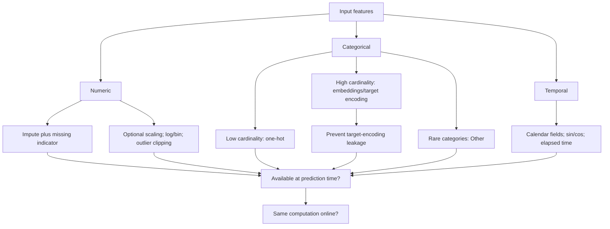

### Follow-ups

- What method do you use to prevent leakage in target encoding? (Out-of-fold encoding + smoothing)

- What makes sin/cos for time features preferable?

- As a follow-up, consider this: how do high-cardinality ID features enter deep models? (Embedding + hashing)

## When Should You Use Built-In Importance, Permutation Tests, or SHAP?

[View this question on DeepOffer](https://getdeepoffer.com/questions/pq-0015.html)

**Source / companies:** Meta

**Interview type:** Classical ML

**Tag:** confirmed

### Answer

<b>Built-in importance (gain/weight)</b>: Read directly after training, very fast. But it is biased - high-cardinality features get an unfair advantage - and it gives only a global ranking with no direction.

<b>Permutation importance</b>: Shuffle one column and watch the metric drop. Model-agnostic, but correlated features mask each other.

<b>SHAP</b>: Based on Shapley values - a fair allocation. Every feature gets a signed contribution per sample. It explains single predictions and aggregates to global views, with the strongest theoretical guarantees (consistency, local accuracy). The cost is speed; TreeSHAP accelerates tree models.

Rule of thumb: gain/permutation for fast feature screening, SHAP for delivering explanations and debugging online issues.

### Mermaid diagram

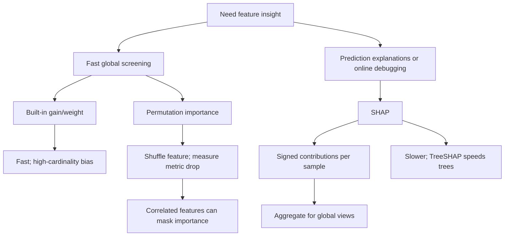

### Follow-ups

- Explore one more angle: predictions suddenly worsen for one segment online - how do you use SHAP to locate the cause?

- As a follow-up, consider this: two strongly correlated features - how does SHAP split credit?

- Explore one more angle: sHAP vs. LIME - what's the difference?

## Compare Precision@K, Recall@K, and NDCG for Ranking Evaluation

[View this question on DeepOffer](https://getdeepoffer.com/questions/precision-recall-ndcg.html)

**Source / companies:** Source: July 2026 MLE interview report · Meta

**Interview type:** Statistics & Evaluation

**Tag:** confirmed

### Answer

<b>Precision@K</b>: Fraction of the top K results that are relevant - how accurate are the recommendations?

<b>Recall@K</b>: Fraction of all relevant items that made it into the top K - how complete is retrieval? This is the core metric for the retrieval stage.

<b>NDCG</b>: Gain with graded relevance and position discount - relevant items ranked higher score more. Normalized by the ideal DCG to 0-1. It handles good results must also be in the right position.

Positions: retrieval uses Recall@K, ranking uses NDCG, and Precision@K when display slots are limited.

### Mermaid diagram

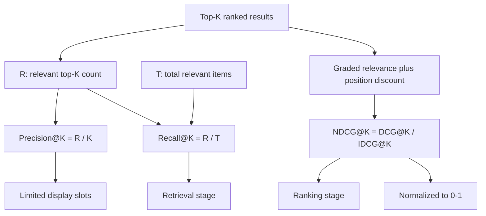

### Follow-ups

- As a follow-up, consider this: offline metric goes up but online CTR does not - possible causes?

- For what reason does NDCG use a log discount?

- As a follow-up, consider this: with multiple objectives (clicks + watch time), how do you set offline metrics?

## During Training and Serving, How Should Dropout Be Applied?

[View this question on DeepOffer](https://getdeepoffer.com/questions/dropout-principle-inference.html)

**Source / companies:** Source: Common pattern across 2026 interview reports · Google

**Interview type:** Deep Learning

**Tag:** hot

### Answer

During training, each neuron is zeroed with probability $p$. The network cannot rely on co-adaptation of a few neurons - it is like training a different sub-network each step, approximating an ensemble.

After zeroing, the expected output of the layer shrinks: training output is multiplied by a $\operatorname{Bernoulli}(p)$ mask, so the expectation is $p$ times the original.

<b>Two inference options</b>: Classic approach multiplies weights by $p$ at inference; modern frameworks use inverted dropout - divide by $p$ during training, use the network as-is at inference. Deployment is simpler.

Bonus point: mention Dropout + BatchNorm ordering and variance shift.

### Follow-ups

- In what way are Dropout and L2 related?

- For what reason must RNN Dropout use a fixed mask? (Variational dropout)

- Could you leave Dropout on at inference? (MC Dropout for uncertainty estimation)

## When Should a Network Use Batch Normalization Rather Than Layer Normalization?

[View this question on DeepOffer](https://getdeepoffer.com/questions/pq-0026.html)

**Source / companies:** Google

**Interview type:** Deep Learning

**Tag:** hot

### Answer

<b>Different normalization axes</b>: BatchNorm computes mean/variance per feature across the batch (depends on batch statistics). LayerNorm computes mean/variance per sample across features (independent of batch).

Consequences: BN must maintain running averages for inference and gets noisy with small batches. LN behaves identically in training and inference and suits variable-length sequences.

<b>Where each wins</b>: BN is still a common default in CV. Transformers use LN (and variants like RMSNorm) throughout, because sequence length varies and inference is often $\text{batch}=1$.

One more: BN adds a mild regularization effect from batch noise; LN does not.

### Mermaid diagram

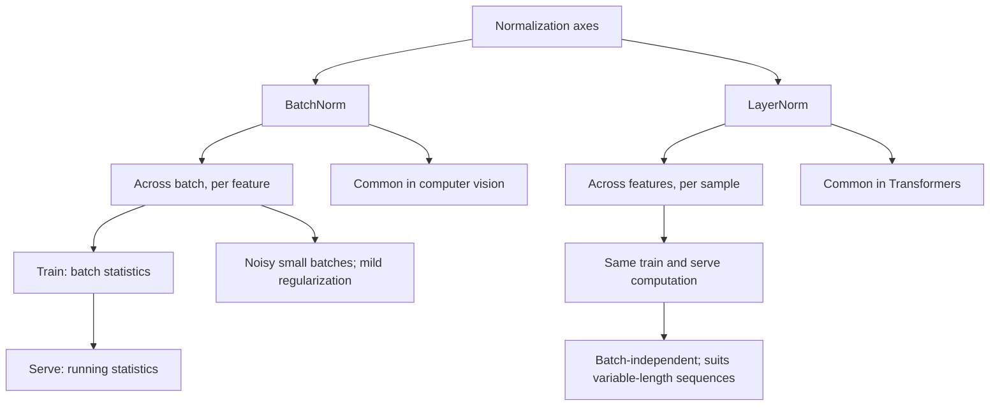

### Follow-ups

- For what reason does BN behave differently in training vs. inference?

- Explore one more angle: what did RMSNorm change, and why do LLMs like it?

- As a follow-up, consider this: what problem does GroupNorm solve?

## Derive the Main Steps and Complexity of Self-Attention

[View this question on DeepOffer](https://getdeepoffer.com/questions/pq-0027.html)

**Source / companies:** Reported in public interview compilations — OpenAI

**Interview type:** Deep Learning

**Tag:** hot

### Answer

Each token is linearly projected to $Q$, $K$, $V$. $\text{Attention} = \operatorname{softmax}\left(\frac{QK^T}{\sqrt{d}}\right)\cdot V$: similarity between $Q$ and all $K$ becomes weights over $V$.

<b>Why divide by $\sqrt{d}$</b>: Dot products grow in variance with dimension. Without scaling, softmax saturates and gradients vanish.

<b>Complexity</b>: Time $O(n^2 d)$, memory $O(n^2)$ for the attention matrix, where $n$ is sequence length. This is why long context is expensive and motivates FlashAttention, linear attention, and similar optimizations.

Multi-head means multiple subspaces attending to different relations in parallel, concatenated and projected. Position info is injected separately via positional encoding - self-attention itself is permutation-invariant.

### Mermaid diagram

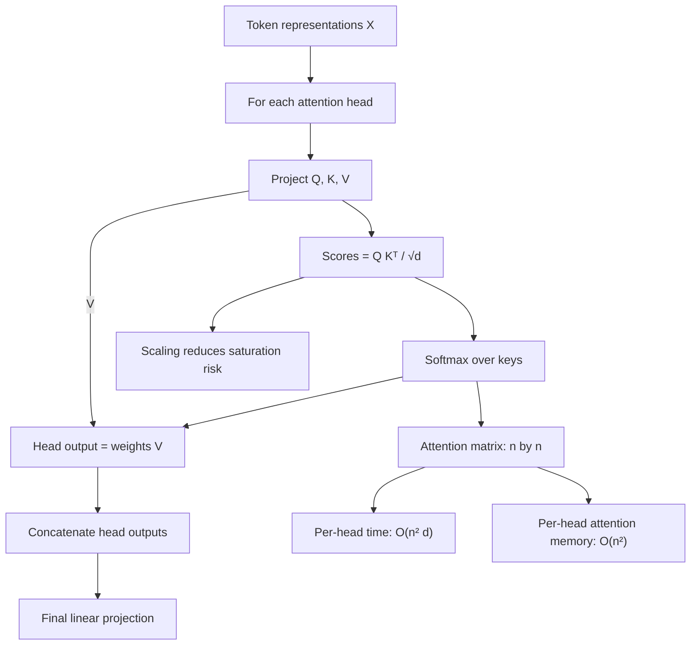

### Follow-ups

- For what reason multi-head instead of one big head?

- How should we interpret what FlashAttention actually save? (Memory IO, not FLOPs)

- How should we interpret what the KV cache store, and which step does it save?

## Explain a Transformer from Input Embeddings Through Its Output Head

[View this question on DeepOffer](https://getdeepoffer.com/questions/pq-0028.html)

**Source / companies:** Reported in public interview compilations — Apple

**Interview type:** Deep Learning

**Tag:** hot

### Answer

<b>Backbone</b>: Embedding (+ positional encoding), then N blocks (multi-head self-attention + FFN, each with residual and normalization), then the output head.

The decoder's causal mask ensures tokens only see the left side. Encoder-decoder models add cross-attention. Mainstream LLMs today are decoder-only.

<b>The FFN</b> holds most parameters (often 2x the attention part). It processes each position independently - think of it as a per-token feature processor.

Bonus details: pre-norm trains more stably than post-norm, RoPE is the mainstream positional encoding for LLMs, and SwiGLU replaces ReLU as the FFN activation.

### Mermaid diagram

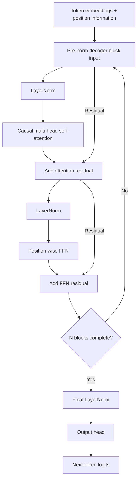

### Follow-ups

- For what reason are LLMs decoder-only now?

- In what way is RoPE better than absolute positional encoding?

- What method do you use to roughly estimate parameters and compute? (The approx. 6ND FLOPs rule)

## What Makes Skip Connections Effective in Very Deep Networks?

[View this question on DeepOffer](https://getdeepoffer.com/questions/why-residual-connection-works.html)

**Source / companies:** Source: Common pattern across 2026 interview reports · Google

**Interview type:** Deep Learning

**Tag:** hot

### Answer

<b>Gradient view</b>: $\text{Output} = F(x)+x$. In backpropagation, gradients have an identity shortcut that does not need to be multiplied layer by layer, so deep gradients no longer decay exponentially.

<b>Optimization view</b>: The network only needs to learn the correction $F(x)$, with identity as the default. A deeper network can be at least as good as a shallower one - the degradation problem is solved.

<b>Representation view</b>: Unrolled, a residual network is an ensemble of paths of different depths. Robustness comes from path redundancy.

Practical details: residuals need the right normalization position (pre-norm/post-norm) and initialization; with bad scaling, very deep networks still fail to train.

### Mermaid diagram

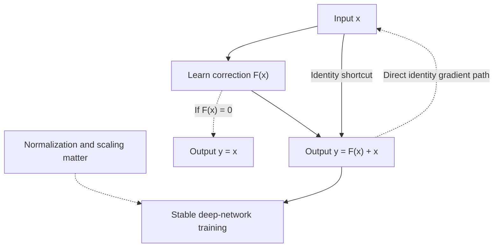

### Follow-ups

- How should we interpret what ResNet's bottleneck block save?

- As a follow-up, consider this: how do DenseNet and ResNet connections differ?

- Explore one more angle: in Transformers, why the pre-norm vs. post-norm debate?

## Connect Cross-Entropy, KL Divergence, and Maximum Likelihood

[View this question on DeepOffer](https://getdeepoffer.com/questions/cross-entropy-kl-mle-relationship.html)

**Source / companies:** Source: Common pattern across 2026 interview reports · Google

**Interview type:** Classical ML

**Tag:** hot

### Answer

One line connects all three: <b>Maximum likelihood</b> maximizes the product of $P(y_i\mid x_i)$. Taking the negative log gives $-\sum\log P(y_i\mid x_i)$ - which is exactly cross-entropy with one-hot labels.

<b>KL divergence</b>: $D_{\mathrm{KL}}(P\|Q) = H(P,Q)-H(P)$. $\text{Cross-entropy} = \text{entropy of the true distribution}+\mathrm{KL}$. With fixed labels, $H(P)$ is constant, so minimizing cross-entropy is equivalent to minimizing KL and to maximizing likelihood.

Why it matters: it upgrades why cross-entropy from a memorized conclusion to first principles, and explains why knowledge distillation uses KL on soft labels.

Add directionality: KL is asymmetric. $D_{\mathrm{KL}}(P\|Q)$ and $D_{\mathrm{KL}}(Q\|P)$ penalize differently (mode-covering vs. mode-seeking) - generation interviews often dig here.

### Mermaid diagram

```mermaid
flowchart TD
  M["Maximize Π Q(yᵢ|xᵢ)"] -- "Negative log" --> N["Minimize -Σ log Q(yᵢ|xᵢ)"]
  N -- "One-hot targets" --> C["Minimize cross-entropy H(P,Q)"]
  F["H(P,Q) = H(P) + DKL(P||Q)"] --> C
  C -- "Equivalent optimum for fixed P" --> K["Minimize DKL(P||Q)"]
  H["Fixed P: H(P) is constant"] --> K
  K -.-> D["KL direction matters"]
```

### Follow-ups

- What makes temperature-scaled soft labels in distillation preferable?

- How would you define the practical effect of KL asymmetry in training?

- Explore one more angle: can cross-entropy be a regression loss? (Yes, after binning)

## Derive scaled dot-product attention and explain why dividing by √d_k is essential.

[View this question on DeepOffer](https://getdeepoffer.com/questions/reported-1-derive-scaled-dot-product-attention-and-explain-why-dividing-by-d-k-is-e.html)

**Source / companies:** Reported in public interview reports · OpenAI

**Interview type:** Deep Learning

**Tag:** reported

### Answer

Scaled dot-product attention forms $\frac{QK^T}{\sqrt{d_k}}$, applies a row-wise softmax, then mixes $V$. The $\sqrt{d_k}$ term keeps logit variance from growing with width, preventing saturated softmax and weak gradients.

Use equations or tensor shapes where they clarify the claim, then name an experiment or ablation that would distinguish competing explanations.

### Mermaid diagram

```mermaid
flowchart TD
  Q["Queries Q"] --> S["Scores = Q * transpose(K)"]
  K["Keys K"] --> S
  S --> D["Divide scores by √(dk)"]
  D --> W["Row-wise softmax weights"]
  W --> O["Output = weights * V"]
  V["Values V"] --> O
  D -.-> L["Keep logit variance controlled"]
  L --> G["Avoid saturation and weak gradients"]
```

### Follow-ups

- Which assumption is easiest to violate in practice?

- How would you test this explanation with an ablation?

## Describe the KV cache, derive its memory formula, and discuss what it costs at production scale.

[View this question on DeepOffer](https://getdeepoffer.com/questions/reported-2-describe-the-kv-cache-derive-its-memory-formula-and-discuss-what-it-cost.html)

**Source / companies:** Reported in public interview compilations — OpenAI, xAI, Mistral AI, Amazon, Apple, NVIDIA, Together AI, Character.AI

**Interview type:** Deep Learning

**Tag:** reported

### Answer

A KV cache stores each prior token’s key and value tensors for every layer, so autoregressive decoding reuses past projections instead of recomputing them. Memory grows roughly with $\text{batch}\times\text{sequence length}\times\text{layers}\times\text{KV heads}\times\text{head dimension}\times 2\times\text{bytes}$.

Use equations or tensor shapes where they clarify the claim, then name an experiment or ablation that would distinguish competing explanations.

### Mermaid diagram

```mermaid
flowchart TD
  T["New token"] --> P["Compute new K and V"]
  P --> C["Append to per-layer cache"]
  C --> A["Attention reuses cached K,V"]
  Q["New query Q"] --> A
  C --> M["Cache bytes =<br/>2 * B * T * L<br/>* Hkv * Dh * b"]
  M --> F["2: keys and values"]
  M --> B["B: batch; T: cached tokens"]
  M --> L["L: layers; Hkv: KV heads"]
  M --> H["Dh: dimension; b: bytes/element"]
```

### Follow-ups

- What changes at 10× model or data scale?

- Which failure mode would you monitor first?

## Contrast multi-query and grouped-query attention with standard multi-head attention, and name what is sacrificed.

[View this question on DeepOffer](https://getdeepoffer.com/questions/reported-3-contrast-multi-query-and-grouped-query-attention-with-standard-multi-hea.html)

**Source / companies:** Reported in public interview compilations — Meta, Mistral AI

**Interview type:** Deep Learning

**Tag:** reported

### Answer

Multi-head attention gives every query head its own K/V heads; MQA shares one K/V set and GQA shares a smaller number of K/V groups. Sharing sharply reduces cache size and memory bandwidth, with a possible quality cost.

Use equations or tensor shapes where they clarify the claim, then name an experiment or ablation that would distinguish competing explanations.

### Mermaid diagram

```mermaid
flowchart TD
  Q["H query heads"] --> M["MHA: H independent KV heads"]
  Q -- "1 < G < H" --> G["GQA: G shared KV groups"]
  Q --> A["MQA: one shared KV set"]
  M --> B["Baseline KV cache and bandwidth"]
  G --> S["Fewer cached KV heads"]
  A --> S
  S --> R["Reduced cache size and bandwidth"]
  R --> T["Possible quality cost"]
```

### Follow-ups

- How does the answer change under a strict latency budget?

- What empirical result would falsify your claim?

## Explain multi-head latent attention and the motivation DeepSeek had for introducing it.

[View this question on DeepOffer](https://getdeepoffer.com/questions/reported-4-explain-multi-head-latent-attention-and-the-motivation-deepseek-had-for.html)

**Source / companies:** Reported in public interview compilations — DeepSeek, Moonshot AI

**Interview type:** Deep Learning

**Tag:** reported

### Answer

MLA compresses keys and values into a lower-dimensional latent representation and reconstructs the needed projections during attention. It cuts KV-cache traffic more aggressively than GQA but adds projection complexity and implementation constraints.

Use equations or tensor shapes where they clarify the claim, then name an experiment or ablation that would distinguish competing explanations.

### Mermaid diagram

```mermaid
flowchart TD
  X["Token representation"] --> L["Compress K,V into compact latent"]
  L --> C["Cache lower-dimensional latent"]
  C --> P["Reconstruct needed projections"]
  P --> A["Compute attention"]
  C --> S["Reduce KV-cache traffic"]
  P --> T["Extra projection and implementation complexity"]
```

### Follow-ups

- Which equation or tensor shape makes the mechanism clearest?

- Where does this method stop working well?

## Walk through FlashAttention and account for its speedup given that it performs the same FLOPs.

[View this question on DeepOffer](https://getdeepoffer.com/questions/pq-0046.html)

**Source / companies:** Reported in public interview compilations — Together AI

**Interview type:** Deep Learning

**Tag:** reported

### Answer

<b>Tiling</b>: attention is computed in blocks sized to fit fast on-chip SRAM, so K and V are loaded once per block instead of being re-read from HBM for every query row.

<b>Online softmax</b>: a running max/sum rescaling trick lets the softmax run inside the tiled loop, so the $N\times N$ score matrix is never written to HBM at all. Memory drops from $O(N^2)$ to $O(N)$.

<b>Same FLOPs, fewer bytes</b>: attention on GPUs is memory-bandwidth bound, not compute bound, so cutting HBM reads/writes is where the speedup comes from. The arithmetic itself is bit-identical to standard attention.

<b>Recomputation in backward</b>: instead of storing the full attention matrix for backprop, FlashAttention stores only the softmax statistics and recomputes the weights on the fly. It trades cheap recompute for expensive memory traffic.

<b>What breaks</b>: for tiny sequences or small head dims the tiling overhead can erase the gain, and causal masks or dropout need kernel-level support (FlashAttention-2/3 handle both) — a naive port of the math without the fused kernel gets you nothing.

### Mermaid diagram

```mermaid
flowchart TD
  Q["Attention inputs Q,K,V"] --> T["Tile blocks into on-chip SRAM"]
  T --> S["Online softmax: running max/sum"]
  S --> O["Exact attention output"]
  S --> N["Avoid full n-by-n HBM matrix"]
  N --> M["Attention workspace: O(n), fixed d"]
  N --> B["Fewer HBM reads and writes"]
  B --> F["Faster when memory-bandwidth bound"]
  S --> V["Save softmax statistics"]
  V --> R["Recompute weights during backward"]
  R --> B
  T --> C["Compute remains O(n² * d)"]
  Z["Tiny inputs: overhead may dominate"] -.-> F
```

### Follow-ups

- FlashAttention cuts memory traffic but not FLOPs. In what regime of sequence length, batch size, and head dimension does its speedup shrink to near zero, and why?

- The backward pass recomputes attention weights instead of storing them. What does that imply for dropout, which needs the identical mask in forward and backward?

## Describe how byte-pair encoding works and where it breaks down (numbers, code, non-Latin scripts).

[View this question on DeepOffer](https://getdeepoffer.com/questions/reported-6-describe-how-byte-pair-encoding-works-and-where-it-breaks-down-numbers-c.html)

**Source / companies:** Reported in public interview compilations — Alibaba, Sarvam AI, Hugging Face

**Interview type:** Deep Learning

**Tag:** reported

### Answer

BPE repeatedly merges the most frequent adjacent token pair learned from the corpus. It is simple and reversible, but vocabulary fertility and boundary choices can be poor for numbers, code, and underrepresented scripts.

Use equations or tensor shapes where they clarify the claim, then name an experiment or ablation that would distinguish competing explanations.

### Mermaid diagram

```mermaid
flowchart TD
  S["Corpus split into initial symbols"] --> C["Count adjacent token pairs"]
  C --> P["Select most frequent pair"]
  P --> M["Merge pair; record rule"]
  M --> D{"Vocabulary target reached?"}
  D -- "No" --> C
  D -- "Yes" --> A["Apply learned merge rules"]
  A --> R["Reversible subword tokenization"]
  R --> L["Poor boundaries or excess tokens"]
  L --> N["Numbers"]
  L --> K["Code"]
  L --> U["Underrepresented scripts"]
```

### Follow-ups

- What changes at 10× model or data scale?

- Which failure mode would you monitor first?

## Trace the evolution of positional encodings from sinusoidal and learned schemes through RoPE and ALiBi, and explain why transformers need them.

[View this question on DeepOffer](https://getdeepoffer.com/questions/pq-0048.html)

**Source / companies:** Meta

**Interview type:** Deep Learning

**Tag:** reported

### Answer

<b>Why they exist</b>: attention is permutation-invariant — shuffle the tokens and the output just shuffles. Position encodings are the only signal the model gets about word order.

<b>Sinusoidal (2017)</b>: fixed sin/cos waves at geometrically spaced frequencies, added to embeddings. Relative offsets are linearly decodable from them, but attention to far-apart positions was weak in practice.

<b>Learned absolute</b>: one trainable vector per position. Simple, but it hard-caps the context length and learns no notion of relative distance — position 5000 is as unrelated to 4999 as to position 3.

<b>RoPE</b>: rotates each Q,K pair in 2D subspaces by an angle proportional to its position. Relative offset then falls out of the QK dot product for free, with zero extra parameters. Length extrapolation still degrades, which is why later tricks (NTK scaling, YaRN) rescale its frequencies.

<b>ALiBi</b>: no position vectors at all — it subtracts a per-head linear penalty $m\cdot|i-j|$ from the attention scores before softmax. Nearby tokens win by construction, and it extrapolates to longer contexts far better than any absolute scheme.

<b>What breaks</b>: absolute encodings bind the model to its trained length. When you need 4× context at inference, RoPE needs frequency rescaling and an ALiBi-style bias usually wins zero-shot. Pick the scheme by whether your deployment will ever exceed the training length.

### Mermaid diagram

```mermaid
flowchart TD
  P["Attention needs token-order signals"] --> A["Absolute position signals"]
  P --> R["Relative attention signals"]
  A --> S["Sinusoidal: fixed sin/cos embeddings"]
  A --> L["Learned: trainable position vectors"]
  S --> E["Add to token embeddings"]
  L --> E
  L --> C["Limited trained position table"]
  R --> O["RoPE: rotate Q,K pairs"]
  O --> D["Dot products encode relative offsets"]
  O --> X["Longer context may need rescaling"]
  R --> B["ALiBi: bias attention scores"]
  B --> F["Subtract m * abs(i-j)"]
  F --> N["Favor nearby tokens"]
```

### Follow-ups

- RoPE's rotation angle grows with position. Why do the high-frequency dimensions over-rotate first, and how does that cause length extrapolation to fail?

- ALiBi was designed for causal language models. What goes wrong if you apply its distance penalty to a bidirectional encoder?

## Explain rotary position embeddings and how position interpolation or YaRN stretches context past the training length.

[View this question on DeepOffer](https://getdeepoffer.com/questions/reported-8-explain-rotary-position-embeddings-and-how-position-interpolation-or-yar.html)

**Source / companies:** Reported in public interview compilations — Meta, Moonshot AI, Alibaba

**Interview type:** LLM Theory

**Tag:** reported

### Answer

<b>Rotate, don't add:</b> RoPE splits each query and key vector into 2D pairs and rotates pair $i$ at position $m$ by angle $m\cdot\theta_i$, where $\theta_i=\mathrm{base}^{-2i/d}$ with base typically 10000. No position vector is added to the token embedding, so content and position stay disentangled.

<b>Relativity falls out of the rotation:</b> because rotation matrices satisfy $R(m)^T R(n)=R(n-m)$, the attention score $q_m^T k_n$ depends on the relative distance $m-n$ rather than absolute positions. That is why RoPE generalizes better than absolute embeddings when sequences get longer.

<b>Frequency spectrum:</b> low-index pairs rotate slowly (large wavelength, coarse long-range order) while high-index pairs rotate fast (fine local order). Extrapolation breaks first at the fast dimensions: positions beyond training length hit rotation angles the model never saw, so attention scores drift out of distribution.

<b>Position interpolation (PI):</b> instead of extrapolating, PI rescales positions by the stretch factor $s=\frac{L_{\mathrm{target}}}{L_{\mathrm{train}}}$, feeding $\frac{m}{s}$ into the rotation. All angles stay inside the trained range, so a 4k-trained model can reach 16k with only light fine-tuning — at the cost of coarser relative resolution, since distinct positions now sit closer together in angle space.

<b>YaRN fixes PI's resolution loss:</b> YaRN applies NTK-aware scaling that stretches low frequencies more than high ones (preserving the fine local structure PI blurs), adds a temperature factor on attention logits to counteract the entropy growth of longer contexts, and fine-tunes briefly. In practice YaRN holds perplexity far past the training length where naive extrapolation collapses and plain PI degrades.

<b>Interview-ready rule:</b> RoPE gives relative position for free; PI buys length by compressing the position axis; YaRN buys length while protecting high-frequency detail and attention sharpness. Any of them still needs the model to have seen long-range dependencies in fine-tuning — stretching positions alone does not teach long-range reasoning.

### Mermaid diagram

```mermaid
flowchart TD
  Q["Q,K split into 2D pairs"] --> R["Rotate pair i by m*freqᵢ"]
  R --> I["R(m)ᵀ * R(n) = R(n-m)"]
  I --> D["Scores encode relative offsets"]
  D --> E["Extend context beyond training length"]
  E --> P["PI: use position m/s"]
  S["s = target length<br/>/ training length"] --> P
  P --> A["Angles stay within trained range"]
  A --> C["Coarser relative resolution"]
  E --> Y["YaRN: scale frequencies selectively"]
  Y --> H["Preserve high-frequency local detail"]
  Y --> T["Adjust attention temperature"]
  H --> F["Brief long-context fine-tuning"]
  T --> F
  C --> F
  F --> L["Stretching alone cannot teach<br/>long-range reasoning"]
```

### Follow-ups

- Why does RoPE's relative property hold for dot-product attention but break if you apply a nonlinearity to q or k before the dot product?

- If PI compresses positions by s, what happens to the model's ability to distinguish two tokens 1000 positions apart at 32k context versus at 4k, and how would you measure that loss?

- YaRN's temperature scaling compensates for attention entropy growth — derive why softmax entropy grows with sequence length even for a fixed query.

## State what the Chinchilla scaling laws claim and how they revised earlier intuitions about scale.

[View this question on DeepOffer](https://getdeepoffer.com/questions/pq-0050.html)

**Source / companies:** Reported in public interview compilations — Anthropic

**Interview type:** LLM Theory

**Tag:** reported

### Answer

<b>The claim</b>: for a fixed training compute budget, the loss-optimal recipe scales parameters and training tokens equally — roughly 20 tokens per parameter.

<b>The revision</b>: Kaplan's laws said grow the model fastest and undertrain it. Chinchilla retrained 400+ models and showed GPT-3-class models were severely undertrained — a 70B model on 1.4T tokens beat 175B–280B models trained on 300B–500B tokens at equal compute.

<b>Why it matters beyond loss</b>: inference cost scales with parameters, not training tokens. A smaller, fully trained model is cheaper to serve forever, so the Chinchilla recipe favors training longer over building bigger.

<b>What breaks</b>: $20:1$ is optimal for pretraining loss, not for everything downstream. Instruction-tuned and reasoning models are often deliberately overtrained past the ratio, and higher data quality shifts the optimum toward fewer tokens. Treat it as a starting point, not a law of physics.

### Mermaid diagram

```mermaid
flowchart TD
  B["Training compute budget"] --> A["Choose parameters N and tokens D"]
  A --> K["Earlier: favor larger N"]
  K --> U["Too few training tokens"]
  A --> C["Chinchilla: balance N and D"]
  C --> R["D approx 20 * N"]
  C --> G["More compute: scale both equally"]
  R --> S["Train smaller models longer"]
  S --> I["Lower inference cost"]
  R -.-> L["Guideline for pretraining loss"]
  L --> O["Other objectives shift optimum"]
  L --> Q["Data quality shifts optimum"]
```

### Follow-ups

- Chinchilla optimizes pretraining loss per FLOP. Why might a lab deliberately overtrain past 20 tokens per parameter even knowing it is compute-suboptimal?

- Kaplan and Chinchilla reached opposite conclusions from scaling experiments. What was the key methodological difference that flipped the result?

## Describe mixture-of-experts and how it grows model capacity without growing per-token compute.

[View this question on DeepOffer](https://getdeepoffer.com/questions/reported-10-describe-mixture-of-experts-and-how-it-grows-model-capacity-without-grow.html)

**Source / companies:** Reported in public interview compilations — Mistral AI, Cohere, DeepSeek, Moonshot AI, Zhipu AI, Alibaba

**Interview type:** LLM Theory

**Tag:** reported

### Answer

A sparse MoE router sends each token to a small subset of expert MLPs. Total parameters can grow while active FLOPs per token stay bounded, but routing balance, communication, expert capacity, and dropped tokens become central concerns.

Use equations or tensor shapes where they clarify the claim, then name an experiment or ablation that would distinguish competing explanations.

### Mermaid diagram

```mermaid
flowchart TD
  T["Token"] --> R["Router"]
  R -- "Select" --> S["Small expert subset"]
  S --> A["Selected expert MLP A"]
  S --> B["Selected expert MLP B"]
  A --> C["Combine selected expert outputs"]
  B --> C
  P["Larger pool of expert MLPs"] --> N["More total parameters"]
  P -. "Only subset active" .-> S
  S --> F["Bounded active FLOPs per token"]
  R --> L["Routing balance"]
  L --> D["Capacity limits may drop tokens"]
  S --> O["Communication overhead"]
```

### Follow-ups

- What changes at 10× model or data scale?

- Which failure mode would you monitor first?

## Distinguish pretraining, supervised fine-tuning, and preference optimization.

[View this question on DeepOffer](https://getdeepoffer.com/questions/reported-11-distinguish-pretraining-supervised-fine-tuning-and-preference-optimizati.html)

**Source / companies:** Reported in public interview compilations — Meta, Scale AI

**Interview type:** LLM Theory

**Tag:** reported

### Answer

Pretraining learns broad next-token structure from large unlabeled corpora; SFT imitates curated demonstrations; preference optimization shifts outputs toward ranked human or synthetic preferences. Each stage changes a different part of capability and behavior.

Use equations or tensor shapes where they clarify the claim, then name an experiment or ablation that would distinguish competing explanations.

### Mermaid diagram

```mermaid
flowchart TD
  C["Large unlabeled corpora"] --> P["Pretraining: next-token prediction"]
  P --> B["Broad learned structure"]
  B --> S["SFT: imitate curated demonstrations"]
  D["Curated demonstrations"] --> S
  S --> I["Demonstration-style behavior"]
  I --> O["Preference optimization"]
  R["Ranked human or synthetic preferences"] --> O
  O --> A["Outputs favor preferred responses"]
```

### Follow-ups

- How does the answer change under a strict latency budget?

- What empirical result would falsify your claim?

## Compare greedy, beam, top-k, top-p, and temperature decoding, and identify when each one fails.

[View this question on DeepOffer](https://getdeepoffer.com/questions/reported-12-compare-greedy-beam-top-k-top-p-and-temperature-decoding-and-identify-wh.html)

**Source / companies:** Reported in public interview compilations — Google DeepMind, Apple, Perplexity

**Interview type:** LLM Theory

**Tag:** reported

### Answer

Greedy decoding always takes the largest logit, beam keeps several high-probability sequences, and sampling draws from a temperature-scaled distribution. Top-k fixes candidate count while top-p keeps the smallest probability mass set; quality, diversity, and latency trade off.

Use equations or tensor shapes where they clarify the claim, then name an experiment or ablation that would distinguish competing explanations.

### Mermaid diagram

```mermaid
flowchart TD
  L["Next-token logits"] --> G["Greedy: choose largest logit"]
  L --> B["Beam: keep high-probability sequences"]
  L --> T["Temperature: logits / T"]
  T --> P["Softmax probabilities"]
  P --> K["Top-k: retain k highest"]
  P -- "Smallest high-probability set" --> N["Top-p: cumulative mass >= p"]
  P -- "No truncation" --> S["Sample next token"]
  K --> S
  N --> S
  G -.-> R["Quality, diversity, latency trade-offs"]
  B -.-> R
  S -.-> R
```

### Follow-ups

- Which equation or tensor shape makes the mechanism clearest?

- Where does this method stop working well?

## Explain the lost-in-the-middle phenomenon in long contexts and how you would mitigate it.

[View this question on DeepOffer](https://getdeepoffer.com/questions/reported-13-explain-the-lost-in-the-middle-phenomenon-in-long-contexts-and-how-you-w.html)

**Source / companies:** Reported in public interview compilations — Moonshot AI

**Interview type:** LLM Theory

**Tag:** reported

### Answer

Long-context models often underuse evidence placed far from both the beginning and end. Better retrieval, reordered evidence, hierarchical summaries, position-aware training, and explicit citation checks can reduce the failure.

Use equations or tensor shapes where they clarify the claim, then name an experiment or ablation that would distinguish competing explanations.

### Mermaid diagram

```mermaid
flowchart TD
  C["Long-context evidence positions"] --> B["Beginning: stronger evidence use"]
  C --> M["Middle: weaker evidence use"]
  C --> E["End: stronger evidence use"]
  M --> F["Risk: relevant evidence missed"]
  F --> R["Improve retrieval; reorder key evidence"]
  F --> S["Use hierarchical summaries"]
  F --> T["Use position-aware training"]
  F --> V["Explicit citation checks"]
```

### Follow-ups

- Which assumption is easiest to violate in practice?

- How would you test this explanation with an ablation?

## Justify placing LayerNorm before each transformer block in modern architectures and describe RMSNorm.

[View this question on DeepOffer](https://getdeepoffer.com/questions/pq-0055.html)

**Source / companies:** OpenAI

**Interview type:** Deep Learning

**Tag:** reported

### Answer

<b>Pre-LN</b>: normalize the input to each sublayer (attention, then MLP) while the residual stream passes through untouched. Gradients flow down the clean identity path, so very deep stacks train stably without the warmup babysitting post-LN needs.

<b>Post-LN (2017 original)</b>: norm applied after the residual add. Late in training the residual branch dominates the sum and gradients through deep layers shrink — workable at 6 layers, a liability at 80.

<b>RMSNorm</b>: $\frac{x_i}{\operatorname{RMS}(x)}\cdot g_i$ — drops LayerNorm's mean-centering and bias. One less pass over the vector, slightly cheaper, empirically identical quality. Standard in Llama and Mistral.

<b>What breaks</b>: pre-LN never renormalizes the residual stream itself, so a few 'highway' dimensions can grow large with depth. The final norm before the output head keeps logits in range — remove it and training destabilizes.

### Mermaid diagram

```mermaid
flowchart TD
  X["Residual input x"] -- "Pre-LN" --> N["Normalize before sublayer"]
  N --> S["Attention or MLP sublayer"]
  S --> A["Add residual"]
  X -- "Untouched identity path" --> A
  A -. "Direct identity gradient path" .-> X
  A --> D["Repeat across deep stack"]
  D --> F["Final norm before output head"]
  X -- "Post-LN" --> P["Apply sublayer first"]
  P --> B["Add residual"]
  X --> B
  B --> L["Then LayerNorm"]
  L --> G["Normalization sits on gradient path"]
  R["RMSNorm: xᵢ * gᵢ / RMS(x)"] -. "Alternative normalization" .-> N
  R --> C["No mean-centering or bias"]
```

### Follow-ups

- If pre-LN leaves the residual stream unnormalized, why doesn't the stream's variance blow up across 80 layers — and where does it actually get corrected?

- RMSNorm drops mean-centering. Construct a concrete activation vector where that simplification changes the normalized output versus full LayerNorm?

## Explain SwiGLU and why gated activations displaced ReLU/GELU in current LLM feed-forward blocks.

[View this question on DeepOffer](https://getdeepoffer.com/questions/reported-15-explain-swiglu-and-why-gated-activations-displaced-relu-gelu-in-current.html)

**Source / companies:** Reported in public interview compilations — Meta

**Interview type:** LLM Theory

**Tag:** reported

### Answer

SwiGLU multiplies a SiLU-transformed branch by a learned linear gate before projection. The gate improves expressiveness and optimization, usually at a parameter or width trade-off versus a plain ReLU/GELU MLP.

Use equations or tensor shapes where they clarify the claim, then name an experiment or ablation that would distinguish competing explanations.

### Mermaid diagram

```mermaid
flowchart TD
  X["Input x"] --> A["Linear branch xW1"]
  A --> S["SiLU"]
  X --> B["Linear branch xW2"]
  S --> M["Elementwise product"]
  B --> M
  M --> D["Down projection W3"]
  D --> O["MLP output"]
  M -.-> G["Expressiveness and optimization gains"]
  G --> T["Parameter or width trade-off"]
```

### Follow-ups

- How does the answer change under a strict latency budget?

- What empirical result would falsify your claim?

## Trace a single forward pass of a decoder-only transformer tensor by tensor.

[View this question on DeepOffer](https://getdeepoffer.com/questions/pq-0057.html)

**Source / companies:** Reported in public interview compilations — Anthropic

**Interview type:** Deep Learning

**Tag:** reported

### Answer

<b>Input</b>: token ids $[B,T]$ go through the embedding lookup to $[B,T,d]$. (With RoPE, position enters later inside attention, not as an additive embedding.)

<b>Per layer</b>: x → RMSNorm → masked multi-head self-attention → add the residual. Then RMSNorm → SwiGLU MLP (up and gate projections, elementwise product, down projection) → add the residual. Shape stays $[B,T,d]$ throughout; inside attention it is $[B,h,T,d_h]$.

<b>Causal mask</b>: scores for future positions are set to $-\infty$ before softmax, so position $t$ only sees positions $\le t$. This single mask is what lets the whole sequence train in one parallel pass while staying autoregressive.

<b>Output head</b>: final RMSNorm → unembedding matrix $[d,V]$ → logits $[B,T,V]$ → softmax → next-token distribution. The loss is cross-entropy against the targets shifted one position left.

<b>Inference shortcut</b>: at generation time you run $T=1$ per step and reuse cached K,V, so each step costs $O(T)$ attention over the cache instead of recomputing the whole prefix.

### Mermaid diagram

```mermaid
flowchart TD
  I["Token IDs: (B,T)"] --> E["Embedding lookup: (B,T,d)"]
  E --> X
  subgraph Layer["Repeat for each decoder layer"]
    X["Layer input: (B,T,d)"] --> N1["RMSNorm"]
    N1 --> A["Causal attention: mask future scores<br/>heads: (B,h,T,dh)"]
    A --> R1["Residual add: (B,T,d)"]
    X -- "Residual" --> R1
    R1 --> N2["RMSNorm"]
    N2 --> M["SwiGLU MLP"]
    M --> R2["Residual add: (B,T,d)"]
    R1 -- "Residual" --> R2
  end
  R2 --> F["Final RMSNorm"]
  F --> U["Unembedding: (d,V)"]
  U --> L["Logits: (B,T,V)"]
  L --> S["Softmax: next-token probabilities"]
  S --> C["Cross-entropy against shifted targets"]
```

### Follow-ups

- The residual stream keeps shape [B, T, d] through every layer. Why is that constant-width design load-bearing for both training stability and inference caching?

- RoPE is applied to Q and K inside each attention block rather than added once at the embedding layer. Why does that placement matter for the KV cache?

## Sketch the architecture of a Transformer model.

[View this question on DeepOffer](https://getdeepoffer.com/questions/pq-0058.html)

**Source / companies:** OpenAI

**Interview type:** Deep Learning

**Tag:** reported

### Answer

<b>Core</b>: a stack of identical blocks, each = multi-head self-attention + position-wise feed-forward network, wrapped in residual connections and normalization.

<b>Attention</b>: $\operatorname{softmax}\left(\frac{QK^T}{\sqrt{d_k}}\right)V$ — every position forms a weighted mix of all other positions. Multiple heads learn different relation types in parallel, then concatenate and re-project.

<b>FFN</b>: two linear layers with a nonlinearity (modern: gated SwiGLU), applied identically at each position. This is where most parameters and most per-token compute live.

<b>2017 vs today</b>: the original was encoder-decoder with cross-attention for seq2seq. Modern LMs drop the encoder and keep a decoder-only stack with causal masking.

<b>What breaks</b>: remove the residual connections and gradients vanish within a dozen layers; remove the $\sqrt{d_k}$ scale and the softmax saturates into a near one-hot, killing gradient flow through attention.

### Mermaid diagram

```mermaid
flowchart TD
  A["Transformer architecture"] --> O["Original: encoder-decoder"]
  O --> E["Encoder stack"]
  O --> D["Decoder stack"]
  E -- "Encoder keys and values" --> C["Decoder cross-attention"]
  D -- "Includes" --> C
  A --> M["Modern: decoder-only"]
  M --> K["Causal self-attention"]
  A --> B["Shared block components"]
  B --> S["Multi-head self-attention"]
  B --> F["Position-wise feed-forward network"]
  B --> R["Residual connections and normalization"]
  S --> H["Heads concatenate and reproject"]
  F --> N["Two linear maps plus nonlinearity"]
```

### Follow-ups

- Roughly two-thirds of a transformer's parameters sit in the FFNs, not in attention. What does that imply about where 'knowledge' lives versus where 'routing' happens?

- The 2017 paper used post-LN and sinusoidal positions. Name two modern replacements and the specific failure mode each one fixed?

## Explain self-attention, its computational complexity, and your options as contexts grow long.

[View this question on DeepOffer](https://getdeepoffer.com/questions/pq-0059.html)

**Source / companies:** Reported in public interview compilations — OpenAI

**Interview type:** Deep Learning

**Tag:** reported

### Answer

<b>The cost</b>: the $QK^T$ score matrix is $n\times n$ per head — $O(n^2\cdot d)$ time and $O(n^2)$ memory. At $n=128\mathrm{k}$ that is 16B scores per head: memory, not FLOPs, is usually what kills you first.

<b>Exact, cheaper memory</b>: FlashAttention keeps the exact softmax but tiles the computation so memory drops to $O(n)$. Same math, far less HBM traffic.

<b>Restricted context</b>: sliding-window attention (Mistral) caps each token's view to $W$ neighbors — $O(n\cdot W)$ time and a fixed-size rolling KV cache. Full pairwise context is sacrificed for linear scaling.

<b>Approximate</b>: sparse patterns, linear/kernel attention, state-space models — all $O(n)$, each trading away some long-range fidelity. Choose by whether the task genuinely needs full pairwise attention.

<b>What breaks</b>: a naive implementation materializes the full fp32 score matrix — at 32k tokens that alone is ~4GB per head per layer. You OOM long before the FLOPs become the bottleneck.

### Mermaid diagram

```mermaid
flowchart TD
  A["Dense self-attention"] --> S["n-by-n scores per head"]
  S --> T["Time: O(n² * d)"]
  S --> M["Score memory: O(n²)"]
  M --> C{"Long-context strategy"}
  C -- "Exact softmax" --> F["FlashAttention: tiled computation"]
  F --> W["Memory: O(n), fixed d"]
  W --> Q["Quadratic compute remains"]
  C -- "Restrict visible tokens" --> L["Sliding window: W neighbors"]
  L --> V["Time: O(n * W)"]
  V --> P["Sacrifice full pairwise context"]
  C -- "Change interactions or model" --> R["Sparse, kernel, or state-space"]
  R --> N["Aim for O(n) scaling"]
  N --> D["Trade long-range fidelity"]
```

### Follow-ups

- FlashAttention is still O(n&#178;) FLOPs — why can it still be the right choice at 128k context, where the FLOPs are genuinely large?

- Sliding-window attention with a rolling KV cache gives O(W) memory. What class of tasks breaks under a fixed window, and how would you detect it in eval?

## Clarify how cross-entropy, KL divergence, and perplexity relate, and why cross-entropy is the standard LM training loss.

[View this question on DeepOffer](https://getdeepoffer.com/questions/pq-0060.html)

**Source / companies:** Reported in public interview compilations — OpenAI

**Interview type:** Classical ML

**Tag:** reported

### Answer

<b>The relation</b>: cross-entropy $H(p,q)=H(p)+D_{\mathrm{KL}}(p\|q)$. The data entropy $H(p)$ is fixed, so minimizing cross-entropy is exactly minimizing KL divergence to the true distribution.

<b>Perplexity</b>: $\exp(\text{cross-entropy})$ — the effective branching factor. A perplexity of 20 means the model's uncertainty is equivalent to rolling a fair 20-sided die at each token.

<b>Why it is the standard loss</b>: next-token cross-entropy is maximum-likelihood estimation. Every token is a training signal, it is smooth and decomposable per position, and it needs no negative sampling.

<b>What breaks</b>: cross-entropy rewards matching the average distribution, which includes dull high-probability text. Pushed far enough it produces safe, boring output — which is part of why RLHF and DPO exist on top of the pretrained model.

### Mermaid diagram

```mermaid
flowchart TD
A["True distribution P"] --> B["Cross-entropy H(P,Q)"]
C["Data entropy H(P)"] --> B
D["KL divergence DKL(P||Q)"] --> B
B --> E["H(P,Q) = H(P) + DKL(P||Q)"]
E --> F["Minimize cross-entropy"]
F --> G["Minimize KL to true distribution"]
F --> H["Same as maximum likelihood"]
B --> I["Perplexity = exp(H(P,Q))"]
I --> J["PPL 20 = fair 20-sided die"]
F --> K["Risk: rewards average dull text"]
K --> L["Why RLHF and DPO exist"]
```

### Follow-ups

- Perplexity is monotone in cross-entropy, so why do practitioners still report both — what does perplexity communicate that raw loss does not?

- If minimizing KL to the data distribution is the goal, why does beam search on a well-trained LM produce degenerate repetitive text?

## Explain why transformers displaced RNNs for language modeling and what the KV cache buys you at inference.

[View this question on DeepOffer](https://getdeepoffer.com/questions/pq-0061.html)

**Source / companies:** Reported in public interview compilations — Amazon

**Interview type:** Deep Learning

**Tag:** reported

### Answer

<b>Parallel training</b>: attention processes all positions at once while RNNs must step through the sequence. Transformers saturate GPUs and scale with data and compute; RNNs bottleneck on the sequential dependency.

<b>Path length</b>: any two tokens interact in $O(1)$ attention hops versus $O(n)$ recurrent steps, so long-range dependencies stop decaying with distance.

<b>The price</b>: $O(n^2)$ attention versus an $O(n)$ fixed-size recurrent state. The KV cache is the inference-side answer to that price.

<b>KV cache</b>: during generation, keys and values of past tokens are frozen — each new token computes only its own q,k,v and attends over the cache. Per-step work drops from $O(n^2)$ recompute to $O(n)$ attention over cached keys, at the cost of $O(n)$ memory.

<b>What breaks</b>: the cache grows linearly with context and batch. At long contexts with big batches you hit memory-bandwidth limits — which is exactly why GQA/MQA and KV quantization target the cache, not the attention math.

### Mermaid diagram

```mermaid
flowchart TD
A["RNN: step through sequence"] --> B["Sequential bottleneck"]
A --> C["O(n) hops for long-range links"]
D["Transformer attention"] --> E["All positions at once"]
E --> F["Parallel training, saturates GPU"]
D --> G["O(1) hops between any tokens"]
D --> H["Price: O(n²) attention"]
H --> I["KV cache at inference"]
I --> J["Freeze past K and V"]
J --> K["Per step: only new q,k,v"]
K --> L["Per-step work O(n²) to O(n)"]
I --> M["Cost: O(n) cache memory"]
M --> N["Long context, big batch: memory wall"]
N --> O["Fix: GQA, MQA, KV quantization"]
```

### Follow-ups

- An RNN's state is fixed-size while a transformer's KV cache grows with context — what workload makes the RNN property the better engineering trade?

- KV cache makes decoding memory-bandwidth bound. Why does a smaller quantized KV cache (GQA, 8-bit) speed up generation more than a faster attention kernel would?

## Justify the architectural choices of a Llama-class model — grouped-query attention, RoPE, SwiGLU — against the original 2017 Transformer.

[View this question on DeepOffer](https://getdeepoffer.com/questions/pq-0062.html)

**Source / companies:** Reported in public interview compilations — Meta

**Interview type:** Deep Learning

**Tag:** reported

### Answer

<b>Grouped-query attention</b>: query heads share KV heads instead of one KV head per query head. It cuts KV cache memory roughly 4–8× for long-context inference with minimal quality loss — the fix for the cache blowup the 2017 design would hit at scale.

<b>RoPE</b>: replaces sinusoidal absolute positions. Relative offset information comes free from the rotation inside the QK dot product, with zero extra parameters and better length behavior than learned positions.

<b>SwiGLU</b>: the FFN becomes a gated unit — $\operatorname{silu}(xW_{\mathrm{gate}})\odot(xW_{\mathrm{up}})$, then down-projected. It adds a third projection versus the 2017 ReLU FFN but gives consistently better loss per FLOP.

<b>Pre-RMSNorm, no biases</b>: norm before each sublayer for deep-stack stability, RMSNorm for speed, and most linear biases removed. Simplifications that only became safe once training at scale was understood.

<b>What breaks</b>: porting 2017 defaults (post-LN, absolute positions, full MHA) into a 70B training run reproduces 2017-era instability and memory blowups. Each Llama change fixes one specific scaling failure.

### Mermaid diagram

```mermaid
flowchart TD
A["2017 Transformer defaults"] --> B["Full MHA: KV head per query"]
A --> C["Sinusoidal absolute positions"]
A --> D["ReLU FFN"]
A --> E["Post-LN"]
B --> F["KV cache blowup at scale"]
C --> G["Weak length behavior"]
D --> H["Worse loss per FLOP"]
E --> I["Deep-stack instability"]
F --> J["Fix: grouped-query attention"]
G --> K["Fix: RoPE, relative offsets free"]
H --> L["Fix: SwiGLU gated FFN"]
I --> M["Fix: pre-RMSNorm, no biases"]
J --> N["Each fix targets one scaling failure"]
K --> N
L --> N
M --> N
```

### Follow-ups

- GQA shares KV heads across query groups. Why does this barely hurt quality — what were the extra KV heads in full MHA doing that turned out to be redundant?

- SwiGLU adds a third projection to the FFN. Holding total parameters fixed, why does the gated variant still win over a wider plain FFN?

## Describe Mistral 7B's grouped-query plus sliding-window attention and what each choice gains and costs.

[View this question on DeepOffer](https://getdeepoffer.com/questions/pq-0063.html)

**Source / companies:** Reported in public interview compilations — Mistral AI

**Interview type:** Deep Learning

**Tag:** reported

### Answer

<b>Grouped-query attention</b>: 32 query heads share 8 KV heads — the same trick as Llama, shrinking the KV cache ~4× so longer contexts and larger batches fit in memory.

<b>Sliding-window attention ($W=4096$)</b>: each token attends only to the previous 4096 tokens. Attention cost becomes $O(n\cdot W)$ and the KV cache is a fixed-size rolling buffer, while stacked layers still propagate information beyond $W$.

<b>What it gains</b>: 7B-class quality at much lower inference memory — the rolling buffer gives large effective context with constant cache size.

<b>What it costs</b>: strict long-range dependencies degrade. A token 20k back is reachable only through layer-by-layer relay, which dilutes the signal — exact retrieval over very long contexts suffers versus full attention.

<b>What breaks</b>: if your eval needs verbatim recall from 50k tokens ago, SWA silently underperforms. Match the architecture to the task's real dependency length instead of assuming the window is free.

### Mermaid diagram

```mermaid
flowchart TD
A["Mistral 7B attention"] --> B["GQA: 32 Q, 8 KV heads"]
B --> C["KV cache about 4x smaller"]
C --> D["Longer context, bigger batches"]
A --> E["Sliding window W = 4096"]
E --> F["Each token sees previous 4096"]
F --> G["Attention cost O(n W)"]
F --> H["Rolling KV buffer, fixed size"]
H --> I["Large effective context"]
E --> J["Layers relay beyond window"]
J --> K["Long-range signal dilutes"]
K --> L["Very-long-context recall suffers"]
L --> M["Match window to task dependency length"]
```

### Follow-ups

- With W=4096 and 32 layers, the theoretical receptive field is ~128k tokens. Why is the effective receptive field much smaller in practice?

- Mistral's rolling buffer discards old KV entries as generation continues — what concrete generation failure mode does this cause that full attention would not have?

## Explain how a Mixtral-style sparse MoE works and why a ~47B-parameter model runs at roughly 13B cost.

[View this question on DeepOffer](https://getdeepoffer.com/questions/pq-0064.html)

**Source / companies:** Reported in public interview compilations — Mistral AI

**Interview type:** LLM Theory

**Tag:** reported

### Answer

<b>Structure</b>: selected FFNs are replaced by 8 expert FFNs. A learned router sends each token to its top-2 experts, and the expert outputs are combined with the router's weights.

<b>47B at ~13B cost</b>: 46.7B total parameters, but per token only 2 of 8 experts run — about 12.9B active. Parameter capacity scales without compute scaling.

<b>Why it works</b>: experts specialize (syntax vs. code vs. math patterns) and the router learns the assignment jointly with the model. Sparse activation keeps FLOPs per token near a 13B dense model while capacity rivals a 47B one.

<b>What breaks</b>: expert imbalance — without a load-balancing auxiliary loss the router collapses onto 1–2 experts and the rest starve. At multi-GPU scale, the all-to-all routing communication, not the experts, becomes the bottleneck.

### Mermaid diagram

```mermaid
flowchart TD
A["Token"] --> B["Router"]
B --> C["Top-2 of 8 experts"]
C --> D["Expert 1 output"]
C --> E["Expert 2 output"]
D --> F["Combine with router weights"]
E --> F
G["46.7B total parameters"] --> H["Only 2 of 8 experts run"]
H --> I["About 12.9B active per token"]
I --> J["47B capacity at 13B cost"]
B --> K["Risk: router collapse"]
K --> L["Fix: load-balancing loss"]
B --> M["Risk: all-to-all communication"]
M --> N["Bottleneck at multi-GPU scale"]
```

### Follow-ups

- Mixtral routes each token independently to its top-2 experts. What goes wrong with this scheme at very small batch sizes during inference?

- The load-balancing loss pushes the router toward uniform expert usage, but true specialization wants skew. How do you distinguish healthy specialization from router collapse in training metrics?

## Walk through DeepSeekMoE and how it differs from a conventional top-2 MoE such as Mixtral.

[View this question on DeepOffer](https://getdeepoffer.com/questions/pq-0065.html)

**Source / companies:** Reported in public interview compilations — DeepSeek

**Interview type:** LLM Theory

**Tag:** reported

### Answer

<b>Fine-grained experts</b>: instead of 8 big experts, DeepSeekMoE segments each FFN into many small experts (e.g., 64 routed experts where a conventional MoE would have 8). The number of possible expert combinations explodes, so knowledge decomposes much more finely.

<b>Shared experts</b>: a couple of experts are always active for every token and absorb common knowledge, so the routed experts do not redundantly relearn the same basics — this is what frees them to actually specialize.

<b>More activated, smaller each</b>: top-6 of 64 small experts instead of top-2 of 8. Total active compute stays comparable, but the combinatorial flexibility is far higher.

<b>Versus Mixtral</b>: Mixtral is coarse — 8 experts, top-2, no sharing. DeepSeekMoE's thesis is that finer segmentation plus shared-expert isolation reaches MoE quality at lower total and active parameter counts.

<b>What breaks</b>: fine-grained routing multiplies all-to-all communication and makes load balancing harder. DeepSeek later added device-limited routing (V2/V3) capping how many devices each token touches — the fix for the communication blowup.

### Mermaid diagram

```mermaid
flowchart TD
A["Mixtral: 8 big experts, top-2"] --> B["Coarse routing"]
C["DeepSeekMoE: 64 small experts"] --> D["Top-6 routed"]
C --> E["Many more expert combinations"]
E --> F["Finer knowledge decomposition"]
C --> G["Shared experts always active"]
G --> H["Absorb common knowledge"]
H --> I["Routed experts truly specialize"]
D --> J["Active compute stays comparable"]
J --> K["Same cost, finer routing"]
C --> L["Cost: more all-to-all traffic"]
L --> M["Fix: device-limited routing"]
```

### Follow-ups

- DeepSeekMoE activates more experts per token than Mixtral (e.g., 6 routed plus shared, versus 2) yet claims lower cost — how does that arithmetic work out?

- Shared experts are supposed to absorb common knowledge. How would you empirically verify they actually did, rather than the routed experts duplicating it anyway?

## Explain DeepSeek-V3's auxiliary-loss-free load balancing: what was wrong with the auxiliary loss and how the bias trick works.

[View this question on DeepOffer](https://getdeepoffer.com/questions/pq-0066.html)

**Source / companies:** Reported in public interview compilations — DeepSeek

**Interview type:** Classical ML

**Tag:** reported

### Answer

<b>Auxiliary loss</b>: the classic MoE trick — add a penalty term that pushes the router to spread tokens evenly across experts. The problem: it is a second objective fighting the language-modeling loss, so over-weighting it forces tokens onto worse experts just to fill hardware queues, and that balance tax permanently degrades cross-entropy.

<b>The bias trick</b>: keep one scalar bias $b_1$ per expert, added to its routing score only to decide the top-K picks. Gating weights are computed from the unbiased affinity scores, so the mixture of chosen experts still follows what the router truly believes — the bias steers selection, never the weighting.

<b>How the bias updates</b>: no gradients — it is a controller, not a parameter. After each step, count tokens per expert; overloaded experts get $b_1$ nudged down by $\gamma$ (0.001 in V3), underloaded ones nudged up. The main loss never sees the bias, so training signal stays clean.

<b>Why it wins</b>: load stays balanced because biased selection reshuffles the top-K set, while the router's learned affinities are untouched by any balancing objective. DeepSeek froze the biases ($\gamma=0$) for the final 500B tokens so the shipped model routes stably — plus a small sequence-wise balance loss to stop extreme imbalance within a single sequence.

### Mermaid diagram

```mermaid
flowchart TD
A["Classic auxiliary loss"] --> B["Penalty pushes even spread"]
B --> C["Second objective fights LM loss"]
C --> D["Tokens forced onto worse experts"]
D --> E["Balance tax degrades cross-entropy"]
F["Bias trick: scalar bias per expert"] --> G["Bias added only for top-K choice"]
G --> H["Gating weights from unbiased scores"]
H --> I["Selection steered, weighting honest"]
F --> J["Bias updated without gradients"]
J --> K["Overloaded experts: bias down"]
J --> L["Underloaded experts: bias up"]
K --> M["Load balances, LM loss untouched"]
L --> M
M --> N["Biases frozen for final 500B tokens"]
```

### Follow-ups

- If the bias changes which experts get selected, doesn't it distort what the model learns anyway — where exactly does the bias touch the forward pass, and where is it invisible?

- What would you expect if the bias update speed &gamma; were set far too high — and which training metric would show it first?

## Describe multi-token prediction and the reason for training with it.

[View this question on DeepOffer](https://getdeepoffer.com/questions/pq-0067.html)

**Source / companies:** Reported in public interview compilations — DeepSeek

**Interview type:** LLM Theory

**Tag:** reported

### Answer

<b>Multi-token prediction (MTP)</b>: at each position the model predicts not just the next token but the next n tokens, using a shared trunk plus n extra prediction heads, all trained with summed cross-entropy. DeepSeek-V3 adopted it after Meta's 2024 work on the idea.

<b>Why train this way</b>: denser supervision — every position yields n gradient signals instead of one, so the trunk must compress information about the future into the current hidden state. Gains show up most in code and math, where the token after next depends on a coherent plan, not just local statistics.

<b>Autoregression stays intact</b>: the extra heads predict multiple steps ahead from the same hidden state; the main head still generates token by token. Nothing about the causal chain changes — the model just learns richer representations while keeping the same decoding procedure.

<b>Inference bonus</b>: the extra heads double as a self-speculative decoder — draft several tokens with the cheap heads, verify them with the main pass, accept the ones that match. That speeds up generation without changing the output distribution, since verification uses the real model.

### Mermaid diagram

```mermaid
flowchart TD
A["Position hidden state"] --> B["Main head: next token"]
A --> C["Extra heads: next n tokens"]
B --> D["Summed cross-entropy loss"]
C --> D
D --> E["Denser supervision per position"]
E --> F["Trunk compresses future info"]
F --> G["Biggest gains in code and math"]
B --> H["Decoding unchanged: token by token"]
C --> I["Inference: self-speculative decoding"]
I --> J["Cheap heads draft tokens"]
J --> K["Main pass verifies"]
K --> L["Same output distribution, faster"]
```

### Follow-ups

- If the second-step prediction head is much weaker than the first, does it still help the main head — what's the mechanism, not the benchmark claim?

- In self-speculative decoding with MTP heads, when would you expect the acceptance rate to collapse, and what would you measure to confirm it?

## Explain what breaks first when pushing Kimi from 8K to hundreds of thousands of tokens, and why.

[View this question on DeepOffer](https://getdeepoffer.com/questions/pq-0068.html)

**Source / companies:** Reported in public interview compilations — Moonshot AI

**Interview type:** LLM Theory

**Tag:** reported

### Answer

<b>Memory breaks first</b>: the KV cache grows linearly with context — every token adds K and V vectors per layer, roughly a hundred KB per token for a mid-size model. At 200K tokens that is tens of GB; you hit OOM on the GPU before anything else, even in bf16.

<b>Attention turns quadratic</b>: prefill computes all-pairs scores, so 25x the tokens means 625x the attention FLOPs. FlashAttention cuts the memory traffic but the compute is still $O(n^2)$ — prompts get slow, not wrong, so this is the second wall, not the first.

<b>RoPE stops extrapolating</b>: rotary positions encode relative distance as rotation angles, and past the trained length those angles land in untrained regimes — attention logits drift and perplexity spikes. The fix is rescaling the position math (NTK-aware / YaRN style), not just more training.

<b>Data distribution shifts</b>: pretraining saw mostly short documents, so the model never learned to use distant context — attention sinks to nearby tokens and needle-in-haystack retrieval degrades. Fixing it needs genuine long-context continual pretraining with real long documents, not concatenated shorts.

### Mermaid diagram

```mermaid
flowchart TD
A["8K to 100K+ tokens"] --> B["Wall 1: KV cache memory"]
B --> C["Cache grows to tens of GB"]
C --> D["OOM hits first"]
A --> E["Wall 2: quadratic attention"]
E --> F["25x tokens means 625x prefill FLOPs"]
F --> G["Slow prompts, not wrong ones"]
A --> H["Wall 3: RoPE extrapolation"]
H --> I["Angles land in untrained regimes"]
I --> J["Fix: rescale positions, NTK or YaRN"]
A --> K["Wall 4: data distribution shift"]
K --> L["Pretraining saw mostly short docs"]
L --> M["Distant context never learned"]
M --> N["Fix: real long-doc continual pretraining"]
```

### Follow-ups

- If you had to serve 200K-context inference tomorrow on fixed GPUs, what would you change first — and what capability would you knowingly sacrifice?

- How would you distinguish 'the model can't use long context' from 'the tokenizer makes the context look long' in a failing eval?

## Walk through RLHF end to end: reward model, policy optimization, and the KL penalty.

[View this question on DeepOffer](https://getdeepoffer.com/questions/reported-42-walk-through-rlhf-end-to-end-reward-model-policy-optimization-and-the-kl.html)

**Source / companies:** Reported in public interview reports · OpenAI

**Interview type:** Classical ML

**Tag:** reported

### Answer

RLHF trains a preference or reward model from comparisons, then optimizes the policy while constraining drift from a reference model, often with a KL term. Reward misspecification, overoptimization, and preference bias require held-out human evaluation.

Use equations or tensor shapes where they clarify the claim, then name an experiment or ablation that would distinguish competing explanations.

### Mermaid diagram

```mermaid
flowchart TD
A["Human preference comparisons"] --> B["Reward model"]
B --> C["Policy optimization"]
D["Reference model"] --> E["KL penalty anchors policy"]
E --> C
C --> F["Policy stays close to reference"]
B --> G["Risks: reward misspecification"]
B --> H["Risks: overoptimization"]
B --> I["Risks: preference bias"]
G --> J["Held-out human evaluation"]
H --> J
I --> J
```

### Follow-ups

- What changes at 10× model or data scale?

- Which failure mode would you monitor first?

## Explain DPO, why it displaced PPO-based RLHF at many labs, and when online RL is still preferable.

[View this question on DeepOffer](https://getdeepoffer.com/questions/reported-43-explain-dpo-why-it-displaced-ppo-based-rlhf-at-many-labs-and-when-online.html)

**Source / companies:** Reported in public interview compilations — Hugging Face, Scale AI

**Interview type:** LLM Theory

**Tag:** reported

### Answer

RLHF trains a preference or reward model from comparisons, then optimizes the policy while constraining drift from a reference model, often with a KL term. Reward misspecification, overoptimization, and preference bias require held-out human evaluation.

Use equations or tensor shapes where they clarify the claim, then name an experiment or ablation that would distinguish competing explanations.

### Follow-ups

- How does the answer change under a strict latency budget?

- What empirical result would falsify your claim?

## Explain GRPO and why dropping the value network matters at scale.

[View this question on DeepOffer](https://getdeepoffer.com/questions/reported-44-explain-grpo-and-why-dropping-the-value-network-matters-at-scale.html)

**Source / companies:** Reported in public interview compilations — DeepSeek

**Interview type:** LLM Theory

**Tag:** reported

### Answer

GRPO compares several sampled responses within a group and normalizes their rewards, avoiding a separate value network. This saves memory at scale but still depends on reward quality and sufficiently diverse samples.

Use equations or tensor shapes where they clarify the claim, then name an experiment or ablation that would distinguish competing explanations.

### Mermaid diagram

```mermaid
flowchart TD
A["One prompt"] --> B["Sample a group of responses"]
B --> C["Score each with reward"]
C --> D["Normalize rewards within group"]
D --> E["Group-relative advantage"]
E --> F["Update policy"]
F --> G["No separate value network"]
G --> H["Saves memory at scale"]
C --> I["Still depends on reward quality"]
B --> J["Needs diverse samples"]
```

### Follow-ups

- Which equation or tensor shape makes the mechanism clearest?

- Where does this method stop working well?

## Derive the LoRA decomposition mathematically, explain why it works, and describe how you pick the rank r.

[View this question on DeepOffer](https://getdeepoffer.com/questions/reported-45-derive-the-lora-decomposition-mathematically-explain-why-it-works-and-de.html)

**Source / companies:** Reported in public interview reports · OpenAI

**Interview type:** LLM Theory

**Tag:** reported

### Answer

<b>Start from the update, not the weight.</b> Full fine-tuning learns a new matrix $W=W_0+\Delta W$, where $W_0$ is the frozen pretrained weight ($d\times k$) and $\Delta W$ is the change. LoRA constrains that change to a low-rank product, $\Delta W=BA$, with $B$ of shape $d\times r$ and $A$ of shape $r\times k$, so the adapted weight is $W=W_0+BA$ and $r$ is chosen far below $\min(d,k)$.

<b>Count the parameters to see the saving.</b> A full update costs $d\cdot k$ parameters; LoRA costs $r\cdot(d+k)$. For a $4096\times4096$ attention projection with $r=16$, that is 16.8M parameters down to about 131K — roughly a 128× reduction — and the saving grows with matrix size because the full cost is quadratic in dimension while LoRA's is linear in $r$.

<b>Why a low-rank update is enough.</b> Pretrained weights already encode most of what the model knows, so adaptation mostly needs to steer existing behavior rather than relearn representations. Empirically, fine-tuning updates have a low intrinsic dimension: their singular values concentrate in a few directions, so discarding the small ones barely changes the function. LoRA bakes that observation in as an architectural constraint instead of discovering it after the fact.

<b>Initialization is what makes training safe.</b> $A$ is drawn from a small random Gaussian and $B$ is initialized to exactly zero, so $BA=0$ at step zero and the model behaves identically to the pretrained model before any update. The forward pass is $h=W_0x+BAx$, and the $BAx$ term is scaled by $\frac{\alpha}{r}$, which decouples the effective step size from the rank choice so raising $r$ does not silently inflate the update magnitude.

<b>Pick $r$ by the size of the behavior shift, not by habit.</b> $r=8\text{ or }16$ covers most style, format, and narrow-domain adaptations; push $r$ to 32–64 when the task demands genuinely new behavior (a new language, a very different output distribution) or when you adapt many modules. The practical test is a small sweep: raise $r$ until validation gain flattens, and if a higher $r$ helps only on the training set, the extra rank is memorizing, not generalizing. At inference time the adapter merges back, $W'=W_0+BA$, so the deployed model pays zero extra latency.

<b>Rank interacts with which modules you adapt.</b> Applying LoRA to query and value projections only is the cheapest standard choice, but extending it to all linear layers (attention plus MLP) usually buys more task gain per extra rank than raising $r$ on two matrices alone. If a sweep shows no gain from higher $r$, widening module coverage is the next knob to try before concluding LoRA cannot express the task.

### Mermaid diagram

```mermaid
flowchart TD
A["Full update: W0 + dW"] --> B["LoRA: dW = B times A"]
B --> C["r far below min(d, k)"]
C --> D["Params: r times (d + k)"]
D --> E["4096 by 4096, r = 16"]
E --> F["16.8M down to about 131K"]
F --> G["About 128x fewer params"]
B --> H["Init: A random, B zero"]
H --> I["BA = 0 at step zero"]
I --> J["Model starts as pretrained"]
B --> K["Forward: h = W0x + BAx"]
K --> L["Scale BAx by α over r"]
L --> M["Rank choice decoupled from step size"]
M --> N["Sweep r: 8 or 16 typical"]
N --> O["Merge at inference: zero extra latency"]
```

### Follow-ups

- If you raise r from 16 to 128 and validation accuracy does not move, what does that tell you about the task's update — and what would you try instead of more rank?

- Why must B start at zero rather than A, and what breaks if you initialize both randomly?

- Suppose you need the adapter to stay swappable at serving time (one base model, many tenants). Why does merging BA into W0 defeat that, and how would you serve it instead?

## Compare LoRA, prefix tuning, prompt tuning, and full fine-tuning, and state when each is the right choice.

[View this question on DeepOffer](https://getdeepoffer.com/questions/reported-47-compare-lora-prefix-tuning-prompt-tuning-and-full-fine-tuning-and-state.html)

**Source / companies:** Reported in public interview compilations — Sarvam AI, Apple

**Interview type:** LLM Theory

**Tag:** reported

### Answer

<b>LoRA rewrites the weights, cheaply.</b> It trains low-rank factors $BA$ added to frozen weight matrices (typically attention and MLP projections), so the adapted model is still just a set of weights: after merging, inference cost and latency are identical to the base model. Trainable parameters run from a few million to tens of millions, and you store one small adapter per task instead of one full model copy.

<b>Prefix tuning rewrites the context, at every layer.</b> It prepends learned continuous vectors to the keys and values of every transformer layer while the model weights stay frozen. Because the prefix is part of the sequence, it costs extra attention compute on every token and cannot be merged away — inference always pays for the longer effective sequence. It shines on generation tasks where steering attention layer-by-layer matters, but it is fussier to optimize than LoRA and its gains are less consistent on classification-style tasks.

<b>Prompt tuning is prefix tuning reduced to the input layer.</b> Only a soft prompt of, say, 20–100 embedding vectors is trained — tens of thousands of parameters total — and the rest of the model is untouched. That makes it the cheapest method to store and the weakest per task: it works surprisingly well on very large models (where a small nudge steers a capable base) and on tasks close to pretraining, but it underperforms LoRA badly on small models or tasks needing new behavior.

<b>Full fine-tuning is the ceiling and the cost.</b> Every parameter moves, so it can express any change the architecture allows, including shifting representations deep in the network. The price is a full model copy per task, the highest training memory and compute, and the greatest risk of catastrophic forgetting — the model can overwrite general capability while fitting the new task, which is why full fine-tuning usually needs a lower learning rate and more regularization than adapter methods.

<b>Choose by constraint, not by fashion.</b> Pick full fine-tuning when you have one flagship task, ample GPU memory, and maximum quality matters more than per-task storage. Pick LoRA when you serve many tasks from one base model, need zero added inference latency, or train on a single GPU — it is the default for most production adaptation. Pick prefix tuning when you need strong generation steering without touching weights and can absorb the extra sequence cost. Pick prompt tuning only when you have a very large frozen model, a simple task, and parameter/storage budget is the binding constraint — or as a quick probe before committing to LoRA.

### Mermaid diagram

```mermaid
flowchart TD
A["Adapt a frozen base model"] --> B["LoRA: train low-rank BA"]
A --> C["Prefix tuning: learned KV prefix"]
A --> D["Prompt tuning: soft prompt only"]
A --> E["Full fine-tuning: move all weights"]
B --> F["Mergeable: zero inference cost"]
C --> G["Extra sequence cost every token"]
D --> H["Cheapest storage, weakest effect"]
E --> I["Best ceiling, highest cost"]
B --> J["Default: many tasks, one base"]
C --> K["Strong generation steering"]
D --> L["Only for very large models"]
E --> M["One flagship task, ample GPUs"]
F --> N["Choose by constraint, not fashion"]
```

### Follow-ups

- You serve ten customer-specific adapters from one base model on a latency-sensitive API. Why does LoRA fit that deployment while prefix tuning creates a problem at serving time?

- A prompt-tuning run on a 7B model barely beats the zero-shot baseline, but the same setup works well on a 70B model. What property of the larger model explains that gap?

- If full fine-tuning gives the best accuracy on your task but degrades the model's general benchmarks, what two concrete mitigations would you try before abandoning full fine-tuning?

## Define catastrophic forgetting and describe how to mitigate it during fine-tuning.

[View this question on DeepOffer](https://getdeepoffer.com/questions/reported-48-define-catastrophic-forgetting-and-describe-how-to-mitigate-it-during-fi.html)

**Source / companies:** Reported in public interview compilations — Mistral AI

**Interview type:** LLM Theory

**Tag:** reported

### Answer

Catastrophic forgetting occurs when fine-tuning overwrites capabilities learned earlier. Mix replay data, lower the learning rate, regularize toward the base weights, freeze layers or use adapters, and evaluate both target and retained capabilities.

Use equations or tensor shapes where they clarify the claim, then name an experiment or ablation that would distinguish competing explanations.

### Mermaid diagram

```mermaid
flowchart TD
A["Fine-tune on new task"] --> B["Old capabilities overwritten"]
B --> C["Catastrophic forgetting"]
C --> D["Mix replay data"]
C --> E["Lower learning rate"]
C --> F["Regularize toward base weights"]
C --> G["Freeze layers or use adapters"]
D --> H["Evaluate target and retained skills"]
E --> H
F --> H
G --> H
```

### Follow-ups

- Which equation or tensor shape makes the mechanism clearest?

- Where does this method stop working well?

## Give a decision framework for choosing between prompting, RAG, and fine-tuning, with cost and latency attached.

[View this question on DeepOffer](https://getdeepoffer.com/questions/reported-49-give-a-decision-framework-for-choosing-between-prompting-rag-and-fine-tu.html)

**Source / companies:** Reported in public interview compilations — OpenAI, Mistral AI, Cohere, Microsoft, Databricks, Glean

**Interview type:** LLM Theory

**Tag:** reported

### Answer

Fine-tuning updates model behavior on task-specific examples. A sound plan defines the target behavior, cleans and splits data, chooses full or parameter-efficient updates, watches retained capabilities, and evaluates against prompting and RAG baselines.

Use equations or tensor shapes where they clarify the claim, then name an experiment or ablation that would distinguish competing explanations.

### Follow-ups

- Which assumption is easiest to violate in practice?

- How would you test this explanation with an ablation?

## Do the GPU memory math for full fine-tuning a 7B model in bf16 with Adam, then redo it with LoRA.

[View this question on DeepOffer](https://getdeepoffer.com/questions/reported-50-do-the-gpu-memory-math-for-full-fine-tuning-a-7b-model-in-bf16-with-adam.html)

**Source / companies:** Reported in public interview compilations — Mistral AI, Hugging Face

**Interview type:** Classical ML

**Tag:** reported

### Answer

<b>Weights: 14 GB.</b> $7\text{ billion parameters}\times2\text{ bytes per bf16 value}=14\text{ GB}$ just to hold the model. This part is the same whether you train or only run inference.

<b>Gradients: 14 GB.</b> Full fine-tuning computes a gradient for every parameter, and storing those gradients in bf16 costs another $7\mathrm{B}\times2\text{ bytes}=14\text{ GB}$, bringing the running total to 28 GB before the optimizer is even considered.

<b>Adam states: 56 GB — the dominant term.</b> Adam keeps two fp32 moments per parameter, $m$ and $v$, at 4 bytes each: $7\mathrm{B}\times4\times2=56\text{ GB}$. That alone is twice the weights plus gradients combined, and it is why optimizer choice matters as much as model size. Running total: 84 GB.

<b>Mixed-precision master weights: another 28 GB in practice.</b> Real bf16 training keeps an fp32 master copy of the weights for stable updates ($7\mathrm{B}\times4\text{ bytes}=28\text{ GB}$), pushing the static total to about 112 GB — before a single activation is stored. This is why full fine-tuning a 7B model does not fit on one 80 GB card with Adam unless you add sharding, 8-bit optimizers, or gradient checkpointing, and why activations (which scale with $\text{batch}\times\text{sequence}\times\text{hidden size}\times\text{layers}$, easily tens of GB without checkpointing) are the term that tips borderline setups over the edge.

<b>Redo with LoRA: the trainable set collapses.</b> The 14 GB of frozen bf16 weights stay, but gradients and Adam states are owed only on the adapter parameters. With $r=16$ across all linear layers, LoRA adds roughly 40M trainable parameters — about 0.6% of 7B — so bf16 gradients cost ~0.08 GB and fp32 Adam states ~0.32 GB, under half a gigabyte combined. Total static memory drops from ~112 GB to roughly 15 GB plus activations, which fits comfortably on a single 24 GB card and leaves headroom for a real batch size.

<b>The comparison generalizes.</b> Full fine-tuning memory scales with the full parameter count three times over (weights + gradients + two optimizer moments, plus the master copy), while LoRA memory is dominated by the frozen weights alone and barely moves with $r$. That is the quantitative reason LoRA turns a multi-GPU training job into a single-GPU one: it does not just shrink the trainable count, it removes the optimizer-state term that was the largest line item in the budget.

### Mermaid diagram

```mermaid
flowchart TD
A["Full fine-tune 7B in bf16, Adam"] --> B["Weights 14 GB (7B x 2B)"]
A --> C["Gradients 14 GB (7B x 2B)"]
A --> D["Adam m, v fp32: 56 GB"]
D --> E["Dominant term"]
B --> F["Running total: 84 GB"]
C --> F
D --> F
F --> G["fp32 master weights: 28 GB"]
G --> H["Static total about 112 GB"]
H --> I["Over one 80 GB card"]
A --> J["LoRA r = 16: 40M trainable"]
J --> K["Grads about 0.08 GB"]
J --> L["Adam states about 0.32 GB"]
K --> M["Static total about 15 GB"]
L --> M
M --> N["Fits one 24 GB card"]
```

### Follow-ups

- Your 112 GB estimate assumes fp32 Adam states. If you switch to an 8-bit Adam optimizer, how much does the optimizer line shrink, and what accuracy risk are you accepting in return?

- LoRA fits on one 24 GB card by your math, yet your run still OOMs. Which term in the budget is the likely culprit, and what is the first knob you would turn?

- How does the memory picture change if you move from a 7B model to a 70B model — which LoRA term stays roughly constant in relative terms and which term still explodes?

## Explain RLVR and where it beats a learned reward model.

[View this question on DeepOffer](https://getdeepoffer.com/questions/reported-51-explain-rlvr-and-where-it-beats-a-learned-reward-model.html)

**Source / companies:** Reported in public interview compilations — Zhipu AI, Alibaba, Sarvam AI, Scale AI

**Interview type:** LLM Theory

**Tag:** reported

### Answer

<b>Verifiable, not learned:</b> RLVR (reinforcement learning with verifiable rewards) replaces a learned reward model with a deterministic checker: a math answer matches the gold solution, code passes held-out unit tests, a proof type-checks. The reward is computed, not predicted, so there is no reward model to fool.

<b>How training runs:</b> for one prompt the policy samples a group of completions (as in GRPO), each gets a 0/1 or partial-credit verifiable score, and the advantage is computed relative to the group mean. No critic network and no human preference labels are needed — only prompts with checkable answers.

<b>Where it beats a learned reward model:</b> wherever correctness is objectively checkable. Learned reward models are gamed (verbose, confident-sounding wrong answers score high) and their errors compound through RL; a unit-test checker cannot be flattered. This is why RLVR drove large gains on math and coding reasoning while RLHF-style reward models plateaued there.

<b>Where it loses:</b> open-ended writing, summarization taste, or any task with no ground-truth checker. Forcing a verifiable proxy there (e.g. length or keyword checks) recreates reward hacking in a cruder form, and RLVR cannot teach style, helpfulness, or judgment.

<b>The hidden cost:</b> RLVR only improves skills already reachable by sampling — if the base model never samples a correct solution to a hard problem, the group reward is all zeros and there is no gradient. Curriculum design (problems at the frontier of current pass rate) and strong base models matter more than RL hyperparameters.

### Mermaid diagram

```mermaid
flowchart TD
A["Task with checkable answer"] --> B["Verifiable reward: 0 or 1"]
B --> C["Math match, unit tests, proof check"]
A --> D["Policy samples a group"]
D --> E["Score each completion"]
E --> F["Advantage vs group mean"]
F --> G["Update policy, no critic network"]
G --> H["No learned reward model to fool"]
H --> I["Beats RLHF on math and code"]
B --> J["Loses where no checker exists"]
J --> K["Style and taste cannot be checked"]
D --> L["Hidden cost: zero pass rate"]
L --> M["All-zero rewards give no gradient"]
```

### Follow-ups

- A model passes your unit tests but its solution is wrong in a way the tests miss — is that reward hacking, and how would you design the checker to catch it?

- Why does RLVR fail on problems where the base model's pass@k is zero, and what training change would you make instead of just increasing the sample count?

- Compare RLVR's data requirements against RLHF: which one needs human annotators, and what breaks if you swap their roles?

## Contrast bagging with boosting and explain the computational difference between XGBoost and Random Forest.

[View this question on DeepOffer](https://getdeepoffer.com/questions/reported-74-contrast-bagging-with-boosting-and-explain-the-computational-difference.html)

**Source / companies:** Reported in a public interview report — Sources: GitHub garliatsai bank, https://github.com/garliatsai/ai-engineering-interview-questions-company-wise; Glassdoor TikTok MLE reviews, https://www.glassdoor.ca/Interview/TikTok-ML-Engineer-Interview-Questions-EI_IE2230881.0,6_KO7,18.htm*

**Interview type:** Classical ML

**Tag:** reported

### Answer

<b>What each reduces:</b> bagging averages many high-variance models trained on bootstrap samples, cutting variance while leaving bias roughly unchanged. Boosting builds models sequentially, each one fitting the previous ensemble's residuals, cutting bias — and risking overfitting if run too long.

<b>Random Forest structure:</b> each tree is trained independently on a bootstrap sample with a random feature subset per split. Trees are deep and unpruned, and the forest averages their votes. Independence is the whole point: trees can be built in parallel across cores or machines, and out-of-bag samples give a free validation estimate.

<b>XGBoost structure:</b> each tree fits the negative gradient of the loss (with a second-order Taylor expansion, using both gradient $g$ and Hessian $h$ per sample) plus an explicit regularization term on leaf weights and tree complexity. Shrinkage (learning rate), column subsampling, and early stopping control the bias-variance tradeoff that boosting otherwise loses.

<b>Computational difference:</b> Random Forest is embarrassingly parallel — tree count scales almost linearly with workers. XGBoost is sequential across boosting rounds (round $t$ needs round $t-1$'s predictions), so parallelism lives inside a round: histogram-based split finding parallelizes over features and data blocks, and sparsity-aware split finding skips missing values instead of imputing them.

<b>Practical consequence:</b> on wide tabular data with missing values and nonlinear interactions, XGBoost usually wins on accuracy per tree but costs sequential wall-clock time and careful tuning; Random Forest is the safer default when you need a fast, robust baseline with minimal tuning and a trustworthy OOB error.

### Mermaid diagram

```mermaid
flowchart TD
A["Bagging"] --> B["Bootstrap samples, deep trees"]
B --> C["Trees trained independently"]
C --> D["Average votes: cuts variance"]
D --> E["Parallel across workers"]
C --> F["Free OOB validation"]
G["Boosting"] --> H["Trees fit prior residuals"]
H --> I["Sequential rounds"]
I --> J["Cuts bias, risks overfitting"]
H --> K["XGBoost: gradient plus Hessian"]
K --> L["Closed-form leaf weights"]
I --> M["Parallel only inside a round"]
M --> N["Histogram split finding"]
```

### Follow-ups

- Why does XGBoost's second-order expansion let it use a principled leaf-weight formula while plain gradient boosting needs a line search, and when does that difference matter?

- If you double the number of workers, which algorithm's training time drops more, and what part of XGBoost's pipeline stays stubbornly sequential?

- A Random Forest and an XGBoost model tie on your validation set — which do you ship for a latency-sensitive service, and what in their prediction paths decides it?

## Manually compute entropy, Gini index, and information gain on a hypothetical dataset to find the best split.

[View this question on DeepOffer](https://getdeepoffer.com/questions/reported-102-manually-compute-entropy-gini-index-and-information-gain-on-a-hypothetic.html)

**Source / companies:** Reported in interviews — Amazon, Dec 2025

**Interview type:** Classical ML

**Tag:** reported

### Answer

<b>Setup:</b> 10 examples, 6 positive and 4 negative. Parent entropy $H=-(0.6\cdot\log_2 0.6+0.4\cdot\log_2 0.4)=-(-0.442-0.529)=0.971$ bits. Parent $\mathrm{Gini}=1-(0.6^2+0.4^2)=1-0.52=0.48$.

<b>Split A (say, feature $X=\text{yes/no}$):</b> the yes branch has 5 examples (4 positive, 1 negative): $H_{\mathrm{yes}}=-(0.8\cdot\log_2 0.8+0.2\cdot\log_2 0.2)=0.722$ bits, $\mathrm{Gini}_{\mathrm{yes}}=1-(0.64+0.04)=0.32$. The no branch has 5 examples (2 positive, 3 negative): $H_{\mathrm{no}}=-(0.4\cdot\log_2 0.4+0.6\cdot\log_2 0.6)=0.971$ bits, $\mathrm{Gini}_{\mathrm{no}}=1-(0.16+0.36)=0.48$.

<b>Weighted impurity and gain for split A:</b> $\text{weighted entropy}=(5/10)\cdot0.722+(5/10)\cdot0.971=0.8465$, so $\text{information gain}=0.971-0.8465=0.1245$ bits. $\text{Weighted Gini}=(5/10)\cdot0.32+(5/10)\cdot0.48=0.40$, so $\text{Gini gain}=0.48-0.40=0.08$.

<b>Compare against split B:</b> suppose split B gives branches of 6 and 4 with weighted entropy 0.92, i.e. information gain of only 0.051 bits. Split A wins on both criteria, so the tree splits on feature X first — the interview answer is not the formula, it is this comparison and the winning split.

<b>Why the two criteria can disagree in general:</b> entropy is more sensitive to changes in class balance near purity (its log curve is steep near 0 and 1), while Gini is cheaper to compute (no logarithms) and slightly favors larger, more balanced partitions. On large trees the practical difference is small; Gini is the default in most libraries for speed, entropy when you want the information-theoretic interpretation.

### Mermaid diagram

```mermaid
flowchart TD
A["10 examples: 6 pos, 4 neg"] --> B["Parent entropy: 0.971 bits"]
A --> C["Parent Gini: 0.48"]
B --> D["Yes branch: 4 pos 1 neg"]
D --> E["H yes 0.722, Gini yes 0.32"]
B --> F["No branch: 2 pos 3 neg"]
F --> G["H no 0.971, Gini no 0.48"]
E --> H["Weighted entropy 0.8465"]
G --> H
H --> I["Information gain 0.1245 bits"]
C --> J["Weighted Gini 0.40"]
J --> K["Gini gain 0.08"]
I --> L["Split B gain: only 0.051 bits"]
K --> L
L --> M["Split A wins: split on X"]
```

### Follow-ups

- Recompute the gain if the yes branch were pure (5 positive, 0 negative) — how much does information gain rise, and why does that show entropy's sensitivity near purity?

- Construct a split where entropy and Gini disagree on which feature is best, and explain which one you would trust for a fraud-detection tree.

- Why does information gain alone bias trees toward high-cardinality features, and what correction (gain ratio or otherwise) fixes it?

## Contrast batch normalization with layer normalization.

[View this question on DeepOffer](https://getdeepoffer.com/questions/reported-103-contrast-batch-normalization-with-layer-normalization.html)

**Source / companies:** Reported in interviews — Amazon, Dec 2025

**Interview type:** Deep Learning

**Tag:** reported

### Answer

<b>Normalization axis is the whole story:</b> batch norm normalizes each feature across the batch: for a feature channel, $\mu$ and $\sigma$ are computed over (batch, height, width) for that channel. Layer norm normalizes each example across its features: $\mu$ and $\sigma$ are computed over the feature dimension of a single token or example, independently of every other example in the batch.

<b>The math, side by side:</b> both compute $\hat{x}=\frac{x-\mu}{\sqrt{\sigma^2+\epsilon}}$, then apply learned scale $\gamma$ and shift $\beta$. Batch norm's $\mu$, $\sigma$ come from the batch at training time and from frozen running averages at inference; layer norm's $\mu$, $\sigma$ are computed fresh from the same example at train and test time, so there is no train/test mismatch.

<b>Batch-size sensitivity:</b> batch norm degrades with small batches (noisy $\mu$, $\sigma$ estimates) and breaks entirely at batch size 1, and it leaks information across examples in the batch — a problem for contrastive or per-example-sensitive training. Layer norm is batch-size independent, which is why it dominates transformers and RNNs where sequence lengths vary and batches are small or ragged.

<b>Regularization side effect:</b> batch norm's batch noise acts as a mild regularizer and smooths the loss landscape, which historically let vision models train with higher learning rates. Layer norm provides no such noise; it stabilizes hidden-state magnitudes across layers, preventing the exploding/vanishing activations that made deep transformers hard to train.

<b>When each wins:</b> batch norm still wins in convolutional vision models with large, stable batches; layer norm (and its RMSNorm variant, which drops the mean-centering) wins for transformers, small batches, variable-length sequences, and any setting where inference must not depend on other examples in the batch.

### Mermaid diagram

```mermaid
flowchart TD
A["x̂ = (x - μ)/σ"] --> B["BatchNorm"]
A --> C["LayerNorm"]
B --> D["μ, σ over batch per feature"]
C --> E["μ, σ over features per example"]
D --> F["Train: batch stats"]
F --> G["Serve: frozen running averages"]
G --> H["Train-serve mismatch"]
D --> I["Small batches: noisy, breaks at 1"]
D --> J["Leaks info across examples"]
J --> K["Mild regularization from batch noise"]
K --> L["Wins: CNN vision, large stable batches"]
E --> M["Same computation train and serve"]
M --> N["Batch-size independent"]
N --> O["Wins: transformers, small or ragged batches"]
```

### Follow-ups

- A model trained with batch norm performs worse at inference on single examples than in training — trace the exact mechanism, and name two fixes beyond just increasing batch size.

- Why does layer norm help transformers specifically, given that attention already mixes information across tokens in a sequence?

- RMSNorm drops the mean subtraction from layer norm — in what situation would that hurt, and why is it still the default in modern LLMs?

## Explain how you would auto-label a fleet dataset and what quality controls you would apply.

[View this question on DeepOffer](https://getdeepoffer.com/questions/reported-105-explain-how-you-would-auto-label-a-fleet-dataset-and-what-quality-contro.html)

**Source / companies:** Reported in a public interview report — Tesla

**Interview type:** Applied ML Systems

**Tag:** reported

### Answer

<b>Offboard teachers, not onboard models:</b> auto-labeling runs offline where compute is unlimited: a large teacher model (or ensemble) processes logged multi-sensor data with full temporal context — future frames included — so it can label an occluded pedestrian using frames from before and after the occlusion, something the real-time onboard model can never do.

<b>Tracking as a label refiner:</b> raw per-frame detections are linked into tracks across time, then smoothed (trajectory fitting, size and heading consistency) so a flickering detection becomes one stable 3D box track. Labels inconsistent with physics — a box teleporting or changing size frame to frame — are flagged or corrected by the tracker, not by a human.

<b>Human labels are the audit set, not the training set:</b> a small, carefully sampled gold set labeled by humans measures the auto-labeler's precision and recall per class. Quality gates are set on that set (e.g. auto-labels ship only if vehicle-box precision exceeds the agreed threshold), and the gold set is stratified to over-represent rare classes so a 99% average cannot hide 50% pedestrian recall.

<b>Disagreement mining:</b> frames where teacher models disagree, where confidence is low, or where the onboard model and the teacher disagree most are routed to human review first. This concentrates expensive human effort on exactly the frames where auto-labels are least trustworthy, and feeds the corrected frames back as hard training examples.

<b>Versioning and rollback:</b> every auto-label release is versioned with the teacher checkpoint and config that produced it, and downstream model training pins a label version. If a teacher regression is found (say, a new systematic error on cyclists at night), the affected label version is quarantined and models retrain on the previous version instead of silently inheriting the error.

### Mermaid diagram

```mermaid
flowchart TD
A["Logged multi-sensor fleet data"] --> B["Offboard teacher ensemble"]
B --> C["Future frames label occluded objects"]
B --> D["Per-frame detections"]
D --> E["Track across time"]
E --> F["Smooth trajectories"]
F --> G["One stable 3D box track"]
G --> H["Physics checks flag bad labels"]
B --> I["Human gold audit set"]
I --> J["Precision and recall per class"]
J --> K["Quality gates before shipping"]
B --> L["Disagreement mining"]
L --> M["Low confidence frames to humans"]
M --> N["Hard examples feed back"]
B --> O["Version labels with teacher checkpoint"]
```

### Follow-ups

- Your auto-labeler achieves 98% precision on the gold set but the downstream detector's pedestrian recall drops — where in the pipeline would you look first, and what metric would have caught it earlier?

- A teacher ensemble disagrees most on night-time cyclists. How do you decide whether to send those frames to humans, reweight them, or exclude them from training?

- Why is using future frames legitimate for auto-labeling but cheating for the onboard model, and what failure does that asymmetry create when the teacher itself is trained on onboard outputs?

## Detect and handle distribution shift between fleet data and the training set.

[View this question on DeepOffer](https://getdeepoffer.com/questions/reported-106-detect-and-handle-distribution-shift-between-fleet-data-and-the-training.html)

**Source / companies:** Reported in a public interview report — Tesla

**Interview type:** Classical ML

**Tag:** reported

### Answer

<b>Detect on inputs, outputs, and performance separately:</b> input shift shows up in feature statistics (population stability index or Kolmogorov–Smirnov tests on sensor readings, weather and geography mix) and in embedding-space drift of a frozen encoder. Output shift shows up when the model's prediction distribution moves (far more pedestrian detections per mile). Performance shift is the ground truth — a held-out, freshly human-labeled slice from the new distribution — and it can move even when inputs look stable.

<b>Slice before you aggregate:</b> a fleet-wide average hides the shift that matters. Break metrics by geography, time of day, weather, sensor hardware version, and road type; a model can be flat overall while collapsing on rainy-night suburban roads, and that slice is where the shift lives.

<b>Handle by severity, not by reflex retraining:</b> mild shift is handled by reweighting training data toward the new distribution (importance weights from a domain classifier) or by targeted augmentation. Severe shift — a new sensor, a new city — needs fresh labeled data from the new distribution and a retraining trigger, not a weight tweak.

<b>Guardrails while you retrain:</b> until the retrained model ships, quarantine the shifted slice: route it to a conservative fallback (lower speed, larger safety margins, human review of the model's outputs) and monitor the slice's metrics daily. Shipping an unguarded model on shifted data to 'collect more data' trades safety for dataset size.

<b>Close the loop:</b> every detected shift gets a written disposition — false alarm, reweighted, retrained, or accepted with a documented performance budget — so the same rainy-city regression does not get rediscovered three months later as a mystery.

### Mermaid diagram

```mermaid
flowchart TD
A["Detect shift on three levels"] --> B["Input: feature stats, PSI, KS tests"]
A --> C["Output: prediction distribution moves"]
A --> D["Performance: fresh human-labeled slice"]
D --> E["Ground truth, can move alone"]
A --> F["Slice metrics, never fleet average"]
F --> G["Geography, weather, time, hardware"]
G --> H["Collapse hides in one slice"]
H --> I["Handle by severity"]
I --> J["Mild: reweight or augment"]
I --> K["Severe: fresh labels, retrain"]
K --> L["Guardrail: quarantine shifted slice"]
L --> M["Conservative fallback until retrained"]
M --> N["Written disposition per shift"]
```

### Follow-ups

- PSI on your camera brightness feature spikes after a firmware update, but downstream detection metrics are flat — is this a real shift, and what do you do about it?

- Your domain classifier separates old and new fleet data with 95% accuracy. Does that prove harmful shift, and what experiment distinguishes harmful shift from harmless covariate change?

- How do you set a retraining trigger threshold that fires before users notice degradation but does not retrain weekly on noise?

## Handle extreme class imbalance in rare-event detection (e.g., a child running into the road).

[View this question on DeepOffer](https://getdeepoffer.com/questions/reported-107-handle-extreme-class-imbalance-in-rare-event-detection-e-g-a-child-runni.html)

**Source / companies:** Reported in a public interview report — Tesla

**Interview type:** Classical ML

**Tag:** reported

### Answer

<b>Accuracy is a trap:</b> with one child-darting event per million frames, a model that never fires is 99.9999% accurate and completely useless. The operating metrics are recall at a fixed false-positive budget (e.g. recall at $\le1$ false brake per 10,000 miles) and precision-recall AUC, never accuracy or ROC-AUC, which the negative class dominates.

<b>Fix the loss, not just the sampling:</b> focal loss down-weights the easy negatives that flood every batch so the rare positives actually move the gradient, and class-weighted or cost-sensitive losses encode the real asymmetry — a missed child costs orders of magnitude more than a false slowdown. Naive oversampling of the rare class duplicates a handful of examples and teaches memorization, not generalization.

<b>Mine hard negatives:</b> the negatives that matter are not random road frames but near-misses — a ball rolling into the street, a pedestrian stepping off the curb then back, a trash can at child height. Hard-negative mining from fleet logs, plus synthetic augmentation of rare-event geometry, builds the decision boundary where it actually gets tested.

<b>Use time, not just frames:</b> a child darting is a temporal event — a small figure accelerating toward the road over several frames. A per-frame classifier sees a blurry blob; a temporal model sees approach velocity and intent cues, which is what separates a real dart from a child standing safely on the sidewalk.

<b>Threshold for the deployment, not the dataset:</b> the final threshold is set on fleet-scale data to hit the false-positive budget with maximum recall, then validated on a held-out slice from a different city and season. A threshold tuned on a balanced test set will fire constantly in the real world, and drivers will learn to ignore it — the worst outcome for a safety system.

### Mermaid diagram

```mermaid
flowchart TD
A["One event per million frames"] --> B["Accuracy is a trap"]
B --> C["Never fires: 99.9999 percent accurate"]
C --> D["Use recall at fixed false-positive budget"]
D --> E["Use PR-AUC, never accuracy or ROC-AUC"]
A --> F["Fix the loss"]
F --> G["Focal loss down-weights easy negatives"]
F --> H["Cost-sensitive loss encodes asymmetry"]
A --> I["Mine hard negatives"]
I --> J["Near-misses: ball, curb step-back"]
J --> K["Build boundary where tested"]
A --> L["Use time, not just frames"]
L --> M["Temporal cues separate dart from standing"]
M --> N["Set threshold on fleet-scale data"]
```

### Follow-ups

- Your model hits 95% recall on the rare event but false brakes triple — walk through how you would trade recall against the false-positive budget, and who signs off on the chosen point?

- Why does oversampling a 1-in-a-million event to 50/50 distort the model's calibrated probabilities, and how would you recalibrate before using its scores downstream?

- Design an evaluation set for this problem that a model cannot game by memorizing the few positive training clips.

## Design the neural network architecture for multi-camera 3D object detection without lidar.

[View this question on DeepOffer](https://getdeepoffer.com/questions/reported-108-design-the-neural-network-architecture-for-multi-camera-3d-object-detect.html)

**Source / companies:** Reported in a public interview report — Tesla

**Interview type:** Robotics & Autonomy

**Tag:** reported

### Answer

<b>Backbone per camera, shared weights:</b> each of the surround cameras feeds a shared convolutional or ViT backbone producing multi-scale feature maps. Sharing weights across cameras keeps the parameter count sane and forces the features into a common representation before any 3D reasoning happens.

<b>Lift to bird's-eye view:</b> the core step converts perspective features into a common BEV grid. Two proven routes: Lift-Splat-Shoot predicts a depth distribution per pixel and splats features into 3D voxels that collapse to BEV, while BEVFormer-style methods use learnable BEV queries that cross-attend to the camera features via camera calibration matrices. Either way, calibration (intrinsics and extrinsics) is an input to the network, not an afterthought.

<b>Temporal fusion in BEV:</b> past BEV grids, warped into the current ego frame using IMU/odometry ego-motion, are fused with the current grid. This is what gives velocity estimates and stabilizes detections through momentary occlusions — a car hidden behind a truck for two frames is still tracked because its BEV history persists.

<b>Detection heads on BEV:</b> a center-based head predicts object centers on the BEV grid with regressions for box size, yaw, velocity, and attribute (vehicle, pedestrian, cyclist), plus a depth-aware classification loss. Predicting in BEV rather than per-image avoids duplicate detections of the same object across overlapping cameras and gives downstream planning a single consistent world model.

<b>Depth supervision without lidar:</b> since no lidar ground truth exists at training time, depth is supervised by multi-view consistency (the same object seen from two cameras must agree in 3D), by structure-from-motion on logged sequences, or by a lidar-equipped data-collection fleet whose labels transfer to the camera-only production model. Occlusion handling comes from the BEV representation itself: an object occluded in one camera is still visible in others, and the BEV grid aggregates all views before deciding.

### Mermaid diagram

```mermaid
flowchart TD
A["Surround cameras"] --> B["Shared backbone per camera"]
B --> C["Multi-scale feature maps"]
C --> D["Lift to bird's-eye view"]
D --> E["Lift-Splat-Shoot: depth distribution"]
D --> F["BEVFormer: BEV queries cross-attend"]
E --> G["Calibration is a network input"]
F --> G
G --> H["Temporal fusion in BEV"]
H --> I["Past grids warped by ego-motion"]
I --> J["Velocity estimates, stable occlusions"]
H --> K["Detection heads on BEV"]
K --> L["Centers, size, yaw, velocity"]
L --> M["Single consistent world model"]
D --> N["Depth without lidar: multi-view consistency"]
```

### Follow-ups

- Two cameras see the same pedestrian but disagree on depth by 3 meters — where in your architecture is that disagreement resolved, and what training signal teaches it to resolve correctly?

- Why is predicting in BEV better than running a 2D detector per camera and fusing boxes afterward, specifically for an object straddling two camera views?

- Your ego-motion estimate drifts during a long turn. Which part of the temporal fusion breaks first, and how would you detect that failure online?

## Identify the well-known failure mode of behavior cloning on teleoperation data and how you address it on a real humanoid.

[View this question on DeepOffer](https://getdeepoffer.com/questions/reported-109-identify-the-well-known-failure-mode-of-behavior-cloning-on-teleoperatio.html)

**Source / companies:** Reported in a public interview report — Figure AI

**Interview type:** Robotics & Autonomy

**Tag:** reported

### Answer

<b>The failure mode is compounding error from covariate shift:</b> behavior cloning trains on states visited by the expert, but at test time the policy's own small errors put it in states the expert never visited. With no training signal for those states, the next action is worse, errors accumulate, and the robot drifts off the demonstration manifold until it fails — the classic 'one small mistake becomes a catastrophe' pattern.

<b>Why teleoperation makes it worse:</b> teleop demos are narrow — one operator, similar grasps, similar object poses — so the state distribution is thin. A humanoid's high-dimensional state space means even tiny joint deviations land far outside the demo distribution, and contact-rich manipulation punishes those deviations immediately (a grasp slightly off becomes a dropped object, not a recoverable wobble).

<b>DAgger-style correction:</b> run the current policy, let a human (or a scripted expert) correct its actions in the states it actually visits, and add those corrections to training. This directly labels the off-manifold states the policy reaches instead of hoping the demo set covers them.

<b>Make the policy robust to its own noise:</b> inject noise into demonstrations during training (perturbed starts, jittered observations) so the policy learns recovery behaviors, and prefer action representations that tolerate error — diffusion policies that model multimodal action distributions, and action chunking that commits to coherent multi-step motions instead of jittery per-step decisions.

<b>Evaluate closed-loop, not open-loop:</b> action-prediction accuracy on held-out demo frames looks excellent right up until the robot fails on hardware, because it never measures compounding. The honest metric is task success over full rollouts on the real robot, across object poses and lighting the demos did not cover.

### Mermaid diagram

```mermaid
flowchart TD
A["Behavior cloning on expert demos"] --> B["Policy visits only expert states"]
B --> C["Test-time error lands off-manifold"]
C --> D["No signal for new states"]
D --> E["Errors compound into failure"]
B --> F["Teleop demos are narrow"]
F --> G["Tiny deviations leave distribution"]
G --> E
E --> H["Fix: DAgger-style correction"]
H --> I["Label states policy actually visits"]
E --> J["Fix: noise injection in training"]
J --> K["Learn recovery behaviors"]
E --> L["Fix: diffusion policies, action chunking"]
L --> M["Tolerate error, commit to motions"]
E --> N["Evaluate closed-loop rollouts"]
N --> O["Open-loop accuracy hides compounding"]
```

### Follow-ups

- Your BC policy scores 98% action accuracy on held-out teleop frames but succeeds on only 30% of real rollouts — explain the gap quantitatively in terms of per-step error and horizon length.

- DAgger needs an expert available during rollouts. On a real humanoid, what makes that expensive or unsafe, and what cheaper substitute would you use?

- Why does a diffusion policy help with multimodality in demos (two valid grasps for one object) where a plain MSE-trained BC policy fails?

## Explain what transfers and what does not when a whole-body controller trained purely in simulation runs on real hardware, and how to close the gap.

[View this question on DeepOffer](https://getdeepoffer.com/questions/reported-110-explain-what-transfers-and-what-does-not-when-a-whole-body-controller-tr.html)

**Source / companies:** Reported in a public interview report — Figure AI

**Interview type:** Robotics & Autonomy

**Tag:** reported

### Answer

<b>What transfers:</b> the structure of the task — gait patterns, balance strategies, the sequencing of whole-body motions, and the controller's general feedback structure. A policy that learned to shift weight before stepping has learned something about bipedal physics, not just about one simulator.

<b>What does not transfer — contact and actuation:</b> friction coefficients, ground compliance, joint backlash, gear elasticity, and actuator latency and torque limits differ between any simulator and real hardware, and often between two real robots of the same model. Contact is discontinuous and sensitive: a footstrike timing error of milliseconds changes the ground-reaction forces the controller must handle.

<b>What does not transfer — sensing:</b> real joint encoders have noise and delay, IMUs drift, and vision has latency and motion blur. A policy trained on clean, instantaneous simulated state will over-trust its observations and oscillate or freeze when real sensors lag.

<b>Closing the gap before hardware:</b> domain randomization over friction, mass, motor strength, latency, and sensor noise during training forces the policy to be robust across a distribution that hopefully contains reality; system identification fits the simulator's parameters to logged real-robot trajectories so the distribution is centered correctly, not just wide.

<b>Closing the gap on hardware:</b> fine-tune with a small amount of real-robot data under strict safety constraints (torque limits, fall-detection kill switches, a gantry or spotter for early runs), and keep a classical safety layer — a balance controller or fall-recovery routine — underneath the learned policy so a sim-to-real surprise degrades to a safe stop instead of a fall.

### Mermaid diagram

```mermaid
flowchart TD
A["Policy trained purely in sim"] --> B["What transfers: task structure"]
B --> C["Gait, balance, motion sequencing"]
A --> D["What fails: contact and actuation"]
D --> E["Friction, backlash, latency differ"]
A --> F["What fails: sensing"]
F --> G["Encoder noise, IMU drift, blur"]
G --> H["Policy over-trusts observations"]
A --> I["Close gap before hardware"]
I --> J["Domain randomization"]
J --> K["System identification from real logs"]
A --> L["Close gap on hardware"]
L --> M["Fine-tune with safety constraints"]
M --> N["Classical safety layer underneath"]
N --> O["Surprise degrades to safe stop"]
```

### Follow-ups

- Your policy walks in simulation across a wide randomization range but falls on hardware within three steps — which unmodeled effect would you investigate first, and what logged signal would confirm it?

- Domain randomization makes the policy robust but also conservative. How do you decide when the randomization range is too wide and is costing you real performance?

- Why is fine-tuning a whole-body policy directly on hardware riskier than fine-tuning a manipulation policy, and what safety structure makes it acceptable?

## Describe where reinforcement learning fits on top of imitation learning for manipulation and why the reward is the hard part.

[View this question on DeepOffer](https://getdeepoffer.com/questions/reported-111-describe-where-reinforcement-learning-fits-on-top-of-imitation-learning.html)

**Source / companies:** Reported in a public interview report — Figure AI

**Interview type:** Robotics & Autonomy

**Tag:** reported

### Answer

<b>Imitation gives the prior, RL gives the improvement:</b> imitation learning (behavior cloning or diffusion policies) puts the robot in the right neighborhood — it can grasp, place, and follow a plausible motion. RL on top optimizes what demos cannot teach: faster execution, recovery from disturbances, and success on object poses and variations absent from the demo set.

<b>RL's job is narrow and deliberate:</b> it fine-tunes within a trust region around the imitation policy (a KL penalty to the BC policy, or a residual policy added on top), rather than learning from scratch. From-scratch RL on a real humanoid is sample-inefficient and unsafe; RL-from-imitation starts from a policy that already mostly works and improves its weak spots.

<b>The reward is the hard part because success is sparse and shaping is hackable:</b> a binary success reward (object in bin: yes/no) gives almost no signal on failed trajectories, so engineers add shaped rewards (distance to target, grasp quality, smoothness). Each shaped term is an invitation to hack — the policy learns to hover near the target, or to move smoothly without ever grasping, optimizing the proxy instead of the task.

<b>Sim reward versus real reward:</b> most robot RL happens in simulation, where the reward is cheap to compute but the simulator's contact and friction model defines what 'success' means. A policy can master the simulated reward while failing on hardware, so sim rewards need validation against real-robot success, not just sim success curves.

<b>Practical stack:</b> BC/diffusion pretraining, then offline RL or RL fine-tuning in sim with a success-based reward plus a KL anchor to the imitation policy, then a small real-robot fine-tuning phase with safety constraints. The imitation policy is both the starting point and the guardrail that keeps RL from destroying a working behavior in pursuit of a flawed reward.

### Mermaid diagram

```mermaid
flowchart TD
A["Imitation learning first"] --> B["BC or diffusion policy"]
B --> C["Right neighborhood: grasp, place"]
C --> D["RL fine-tunes within trust region"]
D --> E["KL penalty to BC policy"]
E --> F["Improves speed, recovery, new poses"]
D --> G["From-scratch RL is unsafe here"]
G --> H["Reward is the hard part"]
H --> I["Binary success is sparse"]
I --> J["Shaped rewards get hacked"]
J --> K["Hover near target, never grasp"]
H --> L["Sim reward vs real reward"]
L --> M["Validate sim reward on real robot"]
M --> N["Stack: BC, sim RL, real fine-tune"]
```

### Follow-ups

- Your RL fine-tuning improves sim success from 70% to 95% but real-robot success drops from 60% to 45% — diagnose whether the reward, the simulator, or the KL anchor is at fault, and what measurement separates the three.

- Design a reward for 'put the mug on the shelf' that cannot be hacked by pushing the mug off the table or hovering near the shelf, and explain what signal remains sparse.

- Why does a KL penalty to the BC policy help early in RL fine-tuning but eventually cap performance, and when would you relax it?

## Argue the case for modular perception-prediction-planning versus end-to-end learned driving, then say what you would actually build.

[View this question on DeepOffer](https://getdeepoffer.com/questions/reported-112-argue-the-case-for-modular-perception-prediction-planning-versus-end-to.html)

**Source / companies:** Reported in a public interview report — Waymo

**Interview type:** Robotics & Autonomy

**Tag:** reported

### Answer

<b>The modular case:</b> perception, prediction, and planning are separately testable, separately debuggable, and separately certifiable. When the car brakes wrongly, you can point to the module at fault — the detector missed the pedestrian, the predictor misjudged its trajectory, or the planner chose badly — and each module has its own metrics, unit tests, and safety monitors. Regulators and safety cases are built on exactly this decomposability.

<b>The end-to-end case:</b> modular interfaces are lossy bottlenecks: perception compresses the world into boxes and lanes, discarding exactly the uncertainty and detail planning might need, and errors compound across hand-designed interfaces. An end-to-end network optimizes the driving objective directly, learns its own intermediate representations, and handles cases the module designers never anticipated — which is why it shines in messy urban scenes where the modular taxonomy breaks down.

<b>The end-to-end liability:</b> when it fails, you cannot say why, cannot patch one behavior without retraining the whole system, and cannot prove a safety property about any part of it. A single weird input can produce an arbitrary output with no intermediate signal to catch it — a hard sell for a safety-critical system.

<b>What I would actually build:</b> a hybrid — learned perception and prediction feeding a planner with explicit safety constraints, plus a learned planner operating inside a verified safety envelope (reachable-set checks, rule-based emergency braking that can override the network). The network proposes, the safety layer disposes. That keeps end-to-end's representational power where it helps (scene understanding) and modularity's guarantees where they matter (never hitting anything).

<b>The deciding factor:</b> the choice is not about accuracy on a benchmark but about the failure-accounting requirement: if you must explain and bound every failure mode before deployment, modularity (or a hybrid with a verifiable safety layer) is not optional, it is the product requirement.

### Mermaid diagram

```mermaid
flowchart TD
A["Modular stack"] --> B["Perception, prediction, planning"]
B --> C["Separately testable and certifiable"]
C --> D["Faults attributable to one module"]
A --> E["Cost: lossy interfaces"]
E --> F["Boxes and lanes discard detail"]
F --> G["Errors compound across modules"]
H["End-to-end network"] --> I["Optimizes driving objective directly"]
I --> K["Shines in messy urban scenes"]
H --> L["Liability: failures unexplainable"]
L --> M["No patch without full retrain"]
M --> N["No provable safety property"]
N --> O["Build a hybrid"]
O --> P["Learned perception, constrained planner"]
```

### Follow-ups

- An end-to-end model outperforms your modular stack on your urban benchmark by 15% but you cannot attribute its failures — make the deployment decision and justify it to a safety reviewer.

- Design a safety envelope for a learned planner: what check runs on every proposed trajectory, and what happens when the check fails mid-maneuver?

- Where exactly does the modular interface lose information that planning needs — give a concrete scene where a box-and-lane representation is insufficient.

## Explain where vision-language and foundation models genuinely help in an autonomy stack and where they are a liability.

[View this question on DeepOffer](https://getdeepoffer.com/questions/reported-113-explain-where-vision-language-and-foundation-models-genuinely-help-in-an.html)

**Source / companies:** Reported in a public interview report — Waymo

**Interview type:** Robotics & Autonomy

**Tag:** reported

### Answer

<b>Where they genuinely help — open-vocabulary understanding:</b> a VLM can recognize and describe things outside the detector's fixed taxonomy — a mattress on the highway, a person in an unusual costume, a hand-painted detour sign. For scene understanding, anomaly flagging, and mining fleet logs for rare cases ('find all clips with a construction worker holding a stop sign'), open vocabulary beats a closed class list.

<b>Where they help — offline, not online:</b> the highest-value deployment is offboard: triaging fleet data, auto-labeling edge cases, generating natural-language scene descriptions for debugging, and answering engineers' queries about what the car saw. Offline, their latency and occasional errors cost nothing; the same errors online could cost a collision.

<b>Where they are a liability — the critical path:</b> VLMs hallucinate, have no calibrated uncertainty, run at seconds-per-frame latencies on automotive hardware, and fail unpredictably on out-of-distribution inputs. A perception stack needs millisecond latency, bounded error rates, and deterministic behavior — none of which a large generative model currently guarantees.

<b>Where they are a liability — evaluation:</b> there is no clean metric for 'did the VLM understand the scene correctly' comparable to detection mAP, so you cannot regression-test a VLM update the way you regression-test a detector. Swapping in a new foundation model version can silently change behavior on safety-relevant scenes.

<b>The sane architecture:</b> keep the certified perception-planning core deterministic and fast, and run foundation models as an advisory layer — flagging anomalies, enriching logs, proposing labels — with their outputs treated as suggestions that the core stack can ignore, never as commands it must obey.

### Mermaid diagram

```mermaid
flowchart TD
A["Vision-language models"] --> B["Help: open-vocabulary understanding"]
B --> D["Scene understanding and log mining"]
A --> E["Help: offline, not online"]
E --> F["Triage, auto-label, debug descriptions"]
F --> G["Latency and errors cost nothing offline"]
A --> H["Liability: critical path"]
H --> I["Hallucinate, no calibrated uncertainty"]
I --> J["Seconds per frame, unpredictable failures"]
J --> K["Needs ms latency and bounded errors"]
A --> L["Liability: evaluation"]
L --> M["No clean metric like detection mAP"]
M --> N["Updates can silently change behavior"]
N --> O["Advisory layer only"]
O --> P["Suggestions core can ignore"]
```

### Follow-ups

- A VLM flags a 'child-sized object' that your detector missed. Walk through the decision of whether that flag should ever reach the planner, and what latency budget it would need to be useful.

- How would you regression-test a VLM update for safety-relevant scene understanding when there is no ground-truth metric like mAP?

- Give a scene where open-vocabulary understanding genuinely changes the driving decision versus one where it only changes the log description — and explain what separates the two.

## Argue both sides of cascaded ASR+LLM+TTS versus native speech-to-speech.

[View this question on DeepOffer](https://getdeepoffer.com/questions/reported-114-argue-both-sides-of-cascaded-asr-llm-tts-versus-native-speech-to-speech.html)

**Source / companies:** Reported in public interview compilations — ElevenLabs

**Interview type:** LLM Theory

**Tag:** reported

### Answer

<b>The cascaded case:</b> each stage is best-of-breed and independently improvable — a state-of-the-art ASR model, a strong text LLM with tool use and reasoning, and a high-quality TTS voice. Text is the perfect debugging interface: you can read exactly what the system heard, what it decided, and what it said, and you can swap any stage without retraining the others.

<b>The cascaded cost — information loss:</b> the text transcript throws away prosody, emotion, emphasis, speaker identity, and hesitation. A user saying 'yeah, great' sarcastically becomes the text 'yeah, great,' and the LLM answers as if they were pleased. Errors also compound: an ASR mistake propagates into a wrong LLM answer and then into confident-sounding speech.

<b>The cascaded cost — latency:</b> total latency is the sum of three sequential stages plus their buffering, typically well over a second end-to-end. Interruptions are awkward because the pipeline must flush or discard in-flight text before it can respond to the user cutting in.

<b>The native case:</b> a speech-to-speech model ingests audio and emits audio directly, preserving paralinguistic information, enabling natural turn-taking and interruption, and cutting latency to near-human conversational gaps. The model can laugh, hesitate, and mirror the user's tone because tone was never discarded.

<b>The native cost — capability and control:</b> native models are trained on far less data than text LLMs, so their reasoning, factual knowledge, tool use, and long-context abilities lag behind the cascaded stack; they are harder to evaluate (no text transcript to inspect), harder to constrain (no clean place to insert a safety filter), and their voices can drift or leak training-speaker identity. The tradeoff is conversational naturalness against raw intelligence and controllability.

### Mermaid diagram

```mermaid
flowchart TD
A["Cascaded: ASR plus LLM plus TTS"] --> B["Each stage best-of-breed"]
B --> C["Text is the debug interface"]
C --> D["Swap any stage freely"]
A --> E["Cost: information loss"]
E --> F["Prosody and sarcasm discarded"]
F --> G["ASR errors compound downstream"]
A --> H["Cost: latency sums"]
H --> I["Over one second; interruptions awkward"]
K["Native speech-to-speech"] --> L["Audio in, audio out"]
L --> M["Tone and turn-taking preserved"]
M --> N["Near-human latency"]
K --> O["Cost: capability and control"]
O --> P["Weaker reasoning and tool use"]
```

### Follow-ups

- A user interrupts the assistant mid-sentence. Trace what happens in the cascaded pipeline versus the native model, and quantify where the latency difference comes from.

- Your native speech model gives a factually wrong answer with a warm, confident tone. Where in the native architecture would you insert a factuality check, and what does that cost you?

- Design an evaluation that fairly compares a cascaded and a native system on the same conversations, given that one of them has no text transcript to score.

## Explain how to evaluate ASR quality beyond WER and TTS quality when no single correct output exists.

[View this question on DeepOffer](https://getdeepoffer.com/questions/reported-115-explain-how-to-evaluate-asr-quality-beyond-wer-and-tts-quality-when-no-s.html)

**Source / companies:** Reported in public interview compilations — ElevenLabs

**Interview type:** Robotics & Autonomy

**Tag:** reported

### Answer

<b>WER's blind spots:</b> word error rate treats every word equally, so it misses what matters: misrecognizing a named entity ('transfer $500 to Alice' versus 'to Alex') is catastrophic while dropping a filler word is harmless. Complement WER with entity error rate on names, numbers, and addresses, and with semantic error rate — does the downstream intent or slot extraction still come out right?

<b>Slice, don't average:</b> report WER and entity error per accent, per noise condition, per speaking rate, and per domain vocabulary. A single global WER hides a model that is excellent on broadcast speech and unusable on accented phone audio, which is exactly the population that suffers most from a bad transcript.

<b>TTS has no single right answer, so measure distributions, not matches:</b> the same sentence can be spoken many correct ways. Evaluate with mean opinion scores (MOS) from human raters on naturalness, intelligibility (can listeners transcribe the output correctly), speaker similarity to the target voice, and prosody appropriateness — does a question sound like a question?

<b>Automated proxies that actually correlate:</b> run the synthesized speech back through a strong ASR system and measure its WER (unintelligible speech scores badly), compute speaker-embedding cosine similarity for voice cloning fidelity, and use learned MOS predictors as a cheap regression signal — but validate any proxy against human ratings on your own data before trusting it.

<b>Preference beats absolute scores:</b> for both ASR and TTS, A/B preference tests ('which transcript/voice is better?') are more sensitive than absolute ratings and sidestep rater calibration drift. Pair them with robustness checks — TTS on numbers, URLs, code-mixed text, and long sentences — where models fail in ways MOS on clean sentences never reveals.

### Mermaid diagram

```mermaid
flowchart TD
A["WER treats every word equally"] --> B["Blind spot: named entities"]
B --> C["Alice vs Alex is catastrophic"]
C --> D["Add entity and semantic error rates"]
A --> E["Slice, do not average"]
E --> F["Per accent, noise, rate, domain"]
F --> G["Global WER hides worst users"]
H["TTS has no single right answer"] --> I["Measure distributions"]
I --> J["MOS: naturalness and intelligibility"]
J --> K["Speaker similarity and prosody"]
I --> L["Automated proxies"]
L --> M["ASR WER on synth speech"]
M --> N["Validate proxies on human ratings"]
N --> O["Preference tests beat absolute scores"]
```

### Follow-ups

- Two ASR systems tie at 8% WER, but one misrecognizes drug names twice as often. Which metric would you have needed to catch that before deployment, and how would you build its test set?

- Your TTS system scores high MOS on short clean sentences but users complain it sounds robotic on long paragraphs — what evaluation gap explains that, and what test closes it?

- An automated MOS predictor says your new voice is better, but human A/B tests disagree. Which do you trust, and what do you check about the predictor's training data?

## Explain how to build ASR that handles code-mixed speech such as Hinglish, given Whisper's failures there.

[View this question on DeepOffer](https://getdeepoffer.com/questions/reported-116-explain-how-to-build-asr-that-handles-code-mixed-speech-such-as-hinglish.html)

**Source / companies:** Reported in a public interview report — Sarvam AI

**Interview type:** Robotics & Autonomy

**Tag:** reported

### Answer

<b>Why Whisper struggles:</b> Whisper was trained mostly on monolingual utterances with a single language token per segment, so code-mixed speech — Hindi grammar with English nouns mid-sentence, or the same word in Devanagari and Roman script — falls between its language modes. It often snaps to one language, transliterates inconsistently, or drops the switched words entirely.

<b>Train on real code-mixed data, not concatenated monolingual data:</b> stitching a Hindi clip to an English clip teaches the model language switching at utterance boundaries, but real Hinglish switches mid-sentence and mid-phrase. Training data must contain genuine intra-sentential switching, with the switch points themselves as part of the distribution, collected from conversational speech rather than read news text.

<b>Unify the script problem:</b> the same Hinglish word appears as Devanagari and Romanized text in different datasets, fragmenting the vocabulary. Normalize transcripts to one script (or train with transliteration augmentation that maps both forms to shared tokens) so the model does not need to learn the same word twice, and so evaluation is not polluted by script-variant 'errors' that are actually correct.

<b>Language modeling for switching:</b> a code-switch-aware language model — trained on code-mixed text with explicit switch-point statistics — predicts that after a Hindi verb phrase, an English noun is likely, where a monolingual LM would penalize it. Decoding with this LM, or fine-tuning the ASR decoder on code-mixed text, recovers many of the words a monolingual system deletes at switch boundaries.

<b>Evaluate on code-mixed benchmarks, not monolingual ones:</b> report WER on code-mixed test sets split by switch density (words per switch), and add a code-mix-specific metric such as switch-point accuracy — did the model get the words right at the exact points where the language changes? A model can score well on monolingual Hindi and English yet fail exactly at the switches your users produce most.

### Mermaid diagram

```mermaid
flowchart TD
A["Whisper: monolingual training"] --> B["One language token per segment"]
B --> C["Code-mixed speech falls between modes"]
C --> D["Snaps to one language, drops words"]
A --> E["Fix: real code-mixed data"]
E --> F["Intra-sentential switching, not spliced clips"]
F --> G["Switch points are the distribution"]
A --> H["Fix: unify the script"]
H --> I["One script or transliteration augmentation"]
I --> J["Shared tokens for same word"]
A --> K["Fix: code-switch-aware LM"]
K --> L["Predicts English noun after Hindi verb"]
L --> M["Recovers words at switch boundaries"]
A --> N["Evaluate on code-mixed benchmarks"]
N --> O["Switch-point accuracy, split by density"]
```

### Follow-ups

- Your model transcribes a Hinglish sentence correctly except it writes one word in Devanagari where the reference uses Roman script — is that an error, and how should your evaluation handle it?

- Why does training on concatenated Hindi+English clips fail to teach intra-sentential switching, in terms of what the model's language-ID conditioning actually learns?

- A user switches languages three times in one sentence. Which part of your pipeline — acoustic model, language model, or decoder — is most likely to drop the third switch, and why?

## Explain the hard parts of text normalization and prosody for code-mixed, mixed-script TTS.

[View this question on DeepOffer](https://getdeepoffer.com/questions/reported-117-explain-the-hard-parts-of-text-normalization-and-prosody-for-code-mixed.html)

**Source / companies:** Reported in a public interview report — Sarvam AI

**Interview type:** Deep Learning

**Tag:** reported

### Answer

<b>Text normalization is language-dependent and ambiguous:</b> the same written form means different things per language — '12/03' is December 3 in American English ordering but 12 March in Indian English usage, 'Dr.' expands differently, and abbreviations like 'Rs.' versus '$' carry currency and pronunciation implications. In code-mixed text the normalizer must first decide which language each token belongs to before it can decide how to expand it, and a wrong language tag produces a confidently wrong pronunciation.

<b>Numbers and named entities are the worst case:</b> a phone number, a cricket score ('189 for 4'), or a mixed-script address has no single correct spoken form, and the correct form depends on the speaker's language dominance — the same Hinglish speaker reads '2024' in English but the surrounding Hindi sentence in Hindi. The normalizer needs per-token language tags and per-language verbalization rules, not a single global rule set.

<b>Script mixing breaks grapheme-to-phoneme conversion:</b> a sentence can contain Devanagari, Roman, and Romanized Hindi in one line, and the same Roman letters map to different sounds per language ('ch' in English versus its Hindi counterpart, or an English loanword pronounced with Hindi phonology). The G2P module must be language-conditioned per token, and loanword pronunciation — English words spoken with Hindi phonetics — is a third category that belongs to neither language's rules.

<b>Prosody resets at language switches:</b> natural code-mixed speech does not just switch words, it switches rhythm, pitch range, and stress patterns mid-sentence. A TTS model trained on monolingual prosody either flattens the switch (sounding monotone and foreign) or inserts an unnatural pause at every boundary. Modeling requires prosody features conditioned on language tags at the phrase level, with training data that actually contains switched prosody rather than spliced monolingual clips.

<b>Evaluation is itself hard:</b> there is no single reference pronunciation for a code-mixed sentence, so MOS raters disagree more than on monolingual speech, and intelligibility tests must separate 'the words were wrong' from 'the accent sounded off.' The practical standard is bilingual raters judging naturalness against how a real code-mixed speaker sounds — not against a monolingual ideal in either language.

### Mermaid diagram

```mermaid
flowchart TD
A["Text normalization is language-dependent"] --> B["12/03 means different dates"]
B --> C["Wrong language tag: wrong pronunciation"]
A --> D["Numbers and entities are worst"]
D --> E["No single correct spoken form"]
E --> F["Per-token language tags needed"]
A --> G["Script mixing breaks G2P"]
G --> H["Same letters, different sounds"]
H --> I["Loanwords are a third category"]
I --> J["G2P must be language-conditioned"]
A --> K["Prosody resets at switches"]
K --> L["Rhythm and pitch change mid-sentence"]
L --> M["Monolingual prosody flattens switches"]
M --> N["Need phrase-level language-conditioned prosody"]
N --> O["Evaluation needs bilingual raters"]
```

### Follow-ups

- The text 'I paid Rs. 500 on 12/03' appears in a Hinglish sentence — enumerate the normalization decisions the system must make before it can speak, and which one is most likely to go wrong.

- Why does splicing monolingual Hindi and English audio fail as training data for code-mixed prosody, in terms of what happens to pitch and rhythm at the splice point?

- An English loanword in a Hindi sentence is pronounced with Hindi phonology by native speakers. How would a language-conditioned G2P system handle that word, and what goes wrong if it uses the English pronunciation instead?

## Explain how vision-language models get images into an LLM — projector, cross-attention, or native tokens — and what changes for video.

[View this question on DeepOffer](https://getdeepoffer.com/questions/reported-118-explain-how-vision-language-models-get-images-into-an-llm-projector-cros.html)

**Source / companies:** Reported in a public interview report — Meta

**Interview type:** Deep Learning

**Tag:** reported

### Answer

<b>Projector (LLaVA-style):</b> a vision encoder (e.g. CLIP ViT) produces image patch embeddings, and a small MLP projector maps them into the LLM's token-embedding space. The projected image tokens are simply prepended to the text tokens, and the frozen or lightly-tuned LLM attends over them like any other tokens. It is simple and cheap, but the LLM must learn to interpret visual tokens through its existing self-attention, and every image costs hundreds of tokens of context.

<b>Cross-attention (Flamingo-style):</b> image features stay outside the token stream; instead, gated cross-attention layers interleaved through the LLM let text tokens attend to visual features. The language model stays largely frozen, the visual conditioning is more parameter-efficient per image, and multiple images are easier to handle — but the architecture is more complex and the cross-attention layers must be trained from scratch on interleaved image-text data.

<b>Native tokens (unified models):</b> images are quantized into discrete tokens (VQ-VAE style) from the same vocabulary family as text, so the model treats an image as just another sequence to predict. This unifies understanding and generation — the same model can caption and draw — but quantization loses fine visual detail, and the tokenizer's quality caps everything downstream.

<b>What changes for video:</b> video multiplies the token problem: 30 frames at 256 tokens each is 7,680 tokens before a single word of text. Practical systems sample frames sparsely (e.g. 8–32 frames), pool or compress per-frame tokens (temporal attention pooling, or a video Q-Former that compresses each clip into a handful of tokens), and add temporal position signals so the model can reason about order and motion rather than treating frames as an unordered bag.

<b>The tradeoff in one line:</b> projectors are simplest and dominate open models, cross-attention is most efficient for frozen LLMs with many images, native tokens unify generation — and for video, token compression is not an optimization, it is the prerequisite that makes the whole thing fit in context at all.

### Mermaid diagram

```mermaid
flowchart TD
A["Projector, LLaVA-style"] --> B["ViT patches plus MLP projector"]
B --> C["Image tokens prepended to text"]
C --> D["Simple, but hundreds of context tokens"]
E["Cross-attention, Flamingo-style"] --> F["Gated cross-attention layers"]
F --> G["LLM stays largely frozen"]
G --> H["Efficient per image, complex to train"]
I["Native tokens, unified models"] --> J["Images quantized to discrete tokens"]
J --> K["Same model captions and draws"]
K --> L["Quantization loses fine detail"]
M["Video multiplies the token problem"] --> N["7680 tokens before any text"]
N --> O["Sample sparsely; pool per-frame tokens"]
```

### Follow-ups

- A projector-based VLM answers questions about image details it gets wrong at low resolution — is the bottleneck the vision encoder, the projector, or the token budget, and what experiment separates them?

- Why does cross-attention let you keep the LLM frozen while a projector typically requires at least some LLM fine-tuning?

- For a 10-minute video, frame sampling loses fast actions and token pooling loses detail. Design a hybrid that preserves both, and state what it costs in context length.

## Explain what a vision-language-action model is and how it differs from an LLM with tools.

[View this question on DeepOffer](https://getdeepoffer.com/questions/reported-119-explain-what-a-vision-language-action-model-is-and-how-it-differs-from-a.html)

**Source / companies:** Reported in a public interview report — Figure AI

**Interview type:** LLM Theory

**Tag:** reported

### Answer

<b>What a VLA is:</b> a vision-language-action model takes camera images and a language instruction ('pick up the red mug') and outputs robot actions directly — joint torques, end-effector poses, or discretized action tokens — in a closed control loop. It is one model from pixels and words to motion, trained on large datasets of robot trajectories paired with language.

<b>Action tokenization is the key trick:</b> continuous actions are discretized into tokens (e.g. each action dimension binned into 256 values) so the same next-token prediction machinery that trains LLMs can train action prediction. The model literally 'speaks' actions the way an LLM speaks words, which is what lets internet-scale vision-language pretraining transfer to robot control.

<b>How it differs from an LLM with tools:</b> an LLM-with-tools reasons in text and calls discrete APIs ('move_arm(x, y, z)') written by engineers, at seconds-per-call latency, with no notion of continuous feedback. A VLA outputs control signals at tens of hertz, reacts to what the camera sees this instant, and needs no hand-written skill library — but it also cannot explain its plan in words or call a calculator, because its output vocabulary is motion, not language.

<b>Embodiment gap:</b> an LLM with tools is embodiment-agnostic — the same model can drive different robots by swapping the tool definitions. A VLA is tied to the action space and camera configuration it was trained on; moving it to a new robot arm typically needs fine-tuning on that robot's data, because its action tokens mean something specific to one body.

<b>Where each wins:</b> LLM-with-tools wins for long-horizon, multi-step tasks that need planning, tool use, and reasoning ('organize the kitchen' decomposes into calls). VLA wins for dexterous, contact-rich, closed-loop skills (grasping, folding, wiping) where the hard part is continuous control under visual feedback, not task decomposition. Serious systems use both: the LLM plans, the VLA executes each step.

### Mermaid diagram

```mermaid
flowchart TD
A["VLA: images plus instruction"] --> B["Outputs robot actions directly"]
B --> C["Torques, poses, action tokens"]
C --> D["Closed control loop"]
D --> E["Key trick: action tokenization"]
E --> F["Continuous actions binned to tokens"]
F --> G["Next-token training transfers to control"]
B --> H["Differs from LLM with tools"]
H --> I["LLM: text reasoning, API calls"]
I --> J["Seconds per call, no feedback"]
H --> K["VLA: tens of hertz, reacts instantly"]
K --> L["No plan explanation or calculator"]
L --> M["Embodiment gap: tied to one robot"]
M --> N["LLM plans, VLA executes each step"]
```

### Follow-ups

- A VLA trained on one robot arm is deployed on an arm with a different gripper. Which part of the model breaks — the vision encoder, the language grounding, or the action head — and why?

- Your VLA grasps successfully but cannot recover when the object slips mid-grasp. Is that a failure of action tokenization, training data, or control frequency, and how would you tell?

- Design a task where an LLM-with-tools beats a VLA and one where the VLA wins, and explain what property of each task decides the winner.

## Explain action chunking and why predicting a sequence of future actions beats predicting only the next one.

[View this question on DeepOffer](https://getdeepoffer.com/questions/reported-120-explain-action-chunking-and-why-predicting-a-sequence-of-future-actions.html)

**Source / companies:** Reported in a public interview report — Figure AI

**Interview type:** Robotics & Autonomy

**Tag:** reported

### Answer

<b>The core idea:</b> instead of predicting one action per observation, the policy predicts a chunk — a sequence of the next k actions (e.g. 50–100 timesteps) — and executes them open-loop before re-planning. The chunk is a coherent motion primitive (reach, grasp, lift) rather than a series of independent per-step decisions.

<b>Why single-step prediction fails:</b> per-step policies suffer compounding error (each step's small mistake shifts the next observation off the training distribution) and temporal jitter — the policy can flip between two valid strategies step to step (grasp from the left, then from the right), producing averaged, incoherent motion that achieves neither. A chunk commits to one strategy for its duration.

<b>Chunking smooths and stabilizes execution:</b> because consecutive actions inside a chunk come from a single forward pass conditioned on one observation, they are temporally consistent by construction — no jitter, no mode-switching mid-motion. In practice this is a large part of why action-chunking transformers dramatically outperform per-step behavior cloning on contact-rich manipulation.

<b>Chunking reduces the effective horizon:</b> a 500-step task becomes 10 chunk decisions instead of 500 step decisions, so compounding error accumulates over chunks, not steps. The policy still re-plans at chunk boundaries, so it can react to disturbances — it is receding-horizon control, not a blind script — but the re-planning rate is decoupled from the control rate.

<b>The tradeoff is chunk length:</b> too short and you recover the jitter problem; too long and the robot cannot react to a slipping object or a moved target until the chunk ends. Practical systems use temporal ensembling — averaging overlapping chunks' predictions at each timestep — to get both smoothness and responsiveness, and choose chunk length per task based on how fast the environment changes.

### Mermaid diagram

```mermaid
flowchart TD
A["Per-step policy"] --> B["Compounding error"]
B --> C["Small mistake shifts next observation"]
C --> D["Temporal jitter"]
D --> E["Flips between two valid strategies"]
E --> F["Averaged motion achieves neither"]
G["Action chunking: predict k actions"] --> H["One coherent motion primitive"]
H --> I["Temporally consistent by construction"]
I --> J["No jitter, no mid-motion switching"]
G --> K["500 steps become 10 chunk decisions"]
K --> L["Error accumulates over chunks"]
L --> M["Re-plan at chunk boundaries"]
M --> N["Tradeoff: chunk length"]
N --> O["Too long cannot react to slips"]
```

### Follow-ups

- Your chunked policy grasps well but fails when the object slips mid-chunk. Is the fix a shorter chunk, temporal ensembling, or faster re-planning — and what does each cost?

- Why does predicting a chunk reduce compounding error mathematically, in terms of the number of sequential decisions over a fixed task horizon?

- A per-step policy and a chunked policy tie on demo-frame action accuracy but differ hugely on rollout success. Explain why open-loop accuracy is the wrong metric here.

## Explain how to fuse camera, radar, and IMU into one perception stack and where the fusion should happen.

[View this question on DeepOffer](https://getdeepoffer.com/questions/reported-121-explain-how-to-fuse-camera-radar-and-imu-into-one-perception-stack-and-w.html)

**Source / companies:** Reported in a public interview report — Tesla

**Interview type:** Robotics & Autonomy

**Tag:** reported

### Answer

<b>Each sensor covers a different failure mode:</b> cameras give dense semantics (what is it, where are the lane lines) but no direct depth and fail in glare, darkness, and heavy rain. Radar gives direct range and radial velocity in all weather but is sparse, has poor angular resolution, and no height information. IMU gives high-rate (100–1000 Hz) ego-motion — acceleration and rotation — but drifts within seconds if used alone.

<b>Time synchronization first:</b> before any fusion, all sensors must be aligned to a common clock with hardware timestamps; a camera frame 100 ms stale relative to radar is a different world than the radar sees at highway speed (about 3 meters of ego travel). Software timestamping on arrival is not good enough — use sensor hardware timestamps and interpolate or extrapolate to a common fusion time.

<b>IMU's role is ego-motion compensation, not perception:</b> IMU plus wheel odometry produce the ego-motion estimate that warps past sensor data into the current frame. This is what makes temporal fusion possible: last second's camera and radar observations are transformed into today's coordinates before they are combined, so a tracked object stays in one place in the fused representation even as the car moves.

<b>Where to fuse — mid-level in BEV:</b> early fusion (raw pixels + radar points) is brittle because the modalities have incompatible representations; late fusion (fuse finished detections) discards uncertainty and duplicates work. The practical answer is mid-level fusion: lift camera features and radar points into a shared bird's-eye-view grid, then fuse feature maps there, so the detector sees camera semantics and radar velocity in one representation and learns cross-modal correlations itself.

<b>Degradation by design:</b> the stack must specify what happens when a modality drops — camera blinded by sun, radar blocked by mud. A fused representation trained with modality dropout (randomly hiding a sensor during training) degrades gracefully to the remaining sensors instead of collapsing, and a per-modality health monitor tells planning which inputs to trust less right now.

### Mermaid diagram

```mermaid
flowchart TD
A["Camera"] --> B["Dense semantics, no direct depth"]
B --> C["Fails in glare, dark, rain"]
D["Radar"] --> E["Direct range and velocity"]
E --> F["Sparse, poor angle, no height"]
G["IMU"] --> H["High-rate ego-motion"]
H --> I["Drifts alone within seconds"]
A --> J["Sync first: hardware timestamps"]
D --> J
G --> J
J --> K["IMU warps past data to now"]
K --> L["Fuse mid-level in BEV"]
L --> M["Camera plus radar in one grid"]
M --> N["Degrade by design: modality dropout"]
N --> O["Health monitor guides planner trust"]
```

### Follow-ups

- Your camera timestamps arrive 80 ms late relative to radar at highway speed. Quantify the resulting position error for an oncoming vehicle and explain where in the fusion pipeline you would compensate.

- Why is mid-level BEV fusion better than late fusion specifically for a pedestrian partially occluded in the camera but visible to radar?

- Radar reports a strong return with no camera detection in heavy rain. How does your fused stack decide whether that is a real object or a rain artifact, and what does planning do with the uncertainty?

## Justify carrying lidar, radar, and cameras rather than cameras alone, and say where you would fuse them.

[View this question on DeepOffer](https://getdeepoffer.com/questions/reported-122-justify-carrying-lidar-radar-and-cameras-rather-than-cameras-alone-and-s.html)

**Source / companies:** Reported in a public interview report — Waymo

**Interview type:** Robotics & Autonomy

**Tag:** reported

### Answer

<b>Cameras alone cannot measure depth directly:</b> a camera measures angles, not distances. Depth from a single camera is inferred from learned priors (object size, ground-plane assumptions), so it fails exactly where it matters: an unfamiliar object, a vehicle on a slope, or a child whose size does not match the prior. Depth error grows roughly quadratically with distance, so a 5% size misjudgment at 50 meters is several meters of position error — the difference between braking in time and not.

<b>Lidar buys metric geometry:</b> lidar returns dense, direct range measurements with centimeter accuracy and true 3D shape, independent of lighting and object familiarity. It resolves the camera's depth ambiguity and gives reliable object dimensions and positions, which is why lidar stacks detect and localize reliably at night and on unusual objects where camera-only systems are guessing.

<b>Radar buys velocity and weather robustness:</b> radar measures radial velocity directly via Doppler shift — it knows a car ahead is decelerating before any camera-based tracking can estimate it from position changes — and it penetrates rain, fog, and dust that blind both cameras and lidar. Its weaknesses (sparse points, no height, poor lateral resolution) are complementary to lidar's and the camera's strengths.

<b>Redundancy is a safety argument, not a luxury:</b> with three modalities, no single sensor failure — sun glare, mud on a lens, lidar obscured by exhaust vapor — leaves the car blind. Each modality's failure mode is covered by another's strength, and cross-modal agreement (all three sensors see the same object) is itself a powerful false-positive filter.

<b>Where to fuse:</b> fuse at the feature level in a shared BEV representation rather than fusing finished object lists. Feature-level fusion lets the network learn that a radar velocity signature plus a camera shape plus a lidar cluster together mean 'braking truck,' and it preserves uncertainty from each sensor instead of forcing each sensor to commit to a detection before fusion. Late fusion is kept only as a fallback sanity check, not the primary path.

### Mermaid diagram

```mermaid
flowchart TD
A["Cameras alone"] --> B["Measure angles, not distances"]
B --> C["Depth from learned priors"]
C --> D["Error grows with distance squared"]
D --> E["Small error at 50m is meters"]
G["Lidar"] --> H["Dense direct range, cm accuracy"]
H --> I["True 3D shape, any lighting"]
I --> J["Resolves depth ambiguity"]
K["Radar"] --> L["Doppler velocity directly"]
L --> M["Sees deceleration before tracking can"]
M --> N["Penetrates rain, fog, dust"]
H --> O["Redundancy: no single failure blinds car"]
L --> O
O --> P["Fuse at feature level in BEV"]
```

### Follow-ups

- A camera-only advocate argues that human drivers use vision alone. Give the strongest version of that argument, then explain precisely where the analogy to human vision breaks for a machine perception stack.

- Lidar is blinded by heavy exhaust vapor and the camera is blinded by sun glare simultaneously. Which modality carries the stack, and what does its output lack that the other two would have provided?

- Quantify the depth-error growth with distance for camera-only estimation versus lidar, and explain what that implies for highway following distance versus urban driving.

## Explain how scaling laws should influence safety evaluation of large models.

[View this question on DeepOffer](https://getdeepoffer.com/questions/reported-123-explain-how-scaling-laws-should-influence-safety-evaluation-of-large-mod.html)

**Source / companies:** Reported in a public interview report — Anthropic

**Interview type:** LLM Theory

**Tag:** reported

### Answer

Chinchilla-style scaling argues that compute-optimal training balances parameter count and token count instead of making the model very large and undertrained. The useful implication is to allocate compute jointly across model size, data, and training duration.

Use equations or tensor shapes where they clarify the claim, then name an experiment or ablation that would distinguish competing explanations.

### Mermaid diagram

```mermaid
flowchart TD
A["Chinchilla scaling"] --> B["Balance parameters and tokens"]
B --> C["About 20 tokens per parameter"]
C --> D["Do not build huge and undertrain"]
B --> E["Allocate compute jointly"]
E --> F["Model size, data, training duration"]
F --> G["Smaller fully trained model wins"]
G --> H["Cheaper inference forever"]
```

### Follow-ups

- How does the answer change under a strict latency budget?

- What empirical result would falsify your claim?

